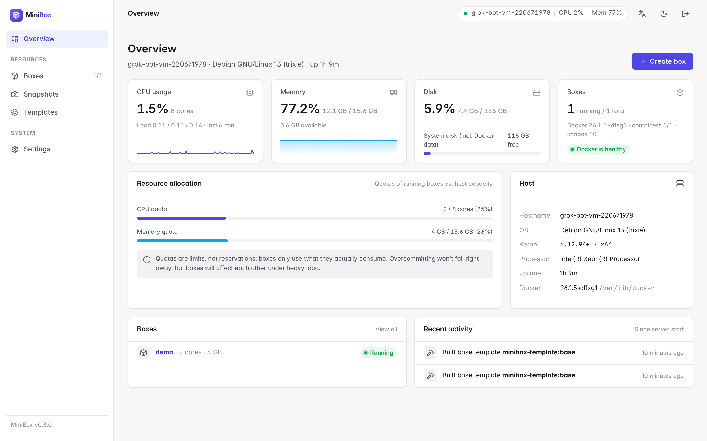
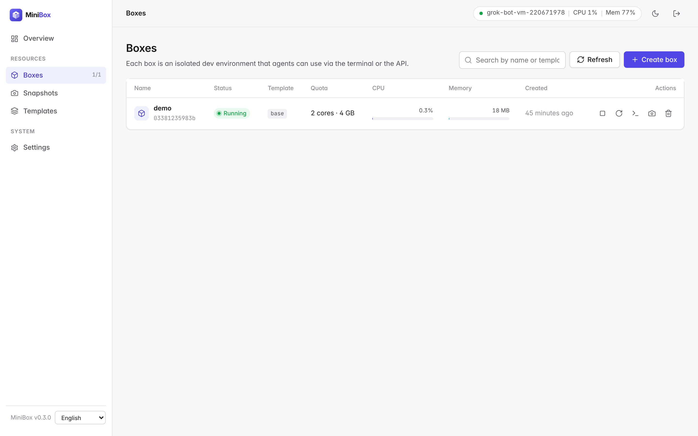
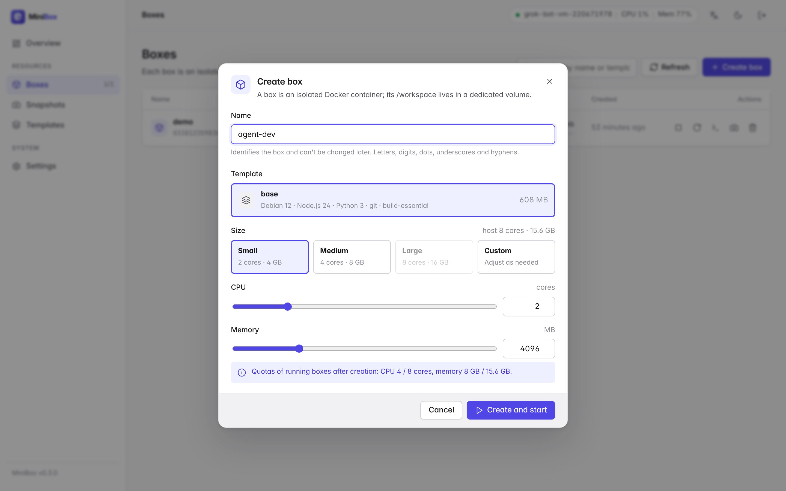
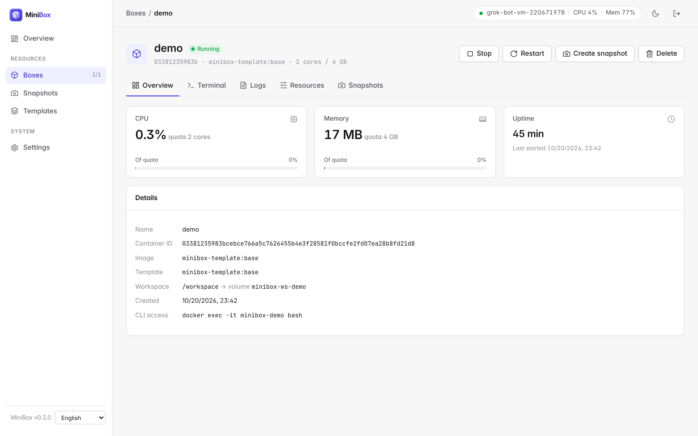
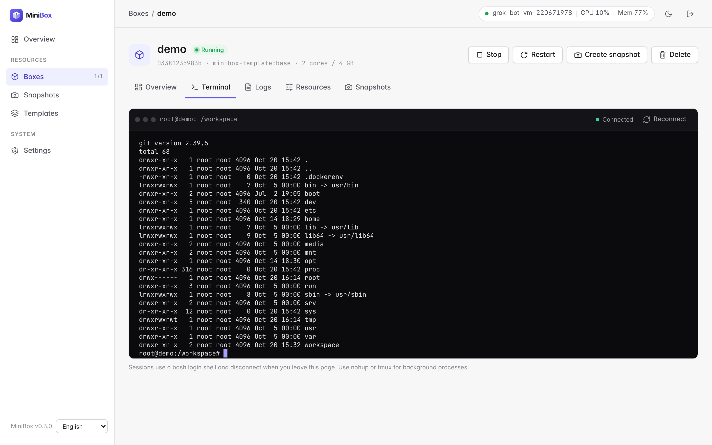
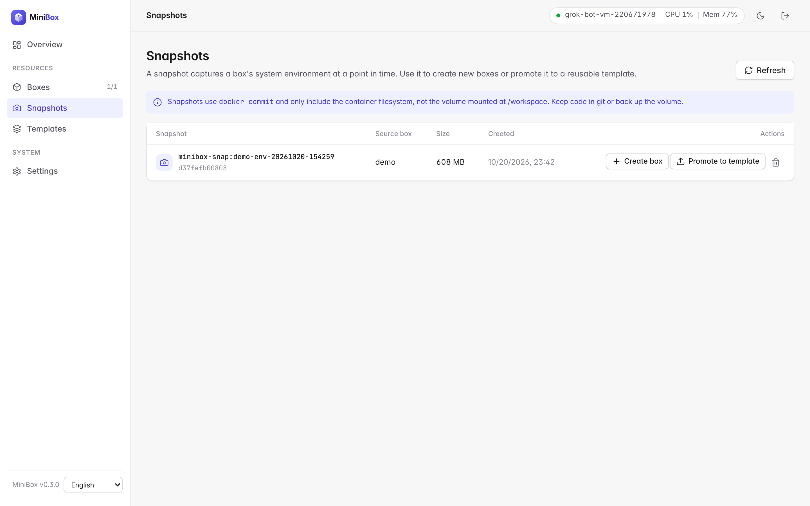
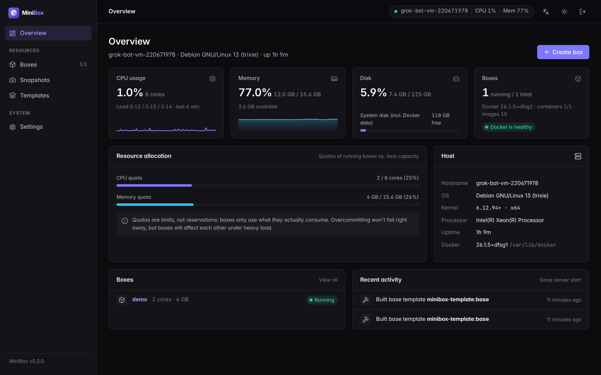
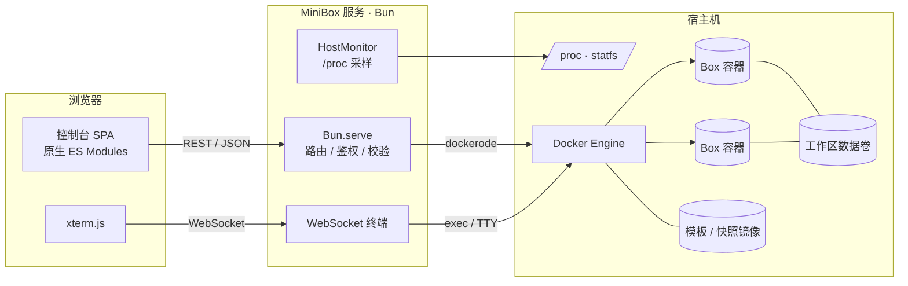

<p align="center">
  <picture>
    <source media="(prefers-color-scheme: dark)" srcset="web/assets/logo-dark.svg" />
    
  </picture>
</p>

<p align="center"><strong>为 AI Agent 准备的个人自托管开发环境：基于 Docker 的 Box 与管理面板。</strong></p>

<p align="center">
  <a href="https://github.com/ArnoChenFx/minibox/actions/workflows/ci.yml"></a>
  <a href="LICENSE"></a>
  <a href="https://bun.sh"></a>
  
</p>

<p align="center"><a href="README.md">English</a> | <b>简体中文</b></p>



## MiniBox 是什么

MiniBox 让你在自己的机器上创建隔离的 **Box**：每个 Box 是一个常驻的 Docker 容器，拥有独立的文件系统、进程树和持久化的 `/workspace` 数据卷，可以通过网页控制台或简洁的 REST API 统一管理。灵感来自 [Upstash Box](https://upstash.com/docs/box)，但面向个人场景做了精简：给编码 Agent（Claude Code、Codex、OpenHands 或你自己的脚本）准备可随时丢弃、可复现的工作环境，而不需要运维一个多租户平台。

**为什么做它**

- Agent 很容易把环境弄乱：随手全局安装、做到一半的构建、残留进程。放进 Box 里就不会污染宿主机，一键即可重建、快照或删除。
- 托管沙箱很好用，但有时你更想用自己的硬件和网络，也不想按分钟计费。
- 更重的自托管方案（基于 Firecracker 的沙箱、Coder、Kubernetes Operator）对个人来说太重。MiniBox 只是一个和本机 Docker Engine 通信的 Bun 进程，**不需要数据库**，所有状态都保存在 Docker 的标签、镜像和数据卷中。

## 功能

| 模块 | 说明 |
|---|---|
| Box 生命周期 | 创建、启动、停止、重启、删除；删除时可选择保留或一并删除工作区数据卷 |
| 资源配额 | 按预设（小型 2 核 4 GB / 中型 4 核 8 GB / 大型 8 核 16 GB）或自定义设置 CPU、内存，并按宿主机容量校验；运行中可热更新（`docker update`） |
| 快照 | 基于 `docker commit` 保存 Box 的系统环境，可从快照创建新 Box，或提升为模板 |
| 模板 | 内置基础模板（Debian 12 · Node.js 24 · Python 3 · git · build-essential），以及由快照提升的自定义模板 |
| 宿主机监控 | CPU 使用率、负载、内存、磁盘（系统盘 / Docker 数据目录）、运行时长、Docker 状态、Box 配额与宿主机容量对比，CPU / 内存迷你折线图 |
| Box 监控 | 每个 Box 的实时 CPU / 内存占用（相对配额）与历史曲线 |
| 网页终端 | 基于 xterm.js + WebSocket 的交互式 bash，随窗口自适应 |
| 日志 | 查看容器主进程输出，支持行数选择与自动刷新 |
| 访问控制 | 单一访问密钥，HttpOnly Cookie 或 `Authorization: Bearer`；按 IP 限制登录失败次数 |
| 多语言 | 英文与简体中文；点击右上角（控制台顶栏和登录页）的语言图标按钮即可切换，默认跟随浏览器语言，并在本浏览器记住选择 |
| 界面 | 浅色 / 深色主题（跟随系统，可手动切换）、响应式布局、空状态、骨架屏、操作提示与危险操作确认 |

## 截图

| Box 列表 | 创建 Box |
|---|---|
|  |  |
| **Box 详情** | **网页终端** |
|  |  |
| **快照** | **概览（深色）** |
|  |  |

更多截图见 [`docs/screenshots`](docs/screenshots)。

## 架构



- **Box** = 带 `minibox=true` 标签、名为 `minibox-<名称>` 的容器，常驻进程为 `sleep infinity`（启用 `--init`，重启策略 `unless-stopped`）。`/workspace` 挂载在独立数据卷 `minibox-ws-<名称>`。
- **快照** = 带 `minibox.snapshot=true` 标签的镜像 `minibox-snap:<名称>-<时间>`。
- **模板** = 带 `minibox.template=true` 标签的镜像 `minibox-template:<名称>`。
- 前端无构建步骤：原生 ES Modules + 手写设计系统；xterm.js 从 jsDelivr CDN 加载。

（`minibox` 是默认的 `LABEL_PREFIX`，所有名称和标签都随前缀变化。）

## 环境要求

- 装有 Docker Engine 的 Linux 宿主机（宿主机指标读取自 `/proc`）
- [Bun](https://bun.sh) ≥ 1.2
- 运行 MiniBox 的用户对 Docker Socket 有读写权限
- 浏览器能访问 `cdn.jsdelivr.net`（网页终端需要）

## 快速开始

```bash
git clone https://github.com/ArnoChenFx/minibox.git
cd minibox
bun install
cp .env.example .env          # 可选，所有配置都有默认值

# 构建内置基础模板（也可以稍后在控制台「模板」页构建）
bun run build:template

# 启动（默认监听 127.0.0.1:3920）
bun start
```

如果 `ACCESS_KEY` 为空，首次启动时会自动生成一个 64 位十六进制密钥并写入 `.env`（权限 600）：

```bash
grep ACCESS_KEY .env
```

浏览器打开 <http://127.0.0.1:3920>，输入密钥登录。

> [!TIP]
> 自动生成密钥时，`.env` 会被重写为只包含 `ACCESS_KEY`、`PORT` 和 `HOST` 三项。其他配置请在首次启动之后再填写，或者事先自己在 `.env` 里写好密钥（例如 `openssl rand -hex 32`）。

### 后台运行

没有 systemd 的环境（容器、云端沙箱）可以使用辅助脚本。它可以重复执行，会依次确保：dockerd 在运行（必要时通过 `sudo` 启动）、基础模板已存在、MiniBox 服务已（重新）启动且健康检查通过；如果装了 `opentunnel` 命令行，还会确保隧道在运行：

```bash
scripts/restart.sh              # 包含隧道
scripts/restart.sh --no-tunnel  # 只启动服务
```

服务输出写入项目根目录的 `server.log`（已在 git 中忽略）。

有 systemd 时，推荐写一个服务单元执行 `bun /path/to/minibox/src/server.ts`。

### 远程访问

服务默认只监听本机。需要远程访问时，请通过 HTTPS 暴露：反向代理、Tailscale 这类私有网络，或 [OpenTunnel](https://opentunnel.xyz) 之类的隧道：

```bash
opentunnel route add 3920 --name minibox
opentunnel up
# → https://minibox.<你的 ID>.opentunnel.xyz
```

如果前面的代理或隧道会设置 `X-Forwarded-For` 和 `X-Forwarded-Proto`，请设置 `TRUST_PROXY=true`，这样登录限流按真实客户端计数，Cookie 也会带上 `Secure` 标记。

对外暴露之前，请先阅读[安全须知](#安全须知)。

### Docker

正式版本的镜像发布在 GitHub Container Registry，支持 `linux/amd64` 和 `linux/arm64`：

```bash
docker run -d --name minibox --restart unless-stopped \
  -p 127.0.0.1:3920:3920 \
  -e ACCESS_KEY="$(openssl rand -hex 32)" \
  -v /var/run/docker.sock:/var/run/docker.sock \
  ghcr.io/arnochenfx/minibox:latest
```

- MiniBox 通过宿主机的 Docker Engine 管理 Box，**必须**挂载 Docker Socket（`-v /var/run/docker.sock:/var/run/docker.sock`）。Box 会作为宿主机上的同级容器创建，而不是在 MiniBox 容器内部。
- 请务必传入 `ACCESS_KEY`，否则会在容器内随机生成，重建容器后就丢失了（`docker logs minibox` 只显示前 4 位）。
- 容器内监听 `0.0.0.0:3920`（`HOST=0.0.0.0`）；如上所示只发布到宿主机的 `127.0.0.1`，远程访问请走 HTTPS。
- 镜像标签：`X.Y.Z`、`X.Y` 和 `latest`（`1.0.0-rc.1` 这类预发布版本只打完整版本号标签）。
- 本地构建：`docker build --build-arg MINIBOX_VERSION=0.3.0 -t minibox .`

## 配置

优先级：进程环境变量 > `.env` 文件 > 默认值。参考 [`.env.example`](.env.example)。

| 变量 | 默认值 | 说明 |
|---|---|---|
| `ACCESS_KEY` | 首次启动自动生成 | 控制台与 API 的访问密钥 |
| `HOST` | `127.0.0.1` | 监听地址 |
| `PORT` | `3920` | 监听端口 |
| `TRUST_PROXY` | `false` | 信任你自己运行的反向代理或隧道设置的 `X-Forwarded-For` / `X-Forwarded-Proto`。直接访问时保持关闭（见[安全须知](#安全须知)） |
| `DOCKER_SOCKET` | `/var/run/docker.sock` | Docker Engine Socket 路径 |
| `LABEL_PREFIX` | `minibox` | 标签以及容器 / 镜像 / 数据卷名称的前缀 |
| `BASE_TEMPLATE` | `<前缀>-template:base` | 新建 Box 的默认模板镜像 |
| `METRICS_INTERVAL_MS` | `3000` | 宿主机采样间隔（毫秒） |
| `METRICS_HISTORY` | `120` | 保留的采样点数量（默认间隔下约 6 分钟） |
| `LOG_LEVEL` | `info` | `debug` / `info` / `warn` / `error` |
| `MINIBOX_VERSION` | 来自 git / `package.json` | 覆盖显示的版本号（发布镜像中自动设置） |

> `bun run build:template` 固定打 `minibox-template:base` 标签。如果改了 `LABEL_PREFIX` 或 `BASE_TEMPLATE`，请改在控制台「模板 → 构建基础模板」中构建，它会使用配置的标签。

## API 参考

请求与响应均为 JSON。除标注**公开**的接口外，都需要登录 Cookie（由 `/api/auth/login` 写入）或 `Authorization: Bearer <ACCESS_KEY>` 请求头。

出错时返回对应的 HTTP 状态码和统一结构：

```json
{ "error": { "code": "validation_failed", "message": "CPU 核数须在 0.1 到 64 之间。", "details": { "field": "cpus" } } }
```

常见错误码：`validation_failed`（400）、`unauthorized`（401）、`not_found`（404）、`method_not_allowed`（405）、`conflict`（409）、`insufficient_capacity`（422）、`too_many_requests`（429）、`docker_error`（502）、`docker_unavailable`（503）。

### 认证与系统

| 方法 | 路径 | 说明 |
|---|---|---|
| `POST` | `/api/auth/login` | **公开**。请求体 `{ "key": "..." }`，成功后写入 HttpOnly Cookie（30 天）。同一客户端地址 5 分钟内最多失败 10 次（IPv6 按 /64 计） |
| `POST` | `/api/auth/logout` | **公开**。清除 Cookie |
| `GET` | `/api/auth/session` | **公开**。返回 `{ "authenticated": boolean }` |
| `GET` | `/api/health` | **公开**。返回 `{ "ok": true, "docker": boolean }`，Docker 不可用时为 503 |
| `GET` | `/api/system` | 版本、运行时、非敏感配置与限制 |
| `GET` | `/api/host/metrics` | 宿主机指标与历史采样 |
| `GET` | `/api/activity` | 最近操作记录（保存在内存中，重启后清空） |

### Box

| 方法 | 路径 | 说明 |
|---|---|---|
| `GET` | `/api/boxes?stats=false` | 列表；除非 `stats=false`，否则附带运行中 Box 的实时占用 |
| `POST` | `/api/boxes` | 创建并启动。`{ "name", "template"?, "cpus"?, "memoryMb"? }`，默认 2 核 / 4096 MB |
| `GET` | `/api/boxes/:id` | 详情（含实时占用） |
| `DELETE` | `/api/boxes/:id?deleteVolume=true` | 删除；可选同时删除工作区数据卷 |
| `POST` | `/api/boxes/:id/start` · `/stop` · `/restart` | 生命周期操作 |
| `PATCH` | `/api/boxes/:id/resources` | 热更新配额 `{ "cpus"?, "memoryMb"? }` |
| `GET` | `/api/boxes/:id/stats` | 实时占用 |
| `GET` | `/api/boxes/:id/logs?tail=300` | 容器日志（1–5000 行） |
| `POST` | `/api/boxes/:id/snapshots` | 创建快照 `{ "name"? }` |
| `GET` (WS) | `/api/boxes/:id/terminal` | WebSocket 终端；发送 `{"type":"resize","cols":N,"rows":N}` 调整窗口，其余消息作为输入 |

`:id` 可以是容器 ID 或容器名（`minibox-<名称>`）。限制：CPU 0.1–64 核，内存 128–262144 MB，且单个 Box 不能超过宿主机的核数或总内存。名称须匹配 `^[a-zA-Z0-9][a-zA-Z0-9_.-]{0,62}$`。

### 快照与模板

`:ref` 为镜像引用（如 `minibox-snap:demo-20261020-154259`），需要 URL 编码。

| 方法 | 路径 | 说明 |
|---|---|---|
| `GET` | `/api/snapshots` | 快照列表 |
| `DELETE` | `/api/snapshots/:ref` | 删除快照 |
| `POST` | `/api/snapshots/:ref/boxes` | 从快照创建 Box `{ "name", "cpus"?, "memoryMb"? }` |
| `POST` | `/api/snapshots/:ref/promote` | 提升为模板 `{ "name", "description"? }` |
| `GET` | `/api/templates` | 模板列表 |
| `POST` | `/api/templates/base/build` | 构建内置基础模板 |
| `DELETE` | `/api/templates/:ref` | 删除模板 |

只有带 MiniBox 标签的镜像才能通过 API 删除。

### 示例

```bash
KEY=$(grep ACCESS_KEY .env | cut -d= -f2)
curl -s -H "Authorization: Bearer $KEY" -H 'content-type: application/json' \
  -d '{"name":"agent-dev","cpus":2,"memoryMb":4096}' http://127.0.0.1:3920/api/boxes

# 之后就可以进去干活，比如在 Agent 的 shell 工具里：
docker exec -it minibox-agent-dev bash
```

## 项目结构

```text
minibox/
├── src/
│   ├── server.ts            # 入口：Bun.serve、静态资源、WebSocket 升级、优雅退出
│   ├── app.ts               # 应用上下文（配置、Docker、监控、操作记录）
│   ├── config.ts            # 环境变量 / .env 配置、密钥生成
│   ├── auth.ts              # 密钥校验、Cookie、登录限流
│   ├── labels.ts            # Docker 标签键与解析
│   ├── activity.ts          # 最近操作记录
│   ├── static.ts            # 静态文件服务（防目录穿越）
│   ├── docker/              # client / boxes / snapshots / templates / images / stats
│   ├── host/                # procfs 解析、HostMonitor 采样
│   ├── routes/              # router 与各组路由（auth / system / boxes / images）
│   ├── ws/terminal.ts       # WebSocket 终端
│   └── lib/                 # errors / http / logger / validation
├── web/
│   ├── index.html · login.html
│   ├── css/app.css          # 设计系统（变量、组件、浅色 / 深色）
│   ├── js/                  # app、pages/*、components/*、lib/*
│   └── assets/              # logo、favicon、图标
├── templates/base/Dockerfile
├── tests/                   # bun test 单元测试
├── scripts/restart.sh       # 无 systemd 环境的重启脚本
├── Dockerfile               # 发布镜像（oven/bun，多架构）
├── .github/workflows/release.yml  # tag → 镜像 + GitHub Release
└── docs/screenshots/
```

## 开发

```bash
bun run dev        # 监听文件变化自动重启
bun run fmt        # 用 oxfmt 格式化（直接写入文件）
bun run fmt:check  # 只检查格式
bun run lint       # oxlint 检查（有警告即失败）
bun run typecheck  # TypeScript 严格模式类型检查（tsc --noEmit）
bun test           # 单元测试（不需要 Docker）
bun run check      # 以上全部，与 CI 一致
```

格式化使用 [oxfmt](https://oxc.rs/docs/guide/usage/formatter.html)（`.oxfmtrc.json`），代码检查使用 [oxlint](https://oxc.rs/docs/guide/usage/linter.html)（`.oxlintrc.json`）。[CI](.github/workflows/ci.yml) 会在每次推送到 `main` 和每个 Pull Request 时运行 `fmt:check`、`lint`、`typecheck` 和 `bun test`，并做一次 Docker 构建冒烟测试（启动镜像并访问 `/login`）。

提交信息遵循 [Conventional Commits](https://www.conventionalcommits.org/zh-hans/)。变更记录见 [CHANGELOG.md](CHANGELOG.md)。

## 发布

版本号遵循 [语义化版本](https://semver.org/lang/zh-CN/)。控制台和 `/api/system` 显示的版本在运行时解析：`MINIBOX_VERSION`（发布镜像中由 tag 写入）→ `git describe --tags`（源码目录中，例如 `0.3.0-2-gabc1234`）→ `package.json`。

1. 修改 `package.json` 中的 `version`，并在 `CHANGELOG.md` 中补上对应版本的条目。
2. 提交并推送到 `main`。
3. 打 tag 并推送：

   ```bash
   git tag v0.3.0 && git push origin v0.3.0
   ```

随后 [发布工作流](.github/workflows/release.yml) 会先运行同一套 CI 检查，校验 tag 与 `package.json` 一致，构建多架构镜像并推送到 `ghcr.io/arnochenfx/minibox`，再用 CHANGELOG 中对应的章节加自动生成的变更说明创建 GitHub Release。带预发布后缀的 tag（如 `v1.0.0-rc.1`）会标记为预发布，且不会更新 `latest`。

## 安全须知

MiniBox 的设计前提是**一个可信用户在自己的机器上使用**。对外暴露前请务必阅读。

- **Docker Socket 等同于 root。** MiniBox 通过 Docker Socket 管理容器，拿到访问密钥的人实际上可以以 root 身份在宿主机上做任何事。请像对待 root 密码一样保管密钥。`.env` 已在 `.gitignore` 中忽略，不要提交它。
- **访问密钥是唯一门禁。** 没有用户体系。登录失败按客户端地址限流（5 分钟内最多 10 次，IPv6 按 /64 计），密钥比对是恒定时间的，但密钥一旦泄露就等于完全失守。更换密钥：修改 `.env` 中的 `ACCESS_KEY` 后重启服务，现有会话立即失效。
- **只监听 `127.0.0.1`**（默认值）。在有公网 IP 的机器上不要设置 `HOST=0.0.0.0`。
- **远程访问请使用 HTTPS。** 通过 HTTPS 访问时登录 Cookie 会带上 `Secure` 标记。默认情况下 MiniBox 忽略 `X-Forwarded-For` 和 `X-Forwarded-Proto`，因此经过反向代理访问时，所有访问者共享代理的地址来计算登录限流。只有当前面的代理由你控制并会设置这些头时，才设置 `TRUST_PROXY=true`：开启后 MiniBox 取 `X-Forwarded-For` 的最后一项（由代理追加的那一项）；关闭时客户端可以伪造这些头来绕过登录限流。
- **公开隧道可以被发现。** 隧道域名（例如 OpenTunnel 的 `*.opentunnel.xyz`）可能出现在公开的证书透明度日志里，也可能被猜到，而且 OpenTunnel 本身不提供认证。这相当于把控制台直接放在公网上，只靠访问密钥保护；流量还会经过隧道的中继服务器。条件允许时优先使用私有网络（如 Tailscale）或带认证的反向代理，不用时把隧道关掉。
- **这是容器隔离，不是安全沙箱。** Box 与宿主机共享内核，适合运行你自己的 Agent，**不适合运行不可信的第三方代码**，那种场景请使用 gVisor 或基于 microVM 的沙箱。不要把 Docker Socket 或宿主机敏感目录挂进 Box。
- **快照不包含 `/workspace`。** `docker commit` 不会保存挂载的数据卷，重要代码请用 git 同步或单独备份数据卷。
- `scripts/restart.sh` 可能会用 `sudo` 启动 `dockerd`，并对 Docker Socket 执行 `chmod 666`，方便非 root 用户访问。这在单用户沙箱里很方便，但放宽了权限，用在其他环境前请先检查脚本。

## 路线图

- [ ] **空闲自动休眠**：一段时间没有 exec / 终端活动就停止 Box，下次请求时自动唤醒
- [ ] **工作区备份**：随快照一起导出 / 恢复 `/workspace` 数据卷
- [ ] **面向 Agent 的接口**：文件读写、流式执行命令，并在此之上提供 MCP 服务
- [ ] **宿主机侧密钥注入**：API Key 只保存在宿主机上，由出站代理注入，而不是写进 Box 的环境变量
- [ ] **声明式模板与预热池**：用仓库中的 Dockerfile 声明模板，并预先启动 Box 以实现秒开

## 许可证

[MIT](LICENSE) © 2026 Arno Chen
