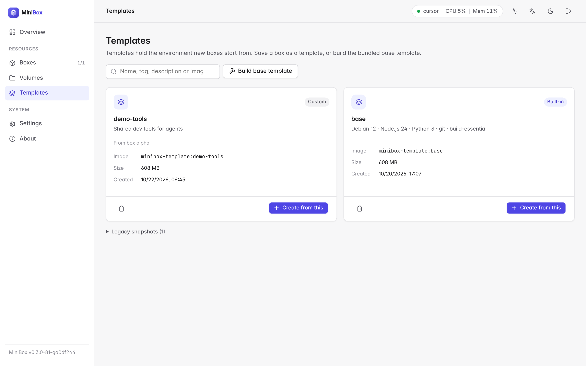
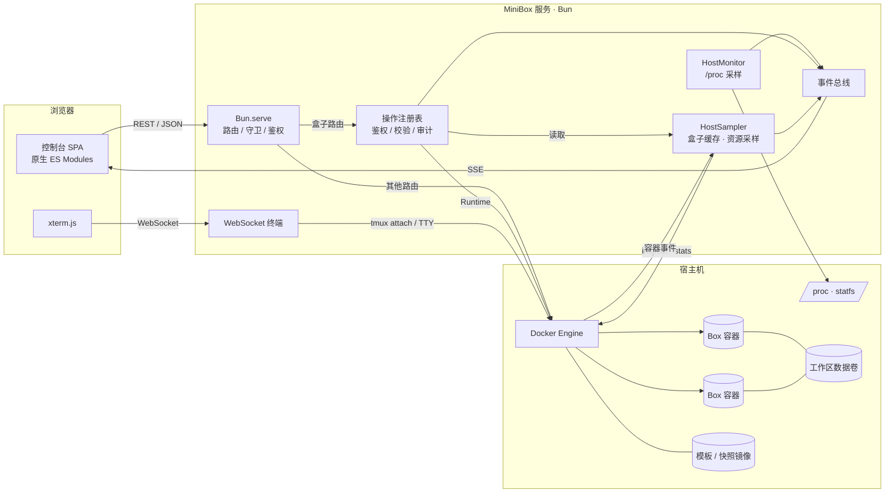
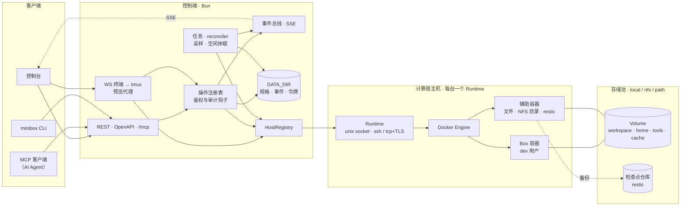

<p align="center">
  
</p>

<p align="center"><strong>为 AI Agent 准备的个人自托管开发环境：基于 Docker 的 Box 与管理面板。</strong></p>

<p align="center">
  <a href="https://github.com/ArnoChenFx/minibox/actions/workflows/ci.yml"></a>
  <a href="LICENSE"></a>
  <a href="https://bun.sh"></a>
  
</p>

<p align="center"><a href="README.md">English</a> | <b>简体中文</b></p>


## MiniBox 是什么

MiniBox 让你在自己的机器上创建隔离的 **Box**：每个 Box 是一个常驻的 Docker 容器，拥有独立的文件系统、进程树和持久化的 `/workspace` 数据卷，可以通过网页控制台或简洁的 REST API 统一管理。灵感来自 [Upstash Box](https://upstash.com/docs/box)，但面向个人场景做了精简：给编码 Agent（Claude Code、Codex、OpenHands 或你自己的脚本）准备可随时丢弃、可复现的工作环境，而不需要运维一个多租户平台。

**为什么做它**

- Agent 很容易把环境弄乱：随手全局安装、做到一半的构建、残留进程。放进 Box 里就不会污染宿主机，一键即可重建、建立检查点或删除。
- 托管沙箱很好用，但有时你更想用自己的硬件和网络，也不想按分钟计费。
- 更重的自托管方案（基于 Firecracker 的沙箱、Coder、Kubernetes Operator）对个人来说太重。MiniBox 只是一个和本机 Docker Engine 通信的 Bun 进程，**不需要数据库服务**。镜像和数据卷在 Docker 里。规格、卷记录和事件日志在[数据目录](#数据目录)里。

## 功能

| 模块 | 说明 |
|---|---|
| Box 生命周期 | 创建、启动、停止、重启、删除；空闲自动休眠与按需唤醒；可选 TTL；删除时可保留卷，或只删除该 Box 拥有的卷 |
| 数据卷 | 独立的 Volume 与存储池（`local`、`nfs`、`path`）。新建 Box 会挂载工作区、主目录、一只共享只读的工具卷，以及本地缓存。见[数据卷与存储池](#数据卷与存储池) |
| 资源配额 | 按预设（小型 2 核 4 GB / 中型 4 核 8 GB / 大型 8 核 16 GB）或自定义设置 CPU、内存，并按宿主机容量校验；运行中可热更新（`docker update`） |
| Box 用户 | Box 以非 root 用户 `dev`（uid/gid 1000）运行；Web 终端与 `docker exec` 默认以 `dev` 进入。三个[安全档位](#安全档位)决定 Box 能做什么：默认的「标准」档位保留无密码 `sudo`，「严格」档位禁止提权。见[基础模板](#基础模板) |
| 环境变量 | Box 的普通环境变量，以及按名称注入的宿主机密钥（`secretRef`）。密钥在「设置」中设置，之后任何接口都不会返回其值。见[环境变量与密钥](#环境变量与密钥) |
| 检查点 | 把 Box 的工作区和主目录复制到 restic 仓库，再从副本派生新 Box，或把 Box 回滚到副本，并确认或撤销这次回滚。适用保留策略与容量上限。可通过 REST 使用，也可在控制台 Box 详情的「检查点」标签页中操作。MCP 工具暂未提供。见[检查点](#检查点) |
| 模板 | 新 Box 使用的环境：内置基础模板（Debian 12 · Node.js 26 · Python 3 · git · tmux · build-essential · 非 root 用户 `dev`），以及从 Box 页面存为模板的自定义模板。保存的是系统层（apt 与 sudo 安装的软件、系统文件的改动），不含 `/workspace` 与 home 数据，数据请使用检查点 |
| 宿主机监控 | CPU 使用率、负载、内存、磁盘（系统盘 / Docker 数据目录）、运行时长、Docker 状态、Box 配额与宿主机容量对比，CPU / 内存迷你折线图 |
| 多宿主机 | 可以通过 unix 套接字、双向 TLS 或 SSH 添加其它 Docker 引擎，并在其中任一台上创建 Box。添加宿主机时确认 SSH 主机密钥。添加与移除宿主机仅所有者可用，可在设置页或 API 中操作。见 [多宿主机](#多宿主机) |
| Box 监控 | 每个 Box 的实时 CPU / 内存占用（相对配额）与历史曲线 |
| 实时更新 | Box 状态、资源采样、宿主机指标、任务进度与 Box 日志通过 SSE 推送：`GET /api/events/stream` 与 `GET /api/boxes/:id/logs/stream`。控制台只在对应的流断开时轮询 |
| 网页终端 | 基于 xterm.js + WebSocket 的交互式 bash，随窗口自适应。具名的 tmux 会话在刷新页面或连接断开后仍然保留。Agent 发起的会话默认只读，接管后才能输入 |
| SSH 访问 | 通过 MiniBox 用 `ssh`、`scp`、`sftp` 与 `ssh -L` 进入 Box，不发布宿主机端口。令牌需要 `box:ssh` 范围。见 [SSH 访问](#ssh-访问) |
| 活动 | Box 的历史记录：经由 MiniBox 执行的命令、容器启动 / 停止 / 内存溢出（OOM）事件，以及终端会话的开启与关闭。从不记录键入的内容。`docker logs` 保留在下方 |
| 日志 | 查看容器主进程输出，支持行数选择；自动刷新开启时通过实时流推送 |
| 访问控制 | 单一访问密钥；登录时换取可撤销的会话令牌，保存在 HttpOnly、`SameSite=Strict` Cookie 中，或以 `Authorization: Bearer` 发送。另有带 scope、`created-by-me`（或 id、标签、全部 Box）、配额和吊销的 Agent API 令牌。按客户端地址限制登录失败次数；拒绝跨站请求 |
| 多语言 | 英文与简体中文；点击右上角（控制台顶栏和登录页）的语言图标按钮即可切换，默认跟随浏览器语言，并在本浏览器记住选择 |
| 界面 | 浅色 / 深色主题（跟随系统，可手动切换）、响应式布局、空状态、骨架屏、操作提示与危险操作确认 |

## 截图

| Box 列表 | 创建 Box |
|---|---|
|  |  |
| **Box 详情** | **网页终端** |
|  |  |
| **模板** | **概览（深色）** |
|  |  |

更多截图见 [`docs/screenshots`](docs/screenshots)。

## 架构

### 当前架构（v0.3）



- **Box** = 带 `minibox=true` 标签、名为 `minibox-<名称>` 的容器，常驻进程为 `sleep infinity`（启用 `--init`）。重启策略为 `no`：启动时的协调器按规格里的期望状态（`running` 或 `stopped`）启动或停止容器。`DATA_DIR/boxes/` 下的规格文件是可变状态的权威来源。容器标签只在创建时写入，之后不再修改。新建 Box 会挂载 `/workspace`、`/home/dev`、共享且只读的 `/opt/minibox/tools` 和 `/home/dev/.cache`。新建卷的引擎名是 `vol_…`。已有的 `minibox-ws-<名称>` 会当作该 Box 的工作区继续使用，不会改名。更改挂载会重建容器，并把容器改名为 `minibox-<box id>`；认领已有容器不会改名。容器以非 root 用户 `dev` 运行（见[基础模板](#基础模板)）。
- **会话** = Box 内以 `dev` 运行的一个具名 tmux 会话。网页终端附着到它；Agent 通过会话工具发送按键、读取屏幕。关闭页面只是断开附着，会话会一直运行，直到被关闭或 Box 停止（见[会话](#会话)）。
- **快照** = 带 `minibox.snapshot=true` 标签的镜像 `minibox-snap:<名称>-<时间>`，由 Box 的容器通过 `docker commit` 制作。这是底层方式：API 与命令行可以创建、提升和删除快照。从 Box 存为模板时，会在内部制作一个快照，模板创建后即删除。
- **模板** = 带 `minibox.template=true` 标签的镜像 `minibox-template:<名称>`。它只保存 Box 的系统环境，从不包含数据。可以在 Box 页面存为模板，也可以提升快照。
- **实时状态** = 每台主机一个 `HostSampler`。它根据引擎的容器事件保持盒子缓存最新，并每分钟重新列出一次容器，以补上事件流静默停止时漏掉的变化。有实时流打开时，每隔 `METRICS_INTERVAL_MS` 为每个运行中的 Box 采样；没有时，只有最近 5 分钟内有人读取过用量，才每 30 秒一次（`METRICS_INTERVAL_MS` 更长时按它），并保留 `METRICS_HISTORY` 个采样点；同时把 Box、采样、链路与主机指标帧发布到事件总线。`GET /api/events/stream` 把它们转发给控制台，控制台只在事件流断开时轮询。每个 Box 的日志在每台主机上只跟随一次，由它的所有日志流（`GET /api/boxes/:id/logs/stream`）共享。实时帧只带环境变量的名称，不带值。同时打开的事件流、任务流与日志流不超过 `STREAM_MAX_CONNECTIONS`，超出的请求返回 `429`。采样只保存在内存中，从不写入事件日志。
- 前端无构建步骤：原生 ES Modules + 手写设计系统；xterm.js 随仓库放在 [`web/vendor/`](web/vendor/README.md)，控制台不会从 CDN 加载任何代码。

（`minibox` 是默认的 `LABEL_PREFIX`，所有名称和标签都随前缀变化。）

### 目标架构（规划中）

> [!NOTE]
> exec、`/mcp` 与 CLI 客户端、会话、路径模式的端口预览代理、检查点（拍摄、派生、回滚、保留策略与控制台的检查点标签页），以及图中的存储池和数据卷已经实现。定时检查点、检查点的导入导出与 MCP 工具、多宿主机的调度、Agent 与迁移（直连 TLS 与 SSH 已可用），以及卷准备之外的辅助容器用途仍在规划中。完整设计见 [`docs/design.md`](docs/design.md)。



- **Box** = `DATA_DIR` 中的规格 + 一个容器。容器标签只保存创建后不可变的部分。
- **Volume** 属于某个存储池，而不属于某个 Box。`cache` 卷留在本地池，不进入检查点。
- **检查点** = Box 规格 + 各卷的快照（restic）+ 可选的系统层。
- **辅助容器**是短生命周期的，负责文件操作、创建 NFS 目录和运行 restic。
- Box 以非 root 的 `dev` 用户运行，并使用「标准」（默认）、「严格」或「宽松」三个安全档位之一。
- MiniBox Agent 与存储节点角色不在主路线上，因此图中未画。

## 环境要求

- 装有 Docker Engine 的 Linux 宿主机（宿主机指标读取自 `/proc`）
- [Bun](https://bun.sh) ≥ 1.4.3
- 运行 MiniBox 的用户对 Docker Socket 有读写权限

## 快速开始

```bash
git clone https://github.com/ArnoChenFx/minibox.git
cd minibox
bun install
cp .env.example .env          # 可选，所有配置都有默认值

# 构建内置基础模板（也可以稍后在控制台「模板」页构建）
bun run build:template

# 启动（默认监听 127.0.0.1:3920）
bun start
```

如果环境变量和 `.env` 中都没有设置 `ACCESS_KEY`，首次启动时会自动生成一个 64 位十六进制密钥，并保存到 `DATA_DIR/access_key`（权限 600，默认为 `./data/access_key`）。`.env` 永远不会被修改：

```bash
cat data/access_key
```

浏览器打开 <http://127.0.0.1:3920>，输入密钥登录。

> [!TIP]
> 想自己指定密钥，就在 `.env` 里设置 `ACCESS_KEY`，至少 20 位随机字符（例如 `openssl rand -hex 32`）。`.env` 或环境变量中的密钥始终优先于自动生成的密钥；早期版本写入 `.env` 的密钥照常生效。

### 后台运行

没有 systemd 的环境（容器、云端沙箱）可以使用辅助脚本。它可以重复执行，会依次确保：dockerd 在运行（必要时通过 `sudo` 启动）、基础模板已存在、MiniBox 服务已（重新）启动且健康检查通过；如果装了 `opentunnel` 命令行，还会确保隧道在运行：

```bash
scripts/restart.sh              # 包含隧道
scripts/restart.sh --no-tunnel  # 只启动服务
```

服务输出写入项目根目录的 `server.log`（已在 git 中忽略），每次启动追加写入。脚本还会报告访问密钥的保存位置，但不会输出密钥本身。`/tmp/dockerd.log` 与 `/tmp/opentunnel.log` 同样是追加写入的，脚本每次启动对应服务时写入一行 `---` 分隔标记。

`restart.sh` 是单用户沙箱的便利脚本。运行后，Docker Socket 的属组设为你的主组、权限为 `660`，因此它启动的服务无需重新登录即可使用 Docker。该主组的成员都能使用 Docker。Socket 同一时间只属于一个组：最后运行脚本的账户所在的主组保留访问，其他账户（包括 `docker` 组的成员）无法访问。Docker 访问等同于 root 权限，请勿在共享主机上使用该脚本。

有 systemd 时，推荐写一个服务单元执行 `bun /path/to/minibox/src/server.ts`。

### 远程访问

服务默认只监听本机。需要远程访问时，请通过 HTTPS 暴露：反向代理、Tailscale 这类私有网络，或 [OpenTunnel](https://opentunnel.xyz) 之类的隧道：

```bash
opentunnel route add 3920 --name minibox
opentunnel up
# → https://minibox.<你的 ID>.opentunnel.xyz
```

> **从旧版本升级、并且已经通过隧道或反向代理访问？请先读这一段。** 需要的设置取决于 MiniBox 前面是什么：
>
> 1. **OpenTunnel，或者保留 `Host` 和 `Origin`、不添加 `X-Forwarded-*` 头的隧道：保持 `TRUST_PROXY` 关闭。** 此时所有请求都从 `127.0.0.1` 到达 MiniBox，因此所有访问者共享同一个登录限流计数，但正确的访问密钥总能登录（见[安全须知](#安全须知)）。这种情况下 `ALLOWED_ORIGINS` 是可选的，因为 `Host` 已与公网地址一致；设置它也没有坏处。登录 Cookie 会因浏览器发出的 `https://` Origin 而带上 `Secure`。
> 2. **你自己控制的反向代理：只有当它会在每个请求上覆盖（或剥离后重新添加）`X-Forwarded-For`、`X-Forwarded-Proto` 和 `X-Forwarded-Host`，并且 MiniBox 只能经由该代理访问（保持 `HOST=127.0.0.1`）时，才设置 `TRUST_PROXY=true`。** `TRUST_PROXY` 会让 MiniBox 信任这三个头，因此能直接连到 MiniBox 的客户端，或原样透传客户端自带值的代理，都可以伪造它们。
> 3. **如果代理把 `Host` 改写成了上游地址，请设置 `ALLOWED_ORIGINS=https://你的公网地址`。** 否则从公网地址发出的登录和终端请求会返回 `403`，登录页会提示该请求的 Origin 不在 `ALLOWED_ORIGINS` 中。nginx 默认会改写 `Host`，除非配置了 `proxy_set_header Host $host;`。
> 4. **`COOKIE_SECURE=1`：仅当浏览器通过 HTTPS 访问，但 MiniBox 收到的请求不带 `https://` Origin（例如代理剥离了它）时才需要。** 浏览器会丢弃从明文 HTTP 收到的 `Secure` Cookie，因此只能经由 HTTP 访问的地址绝不要设置它。
>
> 如果日志中出现 `proxy.headers_ignored`，说明收到了转发头，但 `TRUST_PROXY` 未开启。在会设置这些头的反向代理后面，请按上面开启。OpenTunnel 不添加这些头，所以出现的头来自客户端，应保持关闭。

MiniBox 还会拒绝来自其他网站的请求：浏览器的 `Origin` 必须与请求到达时的 `Host` 一致，或列在 `ALLOWED_ORIGINS` 中。如果代理把公网 `Host` 原样透传，nginx 的 `server` 配置可以这样写：

```nginx
location / {
    proxy_pass http://127.0.0.1:3920;
    proxy_http_version 1.1;
    proxy_set_header Upgrade $http_upgrade;
    proxy_set_header Connection "upgrade";
    proxy_set_header Host $host;
    proxy_set_header X-Forwarded-For $proxy_add_x_forwarded_for;
    proxy_set_header X-Forwarded-Proto $scheme;
}
```

对外暴露之前，请先阅读[安全须知](#安全须知)。

### Docker

正式版本的镜像发布在 GitHub Container Registry，支持 `linux/amd64` 和 `linux/arm64`：

```bash
docker run -d --name minibox --restart unless-stopped \
  -p 127.0.0.1:3920:3920 \
  -e ACCESS_KEY="$(openssl rand -hex 32)" \
  -v /var/run/docker.sock:/var/run/docker.sock \
  -v minibox-data:/data \
  ghcr.io/arnochenfx/minibox:latest
```

- MiniBox 通过宿主机的 Docker Engine 管理 Box，**必须**挂载 Docker Socket（`-v /var/run/docker.sock:/var/run/docker.sock`）。Box 会作为宿主机上的同级容器创建，而不是在 MiniBox 容器内部。
- 挂载一个数据卷到 `/data`（`-v minibox-data:/data`）。它保存[数据目录](#数据目录)，包括自动生成的访问密钥，因此重建容器后状态不会丢失。没有数据卷的话，删除容器时这些状态也会丢失。
- 如果没有传入 `ACCESS_KEY`，用 `docker exec minibox cat /data/access_key` 读取自动生成的密钥。`docker logs` 不会输出密钥的任何部分。
- 从把自动生成的密钥写入 `/app/.env` 的旧镜像升级：该文件位于旧容器内，重建容器时会丢失。请在旧容器运行时用 `docker exec minibox grep '^ACCESS_KEY=' /app/.env` 把密钥取出来，再通过 `-e ACCESS_KEY=...` 传入。
- 容器内监听 `0.0.0.0:3920`（`HOST=0.0.0.0`）；如上所示只发布到宿主机的 `127.0.0.1`，远程访问请走 HTTPS。
- 镜像标签：`X.Y.Z`、`X.Y` 和 `latest`（`1.0.0-rc.1` 这类预发布版本只打完整版本号标签）。
- 本地构建：`docker build --build-arg MINIBOX_VERSION=0.3.0 -t minibox .`

## 工具

创建 Box 时可勾选 Agent CLI 与其他工具。列表按 AI 编程助手、语言与运行时、终端与开发工具、网络四组展示，上方的搜索框可按名称、说明或分组过滤。Box 详情的「工具」页使用同样的分组与搜索，安装 / 升级 / 卸载也在那里完成。目录包括 Claude Code、Codex、OpenCode、Pi coding agent、fx agent、Antigravity CLI、Grok Build CLI、Qoder CLI、oh-my-pi、herdr、luvus、Bun、uv、Rust、Zig 与 Tailscale，每一项都从其官方来源安装（见仓库 `catalog/*.json`），`DATA_DIR/tools.d/*.json` 可追加或覆盖条目。二进制装在共享只读 tools 卷（`/opt/minibox/tools`）；安装由联网的 helper 以 uid 1000 读写挂载该卷完成，从不以 root 运行。镜像或家目录里已有的工具显示为已安装并附版本，MiniBox 不会重复安装；升级与卸载只作用于 MiniBox 自己装在 tools 卷上的工具，卸载前会先停止该工具在 Box 内运行的守护进程。Tailscale 以 `dev` 用户安装，无需 root，并以用户态网络模式运行：在 Box 内执行 `minibox-tailscale up` 启动守护进程并打印登录链接。Box 里不会出现 tailnet 网卡。发往 Box tailnet IP 的入站 TCP 与 UDP 会被转发到 Box 内的 `127.0.0.1`，所以监听 localhost 或 `0.0.0.0`（IPv4）的程序可以从 tailnet 访问（受 tailnet ACL 约束）；只绑定 localhost 的服务也会因此暴露给 tailnet。出站访问 tailnet 主机必须经 `localhost:1055` 的 SOCKS5 或 HTTP 代理：设置 `ALL_PROXY=socks5h://localhost:1055`（`h` 表示由代理解析 MagicDNS 名称），HTTP 客户端也可用 `HTTP_PROXY`/`HTTPS_PROXY=http://localhost:1055`。没有 ICMP，`ping` tailnet 主机会失败，请用 `minibox-tailscale ping`。Box 重启或从空闲休眠唤醒后，守护进程不会自动启动，tailnet 流量也不会唤醒休眠中的 Box：重新执行 `minibox-tailscale up` 即可，已保存的登录会沿用。卸载只停止当前 Box 里的守护进程，同一主机上其他 Box 的守护进程会继续运行，直到它们停止。卸载后，Tailscale 的登录状态仍保留在家目录卷中。长安装走异步任务与实时日志。API：`GET /api/tools`、`GET /api/tools/catalog`、`POST /api/boxes/:id/tools/{install,upgrade,uninstall,reconcile}`。MCP 工具集 `tools`。进程环境中的 `HTTP_PROXY` / `HTTPS_PROXY` 会传入安装环境。

**自定义工具**只由所有者管理。在 Box 的「工具」页点**自定义工具**可新增条目，**编辑**与**删除**可修改或移除自定义条目。每个条目是一个文件 `DATA_DIR/tools.d/<id>.json`，格式与 `catalog/*.json` 相同，加载器把它与内置目录合并。表单在写入前先用加载器自己的规则校验，因此无效的条目不会被保存。若有人手动把 `tools.d` 中的文件改成加载器无法读取的内容，所有 Box 的目录都会加载失败，错误信息会给出该文件的路径，直到修好或删除该文件为止。`DELETE /api/tools/custom/<id>` 可以删除名为 `<id>.json` 的文件，即使它的 JSON 已损坏。与内置工具同名的 id 需要勾选**替换内置条目**（`overrideBuiltin`），删除该条目后内置条目恢复。删除只移除文件：已装在共享 tools 卷上的工具保持安装。API：`GET /api/tools/custom`、`PUT /api/tools/custom/:id` 与 `DELETE /api/tools/custom/:id`。CLI：`minibox tool custom list`、`minibox tool custom put <id> (--file FILE | --stdin) [--override-builtin]` 与 `minibox tool custom delete <id>`。MCP 工具集 `tools` 提供 `list_custom_tools`、`put_custom_tool` 与 `delete_custom_tool`。以上操作都只限所有者，Agent 令牌（包括 admin 预设的令牌）一律拒绝。表单中的命令有安装、升级、卸载、检测，以及可选的停止命令：停止命令在卸载前于运行中的 Box 内以 `dev` 用户执行，先停掉工具启动的守护进程，再删除其二进制。安装、升级与卸载在 tools 卷的 helper 中运行，检测在各 Box 的镜像中以只读卷运行，与内置条目相同。每条命令最多 16000 个字符。

## 空闲休眠

Box 可以在空闲一段时间后自行停止，并按需唤醒（[#12](https://github.com/ArnoChenFx/minibox/issues/12)）。

- **休眠**把期望状态改为 `stopped`（原因 `idle`）并执行 `docker stop`，**不删除容器**，工作区卷也保留。
- **超时。** `BOX_IDLE_TIMEOUT_SEC` 是全局默认值，`0` 关闭空闲休眠。Box 的 `idleTimeoutSec` 可以覆盖它：`0` 表示该 Box 永不休眠，`null` 表示继承默认值。
- **活动**是每个 Box 在内存中的心跳，不写入事件。以下操作计入：终端的输入、输出与关闭，以及打开的终端（无论由 MiniBox 打开，还是箱内会话上有其它客户端附着，例如 `docker exec -it <box> tmux attach`）；SSH 连接（打开期间保持唤醒，其输入每分钟最多刷新一次心跳）；exec 从开始到结束；会话的启动、读取与发送；端口预览请求（包括流式响应），以及预览 WebSocket 直到关闭；卷上的文件调用，计入挂载该卷的每个 Box，且在调用期间保持唤醒；Box 上的异步任务结束时。读取 Box 记录、其统计或其日志（包括实时流）不计入。
- **空闲**指以上都没有进行中，最近一次心跳距今不少于超时时长，且最近的 CPU 采样低于 `BOX_IDLE_CPU_PERCENT`。尚无 CPU 采样的 Box 保持唤醒。
- **唤醒**取决于请求：
  - `exec` 会启动任何已停止的 Box，与以前一样。唤醒记入该次 exec 的审计。
  - SSH 连接会启动任何已停止的 Box，与 `exec` 相同；从休眠唤醒时，审计记在发起连接的主体名下。
  - `session_start`（REST、MCP 与 CLI）会启动任何已停止的 Box。
  - 终端 WebSocket 与端口预览只唤醒处于休眠中的 Box。被人停止的 Box 返回 `409`，错误分别为 `terminal_not_running` 与 `preview_box_stopped`。
  - 读取、发送、关闭或列出会话不会唤醒 Box。会话随容器结束，因此在休眠中的 Box 上打开终端会唤醒它，随后以 `session_not_found` 关闭。
  - 卷上的文件调用不会启动 Box。文件接口在 Box 停止时也可用，因此已停止的 Box 保持停止。
- **TTL**（创建/更新时的 `ttlSec`）是从创建时刻起算的绝对寿命。到期后 MiniBox **停止**该 Box（不删除），原因记为 `ttl`。已到期的 Box 不会再次启动：启动、重启、重建、exec、会话、终端与预览都会以 `409` 与 `box_ttl_expired` 拒绝。清除 TTL，或用 `PATCH /api/boxes/:id` 设置更晚的 TTL，然后再启动 Box。
- **重启**不会让所有 Box 同时休眠：没有心跳的 Box 从 MiniBox 开始监视时起算空闲时间，而不是从创建时刻起算。
- **多宿主机。** 终端与预览会在所有已注册的 Docker 主机上查找 Box，空闲监视也会检查每台主机。
- 控制台在因空闲停止时显示「休眠中」，因 TTL 停止且已到期时显示「TTL 已到期」，并展示最近活动时间。终端页会说明 Box 未运行的原因，并为休眠中的 Box 提供唤醒按钮。
- **已知限制。** 对因空闲而休眠（未到期）的 Box 执行重建时，容器会短暂启动后再停止。预览的响应体在读完或取消之前，会让 Box 保持唤醒。
  - **分离的会话。** 没有附着任何客户端的会话不会让 Box 保持唤醒，无论由谁创建：超过空闲时长没有会话请求时，会话中安静运行的任务会随 Box 休眠而结束。保持一个终端打开，或把任务作为后台 exec 运行（运行期间计为活动），即可避免。从 MiniBox 外部附着的终端会让 Box 保持唤醒。每次巡检（`LIFECYCLE_INTERVAL_MS`）都会检查它。它关闭后，空闲计时从第一次发现它已关闭的巡检起算，因此 Box 不会早于关闭后的空闲时长休眠。

## 端口预览

已登录用户可以通过 MiniBox 打开 Box 内监听的服务，**不会在宿主机发布端口**：

- 路径模式（本版本）：`https://<minibox>/box/<名称或 id>/<端口>/…`
- 代理把 HTTP 与 WebSocket（如 Vite HMR）转到 Box 网络里的容器 IP。
- 响应带 CSP `sandbox`（不含 `allow-same-origin`），预览页无法读取控制台会话 Cookie。建议在新标签打开预览。
- Box 详情 → **端口** 标签会列出监听中的端口（读取箱内 `/proc/net/tcp`），也可手动添加。API：`GET/POST /api/boxes/:id/ports`，`DELETE /api/boxes/:id/ports/:port`。MCP 工具集 `network`（`list_ports`、`expose_port`）。
- 分享链接（签名 URL）与子域名模式（`<端口>-<名称>.<BASE_DOMAIN>`）本版本不做。
- MiniBox 必须能访问容器 IP（宿主机进程经 Docker 网桥即可）。若 MiniBox 自己跑在关闭了 ICC 的 `minibox-boxes` 网络里，预览会不通，需后续网络方案。

框架提示：不少打包工具默认公共路径是 `/`。路径模式下请把应用 base 设为 `/box/<名称>/<端口>/`（如 Vite `base`、Next `assetPrefix`），或等待子域名模式。

## SSH 访问

`ssh`、`scp`、`sftp` 与 `ssh -L` 通过 MiniBox 连接 Box：经由服务器自身地址上的 WebSocket，不发布宿主机端口。服务器同时分发自己的 CLI，因此运行 `ssh` 的机器无需源码目录：先从服务器安装 CLI。

```sh
# 只需一次：把 minibox 安装到 ~/.local/bin（macOS 或 Linux；Windows 在 PowerShell 中运行：irm https://minibox.example.com/cli/install.ps1 | iex）
curl -fsSL https://minibox.example.com/cli/install.sh | sh

# 只需一次：访问密钥，或带 box:ssh 的 Agent 令牌
MINIBOX_URL=https://minibox.example.com MINIBOX_ACCESS_KEY=... minibox ssh-config --append
ssh mybox.minibox
scp ./build.tar.gz mybox.minibox:/workspace/
sftp mybox.minibox
ssh -N -L 8080:127.0.0.1:8080 mybox.minibox
```

安装脚本会识别系统与 CPU，从服务器下载 `minibox-<os>-<arch>`，按 `/cli/checksums.txt` 校验后安装到 `~/.local/bin`（或 `MINIBOX_INSTALL_DIR`）。它不需要 sudo；该目录不在 `PATH` 中时会打印一行 `PATH` 设置。服务器在该版本的首次请求时用 `bun build --compile` 构建各个二进制，并保存在 `DATA_DIR/cli` 下。与服务器不同的平台还需要该平台的 Bun 运行时，约 90 MB，每台服务器只从 npm 下载一次；无法访问 npm 的服务器会返回 `503` 与原因。此时请为 MiniBox 设置 `HTTPS_PROXY`。若想自行构建，可在源码目录运行 `bun run build:cli`，并把 `dist/minibox` 放进 `PATH`。

`ssh-config --append` 在 `~/.ssh/config` 顶部写入 `Host *.minibox` 配置块，把服务器主机密钥固定在 `~/.ssh/minibox_known_hosts`，并把服务器地址与密钥保存到 `~/.config/minibox/ssh-credentials.json`（macOS 与 Linux 上权限为 600）。`ProxyCommand`（`minibox ssh-proxy %h`）在没有设置 `MINIBOX_ACCESS_KEY` 时读取该文件，因此从任何 shell 或 IDE 的 Remote-SSH 启动 ssh 都能使用。已导出的 `MINIBOX_URL` 与 `MINIBOX_ACCESS_KEY` 仍然优先。`--url URL` 与 `--token KEY` 只对本次命令生效，`--append` 会保存它们解析出的值；`--token` 会把密钥留在 shell 历史中，因此建议改用环境变量。

- 登录用户为 `dev` 或 Box id，`root` 与其他名字会被拒绝。访问密钥或令牌在 WebSocket 握手时校验，Box 内不需要任何密钥或密码。浏览器会话不能建立 SSH 连接。
- 令牌需要 `box:ssh` 范围，且只能访问其 Box 选择器允许的 Box。`operator` 与 `admin` 预设包含该范围，`sandboxed-agent` 不包含。它与 `exec` 一样能在 Box 内执行命令、读写全部挂载，因此应同样谨慎地授予。`-L` 另需 `port:expose`。
- 转发只到 Box 内的 `localhost` 与 `127.0.0.1`。`-R`、Unix 套接字转发、X11 与 agent 转发会被拒绝并写入审计日志。
- 已停止或休眠的 Box 会在连接时启动。打开的连接会让 Box 保持运行，连接上的输入计为活动。停止 Box（手动、空闲或 TTL）、删除或重建 Box 会断开它的 SSH 连接；TTL 已过的 Box 拒绝新连接，返回 `409 box_ttl_expired`。上限：每个 Box 8 个连接，全局 64 个，每个连接 16 个通道。超过 Box 或全局上限时，握手返回 `429`。
- `sftp` 与 `-L` 需要 `openssh-sftp-server` 和 `socat`，[基础模板](#基础模板)已包含它们。旧 Box 可在标准档位下执行 `sudo apt-get install -y openssh-sftp-server socat` 补装，或重新创建。
- 主机密钥位于 `DATA_DIR/ssh_host_ed25519_key`，首次启动时生成。删除后需重新运行 `minibox ssh-config --append`，让客户端固定新密钥。连接、通道、被拒绝的转发与断开都会写入审计日志。

### Windows 上的 SSH

请在普通的 PowerShell 窗口中运行，不要以管理员身份运行。Windows 版 OpenSSH 要求 `%USERPROFILE%\.ssh` 中的文件属于你的账户；Windows 上 `ssh-config --append` 会打印这条提醒。

```powershell
irm https://minibox.example.com/cli/install.ps1 | iex
$env:MINIBOX_URL="https://minibox.example.com"; $env:MINIBOX_ACCESS_KEY="..."; minibox ssh-config --append
ssh mybox.minibox
```

- 安装程序把 `minibox.exe` 放在 `%USERPROFILE%\.local\bin`（或 `MINIBOX_INSTALL_DIR`），把该目录加入用户的 PATH，并把旧的 `minibox.exe` 移为 `minibox.exe.old`。之后请打开新的终端，`minibox` 与 `ssh` 才能被找到。若正在运行的 `minibox.exe` 无法移动，安装程序会停止并给出提示，已安装的文件保持不变。若新文件无法运行，安装程序会把旧文件放回原处。
- `ssh` 需要「OpenSSH 客户端」可选功能（设置 → 系统 → 可选功能）。缺少时安装程序会打印提示。
- `ssh-config` 会写入 `%USERPROFILE%\.ssh\config`、`%USERPROFILE%\.ssh\minibox_known_hosts` 与 `%USERPROFILE%\.config\minibox\ssh-credentials.json`。Windows 没有 600 权限，这些文件的权限继承自 `%USERPROFILE%\.ssh`，并属于你的账户。若 ssh 提示所有者或权限有问题，请用 `icacls "%USERPROFILE%\.ssh\config"` 检查所有者与访问规则：所有者应为你本人，其他账户不应有写入权限。
- `ProxyCommand` 用完整路径指向 CLI，例如 `"C:/Users/you/.local/bin/minibox.exe" ssh-proxy %h`，因为 Windows 版 OpenSSH 不经过 shell 启动它，该进程也未必能找到 PATH 中的命令。移动 `minibox.exe` 之后，请重新运行 `minibox ssh-config --append`。

## 配置

优先级：进程环境变量 > `.env` 文件 > 默认值。访问密钥还会回退到 `DATA_DIR/access_key`。参考 [`.env.example`](.env.example)。

| 变量 | 默认值 | 说明 |
|---|---|---|
| `ACCESS_KEY` | 自动生成到 `DATA_DIR/access_key` | 控制台与 API 的访问密钥，至少 20 位随机字符（见[安全须知](#安全须知)）。MiniBox 不会把它写入 `.env` |
| `HOST` | `127.0.0.1` | 监听地址 |
| `PORT` | `3920` | 监听端口 |
| `TRUST_PROXY` | `false` | 信任你自己运行的反向代理设置的 `X-Forwarded-For`、`X-Forwarded-Proto` 和 `X-Forwarded-Host`。**只有代理会在每个请求上覆盖或剥离这些头，并且 MiniBox 只能经由该代理访问时才设为 `true`。** OpenTunnel 等不添加这些头的隧道应保持关闭（见[远程访问](#远程访问)） |
| `ALLOWED_ORIGINS` | 空 | 本 MiniBox 的公网来源（完整的 `https://` 地址），逗号分隔，例如 `https://minibox.example.com`。**代理改写了 `Host` 时需要设置**（nginx 默认如此），否则从该地址发出的登录和终端请求会返回 `403`。OpenTunnel 会保留 `Host`，此时可选，设置也无害 |
| `COOKIE_SECURE` | `false` | 始终为会话 Cookie 加上 `Secure` 标记。浏览器登录时会带上 `https://` Origin，已足以加上该标记，通常无需设置。只在 HTTPS 下使用：浏览器会丢弃明文 HTTP 收到的 `Secure` Cookie |
| `SESSION_TTL_DAYS` | `30` | 一次登录的有效期，从登录时起算，单位为天，大于 0 且至多 3650，可用小数。已登录的会话保持其创建时的有效期 |
| `SESSION_IDLE_DAYS` | 留空（关闭） | 可选的滑动续期：会话在这么多天未被使用后也会结束。每个请求都算作使用，打开的终端里有输入也算。会话永远不会超过 `SESSION_TTL_DAYS` |
| `SESSION_TAKEOVER_IDLE_SEC` | `300` | 接管 Agent 的终端会话后，人在这么多秒内没有输入，会话便还给 Agent。取值为 0 到 86400 的整数；`0` 表示接管一直持续到手动归还，即使页面已经关闭。其他取值回退为 300（见[会话](#会话)） |
| `BOX_IDLE_TIMEOUT_SEC` | `0` | Box 空闲休眠的全局默认秒数。`0` 关闭休眠。每个 Box 可用 `idleTimeoutSec` 覆盖（`0` = 该 Box 永不休眠；`null` 继承此默认）。见[空闲休眠](#空闲休眠) |
| `BOX_IDLE_CPU_PERCENT` | `5` | 仅当最近 CPU 采样严格低于此百分比（0–100）时才视为空闲 |
| `LIFECYCLE_INTERVAL_MS` | `30000` | 检查空闲休眠与 TTL 的间隔（毫秒）。它也决定了 MiniBox 外部打开的终端关闭后，空闲计时最晚延后多久开始 |
| `CHECKPOINT_KEEP_LAST` | `20` | 每个 Box 保留的自动检查点数量（最新的在前），取值 1 至 10000。手动与置顶的检查点从不被保留策略删除。见[检查点](#检查点) |
| `CHECKPOINT_KEEP_DAYS` | `30` | 超过这些天数的自动检查点会被删除，取值 0 至 3650。`0` 表示不论时间长短都保留 |
| `CHECKPOINT_CAPACITY_MB` | `0` | 检查点仓库的容量上限（MB），取值 0 至 1000000000。`0` 表示不限制。达到上限时新的自动检查点会被拒绝，因此回滚（它先要拍摄安全检查点）也会被拒绝 |
| `DOCKER_SOCKET` | `/var/run/docker.sock` | Docker Engine Socket 路径 |
| `DATA_DIR` | `./data`（镜像中为 `/data`） | 状态目录，见[数据目录](#数据目录) |
| `LABEL_PREFIX` | `minibox` | 标签以及容器 / 镜像 / 数据卷名称的前缀 |
| `BASE_TEMPLATE` | `<前缀>-template:base` | 新建 Box 的默认模板镜像 |
| `BOX_PROFILE` | `standard` | 新建 Box 的默认[安全档位](#安全档位)：`standard`、`strict` 或 `relaxed` |
| `BOX_PIDS_LIMIT` | `1024` | 每个新建 Box 允许的最大进程数（正整数） |
| `RUNTIME` | 引擎默认 | 新建 Box 使用的 OCI 运行时，例如 gVisor 的 `runsc`。该运行时必须已经安装在 Docker 引擎中 |
| `STOP_TIMEOUT_SEC` | `3` | 停止或重启 Box 时，发送 SIGTERM 后等待退出的秒数，超时则强制结束。0 到 300 之间的整数 |
| `METRICS_INTERVAL_MS` | `3000` | 宿主机指标的间隔（毫秒）；有实时流打开时，也是每个 Box 资源采样的间隔。没有实时流时，Box 只在最近 5 分钟内有人读取其用量时每 30 秒采样一次（`METRICS_INTERVAL_MS` 更长时按它）。请保持在 2000 以上：Docker 的统计调用需要 1 到 2 秒，超时仍未返回的调用记为缺失的采样 |
| `METRICS_HISTORY` | `120` | 每台主机与每个 Box 保留的采样点数量（默认间隔下约 6 分钟） |
| `STREAM_MAX_CONNECTIONS` | `256` | 同时打开的事件流、任务流与日志流上限，所有浏览器与客户端共用。超出的连接返回 `429`，控制台按逐渐增长的间隔重试。须为正整数 |
| `EVENT_RETENTION_AUDIT_DAYS` | `365` | 审计事件的保留天数：写操作、删除与被拒绝的调用。见[事件](#事件) |
| `EVENT_RETENTION_ACTIVITY_DAYS` | `30` | 活动事件的保留天数：命令执行、容器事件、终端会话与读取。同一分钟内的重复读取会合并 |
| `EVENT_OUTPUT_RETENTION_DAYS` | `7` | 命令输出（`DATA_DIR/exec`）的保留天数。命令结束时 `exec` 会在这里写入头尾窗口 |
| `EVENT_OUTPUT_MAX_MB` | `512` | 命令输出的总大小上限（MB），最旧的先删除 |
| `LOG_LEVEL` | `info` | `debug` / `info` / `warn` / `error` |
| `MINIBOX_VERSION` | 来自 git / `package.json` | 覆盖显示的版本号（发布镜像中自动设置） |

> `bun run build:template` 固定打 `minibox-template:base` 标签。如果改了 `LABEL_PREFIX` 或 `BASE_TEMPLATE`，请改在控制台「模板 → 构建基础模板」中构建，它会使用配置的标签。

## 基础模板

内置模板（[`templates/base/Dockerfile`](templates/base/Dockerfile)）是新建 Box 的起始镜像。它遵循以下约定：

| 方面 | 约定 |
|---|---|
| 用户 | `dev`，uid/gid 为 `1000`。Box 以镜像默认用户启动，因此 Web 终端与 `docker exec` 默认以 `dev` 进入。`sudo` 无需密码，且仅限 Box 内。「严格」档位下 `sudo` 已安装但无法提权（见[安全档位](#安全档位)） |
| 挂载点 | `/workspace`（工作区卷，读写）、`/home/dev`（主目录，读写）、`/opt/minibox/tools`（每个池一只共享工具卷，只读，其 `bin` 在 `PATH` 中）、`/home/dev/.cache`（缓存，读写，本地池）。除非请求里写了 `mounts`，新建 Box 会挂上这四只 |
| 缓存 | `XDG_CACHE_HOME`、`npm_config_cache`、`PIP_CACHE_DIR` 与 `YARN_CACHE_FOLDER` 指向 `/home/dev/.cache` 下。`NPM_CONFIG_PREFIX` 为 `/home/dev/.npm-global`，因此 `npm install -g` 无需 root |
| 标签 | `minibox.template.user`、`minibox.template.uid` 与 `minibox.template.gid` 记录该约定，便于校验其他模板 |

内置工具：`tmux`、`jq`、`ripgrep`、`openssh-client`、`unzip`、`less`、`vim-tiny` 与 `sudo`，以及 `git`、`curl`、`python3`、`build-essential` 与 `procps`。

**所有模板使用同一个 uid。** 共享同一卷的 Box，只有其模板的 uid 与 gid 一致，才能正常读写。Node 镜像自带的 `node` 用户占用了 uid 1000。模板会删除该用户而不是改名，让 `dev` 使用这个 uid，避免两个账户共用一个 uid。如需使用其他 uid，请在 `docker build` 中传入 `--build-arg DEV_UID=<uid> --build-arg DEV_GID=<gid>`；此时与该镜像共享数据的每个模板和卷都必须使用相同的值。

**从 root 版模板升级。**

- 已有的 Box 继续以旧模板的 root 用户运行，不会改名，也不会重建。
- 从旧快照或旧模板创建的 Box，沿用该镜像的用户；在本次改动之前制作的镜像，用户是 root。
- 新建的**本地**卷会由基础模板镜像拉起的短生命周期辅助容器（以 root 运行）执行 `chown -R 1000:1000`。如果该镜像不存在，则跳过 chown，并记录 `volume.chown_skipped`。NFS 与 path 卷必须先建好子目录；那里的 chown 是尽力而为，因为 `root_squash` 经常会拦住它（同一条日志，辅助容器会打印 `MINIBOX_CHOWN_SKIPPED`）。随后 MiniBox 检查 uid 1000 能否写入新目录。不能写入时创建失败，返回 `bad_gateway`（`storage_unwritable`），删除该目录，不创建卷。见 [NAS / NFS 指南](docs/nas-zh.md#属主最关键的一点)。
- 已有的 `minibox-ws-*` 卷在启动时会被识别，那时**不会**自动 chown。创建或重建到给出属主的模板（即带 `minibox.template.uid` 与 `minibox.template.gid` 标签的模板，基础模板会设置这两个标签）时，MiniBox 会在启动前把可写 `/workspace` 的根目录改为该属主，因此旧 Box 留下的 root 属主卷对 `dev` 变为可写。只改根目录，卷内已有文件的属主不变。只是被识别的卷，或模板不带这两个标签的 Box，保持原样。如果它的 `/workspace` 仍是 root 属主，对那一只卷执行一次即可，Box 运行时：

  ```bash
  docker exec -u root minibox-<名称> chown -R 1000:1000 /workspace
  ```

  或者在卷没有被使用时：

  ```bash
  docker run --rm --user root -v minibox-ws-<名称>:/workspace minibox-template:base chown -R 1000:1000 /workspace
  ```

  重建不会递归修改已有数据。已经装过文件的卷，递归 chown 仍然是你自己执行的一次性操作。

用 Docker 检查镜像：执行 `bun run build:template` 后，运行 `bun run check:template`（或 `scripts/check-box-image.sh <镜像>`）。它会检查用户、uid、`sudo`、工具、挂载点、缓存变量、登录 Shell 的 `PATH`，并检查两个共享同一卷的容器能否读写它。它还会以每个安全档位启动一个容器，检查其能力集、`no-new-privileges`、`sudo` 与 `ping`。CI 会对 `linux/amd64` 执行检查，并在模拟环境下对 `linux/arm64` 执行检查。

## 数据目录

MiniBox 把自己管理的状态保存在 `DATA_DIR` 里：一个普通文件目录，外加一个内嵌的 SQLite 数据库，即[事件日志](#事件)。它不是数据库服务，请和其他数据一起备份。相对路径相对于项目根目录解析，`~/` 会展开为你的主目录。

| 路径 | 权限 | 内容 |
|---|---|---|
| `access_key` | `600` | 环境变量和 `.env` 中都没有设置时自动生成的访问密钥 |
| `sessions.json` | `600` | 浏览器会话：令牌的 SHA-256 哈希（从不保存令牌本身）、登录与过期时间、最后活动时间、User-Agent 与地址，以及在访问密钥变更时用于结束全部会话的 scrypt 校验值 |
| `tokens.json` | `600` | Agent API 令牌：只保存 SHA-256。包含 scope、资源范围、配额、到期时间、最后使用，以及创建者。更换 `ACCESS_KEY` 不会吊销这些令牌 |
| `ssh_host_ed25519_key` | `600` | 网关的 SSH 主机密钥（OpenSSH 格式的 ed25519 私钥），首次启动时生成。`minibox ssh-config` 固定的是它的公钥。见 [SSH 访问](#ssh-访问) |
| `boxes/` | `700` | 每个 Box 一个规格文件 `<id>.json`（权限 `600`）。可变状态写在这里；标签只是创建时的副本 |
| `checkpoints/` | `700` | 每个检查点一个记录文件 `ck_….json`（权限 `600`）：记录拍摄时的 Box 规格、各卷的数据层及其 restic 快照 id。数据本身在仓库卷中，不在这里 |
| `exec/` | `700` | `exec` 命令保存的输出，每个 exec 一个 JSON 文件。进程重启后内存中的记录消失，文件保留到清理策略删除它 |
| `secrets/` | `700` | 宿主机密钥与仓库密钥。每个密钥是一个文件 `env/<名称>`（权限 `600`），只在构建 Box 的容器时读取。`checkpoint-repo.key`（权限 `600`）是检查点仓库的密码，首次使用时生成。需与仓库卷一起保存：没有它，检查点无法读取 |
| `volumes/` | `700` | 每只卷一个记录文件 `vol_….json`（权限 `600`）。写入该文件不会改 Docker 卷名 |
| `pools.json` | `600` | 存储池，以及角色到池的默认对应。文件不存在时使用隐式的本地池；文件损坏则保留原文件，并按缺失处理 |
| `hosts.json` | `600` | 远端宿主机：id、名称、不含凭据的端点、SSH 主机密钥指纹，以及添加时间。文件不存在时只有 `local` |
| `hosts/` | `700` | 每台远端宿主机一个目录 `hosts/<id>/`，内含权限为 `600` 的凭据文件：`tcp://` 用 `ca.pem`、`cert.pem` 与 `key.pem`，`ssh://` 用 `ssh_key`。API 从不返回它们，移除宿主机时一并删除 |
| `events.db`（旁边还有 `events.db-wal` 与 `events.db-shm`） | 位于 `DATA_DIR` 内 | 事件库，SQLite WAL 模式。见[事件](#事件) |
| `tasks.db`（旁边还有 `tasks.db-wal` 与 `tasks.db-shm`） | 位于 `DATA_DIR` 内 | 任务状态，以及每个任务最新的 64 KB 输出。见[任务](#任务) |

MiniBox 在启动时创建这些目录，并收紧过宽的权限。它从不写入 `.env`。如果 `DATA_DIR` 丢失，且 `.env` 和环境变量中也没有设置密钥，下次启动会生成新的访问密钥，所有人都需要用新密钥登录。如果你依赖当前密钥，请备份 `access_key`，或在 `.env` 中设置 `ACCESS_KEY`。复制 `events.db` 或 `tasks.db` 之前请先停止 MiniBox：WAL 模式下，最近的变更会留在 `-wal` 文件中，直到 SQLite 将其写回主文件，因此只复制主文件可能是旧的。

## 数据卷与存储池

数据卷是独立对象。一只 Box 可以挂载零只或多只。控制台导航项是**卷**。记录放在 `DATA_DIR` 里，并写明创建该引擎卷的主机，因此以后增加主机时不必假设只有一个 Docker 守护进程。

| 角色 | 默认池 | 挂载点 | 模式 |
|---|---|---|---|
| `workspace` | 默认池 | `/workspace` | 读写 |
| `home` | 默认池 | `/home/dev` | 读写；视为敏感数据 |
| `tools` | 默认池 | `/opt/minibox/tools` | 只读；每个池一只共享的独立卷 |
| `cache` | **本地**池 | `/home/dev/.cache` | 读写；不进入检查点 |

省略 `mounts` 时，新建 Box 得到这四只。`"mounts": []` 表示一只都不挂。显式列表会替换默认值。同一只卷可以挂到多只 Box，每次单独选择读写或只读。第二次读写挂载是允许的，API 返回 `warning: "shared_rw"`；控制台会先询问。Docker 不提供文件锁。

创建 Box 对话框中的「卷」区域遵循同样的规则。选择「默认」时不发送 `mounts`；选择「自定义」时，列表从四个默认挂载开始、作为可编辑的行，并发送界面中显示的完整列表，因此这样创建的 Box 只挂载列出的卷。要在默认卷之外再挂载卷，请在 Box 创建后到它的页面挂载。

`DELETE /api/boxes/:id?deleteVolume=true` 只删除**没有被其他 Box 挂载的自有卷**（随该 Box 创建的工作区、主目录和缓存）。独立卷会留下，包括共享工具卷，以及在数据卷页面单独创建的卷。没有记录的卷，或者属于其他 Box 的卷，即使本 Box 仍挂载着它们，也不会被删除。只有至少删除了一只自有卷时，`volumeDeleted` 才为 true。删除 Box 从不删除独立卷。

新建的引擎卷名为 `vol_…`，并带标签 `minibox.volume=true`。已有的 `minibox-ws-*` 会在启动时、以及创建同名 Box 时被识别：MiniBox 写入所有权记录，不改名、不补标签、不删除。Docker 不能在卷创建之后追加标签。如果 `minibox-ws-<名称>` 已经存在，新建的同名 Box 会把它当作工作区，而不是再创建一只。

更改挂载会重建容器。新容器名为 `<前缀>-<box id>`（默认 `minibox-bx_…`）。认领不会改名。响应里是新的容器 id；稳定的 box id（`bx_…`）在 API 里仍然有效。控制台会跟着跳到新 id。

### 存储池

要把 Box 放到 NAS 上，请看 [NAS / NFS 指南](docs/nas-zh.md)：Linux、群晖、威联通、TrueNAS 和 Unraid 的导出设置，「添加 NFS」各字段的填法，以及服务器宕机时会发生什么。

`pools.json` 保存池列表。始终有一只名为 `local` 的池，其后端保持 `local`。恰好一只池是默认池。角色设为 `null` 时使用规则：缓存放本地池，其余放默认池。保存池配置不会改写已经存在的卷。仍有卷的池不能删除，也不能更换后端（`409`，键 `pool_in_use`）。

| 后端 | MiniBox 的行为 |
|---|---|
| `local` | 本机上的 Docker 本地卷。不要把 Docker 的 data-root 挪到网络存储上。`DATA_DIR` 留在运行 MiniBox 的机器上 |
| `nfs` | 带 NFS 选项的 Docker 本地卷（`type=nfs`，`o=addr=<服务器>,<选项>`，`device=:<导出路径>/<卷 id>`）。辅助容器在导出根目录下创建子目录。**数据**卷使用你设置的选项，通常是 `hard`。**探测**挂载是 `soft,timeo=10,retrans=1`（不会把你的 `hard`/`soft` 抄到探测上），这样服务器无响应时探测不会挂起。NFS 应在可信网络内使用。服务器设置、squash 与 uid 映射、挂载选项和故障排查见 [NAS / NFS 指南](docs/nas-zh.md) |
| `path` | 通过 Docker 卷绑定 `<根目录>/<卷 id>`（`type=none`，`o=bind`）。任何写入之前，辅助容器以只读方式绑定 `root`，并检查标记文件是否存在（默认 `.minibox-mounted`，只能是单个文件名）。标记不存在就是**存储不可达**；MiniBox 不会创建标记，也不会往本地盘里写 |

`GET /api/pools` 探测可达性，并缓存 15 秒。各个池并发探测；5 秒内没有完成探测的池报告 `unreachable`（`no answer within 5 s`），探测本身继续在后台运行。`?refresh=true` 会重新探测，若该池的探测仍在进行，则加入它。列出 Box 不会探测 NFS，因此在有东西探测之前，Box 的 `storage.status` 保持 `unknown`。Box 列表和详情只把 `unreachable` 标出来；`ok` 和 `unknown` 不单独提示。当非本地池不是 `reachable`（包括缺少基础模板镜像），或本地引擎探测本身失败时，启动、重启或创建 Box 返回 `503` `docker_unavailable`（消息键 `storage_unreachable`）。协调器记录 `reconcile.start_failed` 后继续，因此一只不可达的池不会让进程退出。剩余空间低于 5 GiB 或低于 10% 时 `lowSpace` 为 true。没有每卷配额。

挂载卷需要对该卷的 `volume:attach`。读写挂载还需要 `volume:write`；创建卷也需要 `volume:write`，新建 Box 为自己创建的工作区、主目录和缓存同样如此。修改存储池列表需要 `pool:admin`，`volume:write` 不能代替它。每项检查都是对鉴权钩子的一次单独调用，有卷时资源是这只卷。Agent 令牌按卷的记录检查：令牌只能挂载其授权范围内的卷，池根卷对任何主体（包括所有者）都拒绝（[#13](https://github.com/ArnoChenFx/minibox/issues/13)）。`pool:admin` 不是令牌可以持有的 scope，修改存储池只属于所有者。能力标志（`shareable`、`snapshots`、`quota`、`clone`、`crossHost`）由后端计算：每个池都可共享，只有 NFS 的 `crossHost` 为 true，其余为 false。

```bash
# 把 NFS 导出设为默认池。除非覆盖 roles.cache，缓存仍在本地。
curl -s -H "Authorization: Bearer $KEY" -H 'content-type: application/json' \
  -X PUT -d '{"confirm":true,"pools":[
    {"name":"local","backend":"local"},
    {"name":"nas","backend":"nfs","server":"192.168.1.10","export":"/volume1/minibox","options":["nfsvers=4.1","hard","noatime"],"default":true}
  ]}' http://127.0.0.1:3920/api/pools
```

使用 path 池之前，在已经挂载好的文件系统上创建标记：

```bash
sudo touch /mnt/minibox/.minibox-mounted
```

## 检查点

检查点是 Box 数据的一份副本，保存在 restic 仓库中。可以从它派生一个新 Box，也可以把 Box 回滚到它。模板只保存容器的系统层；检查点则包含 `/workspace`。[#11](https://github.com/ArnoChenFx/minibox/issues/11) 涵盖检查点的全部功能。拍摄、派生、回滚与保留策略可通过 REST API 使用，Box 详情的「检查点」标签页也会列出并操作它们。MCP 工具暂未提供。

**检查点包含什么。** Box 的自有卷：工作区与主目录。缓存和共享的工具卷永不包含。Box 挂载的共享卷只有在请求的 `include.volumes` 中指名时才会包含。设置 `include.system: true` 时，可写层会被提交为镜像，派生从系统状态开始；否则派生从 Box 的模板开始。每个检查点还记录拍摄时 Box 的模板、CPU、内存、档位与规格版本。

### 拍摄检查点

`POST /api/boxes/:id/checkpoints` 返回 `202` 与 `taskId`，检查点就是该任务的 `result`。`consistency` 决定读取卷时如何处理 Box：

- `live`（默认）在 Box 继续运行时读取卷。副本是崩溃一致的，即断电后会留下的状态，因此 Box 内的数据库可能需要自行恢复。
- `pause` 在拷贝期间冻结运行中 Box 的进程，之后再恢复。拷贝期间文件不会变化。
- `stop` 在拷贝期间停止运行中的 Box，之后再启动。Box 的版本号会变化两次，因此下一次带 `If-Match` 的请求前需要重新读取版本号。

未运行的 Box 无论选择哪种模式，都按原样读取。

检查点、派生或回滚在运行期间会让 Box 保持唤醒，空闲休眠不会在操作中途把它停下，操作结束后空闲计时重新开始。休眠中的 Box 保持休眠：拍摄按原样读取卷，不会唤醒它；派生不改动源 Box。回滚后它同样保持休眠，但重建会先短暂启动容器，见[空闲休眠](#空闲休眠)。

### 派生

`POST /api/checkpoints/:id/fork` 创建一个使用新卷的新 Box，源 Box 及其卷不会被改动。`copyHome` 默认为 `false`，因此新 Box 的主目录为空；设为 `true` 时同时复制检查点中的主目录。派生与创建 Box 使用相同的配额与容量检查。

### 回滚

`POST /api/boxes/:id/rollback`，请求体为 `{ "checkpoint": "ck_…" }`，把 Box 回滚到它自己的某个检查点。请带上 `If-Match`，值为 Box 当前的版本号：缺少该头返回 `428`，版本过期返回 `412`。没有 `"confirm": true` 时，调用不改动任何内容，并返回 `409 confirmation_required` 与 `details.preview`。预览列出将被替换的卷与容器的变化。

带上 `confirm: true` 后，检查点的数据被恢复到新卷，Box 随之重建到这些卷上。与任何重建一样，卷之外的进程与可写层会丢失。Box 保留其 id、名称、规格历史与共享卷。被替换的卷会保留，但不再挂载，响应的 `replaced` 中列出了它们；删除 Box 不会删除它们。这些卷等待处理：`POST /api/boxes/:id/rollback/confirm` 带上 `"confirm": true` 时删除它们；`POST /api/boxes/:id/rollback/undo` 带上 `"confirm": true` 与 `If-Match` 时重新挂载它们，并删除恢复出的卷，因此回滚之后写入的数据会丢失。`GET /api/boxes/:id/rollback` 显示正在等待的回滚。等待期间，另一次回滚会被拒绝，其安全检查点也不能删除。替换任何卷之前，回滚会先以 `stop` 方式为当前数据拍摄一个安全检查点。属于其他 Box 的检查点，或没有卷数据的检查点，会以 `409` 被拒绝。

### 置顶与删除

`PATCH /api/checkpoints/:id` 修改 `label` 与 `pinned`。置顶的检查点在取消置顶之前不能删除。`DELETE /api/checkpoints/:id` 会忘记它在仓库中的快照，并删除其系统镜像。只有拍摄该检查点的令牌或所有者才能修改或删除它。手动拍摄的检查点保留到被删除为止；自动检查点则由下文的保留策略管理。

检查点功能出现之前拍摄的快照也会列出，带有 `"legacy": true`，只有系统层。可以派生和删除，但不能修改，也不能回滚到它。

### 保留与容量

自动检查点是 MiniBox 自己拍摄的检查点，目前只有每次回滚前的安全检查点。保留策略为每个 Box 保留最新的 `CHECKPOINT_KEEP_LAST` 个（默认 `20`）自动检查点，并删除超过 `CHECKPOINT_KEEP_DAYS` 天（默认 `30`；为 `0` 时不论时间长短都保留）的自动检查点。手动拍摄与置顶的检查点不会被它删除，等待确认或撤销的回滚所对应的安全检查点同样不会被删除。保留策略在服务器启动时执行一次，之后每小时执行一次。

`CHECKPOINT_CAPACITY_MB`（默认 `0`，即不限制）限制检查点仓库占用的空间。达到上限的 80% 时，每小时的检查都会记录 `checkpoint.capacity_warning`，检查点标签页也会显示仓库的占用情况。达到上限时，新的自动检查点会被拒绝，返回 `409 checkpoint_capacity_exceeded`，因此回滚会在替换任何卷之前被拒绝。手动拍摄仍可进行。如果无法测量占用空间，自动检查点照常进行。`GET /api/checkpoints/usage` 返回占用空间、上限、状态与保留策略，只有所有者可以读取。

保留策略是全局的。本版本没有按 Box 覆盖的策略，也没有回收站。

### 数据存放在哪里

仓库由一个短生命周期的辅助容器写入，镜像为 `restic/restic:0.18.1`。每台宿主机一个仓库，位于 Docker 卷 `<LABEL_PREFIX>-checkpoints-<宿主机>` 中，默认为 `minibox-checkpoints-local`。密码在首次使用时生成到 `DATA_DIR/secrets/checkpoint-repo.key`（权限 `600`）。每个辅助容器通过只读文件 `/run/secrets/repo.key` 获得它，restic 经由 `RESTIC_PASSWORD_FILE` 读取，密码不在辅助容器的环境变量中。调用期间它暂存于一个临时的 Docker 卷中，调用结束时删除该卷。如果密码打不开仓库，这是一个错误，而不是新建仓库的理由。

检查点不是灾难恢复。仓库与 Box 位于同一个 Docker 守护进程和同一块磁盘上，磁盘损坏时两者会一起丢失。若要在别处保留副本，请把卷和密钥一起复制。无论如何都不能丢失的内容，请在主机之外保留一份；代码应放在 git 中。辅助容器每次调用有 1 GiB 内存、256 个进程、64 MiB 的 `/tmp`，以及一小时的时限。这些限制尚未用大数据量测量。

### 令牌 scope

- `checkpoint:create` 可以拍摄检查点，并修改或删除该令牌自己创建的检查点。
- `checkpoint:restore` 可以回滚 Box。
- 派生需要 `box:write`。
- 列出与读取需要 `box:read`、`checkpoint:create` 与 `checkpoint:restore` 三者之一。令牌能看到自己创建的检查点，或它有权查看的 Box 所拍摄的检查点。

### 本版本未包含

定时检查点、除回滚之外的自动检查点、重建前的检查点、导入导出（含加密导出包）、单文件浏览、MCP 工具、独立的卷快照、按 Box 覆盖的保留策略与回收站，都计划在 [#11](https://github.com/ArnoChenFx/minibox/issues/11) 中完成。

## 多宿主机

运行 MiniBox 的这台机器始终是宿主机 `local`。你可以在 **设置 → 宿主机** 中或通过 API 添加其它 Docker 引擎，创建 Box 时选择宿主机。每个 Box 都记录其所在的宿主机，对 Box 的全部操作都在该宿主机上执行。

访问引擎有三种方式：

| 端点 | 连接方式 | MiniBox 需要 |
|---|---|---|
| `unix:///var/run/docker.sock` | 本机上的套接字，或挂载进容器的套接字 | 无 |
| `tcp://host:2376` | 引擎的 TLS 端口，双向 TLS | 签发引擎证书的 CA，以及引擎信任的客户端证书与私钥。引擎需以 `--tlsverify` 启动 |
| `ssh://user@host` | 经 SSH 转发引擎的 Docker 套接字，因此只需开放 SSH 端口。除非路径另有指定，套接字为 `/var/run/docker.sock` | 用户可以登录的密钥。添加宿主机时确认 SSH 主机密钥 |

添加宿主机的步骤：

1. 先测试连接。设置页与 `POST /api/hosts/test` 都会连接引擎、读取其版本与容量，SSH 还会显示宿主机出示的主机密钥。测试不保存任何内容。
2. SSH 需将指纹（`SHA256:…`）与宿主机自己的密钥核对，再用该指纹添加宿主机。没有提供指纹时，添加会被 `host_key_unconfirmed` 拒绝，且在登录或发出任何 Docker 请求之前就被拒绝。密钥不一致时返回 `host_key_mismatch`。
3. 添加。凭据写入 `DATA_DIR/hosts/<id>/`（目录 `700`，文件 `600`），API 从不返回它们。

行为：

- **路由。** Box 的操作在其所在的宿主机上执行。在请求体中加入 `host`，即可在另一台宿主机上创建 Box，缺省为 `local`。没有 `/api/hosts/:host/...` 这类路由，因为 Box 的 id 与名称在所有宿主机之间都是唯一的。
- **列表。** Box、卷与检查点的列表同时读取所有宿主机。离线或 5 秒内未响应的宿主机不会拖慢其它宿主机：它的 Box 以 `unreachable` 状态列出，显示规格中的名称与镜像，没有实时数据；它的卷与检查点不列出。本机失败时，列表仍然失败。
- **控制台。** 有多台宿主机时，每个 Box 标明所在的宿主机，概览页为每台宿主机显示一张卡片，顶栏可按宿主机筛选，不可达的 Box 显示为灰色。
- **令牌。** 令牌的 `hosts` 授权列出它可以使用的宿主机：`local`（`readonly`、`operator` 与 `sandboxed-agent` 预设的缺省值）、宿主机 id，或 `*`（`admin` 预设）。令牌访问其它宿主机上的 Box 时返回 `403`（键 `host_not_granted`）。
- **移除。** 仍有 Box、卷或检查点的宿主机不能移除（`409`，键 `host_in_use`）。`local` 不能移除（`409`，键 `host_is_local`）。
- **审计。** 添加、测试与移除宿主机都会写入审计日志，凭据从不写入。

本版本的限制：

- 远端宿主机上的端口预览与快照返回 `501`。端口预览需要 MiniBox 直接访问容器的 IP，远端宿主机上暂时做不到。
- 模板与检查点不会在宿主机之间复制。远端宿主机的引擎上需要有模板镜像，否则在那里创建 Box 返回 `400`（`template_image_missing`）。每台宿主机保留各自的检查点仓库。
- 宿主机层面的 CPU 与内存使用率只来自本机的 `/proc`。远端宿主机显示其引擎报告的核数与内存（`docker info`），以及其上 Box 的占用。
- 尚未支持：从远端机器主动连回的 Agent、`host: "auto"` 调度，以及把 Box 迁移到另一台宿主机。

MCP 工具 `list_hosts`、`test_host`、`add_host` 与 `remove_host` 的功能相同，属于默认开启的 `meta` 工具集。CLI 暂无宿主机命令。

## 环境变量与密钥

Box 的环境变量是一组条目。创建时设置，重建时整体替换。每个条目要么是普通值 `{ "name", "value" }`，由 Box 规格保存；要么是密钥引用 `{ "name", "secretRef" }`，指向一个宿主机密钥。容器在创建或重建时获得密钥的值，规格中只保存名称。

| 条目 | 保存位置 | API 与控制台显示 |
|---|---|---|
| `{ "name", "value" }` | Box 规格，`DATA_DIR/boxes/<id>.json` | 值。控制台默认掩码，点击显示后可见 |
| `{ "name", "secretRef" }` | `DATA_DIR/secrets/env/<名称>`（权限 `600`） | 只显示名称，控制台中为 `🔒 密钥：NAME`。值从不返回 |

在创建对话框的「环境变量」（默认折叠）中，或在 Box 的概览页设置变量。在概览页保存会重建 Box，并先显示预览、再请求确认，因此可写层与运行中的进程会丢失。重建对话框编辑的是同一组行。

所有者在「设置」的「密钥」中设置密钥。添加或替换时，值只发送一次，通过密码输入框输入，之后任何页面都不再显示它。REST 接口见[密钥](#密钥)。没有 CLI 或 MCP 工具可以读取或写入密钥。

- **缺少密钥会使请求失败。** 创建、重建，或会重建 Box 的更新，若引用了未设置的密钥，会在任何改动之前以 `400`（`env_secret_missing`）拒绝。不会有 Box 以空值启动。启动或重启已停止的 Box 时，若其已存储的环境引用了未设置的密钥，返回 `409`，错误键相同。
- **新值在下次重建或创建时生效。** 替换密钥不会改变运行中的容器，启动 Box 也不会再次读取密钥。重建预览会列出每个值与容器中现有值不同的密钥。
- **删除正在使用的密钥会被拒绝。** `DELETE /api/secrets/:name` 返回 `409` 以及引用它的 Box 名称。控制台会先询问、列出这些 Box，并提供强制删除。强制删除后，这些 Box 在重新设置该密钥之前无法重建或启动。
- **快照、模板与系统镜像拒绝密钥。** `docker commit` 会保留容器的环境，因此引用了密钥的 Box 若制作快照、存为模板（`POST /api/boxes/:id/template`），或拍摄带系统镜像的检查点，其值就会被保存。三者都会在任务开始前返回 `409`（`secret_in_image`）。不带系统镜像的检查点仍可拍摄。普通值也不会写进镜像：每次提交都会为 Box 设置的每个变量名写入空值，镜像本身定义了该变量时保留镜像的值。
- **谁可以引用密钥。** 创建或重建时引用 `secretRef`，以及对持有密钥引用的 Box 挂载或卸载卷，都需要 `secret:use` scope。只有 `admin` 预设具有它，因此 Agent 令牌无法把宿主机密钥挂进它控制的 Box。没有该 scope 时返回 `403`（`secret_reference_forbidden`）。不重建 Box 的原地更新不需要额外权限。所有者的访问密钥拥有全部 scope。
- **谁能读到值。** Box 内的进程可以读取自己的环境，通过 `exec`、`box:ssh` 或终端进入该 Box 的人也可以。只为应当持有该密钥的 Box 授予这些 scope。
- **其他地方不含密钥值。** 实时帧、事件、审计日志、容器标签和服务端日志只出现密钥的名称，从不出现值。普通值只出现在 Box 规格出现的地方：Box 详情、规格版本与重建预览。
- **限制。** 一个 Box 最多 64 项。变量名以字母或下划线开头，后接字母、数字或下划线，最长 128 个字符。普通值最长 8192 个字符，且不能包含控制字符。密钥值为 1 到 8192 个字符，且不能包含控制字符。
- **Docker 自己的错误信息不做脱敏。** 引擎返回的错误信息原样传出。

## API 参考

请求与响应均为 JSON。除标注**公开**的接口外，都需要登录 Cookie（由 `/api/auth/login` 写入）或 `Authorization: Bearer` 请求头。Bearer 密钥可以是访问密钥，也可以是在设置页或 `POST /api/tokens` 创建的 Agent API 令牌（`mbx_…`）。写请求必须使用 `Content-Type: application/json`（既没有请求体也没有声明 `Content-Type` 的写请求除外；其他声明的类型返回 `415`），来自其他网站的浏览器请求返回 `403`。

请求可以带上 `X-Minibox-Run` 请求头，标明所属的客户端会话，同一会话的审计事件共享该值。取值为 1 到 64 位字母、数字、点、冒号、下划线或连字符，且以字母或数字开头；其他取值返回 `400`。

出错时返回对应的 HTTP 状态码和统一结构：

```json
{ "error": { "code": "validation_failed", "message": "CPU 核数须在 0.1 到 64 之间。", "hint": "…", "retryable": false, "details": { "field": "cpus" } } }
```

`retryable` 总会出现。408、429 和 5xx 默认为 true，除非处理程序另行指定。`hint` 在有下一步可做时出现，并带 `hintKey` 供界面翻译。常见错误码：`validation_failed`（400）、`unauthorized`（401）、`forbidden`（403）、`not_found`（404）、`method_not_allowed`（405）、`conflict`（409）、`confirmation_required`（409）、`precondition_failed`（412）、`unsupported_media_type`（415）、`insufficient_capacity`（422）、`precondition_required`（428）、`too_many_requests`（429）、`docker_error`（502）、`bad_gateway`（502，存储服务器或上游拒绝了请求）、`docker_unavailable`（503）。错误消息为英文，并带有 `key` 供界面翻译。

### 认证与系统

| 方法 | 路径 | 说明 |
|---|---|---|
| `POST` | `/api/auth/login` | **公开**。请求体 `{ "key": "..." }`，成功后写入 HttpOnly 会话 Cookie（有效期由 `SESSION_TTL_DAYS` 决定，默认 30 天）；登录会结束该浏览器原有的会话。正确的密钥总能登录；错误的密钥在同一客户端地址 5 分钟内失败 10 次（IPv6 按 /64 计）或全部地址合计 50 次后会被拒绝（`429`） |
| `POST` | `/api/auth/logout` | **公开**。立即在服务端结束本浏览器的会话，并清除 Cookie |
| `GET` | `/api/auth/session` | **公开**。返回 `{ "authenticated": boolean }` |
| `GET` | `/api/auth/sessions` | 已登录的浏览器会话，按最近使用时间排序：`id`、`current`、`createdAt`、`lastSeenAt`、`userAgent`、`ip`。从不返回令牌 |
| `DELETE` | `/api/auth/sessions/{id}` | 结束一个会话，包括本浏览器自身的会话（同时清除本浏览器的 Cookie）。未知 id 返回 `404` |
| `POST` | `/api/auth/sessions/revoke-others` | 结束除本浏览器以外的全部会话。返回 `{ "ok": true, "revoked": n }` |
| `GET` | `/api/health` | **公开**。返回 `{ "ok": true, "docker": boolean }`，Docker 不可用时为 503 |
| `GET` | `/api/system` | 版本、运行时、非敏感配置与限制 |
| `GET` | `/api/host/metrics` | 宿主机指标与历史采样 |
| `GET` | `/api/activity` | 最近操作记录（保存在内存中，重启后清空） |

### 宿主机

| 方法 | 路径 | 说明 |
|---|---|---|
| `GET` | `/api/hosts` | **仅所有者。** 每台宿主机的 `status`、`latencyMs`、`capacity`、`dockerVersion`、`boxes` 与 `error`（最近一次失败的检查）。离线的宿主机保留其条目 |
| `POST` | `/api/hosts/test` | **仅所有者。** 检查连接，不保存任何内容。请求体为 `{ "id", "endpoint", "ca"?, "cert"?, "key"?, "privateKey"?, "hostKeyFingerprint"? }`，附带端点所需的凭据。返回 `200` 与 `ok`、`latencyMs`、`capacity`、`dockerVersion`；SSH 还返回宿主机出示的 `hostKeyFingerprint`。失败记录在 `error` 中 |
| `POST` | `/api/hosts` | **仅所有者。** 连接检查通过后添加宿主机。请求体与测试相同，另加 `name`。返回 `201` 与宿主机信息。无效的 id、端点或凭据返回 `400`；键为 `host_exists`、`host_key_unconfirmed` 或 `host_key_mismatch` 时返回 `409`；宿主机无法连接时返回 `503`（`docker_unavailable`） |
| `DELETE` | `/api/hosts/{id}` | **仅所有者。** 移除宿主机并删除其凭据。仍有 Box、卷或检查点时返回 `409`（键 `host_in_use`）；移除 `local` 返回 `409`（键 `host_is_local`） |

### Box

| 方法 | 路径 | 说明 |
|---|---|---|
| `GET` | `/api/boxes?stats=false` | 从主机的缓存列出 Box，缓存由引擎事件保持最新。缓存就绪时列表不调用引擎；除非 `stats=false`，否则运行中的 Box 附带最近一次采样。列表涵盖所有宿主机；`?host=<id>` 只列出该宿主机上的 Box |
| `POST` | `/api/boxes` | 创建并启动。`{ "name", "template"?, "host"?, "cpus"?, "memoryMb"?, "profile"?, "mounts"?, "idleTimeoutSec"?, "ttlSec"? }`，`profile` 为 `standard`、`strict` 或 `relaxed`；默认 2 核 / 4096 MB。每条挂载为 `{ "volume", "path", "mode" }`，`mode` 为 `rw` 或 `ro`。省略 `mounts` 时使用四个角色的默认挂载。`idleTimeoutSec` 为 `0` 时该 Box 永不休眠；省略或 `null` 继承 `BOX_IDLE_TIMEOUT_SEC`。`ttlSec` 为自创建起的绝对寿命。`host` 指定 Box 所在的宿主机，缺省为 `local`（见[多宿主机](#多宿主机)）。`env` 为最多 64 项的列表，每项为 `{ "name", "value" }` 或 `{ "name", "secretRef" }`，见[环境变量与密钥](#环境变量与密钥) |
| `GET` | `/api/boxes/:id` | 详情（含实时占用）。响应带 `ETag: "<revision>"` |
| `PATCH` | `/api/boxes/:id` | 原地更新 `{ "name"?, "cpus"?, "memoryMb"?, "pids"?, "labels"?, "idleTimeoutSec"?, "ttlSec"? }`。必须带 `If-Match`。不修改容器标签。`template`、`mounts`、`env`、`network` 和 `profile` 不会原地生效：与当前值不同时返回 `409 confirmation_required` 和预览，同一请求里的原地字段也不应用 |
| `DELETE` | `/api/boxes/:id?deleteVolume=true` | 删除 Box。`deleteVolume=true` 还会删除没有被其他 Box 挂载的自有卷。独立卷会留下 |
| `POST` | `/api/boxes/:id/start` · `/stop` · `/restart` | 生命周期操作。启动和停止会记下期望状态 |
| `PATCH` | `/api/boxes/:id/resources` | 热更新配额 `{ "cpus"?, "memoryMb"?, "pids"? }`。必须带 `If-Match` |
| `GET` | `/api/boxes/:id/stats` | 最近一次占用（最新采样）。`?history=true` 另外返回最近的采样，按时间从早到晚排列 |
| `GET` | `/api/boxes/:id/logs?tail=300` | 容器日志（1–5000 行）。同一 Box 与 tail 的引擎读取在两秒内共享 |
| `GET` | `/api/boxes/:id/logs/stream?tail=300` | 同样的日志以服务器推送事件（`text/event-stream`）返回：先是一帧 `sync`（最新的行），之后每新增一行一帧 `line`。不是操作，因此不在 OpenAPI 文档中 |
| `POST` | `/api/boxes/:id/snapshots` | 开始创建快照 `{ "name"? }`。返回 `202` `{ "taskId" }` |
| `GET` (WS) | `/api/boxes/:id/terminal?session=NAME` | 附着到具名会话的 WebSocket 终端（见[会话](#会话)）。二进制帧与其他文本帧是键入的输入。文本帧 `{"type":"takeover"}` 与 `{"type":"release"}` 用于接管与归还，`{"type":"resize","cols":N,"rows":N}` 调整窗口。只有浏览器会话能输入、接管或调整窗口；Bearer 调用者只能读取输出，输入会收到带 `terminal_read_only` 的 `forbidden` 错误帧，其调整窗口的消息会被忽略 |
| `POST` | `/api/boxes/:id/exec` | 在 Box 里运行命令。请求体 `{ "argv"?, "cmd"?, "cwd"?, "env"?, "timeoutSec"?, "stdin"?, "user"?, "background"? }`。`argv`（不经 shell）与 `cmd`（`/bin/sh -c`）只能提供一个。默认用户 `dev`，目录 `/workspace`，超时 30 秒；前台调用最长 55 秒，`background: true` 最长 3600 秒。已停止的 Box 会先启动，这会改变它的版本号。结果包含 `status`（`running`、`exited` 或 `killed`）、`exitCode`、`stdout`、`stderr`、`truncated`、`durationMs`、`timedOut` 与 `woke`。非零退出码是程序自己的状态。内联输出保留每个流头尾各约 16 KiB；`outputRef` 指向保存的窗口。「严格」档位下用户只能是 `dev` 或 `1000`；其他档位可以用 `root`，这类执行在审计中标记为 `privileged`。Box 需要 `/bin/sh`、`cat`、`rm` 和 `sleep` |
| `GET` | `/api/execs/:execId?waitMs=` | 读取一次 exec。`waitMs` 在命令仍在运行时最长等待 25000 毫秒。`status` 为 `running`、`exited` 或 `killed` |
| `GET` | `/api/execs/:execId/output` | 已保存的 stdout 与 stderr（每个流头尾各约 64 KiB）。内存记录消失后，在保留期内仍可读取 |
| `POST` | `/api/execs/:execId/kill` | 在 Box 内结束正在运行的 exec 及其进程树：标准与宽松档位以 `root` 执行，严格档位以 exec 的用户执行。已经退出的 exec 返回 `409`。终止从 `/` 启动，而不是从 exec 的目录启动，因此那里挂起的卷不会阻塞它。如果仍有进程存活、exec 没有结束，或终止在 5 秒内未能启动，返回 `502`，exec 保持 `running`，可以再次调用重试 |

`:id` 可以是容器 ID、容器名（`minibox-<名称>`，挂载变更后为 `minibox-<box id>`）、稳定 ID（`bx_…`）或 Box 名称。会改动 Box 的请求必须带 `If-Match`，值为当前版本号（纯数字、带引号的实体标签，或弱标签）。缺少该头返回 `428 precondition_required`；版本过期返回 `412 precondition_failed`。限制：CPU 0.1–64 核，内存 128–262144 MB，进程数 1–1000000，且单个 Box 不能超过宿主机的核数或总内存。名称须匹配 `^[a-zA-Z0-9][a-zA-Z0-9_.-]{0,62}$`。

### 数据卷与存储池

数据卷路由上的 `:id` 是卷 id（`vol_…`）或显示名。

| 方法 | 路径 | 说明 |
|---|---|---|
| `GET` | `/api/volumes` | 列出数据卷，以及哪些 Box 挂载了它们。已有的 `minibox-ws-*` 会被识别 |
| `POST` | `/api/volumes` | 创建独立卷 `{ "name", "pool"?, "role"?, "confirm"? }`。返回 `201`。基础模板镜像存在时，新建的本地卷会 chown 到 uid 1000。不带 `"confirm": true` 时返回 `409` `confirmation_required` 与 `details.preview`，什么也不会创建 |
| `GET` | `/api/volumes/:id` | 一只卷 |
| `DELETE` | `/api/volumes/:id?confirm=true` | 删除没有被任何 Box 挂载的卷。仍被挂载时返回 `409`（`volume_mounted`）。不带 `confirm=true` 时返回 `409` `confirmation_required` 与 `details.preview`，什么也不会删除 |
| `POST` | `/api/volumes/:id/attach` | `{ "box", "path", "mode", "confirm"? }`。必须带该 Box 的 `If-Match`。会重建容器。不带 `"confirm": true` 时返回 `409` `confirmation_required` 与重建预览，什么也不会改变。`warning` 为 `shared_rw` 或 `null`。需要 `volume:attach`；`mode` 为 `rw` 时还需要 `volume:write` |
| `POST` | `/api/volumes/:id/detach` | `{ "box", "path", "confirm"? }`。必须带 `If-Match`。会重建容器。不带 `"confirm": true` 时以 `409` `confirmation_required` 返回重建预览。需要 `volume:attach` |
| `POST` | `/api/volumes/:id/usage` | 用辅助容器统计已用字节，并缓存在卷记录上 |
| `GET` | `/api/pools?refresh=true` | 存储池、角色默认值与可达性。不可达的池会在结果里说明，列表本身不会失败 |
| `PUT` | `/api/pools` | 整体替换 `{ "pools", "roles"?, "confirm"? }`。如果省略，本地池会被补回。不带 `"confirm": true` 时返回 `409` `confirmation_required`，列出将新增和移除的池，且不保存任何内容。需要 `pool:admin` |

重建会保留已挂载的卷、稳定 ID、Box 名称和最近 20 个规格版本。未写入卷的可写层、运行中的进程（包括 tmux）和容器 IP 会丢失。认领不改名；改成 `<LABEL_PREFIX>-<id>` 发生在重建时（决策 D6）。重建会再次读取每个 `secretRef`，因此值已变化的密钥在这里生效，而不是在启动时。缺少的密钥会在任何改动之前以 `400` 拒绝。第一阶段创建时仍只有一个工作区卷；增删挂载属于重建，不是卷池。重建前的检查点不在这一步。对外的容器 ID 会变，稳定 ID 和 Box 名称不变。重启策略保持 `no`。

### 密钥

只有所有者（访问密钥或已登录的会话）可以调用这些接口，Agent 令牌不能。密钥名称由字母、数字、点、下划线和连字符组成，以字母或数字开头，最长 128 个字符。值从不返回。见[环境变量与密钥](#环境变量与密钥)。

| 方法 | 路径 | 说明 |
|---|---|---|
| `GET` | `/api/secrets` | 密钥列表，每项为 `{ "name", "createdAt", "updatedAt", "boxes" }`，`boxes` 列出环境中引用该密钥的 Box。不含值 |
| `PUT` | `/api/secrets/:name` | 创建或替换密钥。请求体 `{ "value" }`：1 到 8192 个字符，不能包含控制字符。返回 `{ "secret", "created" }`。新值在 Box 下次重建或创建时生效 |
| `DELETE` | `/api/secrets/:name` | 删除密钥。有 Box 引用时返回 `409 conflict`，并附 `details.boxes`。`?force=true` 强制删除；这些 Box 在重新设置该密钥之前无法重建或启动 |

### 会话

会话是 Box 内的一个具名 tmux 会话。网页终端每次附着一个会话，Agent 通过 `session_start`、`session_send` 与 `session_read` 使用它们（见 [Agent](#agent)）。会话在每种安全档位下都以 `dev` 运行，调用方断开后仍会继续运行，直到被关闭或 Box 停止。启动一个已存在的名称会返回该会话。在已停止的 Box 中启动会话时，会先启动 Box（`woke: true`）。

| 方法 | 路径 | 说明 |
|---|---|---|
| `GET` | `/api/boxes/:id/sessions` | 列出会话：`name`、`origin`（`agent` 表示 API 与 MCP 创建，`human` 表示控制台创建）、`controller`（`agent` 或 `human`，表示现在谁能输入）、`takenOver`、`createdAt`，以及 `attached`（当前附着在该会话上的终端数） |
| `POST` | `/api/boxes/:id/sessions` | 启动会话，或返回同名的已有会话。请求体 `{ "name" }`：1 到 32 位，以字母或数字开头，其后可含字母、数字、`-` 或 `_`。返回 `session`、`created`（会话已存在时为 false）与 `woke` |
| `GET` | `/api/boxes/:id/sessions/:name?lines=100&since=CURSOR` | 读取屏幕及其历史，最多回看 4000 行。`lines` 取 1 到 2000，默认 100。把最新的 `cursor` 作为 `since` 传回，只取新增的行。`reset: true` 表示屏幕被重绘或游标已过期，此时 `lines` 为当前窗口。`truncated` 表示还有未返回的行 |
| `POST` | `/api/boxes/:id/sessions/:name/input` | 发送输入。请求体为 `{ "keys": [...] }`（tmux 键名，如 `Enter`、`Tab`、`Escape`、`C-c` 或 `Up`，最多 32 个）或 `{ "text": "..." }`（字面 UTF-8，最多 16 KiB），二者只能提供一个。返回发送的 `keys` 数与 `bytes` 字节数。人正在接管该会话时返回 `409 taken_over`，并带 `retryable: true` |
| `DELETE` | `/api/boxes/:id/sessions/:name` | 关闭会话，并结束其中正在运行的程序。人正在持有该会话时，Agent 或 Bearer 调用者会收到 `409 taken_over`，并带 `retryable: true`；只有控制台能关闭它 |

接管与归还是终端的控制帧，不是 REST 调用：控制台通过它的 WebSocket 发送。Agent 发起的会话在控制台中默认只读，直到有人接管。接管会在人手动归还，或人在 `SESSION_TAKEOVER_IDLE_SEC` 秒（默认 300 秒）没有输入后还给 Agent。控制台发起的会话留在人手中，直到人归还。接管状态只保存在内存中，因此 MiniBox 重启后，每个会话的控制方都会回到其发起方对应的默认值。接管锁约束会话 API、关闭与终端，但不约束 `exec`：在箱内以 `dev` 运行 `exec` 的 Agent 仍可用 `tmux send-keys` 或 `tmux kill-session` 直接操作会话（见 [Agent](#agent)）。每个 Box 最多 16 个 tmux 会话，每个会话最多 8 个终端。箱内每一个 tmux 会话都计入，包括由 MiniBox 外部创建、名称 MiniBox 无法使用（如 `my work`）的会话；这些会话不出现在列表中，也不能被寻址，但仍占用名额。其中 Bearer 终端最多 6 个，其余 2 个留给控制台。超过任一上限时，调用返回 `429` 与 `too_many_requests`。

终端 WebSocket 以二进制帧输出，以文本帧发送 `state` 或 `error` 帧。会话结束时以关闭码 `1000` 关闭，浏览器会话结束时以 `1008` 关闭。连接 30 秒没有任何数据时会被关闭，浏览器会自动回应服务器的 ping，因此正常打开的页面不会被断开。浏览器来不及接收时输出会暂停；未读数据超过 4 MiB 的客户端会被关闭。无论终端如何结束，其附着进程都会在 Box 内结束，不会残留 exec。

### SSH

| 方法 | 路径 | 说明 |
|---|---|---|
| `GET` | `/api/ssh/host-key` | 网关的主机密钥：`algorithm`（`ssh-ed25519`）、`fingerprint` 与 `publicKey`。令牌需要 `box:ssh` |
| `GET` | `/api/ssh/:box` | 带 `Upgrade: websocket` 时，把一条 SSH 连接接到该 Box（按名称或 id）。不带时执行同样的检查：通过返回 `204`（并带 `x-minibox-version`，即本服务器版本），拒绝则返回 JSON 错误。仅接受 Bearer 凭据 |

### CLI 下载

公开且只读：不需要密钥，二进制文件不含任何机密。每个客户端对这些路由每分钟最多 120 次请求，超过后返回 `429` 与 `retry-after`。

| 方法 | 路径 | 说明 |
|---|---|---|
| `GET` | `/cli/install.sh` | 适用于 macOS 与 Linux 的安装脚本，已写入本服务器的地址。它会校验二进制，且不需要 sudo |
| `GET` | `/cli/install.ps1` | 适用于 Windows PowerShell 的安装脚本，步骤相同 |
| `GET` | `/cli/checksums.txt` | 已构建二进制的 `sha256sum` 行，安装脚本据此校验 |
| `GET` | `/cli/minibox-<os>-<arch>` | 一个 CLI 二进制，以附件形式返回：`minibox-linux-x64`、`minibox-linux-arm64`、`minibox-darwin-x64`、`minibox-darwin-arm64` 或 `minibox-windows-x64.exe`。该版本的首次请求时构建，并缓存在 `DATA_DIR/cli` 下。不在此列表中的名称返回 `404`。构建失败返回 `503` 与原因及替代方法 |

### 快照与模板

模板只保存 Box 的系统环境，不保存数据。`POST /api/boxes/:id/template` 用于存为模板：它在 Box 的电源锁下提交容器，把提交的镜像提升为模板，并删除中间的快照。模板会记录它来自哪个 Box。快照是这一过程的底层方式，下面的快照接口仍然保留，供脚本使用。

`:ref` 为镜像引用（如 `minibox-snap:demo-20261020-154259`），需要 URL 编码。

| 方法 | 路径 | 说明 |
|---|---|---|
| `POST` | `/api/boxes/:id/template` | 存为模板 `{ "name", "description"? }`。返回 `202` `{ "taskId" }`，结果为新模板。名称已存在时返回 `409` |
| `GET` | `/api/snapshots` | 快照列表 |
| `DELETE` | `/api/snapshots/:ref` | 删除快照 |
| `POST` | `/api/snapshots/:ref/boxes` | 从快照创建 Box `{ "name", "cpus"?, "memoryMb"?, "profile"? }` |
| `POST` | `/api/snapshots/:ref/promote` | 提升为模板 `{ "name", "description"? }`。名称已存在时返回 `409` |
| `GET` | `/api/templates` | 模板列表 |
| `POST` | `/api/templates/base/build` | 开始构建内置基础模板。返回 `202` `{ "taskId" }` |
| `DELETE` | `/api/templates/:ref` | 删除模板 |

只有带 MiniBox 标签的镜像才能通过 API 删除。

### 检查点

`:id` 是检查点 id（`ck_…`）。检查点功能出现之前拍摄的快照，会以从镜像派生的 `ck_…` id 列出。所有写操作都返回 `202` 与 `{ "taskId" }`，结果保存在任务上。见[检查点](#检查点)。

| 方法 | 路径 | 说明 |
|---|---|---|
| `GET` | `/api/checkpoints` | 列出检查点，最新的在前，包括旧快照。令牌只能看到自己有权查看的检查点 |
| `GET` | `/api/checkpoints/:id` | 一个检查点。旧快照带有 `"legacy": true` |
| `POST` | `/api/boxes/:id/checkpoints` | 拍摄检查点 `{ "label"?, "reason"?, "pinned"?, "include"?: { "system"?, "volumes"? }, "consistency"? }`。`consistency` 为 `live`（默认）、`pause` 或 `stop` |
| `POST` | `/api/checkpoints/:id/fork` | 从检查点创建 Box `{ "name", "cpus"?, "memoryMb"?, "profile"?, "copyHome"?, "ttlSec"? }`。`copyHome` 默认为 `false` |
| `POST` | `/api/boxes/:id/rollback` | 回滚 Box `{ "checkpoint", "confirm"? }`。需要 `If-Match`（缺少返回 `428`，过期返回 `412`）。没有 `"confirm": true` 时返回 `409 confirmation_required` 与 `details.preview`，且不改动任何内容 |
| `GET` | `/api/checkpoints/usage` | 仓库的占用空间、上限、状态与保留策略。仅所有者可读 |
| `GET` | `/api/boxes/:id/rollback` | 正在等待确认或撤销的回滚（如果有） |
| `POST` | `/api/boxes/:id/rollback/confirm` | 确认等待中的回滚 `{ "confirm": true }`：删除回滚替换下来的卷 |
| `POST` | `/api/boxes/:id/rollback/undo` | 撤销等待中的回滚 `{ "confirm": true }`。需要 `If-Match`：重新挂载替换下来的卷，并删除恢复出的卷 |
| `PATCH` | `/api/checkpoints/:id` | 置顶或改标签 `{ "pinned"?, "label"? }`。旧快照返回 `409` |
| `DELETE` | `/api/checkpoints/:id` | 删除检查点及其快照。置顶的检查点返回 `409`（`checkpoint_pinned`） |

### 任务

模板构建、存为模板与快照提交都作为任务运行。POST 立即返回 `202` 和 `{ "taskId" }`，工作在服务端继续。同一时间只能构建一个模板，每个 Box 同一时间只能进行一次存为模板，也只能进行一次快照提交；同类的第二次请求返回 `409`，`details.taskId` 指向正在运行的任务。

| 方法 | 路径 | 说明 |
|---|---|---|
| `GET` | `/api/tasks?status=&limit=` | 最新的任务在前。`status` 为 `running`、`succeeded`、`failed`、`cancelled` 或 `interrupted`。列表不含 `output` |
| `GET` | `/api/tasks/:id` | 单个任务，含 `result`（操作自己的输出）和保留的 `output` 日志 |
| `POST` | `/api/tasks/:id/cancel` | 取消正在运行的任务。任务不在运行中时返回 `409` |
| `GET` | `/api/tasks/:id/events` | SSE 进度。它不是操作，因此不在 OpenAPI 文档中。`after` 或 `Last-Event-ID` 从游标续传；`reset` 事件表示日志已被截断 |

日志只保留最新的 64 KB，更早的文本会被丢掉，视图开头会注明。取消会中止构建的输出流。已取消的任务在引擎调用返回之前仍持有模板或 Box 的锁，同一目标的新请求在此之前返回 `409`。已经完成的快照提交不会回滚。重启后，仍在运行的任务变为 `interrupted`，不会继续执行。

Bun 的 HTTP 空闲计时从请求开始计算，上限 60 秒，响应内容不会延长它。如果把构建一直挂在 POST 上，连接会被掐断。`202` 在此之前返回；进度流调用 `server.timeout(req, 0)` 关闭这个计时，并每 15 秒发送心跳，供反向代理使用。顶栏的「任务」按钮打开抽屉，显示实时日志。

### 事件

同步操作在事件日志中记录一次，即[数据目录](#数据目录)中的 `events.db`，不论它经由 REST、[MCP](#agent) 还是 CLI 到达。CLI 的调用是 REST 调用，记为 `rest`；`X-Minibox-Client` 请求头只是客户端的声明，从不决定事件来源。任务在被接受时记录 `started`，结束时再记录一条最终事件；`ref.taskId` 把它们连起来，最终事件的 `parentId` 是 `started` 事件。构建日志不会写入事件库。`exec` 还会在同一条总线上记录 `exec.start`（`status` 为 `started`）、`exec.finish` 与 `exec.killed`，并用 `parentId` 挂到对应的 `exec.run`。事件记录调用者（`principal`）、操作的对象（`op`、`target`）、开始时间与耗时（`ts`、`durationMs`）、结果（`status`），以及所属的客户端会话（`run`，来自 `X-Minibox-Run`，MCP 则用会话 id）。

事件日志只覆盖经由 MiniBox 的调用，不记录箱内发生的事情，包括 Agent 在箱内自己的 Shell 里执行的命令。键入的内容从不记录：终端只记录开启与关闭，以及两个方向各自的字节数；会话发送只记录按键数与字节数，从不记录文本。在请求到达操作之前就被拒绝的请求（例如缺少密钥返回 `401`，或跨站请求返回 `403`）同样不会被记录。

| 方法 | 路径 | 说明 |
|---|---|---|
| `GET` | `/api/events` | 事件，最新的在前。过滤条件：`box`（ID 或名称）、`principal`、`op`、`status`（`started`、`ok`、`error` 或 `denied`）、`run`、`since`（ISO 8601，例如 `2026-10-20T00:00:00Z`）。分页：`limit`（1–200，默认 50）与 `cursor`（上一页的 `nextCursor`）。返回 `{ "events": [...], "nextCursor": ... }`，最后一页的 `nextCursor` 为 `null` |
| `GET` | `/api/events/stream` | 同样的过滤条件，以服务器推送事件（`text/event-stream`）的方式返回。不带过滤条件时还携带实时状态。见下文 |

事件流每条消息对应一个事件：`id` 为事件的序号，`data` 为 JSON 格式的事件。新连接只会收到连接之后记录的事件。断线重连的客户端会把最后收到的 `id` 放在 `Last-Event-ID` 中发回（浏览器会自动这样做），并收到它错过的事件，最多 500 条。如果错过的超过 500 条，或在未读取期间排队的消息超过 1000 条，流会改为发送 `event: reset`（`{"after": N}`）。客户端随后用相同的过滤条件读取 `GET /api/events`，沿 `nextCursor` 翻页直到遇到它收到的最后一个 `id`，然后继续接收事件流。同一事件可能既来自列表，也来自事件流，因此客户端应跳过已经拥有的序号。`reset` 消息不带 `id`，因此 `Last-Event-ID` 仍指向最后收到的事件。空闲时流每 15 秒发送一条 `: keep-alive` 注释，使代理不会断开连接。

不带过滤条件的事件流还会携带控制台显示的实时状态。这些帧以 `event:` 命名且没有 `id:`，因此不会改变 `Last-Event-ID`：`sync` 给出每台主机的 Box 列表与链路状态，首先发送，并在 `reset` 之后再次发送；`box` 表示某个 Box 被新增、修改或删除；`sample` 携带运行中 Box 的资源采样，`host` 携带宿主机指标，`link` 表示主机的采样器是否已连接引擎，`task` 表示任务的状态变化。实时帧从不写入事件日志，因此高频采样不会在 `events.db` 中增加记录。

`GET /api/boxes/:id/logs/stream?tail=N` 推送一个 Box 的日志。先发 `retry`，再发 `sync`（最新的 `tail` 行，默认 300，最多 5000），之后每新增一行发一帧 `line`。容器被替换时重新发送 `sync`，Box 被删除时发送 `closed` 并结束。鉴权与 `GET /api/boxes/:id/logs` 相同，每个打开的流计入 `STREAM_MAX_CONNECTIONS`。控制台的日志面板通过该流读取，流断开期间每 4 秒读取一次。

事件在写入前会脱敏。访问密钥在出现的任何位置都会被替换；环境变量只记录变量名；名为 `password`、`token`、`secret` 或 `api_key` 等的字段值会被替换；常见凭据格式也会被替换：PEM 私钥、`Bearer` 令牌、URL 中的密码、JWT、`sk-` 密钥、GitHub 令牌、AWS 访问密钥、Slack 令牌和 Google API 密钥。这是尽力而为，不保证完整：未列出的格式，或被拆分到多个字段中的凭据，不会被识别。超过 8 KB 的 `detail` 会被替换为一条带大小的说明。

| 档位 | 内容 | 默认保留 |
|---|---|---|
| 审计 | 任何结果的写操作与删除，以及被拒绝的调用。被拒绝的 `exec` 同样记在审计档。会话的接管与归还（`session.takeover`、`session.release`）是写操作，也记在审计档 | 365 天（`EVENT_RETENTION_AUDIT_DAYS`） |
| 活动 | 未被拒绝的读取；全部 `exec.*` 事件（`exec.run`、`exec.get`、`exec.output`、`exec.start`、`exec.finish`、`exec.killed`）；终端会话的开启与关闭（`terminal.open`、`terminal.close`）；会话的启动、发送与关闭（`session.start`、`session.send`、`session.close`）；以及容器的启动、停止与内存溢出事件（`container.start`、`container.stop`、`container.oom`，由 MiniBox 从引擎获取）。同一主体对同一对象、相同操作与结果的读取，在一分钟内合并为一条，带 `count`。exec、终端与容器事件逐条保留 | 30 天（`EVENT_RETENTION_ACTIVITY_DAYS`） |
| 输出 | `DATA_DIR/exec` 中的命令输出，在 exec 结束时写入。每个流保留头尾 | 7 天，总计最多 512 MB（`EVENT_OUTPUT_RETENTION_DAYS`、`EVENT_OUTPUT_MAX_MB`） |

清理在启动时执行，之后每小时执行一次。超过各档位保留期的事件会被删除；输出先按时间删除，再从最旧的开始删除，直到总量不超过上限。保留相关配置必须是正整数，其他取值回退为默认值。

所有者，以及未收窄 scope 和资源范围的 admin 令牌，可以读取全部事件。其他 Agent 令牌只能看到自己造成的事件，以及它有权使用的 Box 的事件。没有 `box:read` 的令牌不能打开事件流。记录事件永远不会导致操作失败：如果事件无法写入，失败会以 `audit.failed` 记入日志，响应保持不变。如果 `events.db` 无法打开（例如 `DATA_DIR` 不可写），启动会失败。

### OpenAPI

盒子、快照、检查点、模板、任务、事件列表以及 Agent 令牌的路由由 [`docs/openapi.json`](docs/openapi.json) 描述。这是一份 OpenAPI 3.1 文档，由 `src/operations/` 中的操作注册表生成，修改操作后运行 `bun run openapi` 重新生成。文件过期或未通过校验时，测试会失败。`202` 的响应体是 `{ "taskId" }`；操作自己的输出在 `x-task-result` 中，并保存在任务上。认证、系统、宿主机与活动记录接口，以及事件流、任务流和日志流，暂未纳入。

### 示例

```bash
KEY=$(grep '^ACCESS_KEY=' .env | cut -d= -f2)   # 若由 MiniBox 生成密钥，也可以用 KEY=$(cat data/access_key)
curl -s -H "Authorization: Bearer $KEY" -H 'content-type: application/json' \
  -d '{"name":"agent-dev","cpus":2,"memoryMb":4096}' http://127.0.0.1:3920/api/boxes

# 之后就可以进去干活，比如在 Agent 的 shell 工具里：
docker exec -it minibox-agent-dev bash

# 给 Agent 签发一枚受限令牌。明文只返回一次，服务端只保存哈希。
# 预设：readonly、operator、sandboxed-agent、admin。签发令牌仍需访问密钥。
curl -s -H "Authorization: Bearer $KEY" -H 'content-type: application/json' \
  -d '{"name":"claude","preset":"sandboxed-agent"}' http://127.0.0.1:3920/api/tokens

# 把返回的 mbx_… 当作 Bearer。同一枚令牌既可以调用 REST，也可以调用 /mcp。
# MCP 客户端可以粘贴这段配置：
# { "mcpServers": { "minibox": { "url": "http://127.0.0.1:3920/mcp",
#   "headers": { "Authorization": "Bearer mbx_…" } } } }

# 或使用 CLI（经服务器安装，见 SSH 访问）：
MINIBOX_ACCESS_KEY=$KEY minibox exec agent-dev -- npm test
```

前台 exec 的 `timeoutSec` 最长 55 秒，因为服务器会在 60 秒后关闭空闲连接。更长的命令使用 `background: true`（`timeoutSec` 最长 3600），或 `minibox exec --background --timeout SEC`，并用 `GET /api/execs/:execId`（`waitMs` 最长 25000）或 `exec_get` 读取结果。每个 Box 最多同时运行 8 个后台 exec，整个 MiniBox 最多 64 个；超过任一上限的调用返回 `429`，且不会启动已停止的 Box。超时会杀掉进程树，CLI 以 124 退出。前台调用对停止最多等待 2 秒：仍未结束时，调用返回 `status: running` 与 `timedOut: true`，停止在后台继续。如果停止失败，exec 同样保持 `status: running`，停止会按递增的间隔（1 秒、2 秒、4 秒，最长 30 秒）再次尝试，也可以随时通过 `POST /api/execs/:execId/kill` 重试。把密钥放在 `env` 里，不要放在 `cmd` 或 `argv` 中：审计日志会记录命令与 argv（脱敏规则见[事件](#事件)），而 `env` 只记录变量名。

`exec` 可以读写该 Box 上挂载的每一个卷。更细的 `files:*` 范围只对没有 `exec` 的令牌有意义。挂载卷需要该卷的 `volume:attach`，读写挂载或新建卷还需要 `volume:write`。修改存储池需要 `pool:admin`。所有者密钥拥有全部范围；Agent 令牌只拥有创建时授予的范围（[#13](https://github.com/ArnoChenFx/minibox/issues/13)）。

## Agent

`POST /mcp` 是 Streamable HTTP MCP。请发送 `Authorization: Bearer`，其值为访问密钥或 Agent 令牌。浏览器会话 Cookie 不会被接受；错误的 Bearer 密钥计入与错误登录密钥相同的登录限流。`tools/list` 只列出令牌 scope 能够调用的工具；令牌无权调用的工具会返回带 `forbidden` 代码的工具错误，且不执行任何操作。会话属于打开它的主体，该令牌被吊销时会话随之结束。`GET /mcp` 不提供事件流。`DELETE /mcp` 结束会话。`?toolsets=core,session` 选择工具集，默认是 `core,meta`。`rebuild_box` 位于 `rebuild` 工具集中，需要用 `?toolsets=rebuild` 启用。

> **警告：主访问密钥在 `/mcp` 上拥有完全的所有者权限。** 持有密钥的客户端可以调用其所请求工具集中的每一个工具，包括在非「严格」档位的 Box 中以 root 执行 `exec`、`delete_box` 与 `rebuild_box`。请把 Agent 令牌（[#13](https://github.com/ArnoChenFx/minibox/issues/13)）交给 Agent，而不是主密钥，并确保密钥不出现在提示词、日志和仓库中。

设计目录有 27 个工具，其中 15 个属于默认工具集，且不包含 `rebuild_box`。当前服务暴露已经实现的工具：`list_boxes`、`get_box`、`create_box`、`update_box`、`box_action`、`delete_box`，加上 `exec`、`exec_get`、`exec_kill`、`read_file`、`write_file`、`list_files` 与 `copy_files`，它们属于默认工具集（共 13 个）；`rebuild_box` 属于 `rebuild`；`session_start`、`session_send` 与 `session_read` 属于 `session`；`storage` 工具集加入九个卷与存储池工具，以及 `tools` 工具集中的 `list_tools` / `install_tool` / `upgrade_tool` / `uninstall_tool` / `reconcile_tools` / `save_template`（`list_volumes`、`get_volume`、`create_volume`、`delete_volume`、`attach_volume`、`detach_volume`、`measure_volume`、`list_pools` 与 `replace_pools`）。其中 `create_volume`、`delete_volume`、`attach_volume`、`detach_volume` 与 `replace_pools` 需要 `confirm: true`；没有它，调用不改动任何内容，并返回 `confirmation_required` 与 `details.preview`。`measure_volume` 只刷新缓存的大小，因此没有 confirm。`network`（`list_ports`、`expose_port`）与 `meta` 可以被接受；启用 `tools` 以使用工具安装操作。说明见 [`docs/agents.md`](docs/agents.md)。

用 [SSH 访问](#ssh-访问) 中的一行安装脚本从服务器安装 CLI，或在源码目录用 `bun run build:cli` 编译（`bun build --compile`，输出 `dist/minibox`，不提交）。`minibox --version` 输出构建该二进制所用的版本，`minibox <命令> --help` 输出帮助并以 0 退出。CLI 访问正在运行的服务。`MINIBOX_URL` 默认 `http://127.0.0.1:3920`。`MINIBOX_ACCESS_KEY` 或 `ACCESS_KEY` 是 Bearer 令牌。`ssh-proxy` 发现服务器比 CLI 新时，会打印一行如何更新的提示。

```bash
minibox box ls
minibox exec mybox -- npm test
minibox exec mybox --background --timeout 600 -- npm test
minibox mcp
```

可以贴进 Agent 的 `AGENTS.md` 的中文说明：

- 先 `list_boxes` 或 `create_box`。`exec` 会启动已停止的 Box，这会改变它的版本号（revision）；若该 Box 的 TTL 已到期，`exec` 不会启动它，而是返回 `box_ttl_expired`。在发送 `expectedRevision` 的更新之前重新读取版本号。
- `argv` 不经过 shell，`cmd` 经 `/bin/sh -c`。默认用户 `dev`，默认目录 `/workspace`。严格 Box 只允许 `dev` 或 `1000` 作为用户。Box 需要 `/bin/sh`、`cat`、`rm` 和 `sleep`。
- 把密钥放在 `env` 里，不要放在 `argv` 或 `cmd` 中。审计日志会记录命令与 argv，但从不记录 env 的值。
- 要给 Box 一个宿主机密钥，请在 `create_box` 中传入 `env`，条目为 `{ "name", "secretRef" }`。调用只接受密钥的名称，从不接受值。没有 `secret:use` 的令牌会被拒绝；密钥未设置时创建失败。
- 结果包含 `status`、`exitCode`、`stdout`、`stderr`、`truncated` 与 `durationMs`。非零退出码是程序自己的状态。
- 内联输出保留每个流头尾各约 16 KiB。`truncated` 为 true 时，`outputRef` 指向 `GET /api/execs/{execId}/output`。
- 前台 exec 的 `timeoutSec` 最大为 55。更长的命令使用 `background: true` 并把 `timeoutSec` 设到最大 3600，再用 `exec_get` 的 `waitMs`（最大 25000）轮询。`exec_kill` 结束进程树。
- `exec` 可以读写该 Box 上挂载的每一个卷。
- `rebuild_box` 位于 `rebuild` 工具集（`/mcp?toolsets=rebuild`），需要 `confirm: true`。
- `session_start`、`session_send` 与 `session_read` 驱动 Box 里的 tmux 会话，它们属于 `session` 工具集（`/mcp?toolsets=core,session`）。会话在你断开后继续运行。一次性命令用 exec，长时间运行或需要交互的程序用会话。列出和关闭会话只在 REST API 与 CLI 中提供。
- 经由 MCP 启动的会话，发起方为 agent。人可以在控制台接管它。人持有会话期间，`session_send` 会失败并返回 `taken_over`（`retryable: true`）：稍等一下，用 `session_read` 读取会话，然后再发送。接管期间 `session_read` 仍可用。
- `session_read` 返回 `lines` 与游标。把最新的游标作为 `since` 传入，只读取新增内容。`reset: true` 表示屏幕被重绘，此时 `lines` 是当前窗口。
- `session_send` 接受 `keys`（tmux 键名，如 Enter、Tab、Escape 或 C-c）或 `text`，二者只能提供一个。审计日志只记录数量，从不记录输入内容。
- `storage` 工具集（`/mcp?toolsets=storage`）包含卷与存储池工具。`create_volume`、`delete_volume`、`attach_volume`、`detach_volume` 与 `replace_pools` 需要 `confirm: true`。没有它，调用不改动任何内容，并返回 `confirmation_required` 与 `details.preview`。`attach_volume` 与 `detach_volume` 会重建 Box，因此适用与 `rebuild_box` 相同的挂载规则。`measure_volume` 只刷新缓存的大小。
- 文件工具：`read_file` / `write_file` / `list_files` / `copy_files`（作用于卷；Box 停止时也可用）。默认工具集是 core 与 meta。设计目录 27 个工具，默认工具集 15 个；当前服务只暴露已经实现的工具。

## 项目结构

```text
minibox/
├── src/
│   ├── server.ts            # 入口：Bun.serve、静态资源、WebSocket 升级、优雅退出
│   ├── app.ts               # 组合根：配置、Runtime、主机注册表、监控、操作记录
│   ├── config.ts            # 环境变量 / .env 配置、访问密钥优先级
│   ├── data-dir.ts          # DATA_DIR 布局与密钥文件（600）
│   ├── secrets/             # 宿主机密钥存储（600 文件）及由其构建的容器环境
│   ├── auth.ts              # 调用方校验（Bearer 或会话）、会话 Cookie、登录限流
│   ├── sessions.ts          # 浏览器会话：令牌哈希、过期、sessions.json 持久化
│   ├── tokens/              # Agent API 令牌：scope、预设、配额、鉴权钩子
│   ├── labels.ts            # Docker 标签键与解析
│   ├── activity.ts          # 最近操作记录
│   ├── static.ts            # 静态文件服务（防目录穿越）
│   ├── runtime/             # Runtime 接口与 RuntimeError（引擎边界）
│   ├── docker/              # Docker 适配器（唯一使用 dockerode）：runtime / errors / logs / stats / proc
│   ├── specs/               # Box 规格存储、认领、漂移、历史与重建计划
│   ├── volumes/             # 卷记录、存储池配置、探测与引擎卷认领
│   ├── services/            # 基于 Runtime 的业务逻辑：boxes / exec / volumes / rebuild / images / snapshots / templates / reconcile / terminals
│   ├── tmux/                # tmux 命令行、会话名称，以及 tmux 输出的解析
│   ├── mcp/                 # /mcp 上的 Streamable HTTP MCP
│   ├── cli.ts               # 瘦客户端：box ls、exec、mcp 的 stdio 代理
│   ├── host/                # 宿主机注册表、HostManager（添加、测试、移除）、端点与连接（unix、TLS、SSH）、procfs 解析、HostSampler（盒子缓存与采样）、HostMonitor
│   ├── events/              # 事件库（SQLite）、脱敏、保留策略、输出存储、SSE 流、实时帧、范围钩子
│   ├── tasks/               # 任务库（SQLite）、管理器、走事件总线的进度流
│   ├── operations/          # 操作注册表：定义、执行器、OpenAPI 与 MCP / CLI 投影
│   ├── routes/              # router、各组路由（auth / system / images）与操作的 REST 适配层
│   ├── ws/terminal.ts       # WebSocket 终端：附着、控制帧、心跳与背压
│   ├── ssh/                 # SSH 网关（WebSocket）：主机密钥、策略、每个连接一个 ssh2 服务
│   └── lib/                 # errors / http / logger / bus（进程内事件总线）/ validation
├── web/
│   ├── index.html · login.html
│   ├── css/app.css          # 设计系统（变量、组件、浅色 / 深色）
│   ├── js/                  # app、pages/*、components/*、lib/*
│   └── assets/              # logo、favicon、图标
├── templates/base/Dockerfile
├── tests/                   # bun test 单元测试；support/ 含 FakeRuntime 与测试辅助
├── scripts/restart.sh       # 无 systemd 环境的重启脚本
├── scripts/export-openapi.ts # 写入 docs/openapi.json（bun run openapi）
├── scripts/check-box-image.sh  # 基础模板的 Docker 检查（CI 中检查 amd64 与 arm64）
├── scripts/docker-integration.ts  # 真实引擎集成测试，结束后清理（bun run test:docker）
├── Dockerfile               # 发布镜像（oven/bun，多架构）
├── .github/workflows/release.yml  # tag → 镜像 + GitHub Release
└── docs/
    ├── design.md            # 产品与架构设计
    ├── agents.md            # MCP 说明与 AGENTS.md 片段
    ├── runtime.md           # Runtime 接口、错误与新增后端
    ├── openapi.json         # 由操作注册表生成的 OpenAPI 3.1 文档
    └── screenshots/
```

## 开发

独立项目主页位于 [`site/`](site/)。运行 `bun run preview:site` 预览，运行 `bun run test:site` 执行浏览器检查。参见[主页开发与 GitHub Pages 部署说明](docs/homepage.md)。

```bash
bun run dev        # 监听文件变化自动重启
bun run fmt        # 用 oxfmt 格式化（直接写入文件）
bun run fmt:check  # 只检查格式
bun run lint       # oxlint 检查（有警告即失败）
bun run typecheck  # TypeScript 严格模式类型检查（tsc --noEmit）
bun test           # 单元测试（不需要 Docker）
bun run check      # 以上全部，与 CI 一致
bun run test:docker  # 真实引擎集成测试（需要 Docker，不包含在 bun run check 中）
bun run openapi      # 由操作注册表重新生成 docs/openapi.json
bun run build:template && bun run check:template  # 基础模板检查（需要 Docker）
```

格式化使用 [oxfmt](https://oxc.rs/docs/guide/usage/formatter.html)（`.oxfmtrc.json`），代码检查使用 [oxlint](https://oxc.rs/docs/guide/usage/linter.html)（`.oxlintrc.json`）。[CI](.github/workflows/ci.yml) 会在每次推送到 `main` 和每个 Pull Request 时运行 `fmt:check`、`lint`、`typecheck` 和 `bun test`，并做一次 Docker 构建冒烟测试（启动镜像并访问 `/login`）。另有一个独立任务 `Integration tests (real Docker engine)`，会在运行器的 Docker 引擎上执行 `bun run test:docker`，它不是必需检查。脚本使用独立的 `mbit` 标签前缀，并清理自己创建的资源，因此可以与真实安装并存。

提交信息遵循 [Conventional Commits](https://www.conventionalcommits.org/zh-hans/)。变更记录见 [CHANGELOG.md](CHANGELOG.md)。

## 发布

版本号遵循 [语义化版本](https://semver.org/lang/zh-CN/)。控制台和 `/api/system` 显示的版本在运行时解析：`MINIBOX_VERSION`（发布镜像中由 tag 写入）→ `git describe --tags`（源码目录中，例如 `0.3.0-2-gabc1234`）→ `package.json`。

1. 修改 `package.json` 中的 `version`，并在 `CHANGELOG.md` 中补上对应版本的条目。
2. 提交并推送到 `main`。
3. 打 tag 并推送：

   ```bash
   git tag v0.3.0 && git push origin v0.3.0
   ```

随后 [发布工作流](.github/workflows/release.yml) 会先运行同一套 CI 检查，校验 tag 与 `package.json` 一致，构建多架构镜像并推送到 `ghcr.io/arnochenfx/minibox`，再用 CHANGELOG 中对应的章节加自动生成的变更说明创建 GitHub Release。带预发布后缀的 tag（如 `v1.0.0-rc.1`）会标记为预发布，且不会更新 `latest`。

## 安全须知

MiniBox 的设计前提是**一个可信用户在自己的机器上使用**。对外暴露前请务必阅读。

- **Docker Socket 等同于 root。** MiniBox 通过 Docker Socket 管理容器，拿到访问密钥的人实际上可以以 root 身份在宿主机上做任何事。请像对待 root 密码一样保管密钥。`.env` 和 `data/` 已在 `.gitignore` 中忽略，不要提交它们。
- **容器以 root 运行。** 容器需要使用 Docker Socket，而 Docker Socket 等同于 root。要缩小这部分权限，可以在 Socket 前放一个只转发 MiniBox 所需 Docker API 的 Socket 代理，并把 `DOCKER_SOCKET` 指向代理的 Unix Socket；也可以让 MiniBox 连接 rootless Docker 或 Podman 的 Socket。
- **访问密钥是唯一门禁。** 没有用户体系，密钥一旦泄露就等于完全失守。密钥比对是恒定时间的。登录限流只拒绝错误的密钥：正确的密钥总能登录，即使错误的密钥正在被拒绝。以 `Authorization: Bearer` 发送的错误密钥（发往 `/api/`、`/mcp` 或终端）计入同一限流。同一客户端地址 5 分钟内失败 10 次（IPv6 按 /64 计），或全部地址合计 50 次后，之后的错误密钥会被拒绝。限流不会阻止猜测，因为每个密钥仍会被校验，所以密钥的长度和随机性才是关键：请使用至少 20 位的随机字符，例如 `openssl rand -hex 32` 生成的密钥（自动生成的密钥为 64 位十六进制）。启动时，若密钥短于 20 位，或明显低熵（只用一类字符且不足 24 位，或只重复同一个字符），会记录 `auth.weak_key` 警告。MiniBox 仍会正常启动，已有部署不受影响。更换密钥：修改 `.env` 中的 `ACCESS_KEY`，或删除 `DATA_DIR/access_key` 以生成新密钥，然后重启服务；使用新密钥启动时，全部浏览器会话随之结束。
- **会话可以撤销。** 登录后密钥不会保存在浏览器里：Cookie 中是随机生成的 32 字节会话令牌，`DATA_DIR/sessions.json` 只保存它的 SHA-256 哈希，因此拿到该文件也无法用来伪造登录 Cookie。文件中还有一个用于检测密钥变更的 scrypt 校验值，所以访问密钥的强度依然重要。会话在登出、在设置页撤销、到期（`SESSION_TTL_DAYS`，默认 30 天）或访问密钥变更时结束；会话结束时，它打开的终端和事件流也会关闭。
- **Agent API 令牌与访问密钥分开。** 在设置页或用 `POST /api/tokens` 创建。明文（`mbx_…`）只显示一次；`DATA_DIR/tokens.json` 只保存 SHA-256。令牌带有 scope（`box:read`、`box:write`、`box:delete`、`exec`、`box:ssh`、`files:read`、`files:write`、`port:expose`、`checkpoint:create`、`checkpoint:restore`、`volume:read`、`volume:write`、`volume:attach`、`tool:install`、`secret:use`）、Box 选择器（默认 `created-by-me`，也可以是 id、标签或 `*`）、显式的卷列表、允许的宿主机，以及可选配额。预设为 `readonly`、`operator`、`sandboxed-agent` 和 `admin`。`sandboxed-agent` 的起点是最多 5 个 Box、合计 8 个 CPU 与 16 GB 内存、4 小时 TTL、每分钟 60 次请求，以及 20 个手动检查点。吊销立即生效，也可以同时删除该令牌创建的 Box。`exec` 与 `box:ssh` 可以读写该令牌有权使用的 Box 上的全部挂载。挂载一个已经存在的卷需要对该卷的 `volume:attach`。在 Box 中引用宿主机密钥需要 `secret:use`，只有 `admin` 预设具有该 scope。更换 `ACCESS_KEY` 会结束浏览器会话，不会吊销 API 令牌。没有任何预设可以签发令牌：那仍属于访问密钥或已登录的会话。到期后 Box 会停止、不删除（[#12](https://github.com/ArnoChenFx/minibox/issues/12)）。同一枚令牌也是 `/mcp` 的 Bearer，`tools/list` 与每次调用都受其 scope 约束。吊销时，它的 MCP 会话、终端、事件流与任务流随之结束；删除它创建的 Box 时覆盖所有宿主机，无法删除的 Box 列在 `failedBoxes` 中。只读且限制在自己创建的 Box 上的令牌，在授予 `*` 或具体 id 之前看不到任何 Box，因为它不能创建 Box。
- **宿主机密钥留在宿主机上。** 密钥只写入一次，保存到 `DATA_DIR/secrets/env/<名称>`（权限 `600`），任何接口都不返回其值。它只会作为该容器的环境进入 Box，因此 Box 内的进程，以及有 `exec`、`box:ssh` 或终端进入该 Box 的人，都能读到它。只有所有者能设置或删除密钥，只有带 `secret:use` 的令牌能引用密钥。见[环境变量与密钥](#环境变量与密钥)。
- **跨站请求会被拒绝。** WebSocket 终端以及 `/api/` 下的所有写操作（`POST`、`PATCH`、`DELETE`）必须来自 MiniBox 自己的来源，或来自 `ALLOWED_ORIGINS` 中列出的来源。不带 `Origin` 请求头的请求（如使用 `Authorization: Bearer` 的脚本）不受此限制。写请求必须声明 `Content-Type: application/json`（既没有请求体也没有声明 `Content-Type` 的写请求除外），这也挡住了 HTML 表单提交。登录 Cookie 为 `SameSite=Strict`，因此从其他网站打开的链接可能需要再登录一次。
- **严格的内容安全策略（CSP）。** 脚本只会从 MiniBox 自身加载（`script-src 'self'`），页面没有内联脚本，且禁止被嵌入 iframe（`frame-ancestors 'none'`）。通过 HTTPS 访问（直接访问、请求带有 `https://` Origin，或在 `TRUST_PROXY=true` 时经由代理）的请求还会带上 `Strict-Transport-Security`，有效期一年，不包含子域名。
- **只监听 `127.0.0.1`**（默认值）。在有公网 IP 的机器上不要设置 `HOST=0.0.0.0`。
- **远程访问请使用 HTTPS。** 通过 HTTPS 访问（或请求带有 `https://` Origin，浏览器登录时会带上）时，登录 Cookie 会带上 `Secure` 标记；`COOKIE_SECURE=1` 可强制加上。默认情况下 MiniBox 忽略 `X-Forwarded-For`、`X-Forwarded-Proto` 和 `X-Forwarded-Host`，因此经过反向代理访问时，所有访问者共享代理的地址来计算登录限流。只有当前面的代理会覆盖这些头，并且 MiniBox 只能经由该代理访问时，才设置 `TRUST_PROXY=true`：开启后 MiniBox 取 `X-Forwarded-For` 的最后一项（由代理追加的那一项），并同样信任另外两个头；关闭时这些头被忽略，伪造它们没有任何效果。
- **公开隧道可以被发现。** 隧道域名（例如 OpenTunnel 的 `*.opentunnel.xyz`）可能出现在公开的证书透明度日志里，也可能被猜到，而且 OpenTunnel 本身不提供认证。这相当于把控制台直接放在公网上，只靠访问密钥保护；流量还会经过隧道的中继服务器。条件允许时优先使用私有网络（如 Tailscale）或带认证的反向代理，不用时把隧道关掉。
- **这是容器隔离，不是安全沙箱。** Box 与宿主机共享内核，适合运行你自己的 Agent，**不适合运行不可信的第三方代码**，那种场景请使用 gVisor 或基于 microVM 的沙箱。不要把 Docker Socket 或宿主机敏感目录挂进 Box。
- **默认的「标准」档位拥有无密码 `sudo`。** Box 内的 `dev` 用户可以提升为 root，而 Box 内的 root 可以改动 Box 以及其工作区卷中的任何内容。「标准」档位还丢弃了大部分 Linux capability，因此 Box 不是特权容器。「严格」档位禁止提权，见[安全档位](#安全档位)。
- **`/mcp` 接受主访问密钥，它拥有完全的所有者权限。** 用该密钥连接 `/mcp` 的 Agent 可以在非「严格」档位的 Box 中以 root 执行 `exec`、删除 Box 并重建它们。请改为给 Agent 发放 Agent 令牌（[#13](https://github.com/ArnoChenFx/minibox/issues/13)），它的 `tools/list` 与每次调用都受其 scope 约束。参见 [Agent](#agent)。
- **模板不包含 `/workspace` 与 home 数据。** 模板保存容器的系统层（apt 与 sudo 安装的软件、系统文件的改动），`docker commit` 不会保存挂载的数据卷。重要代码请用 git 同步或单独备份数据卷。检查点包含 `/workspace`，见[检查点](#检查点)。
- **更早的快照与检查点可能含有环境变量的值。** `docker commit` 会把容器的环境变量复制进镜像。在 MiniBox 开始置空这些值之前制作的镜像仍保留它们；若其中有敏感信息，请删除这些快照与检查点。
- `scripts/restart.sh` 是单用户沙箱的便利脚本。它可能会用 `sudo` 启动 `dockerd`，然后把 Docker Socket 的属组设为你的主组、权限设为 `660`，只有该主组的成员（通常只有你）和 root 能使用 Docker。但 Docker 访问等同于 root 权限，用在其他环境前请先检查脚本。

### 安全档位

Box 的安全档位在创建时确定。可以在创建对话框的「高级」中选择，也可以使用 `POST /api/boxes` 的 `profile` 字段，或用 `BOX_PROFILE` 设置默认值。在本功能出现之前创建的 Box 保持原有设置，不会被重建。

| 档位 | `sudo` | `no-new-privileges` | Linux capability | 取舍 |
|---|---|---|---|---|
| `standard`（默认） | 无密码，仅限 Box 内 | 关闭 | 全部丢弃，再加回 11 项，供 `sudo`、`apt` 与 `ping` 使用 | Box 内的 root 可以改动 Box 与其工作区卷 |
| `strict` | 已安装，但无法提权 | 开启 | 全部丢弃 | 无法通过 `sudo` 提权，因此 Box 内不能安装系统包，请改为放进模板。`ping` 也不可用 |
| `relaxed` | 无密码，仅限 Box 内 | 关闭 | Docker 默认能力集，即「标准」的 11 项再加 `MKNOD`、`SETPCAP`、`SYS_CHROOT` | 保留了其它档位去掉的能力，只用于其它档位拦截了的工具 |

三个档位都会限制每个 Box 的进程数（`BOX_PIDS_LIMIT`，默认 1024），关闭 core dump，把打开文件数上限设为 65536，并把 Box 放在 `<前缀>-boxes` 网络上（默认 `minibox-boxes`），其中的 Box 之间不能互相访问。

出站（egress）策略与磁盘配额暂缓实现。Box 的出站流量经 Docker 的普通 NAT 转发，不做过滤，也能访问宿主机在网桥网关上提供的服务，磁盘用量也没有上限。如果 `minibox-boxes` 上的 Box 无法访问外网，而默认的 `bridge` 可以，说明宿主机防火墙阻止了自定义网桥的转发，例如 `iptables-legacy` 的 FORWARD 策略为 `DROP`。请在宿主机上修复。见 [`docs/design.md`](docs/design.md) 第 14 节。

## 路线图

完整的产品与架构设计见 [`docs/design.md`](docs/design.md)，实施路线与任务拆分见 [#20](https://github.com/ArnoChenFx/minibox/issues/20)。规划中的工作按里程碑分组，有对应 issue 的项目都会链接过去。

### M0 · 地基

顺序：第一个 PR 整理已写好的 #1 #3 #4 改动，然后并行推进 #32 #6 #18，最后是 #22。

- [ ] [#1](https://github.com/ArnoChenFx/minibox/issues/1) 登录限流：只有开启 `TRUST_PROXY` 才信任代理头
- [ ] [#3](https://github.com/ArnoChenFx/minibox/issues/3) WebSocket 与写接口的 Origin 校验
- [ ] [#4](https://github.com/ArnoChenFx/minibox/issues/4) CSP / HSTS，xterm.js 改为本地托管
- [ ] [#32](https://github.com/ArnoChenFx/minibox/issues/32) Runtime / Host 抽象（隐式 `local`，行为不变）
- [ ] [#6](https://github.com/ArnoChenFx/minibox/issues/6) `DATA_DIR` 作为控制端状态目录；自动生成的访问密钥不再写入 `.env`
- [x] [#18](https://github.com/ArnoChenFx/minibox/issues/18) Dependabot、固定 action 的 commit SHA、Bun ≥ 1.4.3 下限，以及 `main` 分支保护
- [ ] [#22](https://github.com/ArnoChenFx/minibox/issues/22) 统一生成 REST / OpenAPI / MCP / CLI 的操作注册表

### M1 · 模板、规格、审计与令牌

- [x] [#27](https://github.com/ArnoChenFx/minibox/issues/27) 基础模板：非 root 用户 `dev`、tmux、挂载点约定
- [x] [#5](https://github.com/ArnoChenFx/minibox/issues/5) Box 加固：「标准」「严格」「宽松」三个安全档位，出站策略与磁盘配额暂缓
- [x] [#23](https://github.com/ArnoChenFx/minibox/issues/23) Box 规格：声明式状态、稳定 ID、重建与回滚
- [x] [#25](https://github.com/ArnoChenFx/minibox/issues/25) 事件库与审计（SQLite、脱敏），基于事件总线
- [x] [#16](https://github.com/ArnoChenFx/minibox/issues/16) 异步任务与进度流
- [x] [#13](https://github.com/ArnoChenFx/minibox/issues/13) Agent 受限令牌：`created-by-me`、配额与吊销
- [x] [#2](https://github.com/ArnoChenFx/minibox/issues/2) 可撤销的会话令牌，取代 Cookie 中的原始访问密钥

### M2 · 存储与 Agent 接口

- [x] [#24](https://github.com/ArnoChenFx/minibox/issues/24) Volume 与存储池（`local` / `nfs` / `path`）
- [x] [#9](https://github.com/ArnoChenFx/minibox/issues/9) 面向 Agent 的执行与文件 API，并提供 MCP 服务与 CLI。exec、MCP 与 CLI 已落地；文件 API 已实现；Volume（#24）之后
- [x] [#14](https://github.com/ArnoChenFx/minibox/issues/14) tmux 会话与人工接管
- [x] [#17](https://github.com/ArnoChenFx/minibox/issues/17) 通过 SSE 推送 Box 状态与资源占用，取代轮询
- [x] [#30](https://github.com/ArnoChenFx/minibox/issues/30) [NAS / NFS 部署指南](docs/nas-zh.md)

### M3 · 核心价值

- [ ] [#11](https://github.com/ArnoChenFx/minibox/issues/11) 基于 restic 的检查点：派生、回滚与保留策略（拍摄、派生、回滚、保留策略、容量上限与控制台的检查点标签页已完成；导入导出、定时检查点与 MCP 工具尚未完成）

- [x] [#10](https://github.com/ArnoChenFx/minibox/issues/10) Box 内 dev server 的端口预览
- [ ] [#8](https://github.com/ArnoChenFx/minibox/issues/8) 创建时或运行中可选装 Agent CLI

### M4 · 多宿主机与优化

- [ ] [#21](https://github.com/ArnoChenFx/minibox/issues/21) 多宿主机（仅 SSH / TLS 直连）（第一部分已完成：直连与控制台；Agent、调度与迁移仍待完成）
- [ ] [#12](https://github.com/ArnoChenFx/minibox/issues/12) 空闲自动休眠与按需唤醒
- [ ] [#15](https://github.com/ArnoChenFx/minibox/issues/15) 模板增强与预热池

### 贯穿各里程碑

- [ ] [#26](https://github.com/ArnoChenFx/minibox/issues/26) 控制台改版，逐页落地
- [ ] [#19](https://github.com/ArnoChenFx/minibox/issues/19) Docker 层与路由的集成测试
- [ ] [#7](https://github.com/ArnoChenFx/minibox/issues/7) 低危安全加固

### 后续，待评估

不在主路线上，动手前需要先单独评估范围。

- [#28](https://github.com/ArnoChenFx/minibox/issues/28) MiniBox Agent 框架：配对、mTLS 与出站通道
- [#29](https://github.com/ArnoChenFx/minibox/issues/29) 存储节点角色：NAS 与 Linux 存储服务器上的目录、配额与快照

## 许可证

[Apache-2.0](LICENSE) © 2026 Arno Chen

第三方组件继续适用各自的许可证，见 [NOTICE](NOTICE)。
