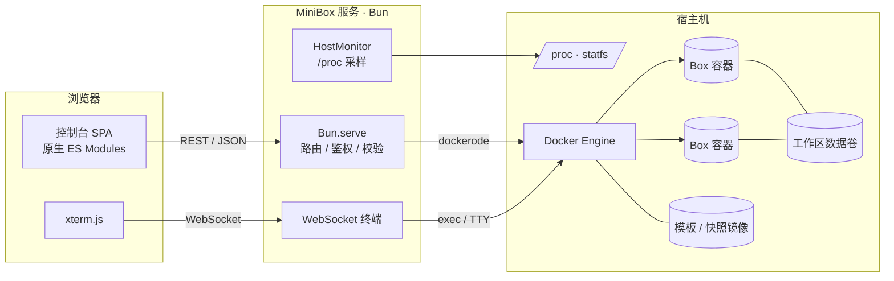
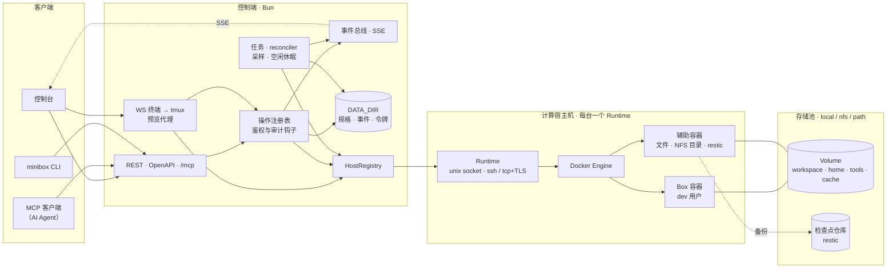

<p align="center">
  <picture>
    <source media="(prefers-color-scheme: dark)" srcset="web/assets/logo-dark.svg" />
    
  </picture>
</p>

<p align="center"><strong>为 AI Agent 准备的个人自托管开发环境：基于 Docker 的 Box 与管理面板。</strong></p>

<p align="center">
  <a href="https://github.com/ArnoChenFx/minibox/actions/workflows/ci.yml"></a>
  <a href="LICENSE"></a>
  <a href="https://bun.sh"></a>
  
</p>

<p align="center"><a href="README.md">English</a> | <b>简体中文</b></p>


## MiniBox 是什么

MiniBox 让你在自己的机器上创建隔离的 **Box**：每个 Box 是一个常驻的 Docker 容器，拥有独立的文件系统、进程树和持久化的 `/workspace` 数据卷，可以通过网页控制台或简洁的 REST API 统一管理。灵感来自 [Upstash Box](https://upstash.com/docs/box)，但面向个人场景做了精简：给编码 Agent（Claude Code、Codex、OpenHands 或你自己的脚本）准备可随时丢弃、可复现的工作环境，而不需要运维一个多租户平台。

**为什么做它**

- Agent 很容易把环境弄乱：随手全局安装、做到一半的构建、残留进程。放进 Box 里就不会污染宿主机，一键即可重建、快照或删除。
- 托管沙箱很好用，但有时你更想用自己的硬件和网络，也不想按分钟计费。
- 更重的自托管方案（基于 Firecracker 的沙箱、Coder、Kubernetes Operator）对个人来说太重。MiniBox 只是一个和本机 Docker Engine 通信的 Bun 进程，**不需要数据库服务**。Box 的状态保存在 Docker 的标签、镜像和数据卷中，MiniBox 自身的少量文件保存在[数据目录](#数据目录)里。

## 功能

| 模块 | 说明 |
|---|---|
| Box 生命周期 | 创建、启动、停止、重启、删除；删除时可选择保留或一并删除工作区数据卷 |
| 资源配额 | 按预设（小型 2 核 4 GB / 中型 4 核 8 GB / 大型 8 核 16 GB）或自定义设置 CPU、内存，并按宿主机容量校验；运行中可热更新（`docker update`） |
| Box 用户 | Box 以非 root 用户 `dev`（uid/gid 1000）运行，并可无密码使用 `sudo`；Web 终端与 `docker exec` 默认以 `dev` 进入。见[基础模板](#基础模板) |
| 快照 | 基于 `docker commit` 保存 Box 的系统环境，可从快照创建新 Box，或提升为模板 |
| 模板 | 内置基础模板（Debian 12 · Node.js 24 · Python 3 · git · tmux · build-essential · 非 root 用户 `dev`），以及由快照提升的自定义模板 |
| 宿主机监控 | CPU 使用率、负载、内存、磁盘（系统盘 / Docker 数据目录）、运行时长、Docker 状态、Box 配额与宿主机容量对比，CPU / 内存迷你折线图 |
| Box 监控 | 每个 Box 的实时 CPU / 内存占用（相对配额）与历史曲线 |
| 网页终端 | 基于 xterm.js + WebSocket 的交互式 bash，随窗口自适应 |
| 日志 | 查看容器主进程输出，支持行数选择与自动刷新 |
| 访问控制 | 单一访问密钥，HttpOnly、`SameSite=Strict` Cookie 或 `Authorization: Bearer`；按客户端地址限制登录失败次数；拒绝跨站请求 |
| 多语言 | 英文与简体中文；点击右上角（控制台顶栏和登录页）的语言图标按钮即可切换，默认跟随浏览器语言，并在本浏览器记住选择 |
| 界面 | 浅色 / 深色主题（跟随系统，可手动切换）、响应式布局、空状态、骨架屏、操作提示与危险操作确认 |

## 截图

| Box 列表 | 创建 Box |
|---|---|
|  |  |
| **Box 详情** | **网页终端** |
|  |  |
| **快照** | **概览（深色）** |
|  |  |

更多截图见 [`docs/screenshots`](docs/screenshots)。

## 架构

### 当前架构（v0.3）



- **Box** = 带 `minibox=true` 标签、名为 `minibox-<名称>` 的容器，常驻进程为 `sleep infinity`（启用 `--init`，重启策略 `unless-stopped`）。`/workspace` 挂载在独立数据卷 `minibox-ws-<名称>`。容器以非 root 用户 `dev` 运行（见[基础模板](#基础模板)）。
- **快照** = 带 `minibox.snapshot=true` 标签的镜像 `minibox-snap:<名称>-<时间>`。
- **模板** = 带 `minibox.template=true` 标签的镜像 `minibox-template:<名称>`。
- 前端无构建步骤：原生 ES Modules + 手写设计系统；xterm.js 随仓库放在 [`web/vendor/`](web/vendor/README.md)，控制台不会从 CDN 加载任何代码。

（`minibox` 是默认的 `LABEL_PREFIX`，所有名称和标签都随前缀变化。）

### 目标架构（规划中）

> [!NOTE]
> 规划中的设计，尚未实现。完整设计与取舍见 [`docs/design.md`](docs/design.md)。



- **Box** = `DATA_DIR` 中的规格 + 一个容器。容器标签只保存创建后不可变的部分。
- **Volume** 属于某个存储池，而不属于某个 Box。`cache` 卷留在本地池，不进入检查点。
- **检查点** = Box 规格 + 各卷的快照（restic）+ 可选的系统层。
- **辅助容器**是短生命周期的，负责文件操作、创建 NFS 目录和运行 restic。
- Box 以非 root 的 `dev` 用户运行，并使用「标准」或「严格」两个安全档位之一。
- MiniBox Agent 与存储节点角色不在主路线上，因此图中未画。

## 环境要求

- 装有 Docker Engine 的 Linux 宿主机（宿主机指标读取自 `/proc`）
- [Bun](https://bun.sh) ≥ 1.4.3
- 运行 MiniBox 的用户对 Docker Socket 有读写权限

## 快速开始

```bash
git clone https://github.com/ArnoChenFx/minibox.git
cd minibox
bun install
cp .env.example .env          # 可选，所有配置都有默认值

# 构建内置基础模板（也可以稍后在控制台「模板」页构建）
bun run build:template

# 启动（默认监听 127.0.0.1:3920）
bun start
```

如果环境变量和 `.env` 中都没有设置 `ACCESS_KEY`，首次启动时会自动生成一个 64 位十六进制密钥，并保存到 `DATA_DIR/access_key`（权限 600，默认为 `./data/access_key`）。`.env` 永远不会被修改：

```bash
cat data/access_key
```

浏览器打开 <http://127.0.0.1:3920>，输入密钥登录。

> [!TIP]
> 想自己指定密钥，就在 `.env` 里设置 `ACCESS_KEY`，至少 20 位随机字符（例如 `openssl rand -hex 32`）。`.env` 或环境变量中的密钥始终优先于自动生成的密钥；早期版本写入 `.env` 的密钥照常生效。

### 后台运行

没有 systemd 的环境（容器、云端沙箱）可以使用辅助脚本。它可以重复执行，会依次确保：dockerd 在运行（必要时通过 `sudo` 启动）、基础模板已存在、MiniBox 服务已（重新）启动且健康检查通过；如果装了 `opentunnel` 命令行，还会确保隧道在运行：

```bash
scripts/restart.sh              # 包含隧道
scripts/restart.sh --no-tunnel  # 只启动服务
```

服务输出写入项目根目录的 `server.log`（已在 git 中忽略）。脚本还会报告访问密钥的保存位置，但不会输出密钥本身。

有 systemd 时，推荐写一个服务单元执行 `bun /path/to/minibox/src/server.ts`。

### 远程访问

服务默认只监听本机。需要远程访问时，请通过 HTTPS 暴露：反向代理、Tailscale 这类私有网络，或 [OpenTunnel](https://opentunnel.xyz) 之类的隧道：

```bash
opentunnel route add 3920 --name minibox
opentunnel up
# → https://minibox.<你的 ID>.opentunnel.xyz
```

> **从旧版本升级、并且已经通过隧道或反向代理访问？请先读这一段。** 需要的设置取决于 MiniBox 前面是什么：
>
> 1. **OpenTunnel，或者保留 `Host` 和 `Origin`、不添加 `X-Forwarded-*` 头的隧道：保持 `TRUST_PROXY` 关闭。** 此时所有请求都从 `127.0.0.1` 到达 MiniBox，因此所有访问者共享同一个登录限流计数，但正确的访问密钥总能登录（见[安全须知](#安全须知)）。这种情况下 `ALLOWED_ORIGINS` 是可选的，因为 `Host` 已与公网地址一致；设置它也没有坏处。登录 Cookie 会因浏览器发出的 `https://` Origin 而带上 `Secure`。
> 2. **你自己控制的反向代理：只有当它会在每个请求上覆盖（或剥离后重新添加）`X-Forwarded-For`、`X-Forwarded-Proto` 和 `X-Forwarded-Host`，并且 MiniBox 只能经由该代理访问（保持 `HOST=127.0.0.1`）时，才设置 `TRUST_PROXY=true`。** `TRUST_PROXY` 会让 MiniBox 信任这三个头，因此能直接连到 MiniBox 的客户端，或原样透传客户端自带值的代理，都可以伪造它们。
> 3. **如果代理把 `Host` 改写成了上游地址，请设置 `ALLOWED_ORIGINS=https://你的公网地址`。** 否则从公网地址发出的登录和终端请求会返回 `403`，登录页会提示该请求的 Origin 不在 `ALLOWED_ORIGINS` 中。nginx 默认会改写 `Host`，除非配置了 `proxy_set_header Host $host;`。
> 4. **`COOKIE_SECURE=1`：仅当浏览器通过 HTTPS 访问，但 MiniBox 收到的请求不带 `https://` Origin（例如代理剥离了它）时才需要。** 浏览器会丢弃从明文 HTTP 收到的 `Secure` Cookie，因此只能经由 HTTP 访问的地址绝不要设置它。
>
> 如果日志中出现 `proxy.headers_ignored`，说明收到了转发头，但 `TRUST_PROXY` 未开启。在会设置这些头的反向代理后面，请按上面开启。OpenTunnel 不添加这些头，所以出现的头来自客户端，应保持关闭。

MiniBox 还会拒绝来自其他网站的请求：浏览器的 `Origin` 必须与请求到达时的 `Host` 一致，或列在 `ALLOWED_ORIGINS` 中。如果代理把公网 `Host` 原样透传，nginx 的 `server` 配置可以这样写：

```nginx
location / {
    proxy_pass http://127.0.0.1:3920;
    proxy_http_version 1.1;
    proxy_set_header Upgrade $http_upgrade;
    proxy_set_header Connection "upgrade";
    proxy_set_header Host $host;
    proxy_set_header X-Forwarded-For $proxy_add_x_forwarded_for;
    proxy_set_header X-Forwarded-Proto $scheme;
}
```

对外暴露之前，请先阅读[安全须知](#安全须知)。

### Docker

正式版本的镜像发布在 GitHub Container Registry，支持 `linux/amd64` 和 `linux/arm64`：

```bash
docker run -d --name minibox --restart unless-stopped \
  -p 127.0.0.1:3920:3920 \
  -e ACCESS_KEY="$(openssl rand -hex 32)" \
  -v /var/run/docker.sock:/var/run/docker.sock \
  -v minibox-data:/data \
  ghcr.io/arnochenfx/minibox:latest
```

- MiniBox 通过宿主机的 Docker Engine 管理 Box，**必须**挂载 Docker Socket（`-v /var/run/docker.sock:/var/run/docker.sock`）。Box 会作为宿主机上的同级容器创建，而不是在 MiniBox 容器内部。
- 挂载一个数据卷到 `/data`（`-v minibox-data:/data`）。它保存[数据目录](#数据目录)，包括自动生成的访问密钥，因此重建容器后状态不会丢失。没有数据卷的话，删除容器时这些状态也会丢失。
- 如果没有传入 `ACCESS_KEY`，用 `docker exec minibox cat /data/access_key` 读取自动生成的密钥。`docker logs` 不会输出密钥的任何部分。
- 从把自动生成的密钥写入 `/app/.env` 的旧镜像升级：该文件位于旧容器内，重建容器时会丢失。请在旧容器运行时用 `docker exec minibox grep '^ACCESS_KEY=' /app/.env` 把密钥取出来，再通过 `-e ACCESS_KEY=...` 传入。
- 容器内监听 `0.0.0.0:3920`（`HOST=0.0.0.0`）；如上所示只发布到宿主机的 `127.0.0.1`，远程访问请走 HTTPS。
- 镜像标签：`X.Y.Z`、`X.Y` 和 `latest`（`1.0.0-rc.1` 这类预发布版本只打完整版本号标签）。
- 本地构建：`docker build --build-arg MINIBOX_VERSION=0.3.0 -t minibox .`

## 配置

优先级：进程环境变量 > `.env` 文件 > 默认值。访问密钥还会回退到 `DATA_DIR/access_key`。参考 [`.env.example`](.env.example)。

| 变量 | 默认值 | 说明 |
|---|---|---|
| `ACCESS_KEY` | 自动生成到 `DATA_DIR/access_key` | 控制台与 API 的访问密钥，至少 20 位随机字符（见[安全须知](#安全须知)）。MiniBox 不会把它写入 `.env` |
| `HOST` | `127.0.0.1` | 监听地址 |
| `PORT` | `3920` | 监听端口 |
| `TRUST_PROXY` | `false` | 信任你自己运行的反向代理设置的 `X-Forwarded-For`、`X-Forwarded-Proto` 和 `X-Forwarded-Host`。**只有代理会在每个请求上覆盖或剥离这些头，并且 MiniBox 只能经由该代理访问时才设为 `true`。** OpenTunnel 等不添加这些头的隧道应保持关闭（见[远程访问](#远程访问)） |
| `ALLOWED_ORIGINS` | 空 | 本 MiniBox 的公网来源（完整的 `https://` 地址），逗号分隔，例如 `https://minibox.example.com`。**代理改写了 `Host` 时需要设置**（nginx 默认如此），否则从该地址发出的登录和终端请求会返回 `403`。OpenTunnel 会保留 `Host`，此时可选，设置也无害 |
| `COOKIE_SECURE` | `false` | 始终为会话 Cookie 加上 `Secure` 标记。浏览器登录时会带上 `https://` Origin，已足以加上该标记，通常无需设置。只在 HTTPS 下使用：浏览器会丢弃明文 HTTP 收到的 `Secure` Cookie |
| `DOCKER_SOCKET` | `/var/run/docker.sock` | Docker Engine Socket 路径 |
| `DATA_DIR` | `./data`（镜像中为 `/data`） | 状态目录，见[数据目录](#数据目录) |
| `LABEL_PREFIX` | `minibox` | 标签以及容器 / 镜像 / 数据卷名称的前缀 |
| `BASE_TEMPLATE` | `<前缀>-template:base` | 新建 Box 的默认模板镜像 |
| `METRICS_INTERVAL_MS` | `3000` | 宿主机采样间隔（毫秒） |
| `METRICS_HISTORY` | `120` | 保留的采样点数量（默认间隔下约 6 分钟） |
| `LOG_LEVEL` | `info` | `debug` / `info` / `warn` / `error` |
| `MINIBOX_VERSION` | 来自 git / `package.json` | 覆盖显示的版本号（发布镜像中自动设置） |

> `bun run build:template` 固定打 `minibox-template:base` 标签。如果改了 `LABEL_PREFIX` 或 `BASE_TEMPLATE`，请改在控制台「模板 → 构建基础模板」中构建，它会使用配置的标签。

## 基础模板

内置模板（[`templates/base/Dockerfile`](templates/base/Dockerfile)）是新建 Box 的起始镜像。它遵循以下约定：

| 方面 | 约定 |
|---|---|
| 用户 | `dev`，uid/gid 为 `1000`。Box 以镜像默认用户启动，因此 Web 终端与 `docker exec` 默认以 `dev` 进入。`sudo` 无需密码，且仅限 Box 内 |
| 挂载点 | `/workspace`（工作区卷）、`/home/dev`（主目录）、`/opt/minibox/tools`（共享且只读的工具，其 `bin` 在 `PATH` 中）、`/home/dev/.cache`（缓存）。在 [#24](https://github.com/ArnoChenFx/minibox/issues/24) 实现数据卷挂载之前，它们是镜像里的普通目录 |
| 缓存 | `XDG_CACHE_HOME`、`npm_config_cache`、`PIP_CACHE_DIR` 与 `YARN_CACHE_FOLDER` 指向 `/home/dev/.cache` 下。`NPM_CONFIG_PREFIX` 为 `/home/dev/.npm-global`，因此 `npm install -g` 无需 root |
| 标签 | `minibox.template.user`、`minibox.template.uid` 与 `minibox.template.gid` 记录该约定，便于校验其他模板 |

内置工具：`tmux`、`jq`、`ripgrep`、`openssh-client`、`unzip`、`less`、`vim-tiny` 与 `sudo`，以及 `git`、`curl`、`python3`、`build-essential` 与 `procps`。

**所有模板使用同一个 uid。** 共享同一卷的 Box，只有其模板的 uid 与 gid 一致，才能正常读写。Node 镜像自带的 `node` 用户占用了 uid 1000。模板会删除该用户而不是改名，让 `dev` 使用这个 uid，避免两个账户共用一个 uid。如需使用其他 uid，请在 `docker build` 中传入 `--build-arg DEV_UID=<uid> --build-arg DEV_GID=<gid>`；此时与该镜像共享数据的每个模板和卷都必须使用相同的值。

**从 root 版模板升级。**

- 已有的 Box 继续以旧模板的 root 用户运行，不会改名，也不会重建。
- 从旧快照或旧模板创建的 Box，沿用该镜像的用户；在本次改动之前制作的镜像，用户是 root。
- 新 Box 如果复用了旧 Box 留下的工作区卷（删除旧 Box 时保留了卷），卷内 `/workspace` 属主为 root，`dev` 无法写入。在 Box 运行时执行一次即可修复：

  ```bash
  docker exec -u root minibox-<名称> chown -R 1000:1000 /workspace
  ```

  或者在卷没有被使用时，用一次性容器对它执行：

  ```bash
  docker run --rm --user root -v minibox-ws-<名称>:/workspace minibox-template:base chown -R 1000:1000 /workspace
  ```

  MiniBox 暂不自动执行。对整个工作区递归 `chown` 可能耗时很长，并且会改动你没有要求改动的数据，因此这件事归入 [#24](https://github.com/ArnoChenFx/minibox/issues/24) 的存储工作一起处理。

用 Docker 检查镜像：执行 `bun run build:template` 后，运行 `bun run check:template`（或 `scripts/check-box-image.sh <镜像>`）。它会检查用户、uid、`sudo`、工具、挂载点、缓存变量、登录 Shell 的 `PATH`，并检查两个共享同一卷的容器能否读写它。CI 会对 `linux/amd64` 执行检查，并在模拟环境下对 `linux/arm64` 执行检查。

## 数据目录

MiniBox 把自己管理的状态保存在 `DATA_DIR` 里。它是一个普通文件目录，而不是数据库服务，请和其他数据一起备份。相对路径相对于项目根目录解析，`~/` 会展开为你的主目录。

| 路径 | 权限 | 内容 |
|---|---|---|
| `access_key` | `600` | 环境变量和 `.env` 中都没有设置时自动生成的访问密钥 |
| `boxes/` | `700` | Box 规格（现在创建，后续功能使用） |
| `exec/` | `700` | `exec` 命令的输出（现在创建，后续功能使用） |
| `secrets/` | `700` | 密钥值与仓库密钥（现在创建，后续功能使用） |

MiniBox 在启动时创建这些目录，并收紧过宽的权限。它从不写入 `.env`。如果 `DATA_DIR` 丢失，且 `.env` 和环境变量中也没有设置密钥，下次启动会生成新的访问密钥，所有人都需要用新密钥登录。如果你依赖当前密钥，请备份 `access_key`，或在 `.env` 中设置 `ACCESS_KEY`。

## API 参考

请求与响应均为 JSON。除标注**公开**的接口外，都需要登录 Cookie（由 `/api/auth/login` 写入）或 `Authorization: Bearer <ACCESS_KEY>` 请求头。写请求必须使用 `Content-Type: application/json`（既没有请求体也没有声明 `Content-Type` 的写请求除外；其他声明的类型返回 `415`），来自其他网站的浏览器请求返回 `403`。

出错时返回对应的 HTTP 状态码和统一结构：

```json
{ "error": { "code": "validation_failed", "message": "CPU 核数须在 0.1 到 64 之间。", "details": { "field": "cpus" } } }
```

常见错误码：`validation_failed`（400）、`unauthorized`（401）、`forbidden`（403）、`not_found`（404）、`method_not_allowed`（405）、`conflict`（409）、`unsupported_media_type`（415）、`insufficient_capacity`（422）、`too_many_requests`（429）、`docker_error`（502）、`docker_unavailable`（503）。

### 认证与系统

| 方法 | 路径 | 说明 |
|---|---|---|
| `POST` | `/api/auth/login` | **公开**。请求体 `{ "key": "..." }`，成功后写入 HttpOnly Cookie（30 天）。正确的密钥总能登录；错误的密钥在同一客户端地址 5 分钟内失败 10 次（IPv6 按 /64 计）或全部地址合计 50 次后会被拒绝（`429`） |
| `POST` | `/api/auth/logout` | **公开**。清除 Cookie |
| `GET` | `/api/auth/session` | **公开**。返回 `{ "authenticated": boolean }` |
| `GET` | `/api/health` | **公开**。返回 `{ "ok": true, "docker": boolean }`，Docker 不可用时为 503 |
| `GET` | `/api/system` | 版本、运行时、非敏感配置与限制 |
| `GET` | `/api/host/metrics` | 宿主机指标与历史采样 |
| `GET` | `/api/activity` | 最近操作记录（保存在内存中，重启后清空） |

### Box

| 方法 | 路径 | 说明 |
|---|---|---|
| `GET` | `/api/boxes?stats=false` | 列表；除非 `stats=false`，否则附带运行中 Box 的实时占用 |
| `POST` | `/api/boxes` | 创建并启动。`{ "name", "template"?, "cpus"?, "memoryMb"? }`，默认 2 核 / 4096 MB |
| `GET` | `/api/boxes/:id` | 详情（含实时占用） |
| `DELETE` | `/api/boxes/:id?deleteVolume=true` | 删除；可选同时删除工作区数据卷 |
| `POST` | `/api/boxes/:id/start` · `/stop` · `/restart` | 生命周期操作 |
| `PATCH` | `/api/boxes/:id/resources` | 热更新配额 `{ "cpus"?, "memoryMb"? }` |
| `GET` | `/api/boxes/:id/stats` | 实时占用 |
| `GET` | `/api/boxes/:id/logs?tail=300` | 容器日志（1–5000 行） |
| `POST` | `/api/boxes/:id/snapshots` | 创建快照 `{ "name"? }` |
| `GET` (WS) | `/api/boxes/:id/terminal` | WebSocket 终端；发送 `{"type":"resize","cols":N,"rows":N}` 调整窗口，其余消息作为输入 |

`:id` 可以是容器 ID 或容器名（`minibox-<名称>`）。限制：CPU 0.1–64 核，内存 128–262144 MB，且单个 Box 不能超过宿主机的核数或总内存。名称须匹配 `^[a-zA-Z0-9][a-zA-Z0-9_.-]{0,62}$`。

### 快照与模板

`:ref` 为镜像引用（如 `minibox-snap:demo-20261020-154259`），需要 URL 编码。

| 方法 | 路径 | 说明 |
|---|---|---|
| `GET` | `/api/snapshots` | 快照列表 |
| `DELETE` | `/api/snapshots/:ref` | 删除快照 |
| `POST` | `/api/snapshots/:ref/boxes` | 从快照创建 Box `{ "name", "cpus"?, "memoryMb"? }` |
| `POST` | `/api/snapshots/:ref/promote` | 提升为模板 `{ "name", "description"? }` |
| `GET` | `/api/templates` | 模板列表 |
| `POST` | `/api/templates/base/build` | 构建内置基础模板 |
| `DELETE` | `/api/templates/:ref` | 删除模板 |

只有带 MiniBox 标签的镜像才能通过 API 删除。

### 示例

```bash
KEY=$(grep '^ACCESS_KEY=' .env | cut -d= -f2)   # 若由 MiniBox 生成密钥，也可以用 KEY=$(cat data/access_key)
curl -s -H "Authorization: Bearer $KEY" -H 'content-type: application/json' \
  -d '{"name":"agent-dev","cpus":2,"memoryMb":4096}' http://127.0.0.1:3920/api/boxes

# 之后就可以进去干活，比如在 Agent 的 shell 工具里：
docker exec -it minibox-agent-dev bash
```

## 项目结构

```text
minibox/
├── src/
│   ├── server.ts            # 入口：Bun.serve、静态资源、WebSocket 升级、优雅退出
│   ├── app.ts               # 应用上下文（配置、Docker、监控、操作记录）
│   ├── config.ts            # 环境变量 / .env 配置、访问密钥优先级
│   ├── data-dir.ts          # DATA_DIR 布局与密钥文件（600）
│   ├── auth.ts              # 密钥校验、Cookie、登录限流
│   ├── labels.ts            # Docker 标签键与解析
│   ├── activity.ts          # 最近操作记录
│   ├── static.ts            # 静态文件服务（防目录穿越）
│   ├── docker/              # client / boxes / snapshots / templates / images / stats
│   ├── host/                # procfs 解析、HostMonitor 采样
│   ├── routes/              # router 与各组路由（auth / system / boxes / images）
│   ├── ws/terminal.ts       # WebSocket 终端
│   └── lib/                 # errors / http / logger / validation
├── web/
│   ├── index.html · login.html
│   ├── css/app.css          # 设计系统（变量、组件、浅色 / 深色）
│   ├── js/                  # app、pages/*、components/*、lib/*
│   └── assets/              # logo、favicon、图标
├── templates/base/Dockerfile
├── tests/                   # bun test 单元测试
├── scripts/restart.sh       # 无 systemd 环境的重启脚本
├── scripts/check-box-image.sh  # 基础模板的 Docker 检查（CI 中检查 amd64 与 arm64）
├── Dockerfile               # 发布镜像（oven/bun，多架构）
├── .github/workflows/release.yml  # tag → 镜像 + GitHub Release
└── docs/screenshots/
```

## 开发

```bash
bun run dev        # 监听文件变化自动重启
bun run fmt        # 用 oxfmt 格式化（直接写入文件）
bun run fmt:check  # 只检查格式
bun run lint       # oxlint 检查（有警告即失败）
bun run typecheck  # TypeScript 严格模式类型检查（tsc --noEmit）
bun test           # 单元测试（不需要 Docker）
bun run check      # 以上全部，与 CI 一致
bun run build:template && bun run check:template  # 基础模板检查（需要 Docker）
```

格式化使用 [oxfmt](https://oxc.rs/docs/guide/usage/formatter.html)（`.oxfmtrc.json`），代码检查使用 [oxlint](https://oxc.rs/docs/guide/usage/linter.html)（`.oxlintrc.json`）。[CI](.github/workflows/ci.yml) 会在每次推送到 `main` 和每个 Pull Request 时运行 `fmt:check`、`lint`、`typecheck` 和 `bun test`，并做一次 Docker 构建冒烟测试（启动镜像并访问 `/login`）。

提交信息遵循 [Conventional Commits](https://www.conventionalcommits.org/zh-hans/)。变更记录见 [CHANGELOG.md](CHANGELOG.md)。

## 发布

版本号遵循 [语义化版本](https://semver.org/lang/zh-CN/)。控制台和 `/api/system` 显示的版本在运行时解析：`MINIBOX_VERSION`（发布镜像中由 tag 写入）→ `git describe --tags`（源码目录中，例如 `0.3.0-2-gabc1234`）→ `package.json`。

1. 修改 `package.json` 中的 `version`，并在 `CHANGELOG.md` 中补上对应版本的条目。
2. 提交并推送到 `main`。
3. 打 tag 并推送：

   ```bash
   git tag v0.3.0 && git push origin v0.3.0
   ```

随后 [发布工作流](.github/workflows/release.yml) 会先运行同一套 CI 检查，校验 tag 与 `package.json` 一致，构建多架构镜像并推送到 `ghcr.io/arnochenfx/minibox`，再用 CHANGELOG 中对应的章节加自动生成的变更说明创建 GitHub Release。带预发布后缀的 tag（如 `v1.0.0-rc.1`）会标记为预发布，且不会更新 `latest`。

## 安全须知

MiniBox 的设计前提是**一个可信用户在自己的机器上使用**。对外暴露前请务必阅读。

- **Docker Socket 等同于 root。** MiniBox 通过 Docker Socket 管理容器，拿到访问密钥的人实际上可以以 root 身份在宿主机上做任何事。请像对待 root 密码一样保管密钥。`.env` 和 `data/` 已在 `.gitignore` 中忽略，不要提交它们。
- **容器以 root 运行。** 容器需要使用 Docker Socket，而 Docker Socket 等同于 root。要缩小这部分权限，可以在 Socket 前放一个只转发 MiniBox 所需 Docker API 的 Socket 代理，并把 `DOCKER_SOCKET` 指向代理的 Unix Socket；也可以让 MiniBox 连接 rootless Docker 或 Podman 的 Socket。
- **访问密钥是唯一门禁。** 没有用户体系，密钥一旦泄露就等于完全失守。密钥比对是恒定时间的。登录限流只拒绝错误的密钥：正确的密钥总能登录，即使错误的密钥正在被拒绝。同一客户端地址 5 分钟内失败 10 次（IPv6 按 /64 计），或全部地址合计 50 次后，之后的错误密钥会被拒绝。限流不会阻止猜测，因为每个密钥仍会被校验，所以密钥的长度和随机性才是关键：请使用至少 20 位的随机字符，例如 `openssl rand -hex 32` 生成的密钥（自动生成的密钥为 64 位十六进制）。启动时，若密钥短于 20 位，或明显低熵（只用一类字符且不足 24 位，或只重复同一个字符），会记录 `auth.weak_key` 警告。MiniBox 仍会正常启动，已有部署不受影响。更换密钥：修改 `.env` 中的 `ACCESS_KEY`，或删除 `DATA_DIR/access_key` 以生成新密钥，然后重启服务，现有会话立即失效。
- **跨站请求会被拒绝。** WebSocket 终端以及 `/api/` 下的所有写操作（`POST`、`PATCH`、`DELETE`）必须来自 MiniBox 自己的来源，或来自 `ALLOWED_ORIGINS` 中列出的来源。不带 `Origin` 请求头的请求（如使用 `Authorization: Bearer` 的脚本）不受此限制。写请求必须声明 `Content-Type: application/json`（既没有请求体也没有声明 `Content-Type` 的写请求除外），这也挡住了 HTML 表单提交。登录 Cookie 为 `SameSite=Strict`，因此从其他网站打开的链接可能需要再登录一次。
- **严格的内容安全策略（CSP）。** 脚本只会从 MiniBox 自身加载（`script-src 'self'`），页面没有内联脚本，且禁止被嵌入 iframe（`frame-ancestors 'none'`）。通过 HTTPS 访问（直接访问、请求带有 `https://` Origin，或在 `TRUST_PROXY=true` 时经由代理）的请求还会带上 `Strict-Transport-Security`，有效期一年，不包含子域名。
- **只监听 `127.0.0.1`**（默认值）。在有公网 IP 的机器上不要设置 `HOST=0.0.0.0`。
- **远程访问请使用 HTTPS。** 通过 HTTPS 访问（或请求带有 `https://` Origin，浏览器登录时会带上）时，登录 Cookie 会带上 `Secure` 标记；`COOKIE_SECURE=1` 可强制加上。默认情况下 MiniBox 忽略 `X-Forwarded-For`、`X-Forwarded-Proto` 和 `X-Forwarded-Host`，因此经过反向代理访问时，所有访问者共享代理的地址来计算登录限流。只有当前面的代理会覆盖这些头，并且 MiniBox 只能经由该代理访问时，才设置 `TRUST_PROXY=true`：开启后 MiniBox 取 `X-Forwarded-For` 的最后一项（由代理追加的那一项），并同样信任另外两个头；关闭时这些头被忽略，伪造它们没有任何效果。
- **公开隧道可以被发现。** 隧道域名（例如 OpenTunnel 的 `*.opentunnel.xyz`）可能出现在公开的证书透明度日志里，也可能被猜到，而且 OpenTunnel 本身不提供认证。这相当于把控制台直接放在公网上，只靠访问密钥保护；流量还会经过隧道的中继服务器。条件允许时优先使用私有网络（如 Tailscale）或带认证的反向代理，不用时把隧道关掉。
- **这是容器隔离，不是安全沙箱。** Box 与宿主机共享内核，适合运行你自己的 Agent，**不适合运行不可信的第三方代码**，那种场景请使用 gVisor 或基于 microVM 的沙箱。不要把 Docker Socket 或宿主机敏感目录挂进 Box。
- **Box 拥有无密码 `sudo`。** Box 内的 `dev` 用户可以提升为 root，而 Box 内的 root 可以改动 Box 以及其工作区卷中的任何内容。容器仍使用 Docker 默认的 capability 集合，而不是特权容器。不带 `sudo` 的严格档位已规划在 [#5](https://github.com/ArnoChenFx/minibox/issues/5) 中。
- **快照不包含 `/workspace`。** `docker commit` 不会保存挂载的数据卷，重要代码请用 git 同步或单独备份数据卷。
- `scripts/restart.sh` 可能会用 `sudo` 启动 `dockerd`，并对 Docker Socket 执行 `chmod 666`，方便非 root 用户访问。这在单用户沙箱里很方便，但放宽了权限，用在其他环境前请先检查脚本。

## 路线图

完整的产品与架构设计见 [`docs/design.md`](docs/design.md)，实施路线与任务拆分见 [#20](https://github.com/ArnoChenFx/minibox/issues/20)。规划中的工作按里程碑分组，有对应 issue 的项目都会链接过去。

### M0 · 地基

顺序：第一个 PR 整理已写好的 #1 #3 #4 改动，然后并行推进 #32 #6 #18，最后是 #22。

- [ ] [#1](https://github.com/ArnoChenFx/minibox/issues/1) 登录限流：只有开启 `TRUST_PROXY` 才信任代理头
- [ ] [#3](https://github.com/ArnoChenFx/minibox/issues/3) WebSocket 与写接口的 Origin 校验
- [ ] [#4](https://github.com/ArnoChenFx/minibox/issues/4) CSP / HSTS，xterm.js 改为本地托管
- [ ] [#32](https://github.com/ArnoChenFx/minibox/issues/32) Runtime / Host 抽象（隐式 `local`，行为不变）
- [ ] [#6](https://github.com/ArnoChenFx/minibox/issues/6) `DATA_DIR` 作为控制端状态目录；自动生成的访问密钥不再写入 `.env`
- [x] [#18](https://github.com/ArnoChenFx/minibox/issues/18) Dependabot、固定 action 的 commit SHA、Bun ≥ 1.4.3 下限，以及 `main` 分支保护
- [ ] [#22](https://github.com/ArnoChenFx/minibox/issues/22) 统一生成 REST / OpenAPI / MCP / CLI 的操作注册表

### M1 · 模板、规格、审计与令牌

- [x] [#27](https://github.com/ArnoChenFx/minibox/issues/27) 基础模板：非 root 用户 `dev`、tmux、挂载点约定
- [ ] [#5](https://github.com/ArnoChenFx/minibox/issues/5) Box 加固：「标准」与「严格」两个安全档位
- [ ] [#23](https://github.com/ArnoChenFx/minibox/issues/23) Box 规格：声明式状态、稳定 ID、重建与回滚
- [ ] [#25](https://github.com/ArnoChenFx/minibox/issues/25) 事件库与审计（SQLite、脱敏），基于事件总线
- [ ] [#16](https://github.com/ArnoChenFx/minibox/issues/16) 异步任务与进度流
- [ ] [#13](https://github.com/ArnoChenFx/minibox/issues/13) Agent 受限令牌：`created-by-me`、配额与 TTL
- [ ] [#2](https://github.com/ArnoChenFx/minibox/issues/2) 可撤销的会话令牌，取代 Cookie 中的原始访问密钥

### M2 · 存储与 Agent 接口

- [ ] [#24](https://github.com/ArnoChenFx/minibox/issues/24) Volume 与存储池（`local` / `nfs` / `path`）
- [ ] [#9](https://github.com/ArnoChenFx/minibox/issues/9) 面向 Agent 的执行与文件 API，并提供 MCP 服务与 CLI
- [ ] [#14](https://github.com/ArnoChenFx/minibox/issues/14) tmux 会话与人工接管
- [ ] [#17](https://github.com/ArnoChenFx/minibox/issues/17) 通过 SSE 推送 Box 状态与资源占用，取代轮询
- [ ] [#30](https://github.com/ArnoChenFx/minibox/issues/30) NAS / NFS 部署指南

### M3 · 核心价值

- [ ] [#11](https://github.com/ArnoChenFx/minibox/issues/11) 基于 restic 的检查点：派生、回滚与保留策略
- [ ] [#10](https://github.com/ArnoChenFx/minibox/issues/10) Box 内 dev server 的端口预览
- [ ] [#8](https://github.com/ArnoChenFx/minibox/issues/8) 创建时或运行中可选装 Agent CLI

### M4 · 多宿主机与优化

- [ ] [#21](https://github.com/ArnoChenFx/minibox/issues/21) 多宿主机（仅 SSH / TLS 直连）
- [ ] [#12](https://github.com/ArnoChenFx/minibox/issues/12) 空闲自动休眠与按需唤醒
- [ ] [#15](https://github.com/ArnoChenFx/minibox/issues/15) 模板增强与预热池

### 贯穿各里程碑

- [ ] [#26](https://github.com/ArnoChenFx/minibox/issues/26) 控制台改版，逐页落地
- [ ] [#19](https://github.com/ArnoChenFx/minibox/issues/19) Docker 层与路由的集成测试
- [ ] [#7](https://github.com/ArnoChenFx/minibox/issues/7) 低危安全加固

### 后续，待评估

不在主路线上，动手前需要先单独评估范围。

- [#28](https://github.com/ArnoChenFx/minibox/issues/28) MiniBox Agent 框架：配对、mTLS 与出站通道
- [#29](https://github.com/ArnoChenFx/minibox/issues/29) 存储节点角色：NAS 与 Linux 存储服务器上的目录、配额与快照
- 宿主机侧密钥注入：API Key 只保存在宿主机上，不写入 Box 的环境变量（暂无对应 issue）

## 许可证

[MIT](LICENSE) © 2026 Arno Chen
