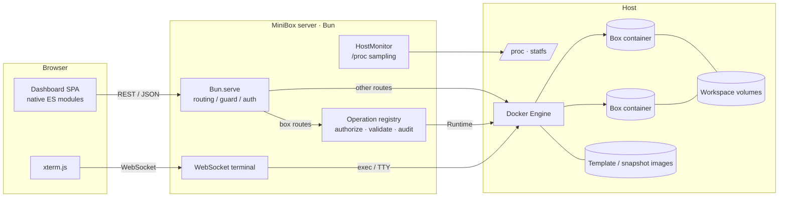
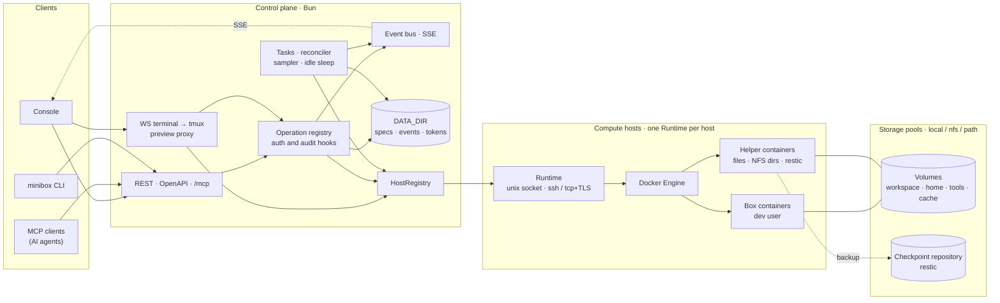

<p align="center">
  <picture>
    <source media="(prefers-color-scheme: dark)" srcset="web/assets/logo-dark.svg" />
    
  </picture>
</p>

<p align="center"><strong>Personal, self-hosted dev environments for AI agents — Docker boxes with a dashboard.</strong></p>

<p align="center">
  <a href="https://github.com/ArnoChenFx/minibox/actions/workflows/ci.yml"></a>
  <a href="LICENSE"></a>
  <a href="https://bun.sh"></a>
  
</p>

<p align="center"><b>English</b> | <a href="README-zh.md">简体中文</a></p>


## What is MiniBox?

MiniBox lets you spin up isolated **boxes** — long-running Docker containers with their own filesystem, process tree and a persistent `/workspace` volume — on your own machine, and manage them from a web dashboard or a small REST API. It is inspired by [Upstash Box](https://upstash.com/docs/box), scaled down for a single person who wants throwaway, reproducible workspaces for coding agents (Claude Code, Codex, OpenHands, your own scripts, …) without running a multi-tenant platform.

**Why?**

- Agents make a mess: random global installs, half-finished builds, stray processes. A box keeps that off your host and can be reset, snapshotted or deleted in one click.
- Hosted sandboxes are great, but sometimes you want your own hardware, your own network and zero per-minute billing.
- Heavier self-hosted options (Firecracker-based sandboxes, Coder, Kubernetes operators) are overkill for one person. MiniBox is a single Bun process talking to the local Docker Engine — **no database server**. Images and volumes live in Docker. Specs, volume records and the event log live in a [data directory](#data-directory).

## Features

| Area | What you get |
|---|---|
| Box lifecycle | Create, start, stop, restart, delete; on delete, keep volumes or remove the ones that box owns |
| Volumes | Independent volumes and storage pools (`local`, `nfs`, `path`). A new box mounts workspace, home, a shared read-only tools volume and a local cache. See [Volumes and storage pools](#volumes-and-storage-pools) |
| Box user | Boxes run as the non-root `dev` user (uid/gid 1000); the web terminal and `docker exec` start as `dev`. Three [security profiles](#security-profiles) set what a box can do: `standard` (default) keeps passwordless `sudo`, and `strict` blocks escalation. See [Base template](#base-template) |
| Resource quotas | Presets (Small 2 vCPU / 4 GB, Medium 4 vCPU / 8 GB, Large 8 vCPU / 16 GB) or custom CPU & memory, validated against host capacity; live-updatable while running (`docker update`) |
| Snapshots | Save a box's system environment via `docker commit`, create new boxes from a snapshot, or promote it to a template |
| Templates | Bundled base template (Debian 12 · Node.js 26 · Python 3 · git · tmux · build-essential · non-root `dev` user) plus your own promoted templates |
| Host monitoring | CPU usage, load average, memory, disk (root & Docker data dir), uptime, Docker status, allocated quota vs. host capacity, CPU/memory sparklines |
| Per-box monitoring | Live CPU / memory usage relative to the box quota, with history charts |
| Web terminal | Interactive bash over WebSocket with xterm.js, auto-resizes with the window |
| Logs | Main-process output with selectable line count and auto-refresh |
| Access control | Single access key, exchanged at sign-in for a revocable session token in an HttpOnly, `SameSite=Strict` cookie, or sent as `Authorization: Bearer`; login rate limiting per client address; cross-site requests refused |
| Languages | English and Simplified Chinese; toggle with the language icon button in the top-right corner (console header and login page). Defaults to the browser language and is remembered per browser |
| UI | Light / dark theme (follows the system, manual toggle), responsive layout, empty states, skeleton loaders, toasts, confirmation for destructive actions |

## Screenshots

| Box list | Create a box |
|---|---|
|  |  |
| **Box detail** | **Web terminal** |
|  |  |
| **Snapshots** | **Overview (dark)** |
|  |  |

More in [`docs/screenshots`](docs/screenshots).

## Architecture

### Current (v0.3)



- **Box** = a container labeled `minibox=true`, named `minibox-<name>`, running `sleep infinity` (with `--init`). The restart policy is `no`: a startup reconciler starts or stops the container to match the spec's desired state (`running` or `stopped`). The spec file under `DATA_DIR/boxes/` is the authority for mutable state. Container labels are written once, at create, and are not changed later. A new box mounts `/workspace`, `/home/dev`, a shared read-only `/opt/minibox/tools` and `/home/dev/.cache`. New volumes are named `vol_…`. An existing `minibox-ws-<name>` volume is reused as that box's workspace and is not renamed. Changing mounts rebuilds the container and renames it to `minibox-<box id>`; claiming a container does not rename it. The container runs as the non-root user `dev` (see [Base template](#base-template)).
- **Snapshot** = an image `minibox-snap:<name>-<timestamp>` labeled `minibox.snapshot=true`.
- **Template** = an image `minibox-template:<name>` labeled `minibox.template=true`.
- The frontend has no build step: plain ES modules and a hand-written design system. xterm.js is vendored under [`web/vendor/`](web/vendor/README.md), so the console never loads code from a CDN.

(`minibox` is the default `LABEL_PREFIX`; all names and labels follow the prefix.)

### Target architecture (planned)

> [!NOTE]
> Storage pools and volumes, exec, `/mcp` and the CLI client are implemented. Sessions, the preview proxy, tasks, checkpoints, multi-host and helper uses beyond volume setup in this diagram are still planned. The full design is in [`docs/design.md`](docs/design.md) (in Chinese).



- **Box** = a spec in `DATA_DIR` plus one container. Container labels hold only what cannot change after creation.
- **Volume** belongs to a storage pool, not to a box. `cache` volumes stay on the local pool and are excluded from checkpoints.
- **Checkpoint** = box spec + volume snapshots (restic) + an optional system layer.
- **Helper containers** are short-lived. They serve file operations, create NFS directories and run restic.
- Boxes run as the non-root `dev` user under one of three security profiles: `standard` (default), `strict` or `relaxed`.
- The MiniBox Agent and storage-node roles are not on the main path, so they are not drawn.

## Requirements

- Linux host with Docker Engine (the server reads `/proc` for host metrics)
- [Bun](https://bun.sh) ≥ 1.4.3
- Read/write access to the Docker socket for the user running MiniBox

## Quick start

```bash
git clone https://github.com/ArnoChenFx/minibox.git
cd minibox
bun install
cp .env.example .env          # optional; every value has a default

# Build the bundled base template (you can also do this later from the Templates page)
bun run build:template

# Start (listens on 127.0.0.1:3920 by default)
bun start
```

If no `ACCESS_KEY` is set in the environment or in `.env`, MiniBox generates a random 64-character hex key on first start and stores it in `DATA_DIR/access_key` (mode `600`; `./data/access_key` by default). `.env` is never modified:

```bash
cat data/access_key
```

Open <http://127.0.0.1:3920> and sign in with that key.

> [!TIP]
> To choose the key yourself, set `ACCESS_KEY` in `.env` to at least 20 random characters (e.g. `openssl rand -hex 32`). A key from `.env` or the environment always takes precedence over the generated one, and keys that earlier versions wrote into `.env` keep working.

### Running in the background

On hosts without systemd (containers, cloud sandboxes), use the helper script. It is idempotent and makes sure, in order, that `dockerd` is running (started via `sudo` if needed), the base template exists, the MiniBox server is (re)started and healthy, and an OpenTunnel tunnel is up if the `opentunnel` CLI is installed:

```bash
scripts/restart.sh              # include the tunnel
scripts/restart.sh --no-tunnel  # server only
```

Server output goes to `server.log` in the project root (git-ignored), appended to on each start. The script also reports where the access key is stored, never the key itself. `/tmp/dockerd.log` and `/tmp/opentunnel.log` are appended to as well, with a `---` marker line each time the script starts that service.

`restart.sh` is a single-user sandbox convenience. After it runs, the Docker socket belongs to your primary group with mode `660`, so the server it starts can use Docker without a re-login. Members of that group can use Docker. The socket belongs to one group at a time: the primary group of the account that ran the script last keeps access, and every other account, including members of the `docker` group, is locked out. Docker access is root-equivalent, so do not use this script on a shared host.

With systemd, a simple service unit running `bun /path/to/minibox/src/server.ts` is the recommended setup.

### Remote access

MiniBox only listens on localhost by default. To reach it from elsewhere, put it behind HTTPS — a reverse proxy, a private network such as Tailscale, or a tunnel like [OpenTunnel](https://opentunnel.xyz):

```bash
opentunnel route add 3920 --name minibox
opentunnel up
# → https://minibox.<your-id>.opentunnel.xyz
```

> **Upgrading an existing tunnel or reverse-proxy setup? Read this first.** Which settings you need depends on what sits in front of MiniBox:
>
> 1. **OpenTunnel, or any tunnel that keeps `Host` and `Origin` and adds no `X-Forwarded-*` headers: leave `TRUST_PROXY` off.** Every request then reaches MiniBox from `127.0.0.1`, so all visitors share one login rate-limit bucket, but a correct access key always signs in (see [Security](#security)). `ALLOWED_ORIGINS` is optional there, because `Host` already matches the public address; setting it does no harm. The session cookie gets `Secure` from the browser's `https://` Origin.
> 2. **A reverse proxy you control: set `TRUST_PROXY=true`** only if it overwrites (or strips and re-adds) `X-Forwarded-For`, `X-Forwarded-Proto` and `X-Forwarded-Host` on every request, and MiniBox is reachable only through that proxy (keep `HOST=127.0.0.1`). `TRUST_PROXY` makes MiniBox trust all three headers, so a client that can reach MiniBox directly, or a proxy that passes client-supplied values through, can forge them.
> 3. **`ALLOWED_ORIGINS=https://your-public-address`** if the proxy rewrites `Host` to its upstream address. Otherwise login and terminal requests from the public address get `403`, and the login page reports that the Origin is not in `ALLOWED_ORIGINS`. nginx rewrites `Host` unless configured with `proxy_set_header Host $host;`.
> 4. **`COOKIE_SECURE=1`** only if browsers reach MiniBox over HTTPS but the requests MiniBox sees carry no `https://` Origin, for example because a proxy strips it. Browsers drop `Secure` cookies received over plain HTTP, so never set it for an address that is only reachable over http.
>
> If the log shows `proxy.headers_ignored`, MiniBox received forwarded headers while `TRUST_PROXY` was off. Behind a reverse proxy that sets them, enable `TRUST_PROXY` as above. A same-host tunnel such as OpenTunnel adds none of them, so any such header came from a client and the setting stays off.

MiniBox also refuses requests that come from other websites. The browser's `Origin` must match the `Host` the request arrived with, or be listed in `ALLOWED_ORIGINS`. With a proxy that passes the public `Host` through, the server block looks like this:

```nginx
location / {
    proxy_pass http://127.0.0.1:3920;
    proxy_http_version 1.1;
    proxy_set_header Upgrade $http_upgrade;
    proxy_set_header Connection "upgrade";
    proxy_set_header Host $host;
    proxy_set_header X-Forwarded-For $proxy_add_x_forwarded_for;
    proxy_set_header X-Forwarded-Proto $scheme;
}
```

Read the [security notes](#security) before exposing it.

### Docker

Release images are published to GitHub Container Registry for `linux/amd64` and `linux/arm64`:

```bash
docker run -d --name minibox --restart unless-stopped \
  -p 127.0.0.1:3920:3920 \
  -e ACCESS_KEY="$(openssl rand -hex 32)" \
  -v /var/run/docker.sock:/var/run/docker.sock \
  -v minibox-data:/data \
  ghcr.io/arnochenfx/minibox:latest
```

- MiniBox manages boxes through the host's Docker Engine, so the Docker socket **must** be mounted (`-v /var/run/docker.sock:/var/run/docker.sock`). Boxes are created as sibling containers on the host, not inside the MiniBox container.
- Mount a volume at `/data` (`-v minibox-data:/data`). It holds the [data directory](#data-directory), including a generated access key, so state survives container re-creation. Without it, that state is lost when the container is removed.
- If you don't pass `ACCESS_KEY`, read the generated key with `docker exec minibox cat /data/access_key`. `docker logs` never prints the key.
- Upgrading from an image that generated its key into `/app/.env`: that file lives in the old container and is lost when the container is re-created. Copy the key out first, while the old container is running, with `docker exec minibox grep '^ACCESS_KEY=' /app/.env`, then pass it as `-e ACCESS_KEY=...`.
- Inside the container MiniBox listens on `0.0.0.0:3920` (`HOST=0.0.0.0`); publish it on `127.0.0.1` as above and use HTTPS for remote access.
- Tags: `X.Y.Z`, `X.Y` and `latest` (pre-releases such as `1.0.0-rc.1` only get their exact tag).
- Build locally: `docker build --build-arg MINIBOX_VERSION=0.3.0 -t minibox .`

## Configuration

Precedence: process environment > `.env` file > defaults. The access key also falls back to `DATA_DIR/access_key`. See [`.env.example`](.env.example).

| Variable | Default | Description |
|---|---|---|
| `ACCESS_KEY` | generated into `DATA_DIR/access_key` | Access key for the dashboard and API: at least 20 random characters (see [Security](#security)). MiniBox never writes it to `.env` |
| `HOST` | `127.0.0.1` | Listen address |
| `PORT` | `3920` | Listen port |
| `TRUST_PROXY` | `false` | Trust `X-Forwarded-For`, `X-Forwarded-Proto` and `X-Forwarded-Host` from a reverse proxy you run in front of MiniBox. **Only behind a proxy that overwrites or strips them on every request**, and only when MiniBox is reachable through that proxy alone. Leave `false` for OpenTunnel and other tunnels that add no such headers (see [Remote access](#remote-access)) |
| `ALLOWED_ORIGINS` | empty | This MiniBox's public origin(s), full `https://` addresses, comma-separated, e.g. `https://minibox.example.com`. **Needed when a proxy rewrites `Host`** (nginx does by default); without it, login and terminal requests from that address get `403`. Optional with OpenTunnel, which keeps `Host`, and harmless there |
| `COOKIE_SECURE` | `false` | Always set the `Secure` flag on the session cookie. Usually unnecessary: browsers send an `https://` Origin on login, which already sets it. Only use over HTTPS, because browsers drop `Secure` cookies from plain HTTP |
| `SESSION_TTL_DAYS` | `30` | How long a sign-in lasts, counted from sign-in: a number of days above 0, at most 3650, fractions allowed. Sessions already signed in keep the lifetime they were given |
| `SESSION_IDLE_DAYS` | empty (off) | Optional sliding renewal: a session also ends after this many days without use. Each request counts as use, and so does typing in an open terminal. A session never outlives `SESSION_TTL_DAYS` |
| `DOCKER_SOCKET` | `/var/run/docker.sock` | Docker Engine socket path |
| `DATA_DIR` | `./data` (`/data` in the image) | State directory, see [Data directory](#data-directory) |
| `LABEL_PREFIX` | `minibox` | Prefix for labels and container / image / volume names |
| `BASE_TEMPLATE` | `<prefix>-template:base` | Default template image for new boxes |
| `BOX_PROFILE` | `standard` | Default [security profile](#security-profiles) for new boxes: `standard`, `strict` or `relaxed` |
| `BOX_PIDS_LIMIT` | `1024` | Maximum number of processes in each new box (a positive integer) |
| `RUNTIME` | engine default | OCI runtime for new boxes, such as `runsc` (gVisor). The runtime must already be installed in the Docker engine |
| `STOP_TIMEOUT_SEC` | `3` | Seconds a box gets to exit after SIGTERM before it is killed, used by stop and restart. Whole number from 0 to 300 |
| `METRICS_INTERVAL_MS` | `3000` | Host metrics sampling interval (ms) |
| `METRICS_HISTORY` | `120` | Number of samples kept (≈ 6 minutes at the default interval) |
| `EVENT_RETENTION_AUDIT_DAYS` | `365` | Days to keep audit events: writes, deletes and refused calls. See [Events](#events) |
| `EVENT_RETENTION_ACTIVITY_DAYS` | `30` | Days to keep read events. Repeated reads are merged per minute |
| `EVENT_OUTPUT_RETENTION_DAYS` | `7` | Days to keep command output in `DATA_DIR/exec`. `exec` writes a head-and-tail window there when a command finishes |
| `EVENT_OUTPUT_MAX_MB` | `512` | Total size cap for stored command output, in MB. The oldest output is removed first |
| `LOG_LEVEL` | `info` | `debug` / `info` / `warn` / `error` |
| `MINIBOX_VERSION` | from git / `package.json` | Override the displayed version (set automatically in release images) |

> `bun run build:template` always tags `minibox-template:base`. If you change `LABEL_PREFIX` or `BASE_TEMPLATE`, build the base template from the dashboard (Templates → Build base template) instead, which uses the configured tag.

## Base template

The bundled template ([`templates/base/Dockerfile`](templates/base/Dockerfile)) is the image new boxes start from. Its conventions:

| Area | Convention |
|---|---|
| User | `dev`, uid/gid `1000`. A box starts the image's default user, so the web terminal and `docker exec` enter as `dev`. `sudo` needs no password, inside the box only. Under the `strict` profile it is installed but cannot escalate (see [Security profiles](#security-profiles)) |
| Mount points | `/workspace` (workspace volume, read-write), `/home/dev` (home, read-write), `/opt/minibox/tools` (one shared tools volume per pool, read-only; its `bin` is on `PATH`), `/home/dev/.cache` (cache, read-write, local pool). A new box mounts all four unless `mounts` says otherwise |
| Caches | `XDG_CACHE_HOME`, `npm_config_cache`, `PIP_CACHE_DIR` and `YARN_CACHE_FOLDER` point under `/home/dev/.cache`. `NPM_CONFIG_PREFIX` is `/home/dev/.npm-global`, so `npm install -g` works without root |
| Labels | `minibox.template.user`, `minibox.template.uid` and `minibox.template.gid` record the convention, so other templates can be checked against it |

Tools: `tmux`, `jq`, `ripgrep`, `openssh-client`, `unzip`, `less`, `vim-tiny` and `sudo`, plus `git`, `curl`, `python3`, `build-essential` and `procps`.

**One uid for every template.** Boxes that share a volume only work if their templates agree on the uid and gid. The Node image ships a `node` user on uid 1000. The template removes that user rather than renaming it, so `dev` takes the uid and no second account shares it. To build with another uid, pass `--build-arg DEV_UID=<uid> --build-arg DEV_GID=<gid>` to `docker build`. Every template and volume that shares data with that image must then use the same values.

**Upgrading from the root template.**

- Existing boxes keep running as root on the template they were created from. Nothing is renamed or rebuilt.
- Boxes created from an older snapshot or template keep that image's user, which is root for images made before this change.
- A new **local** volume is `chown -R 1000:1000` by a short-lived helper container from the base template image, running as root. If that image is not present, the chown is skipped and MiniBox logs `volume.chown_skipped`. NFS and path volumes must have their subdirectory created; chown there is best-effort, because `root_squash` often blocks it (the same log line, with the helper printing `MINIBOX_CHOWN_SKIPPED`).
- An existing `minibox-ws-*` volume is recognized and **not** chowned. A new box that reuses one still gets a root-owned `/workspace` when that volume was created before this change, so `dev` can't write to it. Fix that volume once, with the box running:

  ```bash
  docker exec -u root minibox-<name> chown -R 1000:1000 /workspace
  ```

  Or, while the volume is not in use:

  ```bash
  docker run --rm --user root -v minibox-ws-<name>:/workspace minibox-template:base chown -R 1000:1000 /workspace
  ```

  A rebuild does not walk existing data. A recursive chown of a volume you already filled is still a one-shot you run yourself.

Checking an image against Docker: after `bun run build:template`, run `bun run check:template` (or `scripts/check-box-image.sh <image>`). It checks the user, uid, `sudo`, tools, mount points, cache variables, the PATH of login shells, and that two containers sharing a volume can write to it. It also starts a container under each security profile and checks its capabilities, `no-new-privileges`, `sudo` and `ping`. CI runs it for `linux/amd64` and, under emulation, `linux/arm64`.

## Data directory

MiniBox keeps the state it owns in `DATA_DIR`: a directory of plain files and one embedded SQLite database, the [event log](#events). It is not a database server, so include it in your backups. Relative paths resolve from the project root, and `~/` expands to your home directory.

| Path | Mode | Contents |
|---|---|---|
| `access_key` | `600` | Access key generated when none is set in the environment or `.env` |
| `sessions.json` | `600` | Browser sessions: SHA-256 hashes of the tokens (never the tokens themselves), sign-in and expiry times, last use, user agent and address, and a scrypt check of the access key that ends every session when the key changes |
| `boxes/` | `700` | One Box spec per file, `<id>.json` (mode `600`). Mutable state lives here; labels are only a create-time copy |
| `exec/` | `700` | Saved output of `exec` commands, one JSON file per exec. The in-memory record is dropped on restart; the file stays until retention removes it |
| `secrets/` | `700` | Secret values and repository keys (created now, used by later features) |
| `volumes/` | `700` | One volume record per file, `vol_….json` (mode `600`). The engine volume is not renamed when this file is written |
| `pools.json` | `600` | Storage pools and the role-to-pool defaults. Missing means the implicit local pool; a corrupt file is left in place and treated as missing |
| `events.db` (with `events.db-wal` and `events.db-shm` beside it) | inside `DATA_DIR` | Event log, SQLite in WAL mode. See [Events](#events) |
| `tasks.db` (with `tasks.db-wal` and `tasks.db-shm` beside it) | inside `DATA_DIR` | Task status and the newest 64 KB of each task's output. See [Tasks](#tasks) |

MiniBox creates these directories at startup and tightens looser modes. It never writes `.env`. If `DATA_DIR` is lost and no key is set in `.env` or the environment, the next start generates a new access key, so everyone has to sign in with it. Keep a copy of `access_key`, or set `ACCESS_KEY` in `.env`, if you rely on the current one. Stop MiniBox before copying `events.db` or `tasks.db`: in WAL mode, recent changes stay in the `-wal` file until SQLite checkpoints them, so the main file alone can be stale.

## Volumes and storage pools

A volume is its own object. A box mounts zero or more of them. The console page is **Volumes**. Records live under `DATA_DIR` and name the host that created the engine volume, so a later host does not have to assume there is only one Docker daemon.

| Role | Default pool | Mount | Mode |
|---|---|---|---|
| `workspace` | default pool | `/workspace` | read-write |
| `home` | default pool | `/home/dev` | read-write; treated as sensitive |
| `tools` | default pool | `/opt/minibox/tools` | read-only; one shared independent volume per pool |
| `cache` | **local** pool | `/home/dev/.cache` | read-write; left out of checkpoints |

Omit `mounts` and a new box gets those four. `"mounts": []` creates a box with none. An explicit list replaces the defaults. The same volume can be mounted on several boxes, each read-write or read-only. A second read-write mount is allowed and the API returns `warning: "shared_rw"`; the console asks before doing it. Docker does not provide file locks.

`DELETE /api/boxes/:id?deleteVolume=true` removes **owned** volumes that no other box mounts (the workspace, home and cache created with that box). Independent volumes, including the shared tools volume and anything created on the Volumes page, stay. A volume with no record, or one that another box owns, is never removed, even when this box still mounts it. `volumeDeleted` is true only when at least one owned volume was actually removed. Deleting a box never deletes an independent volume.

New engine volumes are named `vol_…` and labeled `minibox.volume=true`. An existing `minibox-ws-*` volume is recognized on startup and when a box of that name is created: MiniBox writes an ownership record and does not rename, relabel or delete it. Docker cannot add a label after a volume exists. A new box adopts `minibox-ws-<name>` as its workspace when that volume is already there, instead of creating a second one.

Changing mounts rebuilds the container. The new container is named `<prefix>-<box id>` (`minibox-bx_…` by default). Claim does not rename. The response carries the new container id; the stable box id (`bx_…`) still works in the API. The console follows the new id.

### Pools

`pools.json` holds the pool list. There is always a `local` pool, and its backend stays `local`. Exactly one pool is the default. A role set to `null` uses the rule: cache on the local pool, everything else on the default. Saving pools does not rewrite volumes that already exist. A pool that still has volumes cannot be removed or change backend (`409`, key `pool_in_use`).

| Backend | What MiniBox does |
|---|---|
| `local` | A Docker local volume on this host. Do not move Docker's data-root onto network storage. `DATA_DIR` stays on the machine that runs MiniBox |
| `nfs` | A Docker local volume with NFS options (`type=nfs`, `o=addr=<server>,<options>`, `device=:<export>/<volume id>`). A helper container creates the subdirectory on the export. **Data** volumes use the options you set, often `hard`. The **probe** mount is `soft,timeo=10,retrans=1` (your `hard`/`soft` is not copied onto it) so a dead server cannot hang the probe. Use NFS on a trusted network. A longer NAS guide is [#30](https://github.com/ArnoChenFx/minibox/issues/30) |
| `path` | A bind of `<root>/<volume id>` through a Docker volume (`type=none`, `o=bind`). Before any write, a helper bind-mounts `root` read-only and checks that the marker file exists (default `.minibox-mounted`, a single file name). A missing marker is **storage unreachable**; MiniBox does not create the marker and does not write the local disk |

`GET /api/pools` probes reachability and caches the result for 15 seconds. `?refresh=true` probes again. Listing boxes does not probe NFS, so a box's `storage.status` stays `unknown` until something probes. `unreachable` is what the box list and the box page call out; `ok` and `unknown` do not. Starting, restarting or creating a box returns `503` `docker_unavailable` (message key `storage_unreachable`) when a non-local pool is not `reachable`, including when the base template image is missing, and when the local engine probe itself fails. The reconciler logs `reconcile.start_failed` and continues, so one unreachable pool does not stop the process. Free space under 5 GiB or under 10% is `lowSpace`. There is no per-volume quota.

Mounting a volume needs `volume:attach` on that volume. A read-write mount also needs `volume:write`, and so does creating a volume, including the workspace, home and cache that a new box creates for itself. Changing the pool list needs `pool:admin`, and `volume:write` does not stand in for it. Each check is a separate call to the authorize hook, with the volume as the resource where there is one, so agent tokens can be scoped to them when [#13](https://github.com/ArnoChenFx/minibox/issues/13) lands. Until then the hook admits only the owner, the only principal today, which is also who a browser session acts as. Capabilities (`shareable`, `snapshots`, `quota`, `clone`, `crossHost`) are computed from the backend: every pool is shareable, only NFS is `crossHost`, and the rest are false.

```bash
# Make an NFS export the default. Cache stays on local unless you override roles.cache.
curl -s -H "Authorization: Bearer $KEY" -H 'content-type: application/json' \
  -X PUT -d '{"pools":[
    {"name":"local","backend":"local"},
    {"name":"nas","backend":"nfs","server":"192.168.1.10","export":"/volume1/minibox","options":["nfsvers=4.1","hard","noatime"],"default":true}
  ]}' http://127.0.0.1:3920/api/pools
```

Create the marker before using a path pool, on the mounted filesystem:

```bash
sudo touch /mnt/minibox/.minibox-mounted
```

## API reference

All endpoints are JSON. Everything except those marked **public** requires either the session cookie (set by `/api/auth/login`) or an `Authorization: Bearer <ACCESS_KEY>` header. Writes must send `Content-Type: application/json`, except requests that have neither a body nor a `Content-Type` (any other declared type gets `415`), and browser requests from other websites get `403`.

A request may send an `X-Minibox-Run` header that names the client session it belongs to; the audit events of one session share that value. It takes 1 to 64 letters, digits, dots, colons, underscores or hyphens, starting with a letter or digit. Any other value gets `400`.

Errors use a consistent shape and the matching HTTP status:

```json
{ "error": { "code": "validation_failed", "message": "…", "hint": "…", "retryable": false, "details": { "field": "cpus" } } }
```

`retryable` is always present. It is true for 408, 429 and 5xx unless a handler sets it. `hint` is present when a next step would help, with `hintKey` for the UI. Common codes: `validation_failed` (400), `unauthorized` (401), `forbidden` (403), `not_found` (404), `method_not_allowed` (405), `conflict` (409), `confirmation_required` (409), `precondition_failed` (412), `unsupported_media_type` (415), `insufficient_capacity` (422), `precondition_required` (428), `too_many_requests` (429), `docker_error` (502), `docker_unavailable` (503). Error messages are currently in English, with a `key` the UI translates.

### Auth & system

| Method | Path | Description |
|---|---|---|
| `POST` | `/api/auth/login` | **Public.** Body `{ "key": "..." }`; sets an HttpOnly session cookie (`SESSION_TTL_DAYS`, 30 days by default). Signing in again ends the session it replaces. A correct key always signs in. Wrong keys are refused (`429`) after 10 failures per client address (IPv6: per /64) or 50 failures from all addresses together, within 5 min |
| `POST` | `/api/auth/logout` | **Public.** Ends this browser's session on the server at once, and clears the cookie |
| `GET` | `/api/auth/session` | **Public.** `{ "authenticated": boolean }` |
| `GET` | `/api/auth/sessions` | Signed-in browser sessions, most recently used first: `id`, `current`, `createdAt`, `lastSeenAt`, `userAgent`, `ip`. Tokens are never returned |
| `DELETE` | `/api/auth/sessions/{id}` | End one session, including this browser's own (which also clears its cookie). `404` for an unknown id |
| `POST` | `/api/auth/sessions/revoke-others` | End every session except this browser's. Returns `{ "ok": true, "revoked": n }` |
| `GET` | `/api/health` | **Public.** `{ "ok": true, "docker": boolean }`; `503` when Docker is unreachable |
| `GET` | `/api/system` | Version, runtime, non-secret config and limits |
| `GET` | `/api/host/metrics` | Host metrics with sample history |
| `GET` | `/api/activity` | Recent operations (in memory, cleared on restart) |

### Boxes

| Method | Path | Description |
|---|---|---|
| `GET` | `/api/boxes?stats=false` | List boxes; live usage of running boxes is included unless `stats=false` |
| `POST` | `/api/boxes` | Create and start. `{ "name", "template"?, "cpus"?, "memoryMb"?, "profile"?, "mounts"? }`, where `profile` is `standard`, `strict` or `relaxed`; defaults 2 vCPU / 4096 MB. Each mount is `{ "volume", "path", "mode" }` with `mode` `rw` or `ro`. Omitted mounts use the four role defaults |
| `GET` | `/api/boxes/:id` | Details, including live usage. The response carries `ETag: "<revision>"` |
| `PATCH` | `/api/boxes/:id` | In-place update `{ "name"?, "cpus"?, "memoryMb"?, "pids"?, "labels"?, "idleTimeoutSec"?, "ttlSec"? }`. Requires `If-Match`. Does not change container labels. `template`, `mounts`, `env`, `network` and `profile` are not applied in place: a difference returns `409 confirmation_required` with a preview and leaves the in-place fields unchanged |
| `DELETE` | `/api/boxes/:id?deleteVolume=true` | Delete the box. `deleteVolume=true` also deletes owned volumes that no other box mounts. Independent volumes stay |
| `POST` | `/api/boxes/:id/start` · `/stop` · `/restart` | Lifecycle actions. Start and stop record the desired state |
| `PATCH` | `/api/boxes/:id/resources` | Live-update quota `{ "cpus"?, "memoryMb"?, "pids"? }`. Requires `If-Match` |
| `GET` | `/api/boxes/:id/stats` | Live usage |
| `GET` | `/api/boxes/:id/logs?tail=300` | Container logs (1–5000 lines) |
| `POST` | `/api/boxes/:id/snapshots` | Start a snapshot `{ "name"? }`. Returns `202` `{ "taskId" }` |
| `GET` (WS) | `/api/boxes/:id/terminal` | WebSocket terminal. Send `{"type":"resize","cols":N,"rows":N}` to resize; any other message is stdin |
| `POST` | `/api/boxes/:id/exec` | Run a command. Body `{ "argv"?, "cmd"?, "cwd"?, "env"?, "timeoutSec"?, "stdin"?, "user"?, "background"? }`. Send exactly one of `argv` (no shell) or `cmd` (`/bin/sh -c`). Defaults: user `dev`, directory `/workspace`, timeout 30s. A foreground call takes at most 55s, and `background: true` takes up to 3600s. A stopped box is started, which changes its revision. The result includes `status` (`running`, `exited` or `killed`), `exitCode`, `stdout`, `stderr`, `truncated`, `durationMs`, `timedOut` and `woke`. A non-zero exit is the program's status. Inline output keeps about 16 KiB from each end of each stream; `outputRef` names the saved window. Under the `strict` profile only `dev` or `1000` may be the user; other profiles may use `root`, and those runs are marked `privileged` in the audit. The box needs `/bin/sh`, `cat`, `rm` and `sleep` |
| `GET` | `/api/execs/:execId?waitMs=` | Read an exec. `waitMs` long-polls while it is running, up to 25000 ms. `status` is `running`, `exited` or `killed` |
| `GET` | `/api/execs/:execId/output` | Saved stdout and stderr (about 64 KiB from each end). Available after the in-memory record is gone, until retention deletes the file |
| `POST` | `/api/execs/:execId/kill` | Kill a running exec and its process tree, from inside the box. The kill runs as `root` in the standard and relaxed profiles, and as the exec's user in the strict profile. An exec that has already exited returns `409`. If a process survives, or the exec does not end, the call returns `502` and the exec stays `running`, so the kill can be retried |

`:id` is a container id, a container name (`minibox-<name>`, or `minibox-<box id>` after a mount change), a stable box id (`bx_…`), or the box name. Updates that change a box require `If-Match` set to its current revision (a bare number, a quoted tag, or a weak tag). A missing header is `428 precondition_required`; a stale revision is `412 precondition_failed`. Limits: CPU 0.1–64, memory 128–262144 MB, process limit 1–1000000, and a single box may not exceed the host's cores or total memory. Names must match `^[a-zA-Z0-9][a-zA-Z0-9_.-]{0,62}$`.

### Volumes and pools

`:id` on a volume route is a volume id (`vol_…`) or its display name.

| Method | Path | Description |
|---|---|---|
| `GET` | `/api/volumes` | List volumes and which boxes mount them. Existing `minibox-ws-*` volumes are recognized |
| `POST` | `/api/volumes` | Create an independent volume `{ "name", "pool"?, "role"? }`. `201`. A new local volume is chowned to uid 1000 when the base template image exists |
| `GET` | `/api/volumes/:id` | One volume |
| `DELETE` | `/api/volumes/:id` | Delete a volume no box mounts. A mounted volume is `409` |
| `POST` | `/api/volumes/:id/attach` | `{ "box", "path", "mode" }`. Requires `If-Match` of the box. Rebuilds the container. `warning` is `shared_rw` or `null`. Needs `volume:attach`, and also `volume:write` when `mode` is `rw` |
| `POST` | `/api/volumes/:id/detach` | `{ "box", "path" }`. Requires `If-Match`. Rebuilds the container. Needs `volume:attach` |
| `POST` | `/api/volumes/:id/usage` | Measure used bytes with a helper container and cache them on the volume |
| `GET` | `/api/pools?refresh=true` | Pools, role defaults and reachability. An unreachable pool is reported; the list itself does not fail |
| `PUT` | `/api/pools` | Replace `{ "pools", "roles"? }`. The local pool is restored if omitted. Needs `pool:admin` |

A rebuild keeps mounted volumes, the stable id, the box name and the last 20 spec revisions. It drops the writable layer outside volumes, running processes (including tmux) and the container IP. Claim does not rename; the rename to `<LABEL_PREFIX>-<id>` happens on rebuild (decision D6). `secretRef` is stored and not injected. Stage 1 still creates one workspace volume; adding or removing a mount is a rebuild, not a volume pool. A checkpoint before rebuild is not part of this step. The public container id changes; the stable id and the box name do not. Restart policy stays `no`.

### Snapshots & templates

`:ref` is an image reference (e.g. `minibox-snap:demo-20261020-154259`) and must be URL-encoded.

| Method | Path | Description |
|---|---|---|
| `GET` | `/api/snapshots` | List snapshots |
| `DELETE` | `/api/snapshots/:ref` | Delete a snapshot |
| `POST` | `/api/snapshots/:ref/boxes` | Create a box from a snapshot `{ "name", "cpus"?, "memoryMb"?, "profile"? }` |
| `POST` | `/api/snapshots/:ref/promote` | Promote to a template `{ "name", "description"? }` |
| `GET` | `/api/templates` | List templates |
| `POST` | `/api/templates/base/build` | Start a build of the bundled base template. Returns `202` `{ "taskId" }` |
| `DELETE` | `/api/templates/:ref` | Delete a template |

Only images carrying MiniBox labels can be deleted through the API.

### Tasks

Template builds and snapshot commits run as tasks. The POST returns `202` and `{ "taskId" }` immediately, then the work continues on the server. One template build runs at a time, and one snapshot commit runs at a time per box; a second request gets `409` with `details.taskId` of the one already running.

| Method | Path | Description |
|---|---|---|
| `GET` | `/api/tasks?status=&limit=` | Newest tasks first. `status` is `running`, `succeeded`, `failed`, `cancelled` or `interrupted`. `output` is left off |
| `GET` | `/api/tasks/:id` | One task, including `result` (the operation's own output) and the retained `output` log |
| `POST` | `/api/tasks/:id/cancel` | Cancel a running task. A task that is not running gets `409` |
| `GET` | `/api/tasks/:id/events` | SSE progress. Not an operation, so it is not in the OpenAPI document. `after` or `Last-Event-ID` resumes the cursor; a `reset` event means the log was trimmed |

The log keeps the newest 64 KB. Older text is dropped and the view starts with a note that it did. Cancellation aborts a build's output stream. A cancelled task still holds its template or box lock until its engine call returns, so a new request for the same target gets `409` until then. A snapshot commit that has already finished is not rolled back. After a restart, tasks that were still running are `interrupted` and are not resumed.

Bun's HTTP idle timer is 60 seconds, measured from the start of the request, and response bytes do not extend it. Holding the build open on the POST would be cut off. The 202 returns before that, and the progress stream disables the timer (`server.timeout(req, 0)`) and sends a heartbeat every 15 seconds for proxies. The Tasks button in the top bar opens a drawer with the live log.

### Events

A synchronous operation is recorded once in the event log, `events.db` in the [data directory](#data-directory), whichever interface it came through: REST, the [MCP server](#agents) or the CLI. The CLI's calls are REST calls, recorded as `rest`; the `X-Minibox-Client` header is only a claim and never sets the source. A task records `started` when it is accepted and one terminal event when it finishes; `ref.taskId` links them, and the terminal event's `parentId` is the started event. The build log is not copied into the event log. `exec` also records `exec.start` (`status: started`), `exec.finish` and `exec.killed` on the same bus. Those three are parented to the `exec.run` event. An event says who made the call (`principal`), what it touched (`op`, `target`), when and for how long (`ts`, `durationMs`), the outcome (`status`) and the client session (`run`, from `X-Minibox-Run`, or the MCP session id).

The log covers calls made through MiniBox. It does not record what runs inside a box, including commands an agent runs in its own shell there. Requests refused before they reach an operation, such as a missing key (`401`) or a cross-site request (`403`), are not recorded either.

| Method | Path | Description |
|---|---|---|
| `GET` | `/api/events` | Events, newest first. Filters: `box` (id or name), `principal`, `op`, `status` (`started`, `ok`, `error` or `denied`), `run`, `since` (ISO 8601, such as `2026-10-20T00:00:00Z`). Paging: `limit` (1–200, default 50) and `cursor`, the `nextCursor` of the previous page. Returns `{ "events": [...], "nextCursor": ... }`, where `nextCursor` is `null` on the last page |
| `GET` | `/api/events/stream` | The same filters as a server-sent event stream (`text/event-stream`). See below |

The stream sends one message per event: `id` is the event's sequence number and `data` is the event as JSON. A new connection receives only the events recorded after it connects. A client that reconnects sends its last `id` back as `Last-Event-ID` (browsers do this on their own), and receives the events it missed, up to 500. If it missed more than 500, or more than 1000 messages queued up while it was not reading, the stream sends `event: reset` with `{"after": N}` instead. The client then reads `GET /api/events` with the same filters, following `nextCursor` until it reaches the last `id` it received, and carries on with the stream. An event can arrive both from the list and from the stream, so the client skips any sequence number it already has. The reset carries no `id`, so `Last-Event-ID` still points at the last event received. An idle stream sends a `: keep-alive` comment every 15 seconds, so proxies keep the connection open.

Events are redacted before they are written. The access key is replaced wherever it appears, environment variables are recorded by name only, values under keys such as `password`, `token`, `secret` or `api_key` are replaced, and common credential formats are replaced too: PEM private keys, `Bearer` tokens, passwords in URLs, JWTs, `sk-` keys, GitHub tokens, AWS access keys, Slack tokens and Google API keys. This is best effort and not a guarantee: a credential in a format not listed here, or one split across fields, is not caught. A `detail` over 8 KB is replaced by a note with its size.

| Tier | What it holds | Default |
|---|---|---|
| Audit | Writes and deletes in any outcome, and refused calls. A refused `exec` is audit as well | 365 days (`EVENT_RETENTION_AUDIT_DAYS`) |
| Activity | Reads that were not refused, and every `exec.*` event (`exec.run`, `exec.get`, `exec.output`, `exec.start`, `exec.finish`, `exec.killed`). Reads with the same operation and outcome, by one principal on one target, within a minute are merged into one event with a `count`. Exec events are kept one by one | 30 days (`EVENT_RETENTION_ACTIVITY_DAYS`) |
| Output | Command output in `DATA_DIR/exec`, written when an exec finishes. Each stream keeps its head and tail | 7 days, at most 512 MB in total (`EVENT_OUTPUT_RETENTION_DAYS`, `EVENT_OUTPUT_MAX_MB`) |

Pruning runs at startup and then every hour. Events older than their tier's window are deleted. Output is deleted by age, then oldest first until the total fits the cap. Retention settings must be positive whole numbers; any other value falls back to its default.

Only the owner can read the event log for now. Scoped tokens ([#13](https://github.com/ArnoChenFx/minibox/issues/13)) will narrow what each token sees. Recording never fails an operation: if an event cannot be written, the failure is logged as `audit.failed` and the response is unchanged. Startup fails if `events.db` cannot be opened, for example because `DATA_DIR` is not writable.

### OpenAPI

The box, snapshot, template, task and event-list routes are described by an OpenAPI 3.1 document, [`docs/openapi.json`](docs/openapi.json). It is generated from the operation registry in `src/operations/`, so run `bun run openapi` after changing an operation. The test suite fails when the committed file is stale or no longer validates. A `202` body is `{ "taskId" }`; the operation's own output is `x-task-result` and is stored on the task. Auth, system, host and activity routes, and the event and task streams, are not in it yet.

### Example

```bash
KEY=$(grep '^ACCESS_KEY=' .env | cut -d= -f2)   # or: KEY=$(cat data/access_key) if MiniBox generated it
curl -s -H "Authorization: Bearer $KEY" -H 'content-type: application/json' \
  -d '{"name":"agent-dev","cpus":2,"memoryMb":4096}' http://127.0.0.1:3920/api/boxes

# Then work inside it, e.g. from an agent's shell tool:
docker exec -it minibox-agent-dev bash

# Or from the CLI (bun run build:cli writes dist/minibox):
MINIBOX_ACCESS_KEY=$KEY dist/minibox exec agent-dev -- npm test
```

A foreground exec may use `timeoutSec` up to 55 seconds, because the server closes an idle connection after 60. Longer commands use `background: true` with a `timeoutSec` up to 3600, or `minibox exec --background --timeout SEC`, and are read with `GET /api/execs/:execId` (`waitMs` up to 25000) or `exec_get`. At most 8 background execs run per box and 64 across MiniBox; a call over either limit gets `429` and does not start a stopped box. A timeout stops the process tree and the CLI exits 124. If the stop fails, the exec keeps running with `status: running`. The stop is retried after a growing delay (1 s, then 2 s, 4 s, up to 30 s), and `POST /api/execs/:execId/kill` can retry at any time. Pass secrets in `env`, not in `cmd` or `argv`: the audit log records the command and argv (redacted as described under Events) and only the names of the `env` variables.

`exec` can read and write every volume mounted on that box. Finer `files:*` scopes only matter for a token that does not have `exec`. Attaching a volume requires `volume:attach` ([#13](https://github.com/ArnoChenFx/minibox/issues/13), not enforced yet).

## Agents

`POST /mcp` is Streamable HTTP MCP. Send `Authorization: Bearer` and the access key. A browser session cookie is refused, and a wrong Bearer key counts toward the same login limit as a wrong login key. `GET /mcp` is not an event stream. `DELETE /mcp` closes a session. `?toolsets=core,session` selects toolsets. The default is `core,meta`. `rebuild_box` is in the `rebuild` toolset, so enable it with `?toolsets=rebuild`.

> **Warning: `/mcp` authenticates with the main access key, which grants full owner access.** A client that holds the key can call every tool in the toolsets it asks for, including `exec` as root in a box that is not `strict`, `delete_box` and `rebuild_box`. Scoped tokens are not built yet ([#13](https://github.com/ArnoChenFx/minibox/issues/13)). Give an agent the key only if that is acceptable, and keep it out of prompts, logs and repositories.

The design catalog has 27 tools, 15 of them in the default toolsets, and it does not list `rebuild_box`. This server exposes the tools that exist today: `list_boxes`, `get_box`, `create_box`, `update_box`, `box_action`, `delete_box`, `exec`, `exec_get` and `exec_kill` in the default toolsets (9 tools), and `rebuild_box` in `rebuild` (1 tool). The `storage` toolset (`/mcp?toolsets=storage`) adds the nine volume and pool tools: `list_volumes`, `get_volume`, `create_volume`, `delete_volume`, `attach_volume`, `detach_volume`, `measure_volume`, `list_pools` and `replace_pools`. `create_volume`, `delete_volume`, `attach_volume`, `detach_volume` and `replace_pools` need `confirm: true`; without it the call changes nothing and returns `confirmation_required` with `details.preview`. `measure_volume` only refreshes the cached size, so it has no confirm. `session`, `network`, `tools` and `meta` are accepted and currently add no tools. File tools are not implemented; they follow Volume ([#24](https://github.com/ArnoChenFx/minibox/issues/24)). See [`docs/agents.md`](docs/agents.md).

Build the CLI with `bun run build:cli` (`bun build --compile`, output `dist/minibox`, not committed). It talks to a running server. `MINIBOX_URL` defaults to `http://127.0.0.1:3920`. `MINIBOX_ACCESS_KEY` or `ACCESS_KEY` is the bearer token.

```bash
minibox box ls
minibox exec mybox -- npm test
minibox exec mybox --background --timeout 600 -- npm test
minibox mcp
```

Paste this into an agent's `AGENTS.md`:

## MiniBox

Use the MiniBox MCP server (`/mcp`, Bearer access key) to work inside a box.

- list_boxes or create_box before doing work. exec starts a stopped box, which changes its revision. Read the revision again before an update that sends expectedRevision.
- exec takes argv (no shell) or cmd (via /bin/sh -c). Default user is dev, default directory is /workspace. A strict box allows only dev or 1000 as the user. The box needs /bin/sh, cat, rm and sleep.
- Pass secrets in env, not in argv or cmd. The audit log keeps commands and argv, but never env values.
- The result includes status, exitCode, stdout, stderr, truncated and durationMs. A non-zero exit code is the program's status.
- Inline output keeps about 16 KiB from the start and 16 KiB from the end of each stream. When truncated is true, outputRef names the rest: GET /api/execs/{execId}/output.
- A foreground exec may set timeoutSec up to 55. For a longer command, use exec with background true and a larger timeoutSec (up to 3600), then exec_get with waitMs (max 25000). exec_kill stops the process tree.
- exec can read and write every volume mounted on that box.
- rebuild_box is in the rebuild toolset (`/mcp?toolsets=rebuild`) and needs confirm true.
- The storage toolset (`/mcp?toolsets=storage`) holds the volume and pool tools. create_volume, delete_volume, attach_volume, detach_volume and replace_pools need confirm true. Without it the call changes nothing and returns confirmation_required with details.preview. attach_volume and detach_volume rebuild the box, so the same mount rules apply as to rebuild_box. measure_volume only refreshes the cached size.
- File tools are not available yet. Ask for toolsets with /mcp?toolsets=core,session. The default is core and meta. The design catalog is 27 tools, 15 of them in the default toolsets; this server exposes the tools that are implemented.

## Project structure

```text
minibox/
├── src/
│   ├── server.ts            # Entry: Bun.serve, static files, WebSocket upgrade, graceful shutdown
│   ├── app.ts               # Composition root: config, Runtime, host registry, monitor, activity log
│   ├── config.ts            # Env / .env loading, access key precedence
│   ├── data-dir.ts          # DATA_DIR layout and secret files (600)
│   ├── auth.ts              # Caller checks (bearer or session), session cookie, login throttle
│   ├── sessions.ts          # Browser sessions: token hashes, expiry, sessions.json
│   ├── labels.ts            # Docker label keys and parsers
│   ├── activity.ts          # Recent-operations log
│   ├── static.ts            # Static file serving (path-traversal safe)
│   ├── runtime/             # Runtime interface and RuntimeError (the engine seam)
│   ├── docker/              # Docker adapter, the only dockerode user: runtime / errors / logs / stats / proc
│   ├── specs/               # Box spec store, claim, drift, history and rebuild plan
│   ├── volumes/             # Volume records, pool config, probes and engine claim
│   ├── services/            # Business logic on Runtime: boxes / exec / volumes / rebuild / images / snapshots / templates / reconcile
│   ├── mcp/                 # Streamable HTTP MCP at /mcp
│   ├── cli.ts               # Thin client: box ls, exec, mcp stdio proxy
│   ├── host/                # Host registry (implicit local), procfs parsers, HostMonitor sampler
│   ├── events/              # Event store (SQLite), redaction, retention, output store, SSE stream, scope hook
│   ├── tasks/               # Task store (SQLite), manager, progress stream on the event bus
│   ├── operations/          # Operation registry: definitions, executor, OpenAPI and MCP / CLI projections
│   ├── routes/              # Router, route groups (auth / system / images) and the REST adapter for operations
│   ├── ws/terminal.ts       # WebSocket terminal
│   └── lib/                 # errors / http / logger / bus (in-process event bus) / validation
├── web/
│   ├── index.html · login.html
│   ├── css/app.css          # Design system (tokens, components, light / dark)
│   ├── js/                  # app, pages/*, components/*, lib/*
│   └── assets/              # Logo, favicons, icons
├── templates/base/Dockerfile
├── tests/                   # bun test unit tests; support/ has FakeRuntime and test helpers
├── scripts/restart.sh       # Restart helper for hosts without systemd
├── scripts/export-openapi.ts # Writes docs/openapi.json (bun run openapi)
├── scripts/check-box-image.sh  # Base template checks against Docker (CI runs amd64 and arm64)
├── scripts/docker-integration.ts  # Real-engine integration tests, with cleanup (bun run test:docker)
├── Dockerfile               # Release image (oven/bun, multi-arch)
├── .github/workflows/release.yml  # Tag → image + GitHub Release
└── docs/
    ├── design.md            # Product and architecture design (Chinese)
    ├── agents.md            # MCP instructions and the AGENTS.md snippet
    ├── runtime.md           # Runtime interface, errors and adding a backend (Chinese)
    ├── openapi.json         # OpenAPI 3.1 document generated from the operation registry
    └── screenshots/
```

## Development

```bash
bun run dev        # Restart on file changes
bun run fmt        # Format with oxfmt (writes files)
bun run fmt:check  # Check formatting only
bun run lint       # oxlint (warnings fail the run)
bun run typecheck  # TypeScript (strict, tsc --noEmit)
bun test           # Unit tests (no Docker needed)
bun run check      # All of the above, same as CI
bun run test:docker  # Real-engine integration tests (needs Docker; not part of check)
bun run openapi      # Regenerate docs/openapi.json from the operation registry
bun run build:template && bun run check:template  # Base template checks (needs Docker)
```

Formatting uses [oxfmt](https://oxc.rs/docs/guide/usage/formatter.html) (`.oxfmtrc.json`) and linting uses [oxlint](https://oxc.rs/docs/guide/usage/linter.html) (`.oxlintrc.json`). [CI](.github/workflows/ci.yml) runs `fmt:check`, `lint`, `typecheck` and `bun test` on every push to `main` and every pull request, plus a Docker build smoke test that starts the image and probes `/login`. A separate job, `Integration tests (real Docker engine)`, runs `bun run test:docker` against the runner's Docker engine. It is not a required check. The script uses its own `mbit` label prefix and removes what it created, so it can run next to a real install.

Commits follow [Conventional Commits](https://www.conventionalcommits.org/). See [CHANGELOG.md](CHANGELOG.md).

## Releasing

Versions follow [SemVer](https://semver.org/). The version shown in the dashboard and `/api/system` is resolved at runtime: `MINIBOX_VERSION` (set in release images from the tag) → `git describe --tags` (in a checkout, e.g. `0.3.0-2-gabc1234`) → `package.json`.

1. Bump `version` in `package.json` and add a section for it to `CHANGELOG.md`.
2. Commit and push to `main`.
3. Tag and push:

   ```bash
   git tag v0.3.0 && git push origin v0.3.0
   ```

The [release workflow](.github/workflows/release.yml) then runs the same CI checks, verifies that the tag matches `package.json`, builds and pushes the multi-arch image to `ghcr.io/arnochenfx/minibox`, and creates a GitHub Release using the matching CHANGELOG section plus auto-generated notes. Tags with a pre-release suffix (`v1.0.0-rc.1`) are marked as pre-releases and don't move `latest`.

## Security

MiniBox is built for **one trusted user on their own machine**. Please read this before exposing it.

- **The Docker socket is root.** MiniBox controls Docker through its socket, so anyone holding the access key can effectively run anything on the host as root. Treat the key like a root password. `.env` and `data/` are git-ignored — keep them that way.
- **The container runs as root**, because it needs the Docker socket, which is root-equivalent. To narrow that, put a socket proxy that forwards only the Docker API calls MiniBox uses in front of the socket, and point `DOCKER_SOCKET` at the proxy's Unix socket. Or run MiniBox against a rootless Docker or Podman socket.
- **The access key is the only guard.** There are no user accounts, and a leaked key means full access. The key is compared in constant time. Login limiting only refuses wrong keys: a correct key always signs in, even while wrong keys are refused. Wrong keys sent as `Authorization: Bearer` to `/api/`, `/mcp` or the terminal count toward the same limit. Wrong keys are refused after 10 failures per client address (IPv6 addresses per /64) or 50 from all addresses together, within 5 minutes. The limiter does not stop guessing, because every key is still checked, so the key's length and randomness are what matter: use at least 20 random characters, such as `openssl rand -hex 32` (the generated key is 64 hex characters). At startup, a key shorter than 20 characters, or obviously low-entropy (one character class under 24 characters, or one repeated character), logs an `auth.weak_key` warning. MiniBox still starts, so existing deployments keep working. To rotate it, change `ACCESS_KEY` in `.env`, or delete `DATA_DIR/access_key` to get a newly generated key, then restart; every browser session ends when MiniBox starts with the new key.
- **Sessions are revocable.** A sign-in does not put the key in the browser. The cookie holds a random 32-byte session token, and `DATA_DIR/sessions.json` keeps only its SHA-256 hash, so a copy of that file cannot be replayed as a cookie. The file also holds a scrypt check of the access key, so the key's strength still matters. Sessions end on logout, when revoked in Settings, at their expiry (`SESSION_TTL_DAYS`, 30 days by default), or when the access key changes. An open terminal and an open event stream close when their session ends.
- **Cross-site requests are refused.** The terminal WebSocket and every write (`POST`, `PATCH`, `DELETE`) under `/api/` must come from MiniBox's own origin, or from an origin listed in `ALLOWED_ORIGINS`. Requests without an `Origin` header (scripts using `Authorization: Bearer`) are accepted. Writes must declare `Content-Type: application/json` unless they carry neither a body nor a `Content-Type`, which also blocks HTML form posts. The session cookie is `SameSite=Strict`, so a link from another website may ask you to sign in once more.
- **Strict Content-Security-Policy.** Scripts load only from MiniBox itself (`script-src 'self'`), the pages have no inline scripts, and MiniBox can't be framed (`frame-ancestors 'none'`). Requests that arrive over HTTPS (directly, with an `https://` Origin, or through a proxy when `TRUST_PROXY=true`) also get `Strict-Transport-Security` for one year, without `includeSubDomains`.
- **Bind to `127.0.0.1`** (the default). Don't set `HOST=0.0.0.0` on a machine with a public IP.
- **Use HTTPS for remote access.** The session cookie gets the `Secure` flag when the request arrives over HTTPS or carries an `https://` Origin, which browsers send on login; `COOKIE_SECURE=1` forces it. By default MiniBox ignores `X-Forwarded-For`, `X-Forwarded-Proto` and `X-Forwarded-Host`, so behind a reverse proxy every visitor shares the proxy's address for rate limiting. Set `TRUST_PROXY=true` only behind a proxy that overwrites these headers, and only when MiniBox is reachable only through that proxy. With it on, MiniBox uses the right-most `X-Forwarded-For` entry, which the proxy appended, and trusts the other two headers too. With it off, the headers are ignored, so forging them has no effect.
- **Public tunnels are discoverable.** Tunnel hostnames (e.g. OpenTunnel's `*.opentunnel.xyz`) can show up in public Certificate Transparency logs or be guessed, and OpenTunnel itself does not add authentication — the dashboard is effectively on the internet, protected only by the access key. Traffic also passes through the tunnel's relay. Prefer a private network (e.g. Tailscale) or an authenticating reverse proxy when you can, and stop the tunnel when you don't need it.
- **Container isolation, not a security sandbox.** Boxes share the host kernel. They are fine for your own agents, but **not for untrusted third-party code** — use gVisor or a microVM-based sandbox for that. Don't mount the Docker socket or sensitive host paths into a box.
- **Boxes have passwordless `sudo` by default.** Under the default `standard` profile the `dev` user can become root inside its box, and root there can change anything in the box and in its workspace volume. `standard` also drops most Linux capabilities, so a box is not a privileged container. The `strict` profile stops escalation; see [Security profiles](#security-profiles).
- **`/mcp` uses the main access key, which grants full owner access.** An agent that connects with the key can run `exec` as root in a box that is not `strict`, delete boxes and rebuild them. Scoped tokens are not built yet ([#13](https://github.com/ArnoChenFx/minibox/issues/13)), so give an agent the key only if that is acceptable. See [Agents](#agents).
- **Snapshots don't include `/workspace`.** `docker commit` skips mounted volumes; keep code in git or back up the volume separately.
- `scripts/restart.sh` is a single-user sandbox convenience. It may start `dockerd` with `sudo`, then gives the Docker socket to your primary group with mode `660`, so only members of that group (normally just you) and root can use it. Docker access is still root-equivalent, so review the script before using it elsewhere.

### Security profiles

A box's profile is fixed when the box is created. Choose it in the create dialog (Advanced), with the `profile` field of `POST /api/boxes`, or set the default with `BOX_PROFILE`. Boxes created before profiles existed keep their settings, and nothing is recreated.

| Profile | `sudo` | `no-new-privileges` | Linux capabilities | Trade-off |
|---|---|---|---|---|
| `standard` (default) | passwordless, inside the box | off | all dropped, then 11 added back for `sudo`, `apt` and `ping` | Root in the box can change the box and its workspace volume |
| `strict` | installed but cannot escalate | on | all dropped | `sudo` cannot elevate, so system packages cannot be installed in the box. Add them to the template instead. `ping` fails too |
| `relaxed` | passwordless, inside the box | off | Docker's default set: the `standard` set plus `MKNOD`, `SETPCAP` and `SYS_CHROOT` | Keeps capabilities the other profiles remove. Use it only for a tool that they block |

Every profile also limits each box to `BOX_PIDS_LIMIT` processes (1024 by default), disables core dumps, sets the open-file limit to 65536, and puts the box on the `<LABEL_PREFIX>-boxes` network (`minibox-boxes` by default), where boxes cannot reach each other.

Outbound (egress) filtering and disk quotas are deferred and not implemented yet. Box traffic leaves through Docker's normal NAT without filtering, boxes can reach services on the host's bridge gateway, and nothing limits a box's disk use. If boxes on `minibox-boxes` cannot reach the internet while the default `bridge` can, the host's firewall is blocking forwarding for user-defined bridges. A stale `iptables-legacy` FORWARD policy of `DROP` is one cause; fix it on the host. See [`docs/design.md`](docs/design.md) §14.

## Roadmap

The full product and architecture design (in Chinese) is in [`docs/design.md`](docs/design.md); the implementation plan is tracked in [#20](https://github.com/ArnoChenFx/minibox/issues/20). Planned work is grouped into milestones. Items link to their issues where one exists.

### M0 · Foundations

Order: the first PR bundles the changes already written for #1, #3 and #4. Then #32, #6 and #18 run in parallel, and #22 comes last.

- [ ] [#1](https://github.com/ArnoChenFx/minibox/issues/1) Login rate limiting: proxy headers are trusted only with `TRUST_PROXY`
- [ ] [#3](https://github.com/ArnoChenFx/minibox/issues/3) Origin checks for WebSocket and write endpoints
- [ ] [#4](https://github.com/ArnoChenFx/minibox/issues/4) CSP and HSTS; self-host xterm.js instead of the CDN
- [ ] [#32](https://github.com/ArnoChenFx/minibox/issues/32) Runtime / Host abstraction (implicit `local`, no behavior change)
- [ ] [#6](https://github.com/ArnoChenFx/minibox/issues/6) `DATA_DIR` for control-plane state; the generated access key moves out of `.env`
- [x] [#18](https://github.com/ArnoChenFx/minibox/issues/18) Dependabot, pinned action SHAs, a Bun ≥ 1.4.3 floor and branch protection on `main`
- [ ] [#22](https://github.com/ArnoChenFx/minibox/issues/22) One operation registry that generates REST, OpenAPI, MCP and CLI

### M1 · Templates, specs, audit and tokens

- [x] [#27](https://github.com/ArnoChenFx/minibox/issues/27) Base template: non-root `dev` user, tmux and mount-point conventions
- [x] [#5](https://github.com/ArnoChenFx/minibox/issues/5) Box hardening with `standard`, `strict` and `relaxed` security profiles; outbound filtering and disk quotas are deferred
- [x] [#23](https://github.com/ArnoChenFx/minibox/issues/23) Box specs: declarative state, stable IDs, rebuilds and rollback
- [x] [#25](https://github.com/ArnoChenFx/minibox/issues/25) Event store and audit trail (SQLite, redaction) on an event bus
- [x] [#16](https://github.com/ArnoChenFx/minibox/issues/16) Async tasks with progress streams
- [ ] [#13](https://github.com/ArnoChenFx/minibox/issues/13) Scoped agent tokens: `created-by-me`, quotas and TTL
- [x] [#2](https://github.com/ArnoChenFx/minibox/issues/2) Revocable session tokens instead of the raw access key in cookies

### M2 · Storage and agent interface

- [x] [#24](https://github.com/ArnoChenFx/minibox/issues/24) Volumes and storage pools (`local`, `nfs`, `path`)
- [ ] [#9](https://github.com/ArnoChenFx/minibox/issues/9) Exec and file API for agents, with an MCP server and CLI. Exec, MCP and the CLI are in place; the file API remains, after Volume (#24)
- [ ] [#14](https://github.com/ArnoChenFx/minibox/issues/14) tmux sessions with human takeover
- [ ] [#17](https://github.com/ArnoChenFx/minibox/issues/17) Stream box state and resource usage over SSE instead of polling
- [ ] [#30](https://github.com/ArnoChenFx/minibox/issues/30) NAS / NFS setup guide

### M3 · Core value

- [ ] [#11](https://github.com/ArnoChenFx/minibox/issues/11) Checkpoints with restic: fork, rollback and retention
- [ ] [#10](https://github.com/ArnoChenFx/minibox/issues/10) Port preview for dev servers running inside boxes
- [ ] [#8](https://github.com/ArnoChenFx/minibox/issues/8) Optional agent CLI install at creation or at runtime

### M4 · Multi-host and optimization

- [ ] [#21](https://github.com/ArnoChenFx/minibox/issues/21) Multi-host support over SSH or TLS
- [ ] [#12](https://github.com/ArnoChenFx/minibox/issues/12) Idle auto-sleep with on-demand wake
- [ ] [#15](https://github.com/ArnoChenFx/minibox/issues/15) Template enhancements and warm pool

### Across all milestones

- [ ] [#26](https://github.com/ArnoChenFx/minibox/issues/26) Console redesign, shipped page by page
- [ ] [#19](https://github.com/ArnoChenFx/minibox/issues/19) Integration tests for the Docker layer and routes
- [ ] [#7](https://github.com/ArnoChenFx/minibox/issues/7) Low-risk security hardening

### Later / under evaluation

Not on the main path. Each needs a scope review before work starts.

- [#28](https://github.com/ArnoChenFx/minibox/issues/28) MiniBox Agent framework: pairing, mTLS and an outbound channel
- [#29](https://github.com/ArnoChenFx/minibox/issues/29) Storage-node role for NAS and Linux storage servers: directories, quotas, snapshots
- Host-side secret injection: keep API keys on the host instead of in box environment variables (no tracking issue yet)

## License

[MIT](LICENSE) © 2026 Arno Chen
