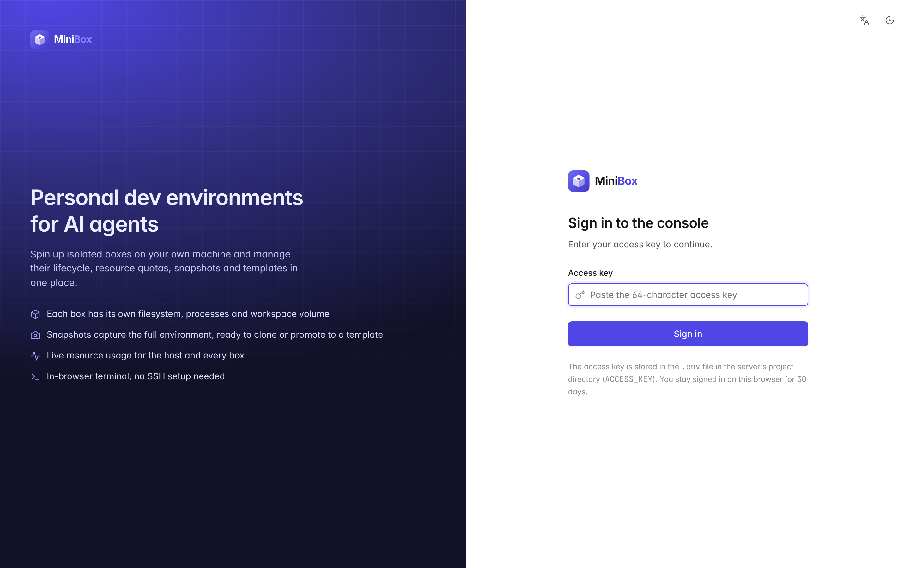
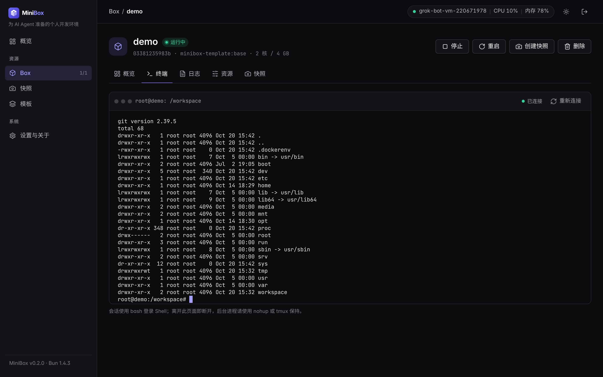
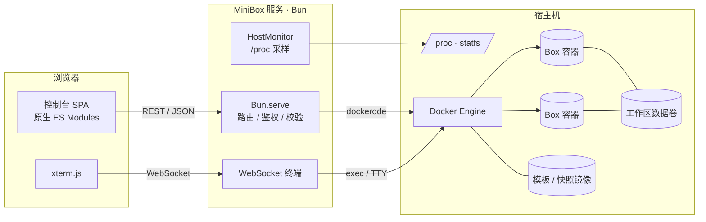

<p align="center">
  
</p>

<p align="center"><strong>为 AI Agent 准备的个人开发环境</strong></p>

<p align="center">
  在自己的机器上用 Docker 创建隔离的 Box，统一管理生命周期、资源配额、快照与模板。<br />
  灵感来自 <a href="https://upstash.com/docs/box">Upstash Box</a>，面向个人自托管场景。
</p>


## 目录

- [功能](#功能)
- [截图](#截图)
- [架构](#架构)
- [快速开始](#快速开始)
- [配置](#配置)
- [API 参考](#api-参考)
- [安全须知](#安全须知)
- [项目结构](#项目结构)
- [开发](#开发)
- [许可证](#许可证)

## 功能

| 模块 | 说明 |
|---|---|
| Box 生命周期 | 创建、启动、停止、重启、删除；删除时可选择保留或一并删除工作区数据卷 |
| 资源配额 | 创建时按预设（小型 2 核 4 GB / 中型 4 核 8 GB / 大型 8 核 16 GB）或自定义设置 CPU、内存，并按宿主机容量校验；运行中可热更新 |
| 快照 | 基于 `docker commit` 保存 Box 的系统环境，可从快照创建新 Box，或提升为模板 |
| 模板 | 内置基础模板（Debian 12 · Node.js 24 · Python 3 · git · build-essential），支持自定义模板 |
| 宿主机监控 | CPU 使用率、负载、内存、磁盘、运行时长、Docker 状态、Box 配额与宿主机容量对比，CPU / 内存迷你折线图 |
| Box 监控 | 每个 Box 的实时 CPU / 内存占用（相对配额）与历史曲线 |
| 网页终端 | 基于 xterm.js + WebSocket 的交互式 bash，支持窗口自适应 |
| 日志 | 查看容器主进程输出，支持行数选择与自动刷新 |
| 访问控制 | 单一访问密钥，HttpOnly Cookie 或 `Authorization: Bearer`；登录失败限流 |
| 界面 | 浅色 / 深色主题（跟随系统，可手动切换）、响应式布局、空状态、骨架屏、操作提示与危险操作确认 |

所有状态都保存在 Docker 的 label、镜像和数据卷中，**不需要额外的数据库**。

## 截图

| 登录 | Box 列表 |
|---|---|
|  |  |
| **创建 Box** | **Box 详情** |
|  |  |
| **网页终端（深色）** | **概览（深色）** |
|  |  |

更多截图见 [`docs/screenshots`](docs/screenshots)。

## 架构



- **Box** = 带 `minibox=true` 标签的容器，常驻进程为 `sleep infinity`，工作区 `/workspace` 挂载在独立数据卷 `minibox-ws-<名称>`。
- **快照** = 带 `minibox.snapshot=true` 标签的镜像 `minibox-snap:<名称>-<时间>`。
- **模板** = 带 `minibox.template=true` 标签的镜像 `minibox-template:<名称>`。
- 前端无构建步骤，原生 ES Modules + 手写设计系统；终端组件从 jsDelivr CDN 加载。

## 快速开始

依赖：Linux、Docker Engine、[Bun](https://bun.sh) ≥ 1.2。

```bash
git clone https://github.com/ArnoChenFx/minibox.git
cd minibox
bun install

# 构建内置基础模板（也可以稍后在控制台「模板」页构建）
bun run build:template

# 启动（默认监听 127.0.0.1:3920）
bun start
```

首次启动时若未配置 `ACCESS_KEY`，会自动生成一个 64 位十六进制密钥并写入 `.env`（权限 600）：

```bash
grep ACCESS_KEY .env
```

浏览器打开 <http://127.0.0.1:3920>，输入密钥登录。

### 后台运行

没有 systemd 的环境（容器、云端沙箱）可使用辅助脚本，它会依次确保 dockerd、基础模板、MiniBox 服务和 OpenTunnel 隧道都在运行：

```bash
scripts/restart.sh            # 包含隧道
scripts/restart.sh --no-tunnel
```

有 systemd 时，推荐写一个服务单元执行 `bun /path/to/minibox/src/server.ts`。

### 远程访问

服务默认只监听本机。需要远程访问时，请通过 HTTPS 隧道或反向代理暴露，例如 [OpenTunnel](https://opentunnel.xyz)：

```bash
opentunnel route add 3920 --name minibox
opentunnel up
```

## 配置

配置优先级：进程环境变量 > `.env` 文件 > 默认值。参考 [`.env.example`](.env.example)。

| 变量 | 默认值 | 说明 |
|---|---|---|
| `ACCESS_KEY` | 首次启动自动生成 | 访问密钥，登录与 API 鉴权使用 |
| `HOST` | `127.0.0.1` | 监听地址 |
| `PORT` | `3920` | 监听端口 |
| `DOCKER_SOCKET` | `/var/run/docker.sock` | Docker Engine Socket 路径 |
| `LABEL_PREFIX` | `minibox` | 容器 / 镜像 / 数据卷的标签与命名前缀 |
| `BASE_TEMPLATE` | `<前缀>-template:base` | 默认模板镜像 |
| `METRICS_INTERVAL_MS` | `3000` | 宿主机采样间隔（毫秒） |
| `METRICS_HISTORY` | `120` | 保留的历史采样点数量（默认约 6 分钟） |
| `LOG_LEVEL` | `info` | 日志级别：`debug` / `info` / `warn` / `error` |

## API 参考

除标注「公开」外，所有接口都需要登录 Cookie 或 `Authorization: Bearer <ACCESS_KEY>`。

请求与响应均为 JSON。出错时返回对应的 HTTP 状态码和统一结构：

```json
{ "error": { "code": "validation_failed", "message": "CPU 核数须在 0.1 到 64 之间。", "details": { "field": "cpus" } } }
```

常见错误码：`validation_failed`（400）、`unauthorized`（401）、`not_found`（404）、`method_not_allowed`（405）、`conflict`（409）、`insufficient_capacity`（422）、`too_many_requests`（429）、`docker_error`（502）、`docker_unavailable`（503）。

### 认证与系统

| 方法 | 路径 | 说明 |
|---|---|---|
| `POST` | `/api/auth/login` | 公开。请求体 `{ "key": "..." }`，成功后写入 HttpOnly Cookie |
| `POST` | `/api/auth/logout` | 公开。清除 Cookie |
| `GET` | `/api/auth/session` | 公开。返回 `{ "authenticated": boolean }` |
| `GET` | `/api/health` | 公开。返回 `{ "ok": true, "docker": boolean }`，Docker 不可用时为 503 |
| `GET` | `/api/system` | 版本、运行时、非敏感配置与限制 |
| `GET` | `/api/host/metrics` | 宿主机指标与历史采样 |
| `GET` | `/api/activity` | 最近操作记录 |

### Box

| 方法 | 路径 | 说明 |
|---|---|---|
| `GET` | `/api/boxes?stats=false` | 列表；默认附带运行中 Box 的实时占用 |
| `POST` | `/api/boxes` | 创建并启动。`{ "name", "template"?, "cpus"?, "memoryMb"? }`，默认 2 核 / 4096 MB |
| `GET` | `/api/boxes/:id` | 详情（含实时占用） |
| `DELETE` | `/api/boxes/:id?deleteVolume=true` | 删除；可选同时删除工作区数据卷 |
| `POST` | `/api/boxes/:id/start` · `stop` · `restart` | 生命周期操作 |
| `PATCH` | `/api/boxes/:id/resources` | 热更新配额 `{ "cpus"?, "memoryMb"? }` |
| `GET` | `/api/boxes/:id/stats` | 实时占用 |
| `GET` | `/api/boxes/:id/logs?tail=300` | 容器日志（1–5000 行） |
| `POST` | `/api/boxes/:id/snapshots` | 创建快照 `{ "name"? }` |
| `GET` (WS) | `/api/boxes/:id/terminal` | WebSocket 终端；发送 `{"type":"resize","cols":N,"rows":N}` 调整窗口，其余消息作为输入 |

`:id` 可以是容器 ID 或容器名（`minibox-<名称>`）。

### 快照与模板

`:ref` 为镜像引用（如 `minibox-snap:demo-20261020-154259`），需要 URL 编码。

| 方法 | 路径 | 说明 |
|---|---|---|
| `GET` | `/api/snapshots` | 快照列表 |
| `DELETE` | `/api/snapshots/:ref` | 删除快照 |
| `POST` | `/api/snapshots/:ref/boxes` | 从快照创建 Box `{ "name", "cpus"?, "memoryMb"? }` |
| `POST` | `/api/snapshots/:ref/promote` | 提升为模板 `{ "name", "description"? }` |
| `GET` | `/api/templates` | 模板列表 |
| `POST` | `/api/templates/base/build` | 构建内置基础模板 |
| `DELETE` | `/api/templates/:ref` | 删除模板 |

示例：

```bash
KEY=$(grep ACCESS_KEY .env | cut -d= -f2)
curl -s -H "Authorization: Bearer $KEY" -H 'content-type: application/json' \
  -d '{"name":"agent-dev","cpus":2,"memoryMb":4096}' http://127.0.0.1:3920/api/boxes
docker exec -it minibox-agent-dev bash
```

## 安全须知

- **访问密钥等同于宿主机 root 权限**：MiniBox 通过 Docker Socket 管理容器，拿到密钥的人可以在宿主机上创建任意容器。请妥善保管 `.env`，不要提交到版本库（已在 `.gitignore` 中忽略）。
- 服务默认只监听 `127.0.0.1`。对外访问务必经过 HTTPS（隧道或反向代理）；登录 Cookie 在 HTTPS 下带 `Secure` 标记。
- 公开隧道的域名可能被扫描发现，访问密钥是唯一门禁。登录失败会按 IP 限流（5 分钟内最多 10 次）。
- 更换密钥：修改 `.env` 中的 `ACCESS_KEY` 后重启服务，现有会话立即失效。
- Box 基于容器隔离（共享宿主机内核），适合个人使用自己的 Agent，**不适合运行不可信的第三方代码**。需要更强隔离时可考虑 gVisor 或 Firecracker 方案。
- 快照不包含 `/workspace` 数据卷，重要代码请通过 git 同步或单独备份数据卷。

## 项目结构

```text
minibox/
├── src/
│   ├── server.ts            # 入口：Bun.serve、静态资源、WebSocket、优雅退出
│   ├── app.ts               # 应用上下文（配置、Docker、监控、操作记录）
│   ├── config.ts            # 环境变量 / .env 配置
│   ├── auth.ts              # 密钥校验、Cookie、登录限流
│   ├── labels.ts            # Docker 标签键与解析
│   ├── activity.ts          # 最近操作记录
│   ├── static.ts            # 静态文件服务（防目录穿越）
│   ├── docker/              # client / boxes / snapshots / templates / images / stats
│   ├── host/                # procfs 解析、HostMonitor 采样
│   ├── routes/              # router 与各组路由（auth / system / boxes / images）
│   ├── ws/terminal.ts       # WebSocket 终端
│   └── lib/                 # errors / http / logger / validation
├── web/
│   ├── index.html · login.html
│   ├── css/app.css          # 设计系统（变量、组件、浅色 / 深色）
│   ├── js/                  # app、pages/*、components/*、lib/*
│   └── assets/              # logo、favicon、图标
├── templates/base/Dockerfile
├── tests/                   # bun test 单元测试
├── scripts/restart.sh       # 无 systemd 环境的重启脚本
└── docs/screenshots/
```

## 开发

```bash
bun run dev        # 监听文件变化自动重启
bun run typecheck  # TypeScript 严格模式类型检查
bun run lint       # Biome 检查（格式 + lint）
bun run format     # 自动修复格式
bun test           # 单元测试
bun run check      # 以上全部
```

提交信息遵循 [Conventional Commits](https://www.conventionalcommits.org/zh-hans/)。变更记录见 [CHANGELOG.md](CHANGELOG.md)。

## 许可证

[MIT](LICENSE) © 2026 Arno Chen
