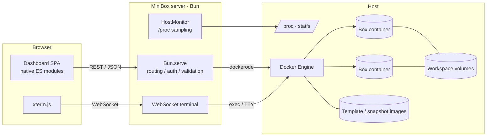
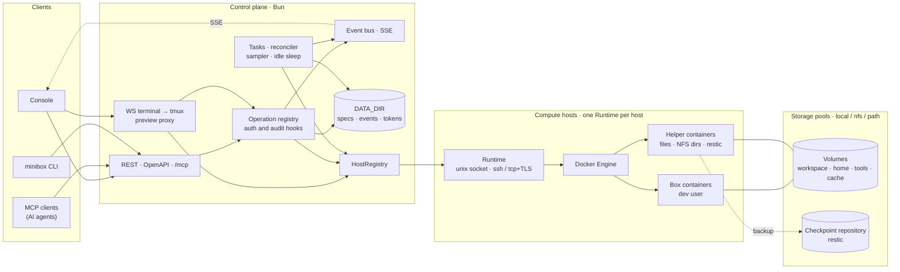

<p align="center">
  <picture>
    <source media="(prefers-color-scheme: dark)" srcset="web/assets/logo-dark.svg" />
    
  </picture>
</p>

<p align="center"><strong>Personal, self-hosted dev environments for AI agents — Docker boxes with a dashboard.</strong></p>

<p align="center">
  <a href="https://github.com/ArnoChenFx/minibox/actions/workflows/ci.yml"></a>
  <a href="LICENSE"></a>
  <a href="https://bun.sh"></a>
  
</p>

<p align="center"><b>English</b> | <a href="README-zh.md">简体中文</a></p>


## What is MiniBox?

MiniBox lets you spin up isolated **boxes** — long-running Docker containers with their own filesystem, process tree and a persistent `/workspace` volume — on your own machine, and manage them from a web dashboard or a small REST API. It is inspired by [Upstash Box](https://upstash.com/docs/box), scaled down for a single person who wants throwaway, reproducible workspaces for coding agents (Claude Code, Codex, OpenHands, your own scripts, …) without running a multi-tenant platform.

**Why?**

- Agents make a mess: random global installs, half-finished builds, stray processes. A box keeps that off your host and can be reset, snapshotted or deleted in one click.
- Hosted sandboxes are great, but sometimes you want your own hardware, your own network and zero per-minute billing.
- Heavier self-hosted options (Firecracker-based sandboxes, Coder, Kubernetes operators) are overkill for one person. MiniBox is a single Bun process talking to the local Docker Engine — **no database**, all state lives in Docker labels, images and volumes.

## Features

| Area | What you get |
|---|---|
| Box lifecycle | Create, start, stop, restart, delete; on delete, keep or remove the workspace volume |
| Resource quotas | Presets (Small 2 vCPU / 4 GB, Medium 4 vCPU / 8 GB, Large 8 vCPU / 16 GB) or custom CPU & memory, validated against host capacity; live-updatable while running (`docker update`) |
| Snapshots | Save a box's system environment via `docker commit`, create new boxes from a snapshot, or promote it to a template |
| Templates | Bundled base template (Debian 12 · Node.js 24 · Python 3 · git · build-essential) plus your own promoted templates |
| Host monitoring | CPU usage, load average, memory, disk (root & Docker data dir), uptime, Docker status, allocated quota vs. host capacity, CPU/memory sparklines |
| Per-box monitoring | Live CPU / memory usage relative to the box quota, with history charts |
| Web terminal | Interactive bash over WebSocket with xterm.js, auto-resizes with the window |
| Logs | Main-process output with selectable line count and auto-refresh |
| Access control | Single access key via HttpOnly cookie or `Authorization: Bearer`; login rate limiting per IP |
| Languages | English and Simplified Chinese; toggle with the language icon button in the top-right corner (console header and login page). Defaults to the browser language and is remembered per browser |
| UI | Light / dark theme (follows the system, manual toggle), responsive layout, empty states, skeleton loaders, toasts, confirmation for destructive actions |

## Screenshots

| Box list | Create a box |
|---|---|
|  |  |
| **Box detail** | **Web terminal** |
|  |  |
| **Snapshots** | **Overview (dark)** |
|  |  |

More in [`docs/screenshots`](docs/screenshots).

## Architecture

### Current (v0.3)



- **Box** = a container labeled `minibox=true`, named `minibox-<name>`, running `sleep infinity` (with `--init`, restart policy `unless-stopped`). `/workspace` is mounted from a dedicated volume `minibox-ws-<name>`.
- **Snapshot** = an image `minibox-snap:<name>-<timestamp>` labeled `minibox.snapshot=true`.
- **Template** = an image `minibox-template:<name>` labeled `minibox.template=true`.
- The frontend has no build step: plain ES modules and a hand-written design system. xterm.js is loaded from the jsDelivr CDN.

(`minibox` is the default `LABEL_PREFIX`; all names and labels follow the prefix.)

### Target architecture (planned)

> [!NOTE]
> Planned, not implemented yet. The full design and its rationale are in [`docs/design.md`](docs/design.md) (in Chinese).



- **Box** = a spec in `DATA_DIR` plus one container. Container labels hold only what cannot change after creation.
- **Volume** belongs to a storage pool, not to a box. `cache` volumes stay on the local pool and are excluded from checkpoints.
- **Checkpoint** = box spec + volume snapshots (restic) + an optional system layer.
- **Helper containers** are short-lived. They serve file operations, create NFS directories and run restic.
- Boxes run as the non-root `dev` user under one of two security profiles, `standard` or `strict`.
- The MiniBox Agent and storage-node roles are not on the main path, so they are not drawn.

## Requirements

- Linux host with Docker Engine (the server reads `/proc` for host metrics)
- [Bun](https://bun.sh) ≥ 1.2
- Read/write access to the Docker socket for the user running MiniBox
- A browser that can reach `cdn.jsdelivr.net` (for the web terminal)

## Quick start

```bash
git clone https://github.com/ArnoChenFx/minibox.git
cd minibox
bun install
cp .env.example .env          # optional; every value has a default

# Build the bundled base template (you can also do this later from the Templates page)
bun run build:template

# Start (listens on 127.0.0.1:3920 by default)
bun start
```

If `ACCESS_KEY` is empty, MiniBox generates a random 64-character hex key on first start and writes it to `.env` (mode `600`):

```bash
grep ACCESS_KEY .env
```

Open <http://127.0.0.1:3920> and sign in with that key.

> [!TIP]
> When the key is auto-generated, `.env` is rewritten with only `ACCESS_KEY`, `PORT` and `HOST`. Set your other options after the first start, or put a key into `.env` yourself (e.g. `openssl rand -hex 32`).

### Running in the background

On hosts without systemd (containers, cloud sandboxes), use the helper script. It is idempotent and makes sure, in order, that `dockerd` is running (started via `sudo` if needed), the base template exists, the MiniBox server is (re)started and healthy, and an OpenTunnel tunnel is up if the `opentunnel` CLI is installed:

```bash
scripts/restart.sh              # include the tunnel
scripts/restart.sh --no-tunnel  # server only
```

Server output goes to `server.log` in the project root (git-ignored).

With systemd, a simple service unit running `bun /path/to/minibox/src/server.ts` is the recommended setup.

### Remote access

MiniBox only listens on localhost by default. To reach it from elsewhere, put it behind HTTPS — a reverse proxy, a private network such as Tailscale, or a tunnel like [OpenTunnel](https://opentunnel.xyz):

```bash
opentunnel route add 3920 --name minibox
opentunnel up
# → https://minibox.<your-id>.opentunnel.xyz
```

Read the [security notes](#security) before exposing it.

### Docker

Release images are published to GitHub Container Registry for `linux/amd64` and `linux/arm64`:

```bash
docker run -d --name minibox --restart unless-stopped \
  -p 127.0.0.1:3920:3920 \
  -e ACCESS_KEY="$(openssl rand -hex 32)" \
  -v /var/run/docker.sock:/var/run/docker.sock \
  ghcr.io/arnochenfx/minibox:latest
```

- MiniBox manages boxes through the host's Docker Engine, so the Docker socket **must** be mounted (`-v /var/run/docker.sock:/var/run/docker.sock`). Boxes are created as sibling containers on the host, not inside the MiniBox container.
- Always pass `ACCESS_KEY`; otherwise a random key is generated inside the container and lost on recreation (`docker logs minibox` shows only its first 4 characters).
- Inside the container MiniBox listens on `0.0.0.0:3920` (`HOST=0.0.0.0`); publish it on `127.0.0.1` as above and use HTTPS for remote access.
- Tags: `X.Y.Z`, `X.Y` and `latest` (pre-releases such as `1.0.0-rc.1` only get their exact tag).
- Build locally: `docker build --build-arg MINIBOX_VERSION=0.3.0 -t minibox .`

## Configuration

Precedence: process environment > `.env` file > defaults. See [`.env.example`](.env.example).

| Variable | Default | Description |
|---|---|---|
| `ACCESS_KEY` | generated on first start | Access key for the dashboard and API |
| `HOST` | `127.0.0.1` | Listen address |
| `PORT` | `3920` | Listen port |
| `DOCKER_SOCKET` | `/var/run/docker.sock` | Docker Engine socket path |
| `LABEL_PREFIX` | `minibox` | Prefix for labels and container / image / volume names |
| `BASE_TEMPLATE` | `<prefix>-template:base` | Default template image for new boxes |
| `METRICS_INTERVAL_MS` | `3000` | Host metrics sampling interval (ms) |
| `METRICS_HISTORY` | `120` | Number of samples kept (≈ 6 minutes at the default interval) |
| `LOG_LEVEL` | `info` | `debug` / `info` / `warn` / `error` |
| `MINIBOX_VERSION` | from git / `package.json` | Override the displayed version (set automatically in release images) |

> `bun run build:template` always tags `minibox-template:base`. If you change `LABEL_PREFIX` or `BASE_TEMPLATE`, build the base template from the dashboard (Templates → Build base template) instead, which uses the configured tag.

## API reference

All endpoints are JSON. Everything except those marked **public** requires either the session cookie (set by `/api/auth/login`) or an `Authorization: Bearer <ACCESS_KEY>` header.

Errors use a consistent shape and the matching HTTP status:

```json
{ "error": { "code": "validation_failed", "message": "…", "details": { "field": "cpus" } } }
```

Common codes: `validation_failed` (400), `unauthorized` (401), `not_found` (404), `method_not_allowed` (405), `conflict` (409), `insufficient_capacity` (422), `too_many_requests` (429), `docker_error` (502), `docker_unavailable` (503). Error messages are currently in Chinese.

### Auth & system

| Method | Path | Description |
|---|---|---|
| `POST` | `/api/auth/login` | **Public.** Body `{ "key": "..." }`; sets an HttpOnly cookie (30 days). Max 10 failures per IP per 5 min |
| `POST` | `/api/auth/logout` | **Public.** Clears the cookie |
| `GET` | `/api/auth/session` | **Public.** `{ "authenticated": boolean }` |
| `GET` | `/api/health` | **Public.** `{ "ok": true, "docker": boolean }`; `503` when Docker is unreachable |
| `GET` | `/api/system` | Version, runtime, non-secret config and limits |
| `GET` | `/api/host/metrics` | Host metrics with sample history |
| `GET` | `/api/activity` | Recent operations (in memory, cleared on restart) |

### Boxes

| Method | Path | Description |
|---|---|---|
| `GET` | `/api/boxes?stats=false` | List boxes; live usage of running boxes is included unless `stats=false` |
| `POST` | `/api/boxes` | Create and start. `{ "name", "template"?, "cpus"?, "memoryMb"? }`; defaults 2 vCPU / 4096 MB |
| `GET` | `/api/boxes/:id` | Details, including live usage |
| `DELETE` | `/api/boxes/:id?deleteVolume=true` | Delete; optionally delete the workspace volume too |
| `POST` | `/api/boxes/:id/start` · `/stop` · `/restart` | Lifecycle actions |
| `PATCH` | `/api/boxes/:id/resources` | Live-update quota `{ "cpus"?, "memoryMb"? }` |
| `GET` | `/api/boxes/:id/stats` | Live usage |
| `GET` | `/api/boxes/:id/logs?tail=300` | Container logs (1–5000 lines) |
| `POST` | `/api/boxes/:id/snapshots` | Create a snapshot `{ "name"? }` |
| `GET` (WS) | `/api/boxes/:id/terminal` | WebSocket terminal. Send `{"type":"resize","cols":N,"rows":N}` to resize; any other message is stdin |

`:id` is a container ID or container name (`minibox-<name>`). Limits: CPU 0.1–64, memory 128–262144 MB, and a single box may not exceed the host's cores or total memory. Names must match `^[a-zA-Z0-9][a-zA-Z0-9_.-]{0,62}$`.

### Snapshots & templates

`:ref` is an image reference (e.g. `minibox-snap:demo-20261020-154259`) and must be URL-encoded.

| Method | Path | Description |
|---|---|---|
| `GET` | `/api/snapshots` | List snapshots |
| `DELETE` | `/api/snapshots/:ref` | Delete a snapshot |
| `POST` | `/api/snapshots/:ref/boxes` | Create a box from a snapshot `{ "name", "cpus"?, "memoryMb"? }` |
| `POST` | `/api/snapshots/:ref/promote` | Promote to a template `{ "name", "description"? }` |
| `GET` | `/api/templates` | List templates |
| `POST` | `/api/templates/base/build` | Build the bundled base template |
| `DELETE` | `/api/templates/:ref` | Delete a template |

Only images carrying MiniBox labels can be deleted through the API.

### Example

```bash
KEY=$(grep ACCESS_KEY .env | cut -d= -f2)
curl -s -H "Authorization: Bearer $KEY" -H 'content-type: application/json' \
  -d '{"name":"agent-dev","cpus":2,"memoryMb":4096}' http://127.0.0.1:3920/api/boxes

# Then work inside it, e.g. from an agent's shell tool:
docker exec -it minibox-agent-dev bash
```

## Project structure

```text
minibox/
├── src/
│   ├── server.ts            # Entry: Bun.serve, static files, WebSocket upgrade, graceful shutdown
│   ├── app.ts               # App context (config, Docker, monitor, activity log)
│   ├── config.ts            # Env / .env loading, key generation
│   ├── auth.ts              # Key check, cookies, login throttle
│   ├── labels.ts            # Docker label keys and parsers
│   ├── activity.ts          # Recent-operations log
│   ├── static.ts            # Static file serving (path-traversal safe)
│   ├── docker/              # client / boxes / snapshots / templates / images / stats
│   ├── host/                # procfs parsers, HostMonitor sampler
│   ├── routes/              # Router and route groups (auth / system / boxes / images)
│   ├── ws/terminal.ts       # WebSocket terminal
│   └── lib/                 # errors / http / logger / validation
├── web/
│   ├── index.html · login.html
│   ├── css/app.css          # Design system (tokens, components, light / dark)
│   ├── js/                  # app, pages/*, components/*, lib/*
│   └── assets/              # Logo, favicons, icons
├── templates/base/Dockerfile
├── tests/                   # bun test unit tests
├── scripts/restart.sh       # Restart helper for hosts without systemd
├── Dockerfile               # Release image (oven/bun, multi-arch)
├── .github/workflows/release.yml  # Tag → image + GitHub Release
└── docs/screenshots/
```

## Development

```bash
bun run dev        # Restart on file changes
bun run fmt        # Format with oxfmt (writes files)
bun run fmt:check  # Check formatting only
bun run lint       # oxlint (warnings fail the run)
bun run typecheck  # TypeScript (strict, tsc --noEmit)
bun test           # Unit tests (no Docker needed)
bun run check      # All of the above, same as CI
```

Formatting uses [oxfmt](https://oxc.rs/docs/guide/usage/formatter.html) (`.oxfmtrc.json`) and linting uses [oxlint](https://oxc.rs/docs/guide/usage/linter.html) (`.oxlintrc.json`). [CI](.github/workflows/ci.yml) runs `fmt:check`, `lint`, `typecheck` and `bun test` on every push to `main` and every pull request, plus a Docker build smoke test that starts the image and probes `/login`.

Commits follow [Conventional Commits](https://www.conventionalcommits.org/). See [CHANGELOG.md](CHANGELOG.md).

## Releasing

Versions follow [SemVer](https://semver.org/). The version shown in the dashboard and `/api/system` is resolved at runtime: `MINIBOX_VERSION` (set in release images from the tag) → `git describe --tags` (in a checkout, e.g. `0.3.0-2-gabc1234`) → `package.json`.

1. Bump `version` in `package.json` and add a section for it to `CHANGELOG.md`.
2. Commit and push to `main`.
3. Tag and push:

   ```bash
   git tag v0.3.0 && git push origin v0.3.0
   ```

The [release workflow](.github/workflows/release.yml) then runs the same CI checks, verifies that the tag matches `package.json`, builds and pushes the multi-arch image to `ghcr.io/arnochenfx/minibox`, and creates a GitHub Release using the matching CHANGELOG section plus auto-generated notes. Tags with a pre-release suffix (`v1.0.0-rc.1`) are marked as pre-releases and don't move `latest`.

## Security

MiniBox is built for **one trusted user on their own machine**. Please read this before exposing it.

- **The Docker socket is root.** MiniBox controls Docker through its socket, so anyone holding the access key can effectively run anything on the host as root. Treat the key like a root password. `.env` is git-ignored — keep it that way.
- **The access key is the only guard.** There are no user accounts. Login failures are rate-limited per IP (10 per 5 minutes) and the key is compared in constant time, but a leaked key means full access. To rotate it, change `ACCESS_KEY` in `.env` and restart; existing sessions stop working immediately.
- **Bind to `127.0.0.1`** (the default). Don't set `HOST=0.0.0.0` on a machine with a public IP.
- **Use HTTPS for remote access.** The session cookie gets the `Secure` flag when the request arrives over HTTPS (including behind TLS-terminating proxies that set `X-Forwarded-Proto`).
- **Public tunnels are discoverable.** Tunnel hostnames (e.g. OpenTunnel's `*.opentunnel.xyz`) can show up in public Certificate Transparency logs or be guessed, and OpenTunnel itself does not add authentication — the dashboard is effectively on the internet, protected only by the access key. Traffic also passes through the tunnel's relay. Prefer a private network (e.g. Tailscale) or an authenticating reverse proxy when you can, and stop the tunnel when you don't need it.
- **Container isolation, not a security sandbox.** Boxes share the host kernel. They are fine for your own agents, but **not for untrusted third-party code** — use gVisor or a microVM-based sandbox for that. Don't mount the Docker socket or sensitive host paths into a box.
- **Snapshots don't include `/workspace`.** `docker commit` skips mounted volumes; keep code in git or back up the volume separately.
- `scripts/restart.sh` may start `dockerd` with `sudo` and `chmod 666` the Docker socket so a non-root user can reach it. That's convenient on a single-user sandbox but loosens permissions; review it before using it elsewhere.

## Roadmap

The full product and architecture design (in Chinese) is in [`docs/design.md`](docs/design.md); the implementation plan is tracked in [#20](https://github.com/ArnoChenFx/minibox/issues/20). Planned work is grouped into milestones, and each item links to its issue.

### M0 · Foundations

Order: the first PR packages the changes already written for #1, #3 and #4; then #32, #6 and #18 run in parallel, and #22 comes last.

- [ ] [#1](https://github.com/ArnoChenFx/minibox/issues/1) Login rate limiting: proxy headers are trusted only with `TRUST_PROXY`
- [ ] [#3](https://github.com/ArnoChenFx/minibox/issues/3) Origin checks for WebSocket and write endpoints
- [ ] [#4](https://github.com/ArnoChenFx/minibox/issues/4) CSP and HSTS; self-host xterm.js instead of the CDN
- [ ] [#32](https://github.com/ArnoChenFx/minibox/issues/32) Runtime / Host abstraction (implicit `local`, no behavior change)
- [ ] [#6](https://github.com/ArnoChenFx/minibox/issues/6) `DATA_DIR` for control-plane state; the generated access key moves out of `.env`
- [ ] [#18](https://github.com/ArnoChenFx/minibox/issues/18) Dependabot, a pinned Bun version and branch protection
- [ ] [#22](https://github.com/ArnoChenFx/minibox/issues/22) One operation registry that generates REST, OpenAPI, MCP and CLI

### M1 · Templates, specs, audit and tokens

- [ ] [#27](https://github.com/ArnoChenFx/minibox/issues/27) Base template: non-root `dev` user, tmux and mount-point conventions
- [ ] [#5](https://github.com/ArnoChenFx/minibox/issues/5) Box hardening with `standard` and `strict` security profiles
- [ ] [#23](https://github.com/ArnoChenFx/minibox/issues/23) Box specs: declarative state, stable IDs, rebuilds and rollback
- [ ] [#25](https://github.com/ArnoChenFx/minibox/issues/25) Event store and audit trail (SQLite, redaction) on an event bus
- [ ] [#16](https://github.com/ArnoChenFx/minibox/issues/16) Async tasks with progress streams
- [ ] [#13](https://github.com/ArnoChenFx/minibox/issues/13) Scoped agent tokens: `created-by-me`, quotas and TTL
- [ ] [#2](https://github.com/ArnoChenFx/minibox/issues/2) Revocable session tokens instead of the raw access key in cookies

### M2 · Storage and agent interface

- [ ] [#24](https://github.com/ArnoChenFx/minibox/issues/24) Volumes and storage pools (`local`, `nfs`, `path`)
- [ ] [#9](https://github.com/ArnoChenFx/minibox/issues/9) Exec and file API for agents, with an MCP server and CLI
- [ ] [#14](https://github.com/ArnoChenFx/minibox/issues/14) tmux sessions with human takeover
- [ ] [#17](https://github.com/ArnoChenFx/minibox/issues/17) Stream box state and resource usage over SSE instead of polling
- [ ] [#30](https://github.com/ArnoChenFx/minibox/issues/30) NAS / NFS setup guide

### M3 · Core value

- [ ] [#11](https://github.com/ArnoChenFx/minibox/issues/11) Checkpoints with restic: fork, rollback and retention
- [ ] [#10](https://github.com/ArnoChenFx/minibox/issues/10) Port preview for dev servers running inside boxes
- [ ] [#8](https://github.com/ArnoChenFx/minibox/issues/8) Optional agent CLI install at creation or at runtime

### M4 · Multi-host and optimization

- [ ] [#21](https://github.com/ArnoChenFx/minibox/issues/21) Multi-host support over SSH or TLS
- [ ] [#12](https://github.com/ArnoChenFx/minibox/issues/12) Idle auto-sleep with on-demand wake
- [ ] [#15](https://github.com/ArnoChenFx/minibox/issues/15) Template enhancements and warm pool

### Across all milestones

- [ ] [#26](https://github.com/ArnoChenFx/minibox/issues/26) Console redesign, shipped page by page
- [ ] [#19](https://github.com/ArnoChenFx/minibox/issues/19) Integration tests for the Docker layer and routes
- [ ] [#7](https://github.com/ArnoChenFx/minibox/issues/7) Low-risk security hardening

### Later / under evaluation

Not on the main path. Each needs a scope review before work starts.

- [#28](https://github.com/ArnoChenFx/minibox/issues/28) MiniBox Agent framework: pairing, mTLS and an outbound channel
- [#29](https://github.com/ArnoChenFx/minibox/issues/29) Storage-node role for NAS and Linux storage servers: directories, quotas, snapshots
- Host-side secret injection: keep API keys on the host instead of in box environment variables (no tracking issue yet)

## License

[MIT](LICENSE) © 2026 Arno Chen
