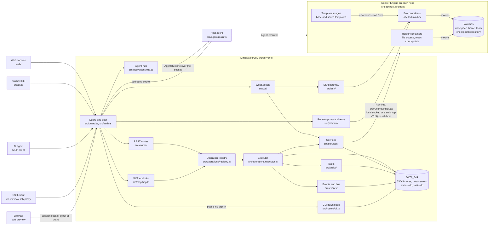

# Architecture

MiniBox is one Bun process. It serves the web console, the REST API, the MCP endpoint, the CLI downloads, the terminal and SSH WebSockets, and port previews. It does all container work through the Docker Engine API. Its own state is plain JSON files and two SQLite databases in `DATA_DIR`.



The same links as text, one line per path:

```text
REST      Web / CLI → src/routes/operations.ts → app.operations.run → src/operations/executor.ts → src/services/ → Runtime → src/docker/
MCP       MCP client → src/mcp/http.ts → app.operations.run → the same executor → the same services
Agent     executor → src/host/agent/runtime.ts (AgentRuntime) → src/host/agent/hub.ts → /api/agent/connect → src/agent/executor.ts → Docker on that host
Tasks     executor → src/tasks/manager.ts → src/tasks/store.ts → app.bus ("task") → src/tasks/stream.ts → GET /api/tasks/:id/events → Web
Events    executor / services → src/events/store.ts → app.bus ("event") → src/events/stream.ts → GET /api/events/stream → Web
Terminal  Browser → GET /api/boxes/:id/terminal (WS) → src/ws/terminal.ts → src/services/terminal-service.ts → tmux attach exec in the box
SSH       SSH client → minibox ssh-proxy → GET /api/ssh/:box (WS) → src/ssh/gateway.ts → src/ssh/connection.ts → exec in the box
Preview   Browser → /box/:ref/:port/ or a preview host → src/preview/proxy.ts → src/preview/relay.ts → relay exec in the box → 127.0.0.1:port
```

## Request path

1. `src/server.ts` routes each request. A request to a preview host goes to `src/preview/subdomain.ts` first, before the console's guard. Otherwise it serves console files from `web/`, CLI downloads under `/cli/`, path-mode port previews under `/box/<name>/<port>/`, the agent socket at `/api/agent/connect`, the terminal and SSH WebSockets, and the MCP and API paths described below. WebSocket upgrades are matched by path in `dispatch` itself, not by the route table.
2. `src/guard.ts` checks every request first, and refuses cross-site browser requests. `src/auth.ts` finds the caller from a bearer token, which is the access key or an agent token from `src/tokens/`, or from a browser session in `src/sessions.ts`. A box's own agent authenticates with its box `self` token from `src/tokens/self-store.ts`.
3. The REST routes in `src/routes/` and the MCP endpoint in `src/mcp/http.ts` both call `app.operations.run`. The executor in `src/operations/executor.ts` checks the caller's scopes, validates the input, runs the operation and writes an audit event to `events.db`.
4. Services in `src/services/` do the work. They read and write the stores in `DATA_DIR`, and they call the runtime in `src/runtime/`. The Docker implementation is `src/docker/runtime.ts`.
5. Long operations, such as template builds, checkpoints, rollbacks and tool installs, run as tasks in `src/tasks/`. They return `202` with a task ID at once, and their progress streams as server-sent events.

### The executor, step by step

`src/operations/executor.ts` is the only entry point for a registry operation, whichever interface called it. One run is:

1. **authorize, phase `scope`**: the hook in `src/tokens/authorize.ts` decides whether this principal may call this operation at all. The owner passes, a box's agent passes only for the `self` operations, and an agent token passes when its grants cover the operation's scope (`scopeAllowed` in `src/tokens/model.ts`). An operation with no access rule is refused for tokens, so a new operation is owner-only until it gets one.
2. **parse**: `operation.parse(raw)` is the operation's own zod schema (`src/operations/define.ts` wraps it around `parseInput` in `src/operations/validation.ts`). A validation failure is audited as `error` before any service runs.
3. **`hostFor`**, **`precondition`**, **`resolve`**: the operation may pick the host the target lives on (`src/operations/routing.ts`), refuse early (for example `refuseAgent`, below), and load the object the request names.
4. **authorize, phase `access`**: with the parsed input and the resolved object, the hook checks the box, volumes, host, profile and quotas. A `false` answer, or an operation's own rule raising a 403, is audited as `denied`.
5. **run**: `operation.run` calls the services. A synchronous operation returns its result; an async one goes to `startAsync`.
6. **audit**: exactly one event per execution, including refusals and failures (`recordAudit` in `src/app.ts` writes it to `src/events/store.ts` and publishes it on the bus). A write also reaches the activity feed when the operation declares `activity`.

A service may ask about one resource again while it runs: `ctx.authorize({ scope, resource })` in `src/operations/authz.ts` calls the same hook with phase `resource`, which is how a token's per-volume grants are enforced at the moment a volume is mounted or written.

### Where the registry's rules are checked

`src/operations/registry.ts` exports `OPERATIONS` and `registryProblems`. The checker claims every operation name, every `method path` REST binding, every OpenAPI `operationId`, every MCP tool name and every `cli` command name in its own set, and reports a duplicate, a path parameter or query key that is not an input, a `:path` outside `/api/`, a read bound to a write method, an async operation that does not answer `202`, and a write with no `activity`. `tests/operations.test.ts` asserts that `registryProblems(OPERATIONS)` is empty, so a duplicate route or CLI command fails CI rather than shadowing another at runtime. `Executor`'s constructor additionally throws on a duplicate operation name, because a name collision would make `run` ambiguous.

The CLI command names are not dispatched by the server: `src/cli.ts` is a hand-written REST client (`src/cli/box.ts`, `src/cli/volume.ts` and so on), and the registry's `cli` field is what ties each operation to the command documented for it: the registry checks that the command names stay unique (`src/operations/registry.ts`), and the OpenAPI document carries it as `x-cli`.

## One operation list, several interfaces

`src/operations/registry.ts` lists every operation. The REST routes, the MCP tools (`src/operations/projections.ts`) and the OpenAPI document in `docs/openapi.json` all come from that list. `bun run openapi` writes the document, through `scripts/export-openapi.ts`. Each operation carries its scope and, when it is an MCP tool, its toolset.

The REST adapter is generated too: `operationRoutes(OPERATIONS)` in `src/routes/operations.ts` builds one route per `rest` binding, and `src/routes/index.ts` appends them after the hand-written routes. A generated route only checks the operation's scope (`scopedAccess(operation.scope)` in `src/routes/router.ts`, applied by `routeAllows`); the executor checks the target, the profile, the volumes and the quotas. The handler reads the body, path, query, `If-Match` and `X-Minibox-Run` into the operation's input, calls `app.operations.run`, answers `202` for an async operation, and tags a box response with its revision as an `ETag`. A `stream` binding answers with bytes instead of JSON.

The MCP endpoint (`src/mcp/http.ts`) is streamable HTTP at `POST /mcp`, with no GET event stream. It requires a Bearer credential, never a session cookie, and applies `MCP_ALLOW_OWNER_KEY` to the owner access key. Every tool call goes through the same executor with `source: "mcp"` and the MCP session id as the `run`, so a token's scopes and grants apply exactly as they do on REST. `mcpTools(operations, toolsets)` in `src/operations/projections.ts` keeps the operations that name an MCP tool in an enabled toolset; `DEFAULT_TOOLSETS` is `core` and `meta`, `?toolsets=core,storage` opens more, and the accepted names are the `Toolset` union in `src/operations/types.ts`. A box's own agent defaults to the `self` toolset instead, and `callableBy` narrows the list to what the principal's scopes reach. A tool whose toolset is not enabled is answered as a tool error, not run.

The CLI is a REST client. `minibox mcp` relays standard input and output to `/mcp`. `minibox ssh-proxy` relays them to the SSH WebSocket at `/api/ssh/<box>`. The server also serves the CLI binaries under `/cli/`, which `src/routes/cli.ts` handles. An operation's `cli` name is metadata for the CLI reference, not a command generator: it is set only where `src/cli.ts` really dispatches that command, and `tests/operations.test.ts` runs each name through the real dispatcher so a `cli` value with no command behind it fails the build. A family that takes its subcommand as `argv[0]` (such as `exec`) or a command that refuses some subcommands (such as `tool custom`) is checked the same way, against what the dispatcher actually accepts.

## Hosts and engines

`src/host/registry.ts` holds one runtime for each host. The `local` host uses the Docker socket on the server. A remote host uses a `unix://`, `tcp://` or `ssh://` endpoint, which `src/host/endpoint.ts` parses. A `tcp://` host uses mutual TLS, and over `ssh://`, `src/host/ssh.ts` opens the tunnel.

An agent host has no endpoint to dial. Its `agent://<agent id>` endpoint is served by the agent on that machine, which opens an outbound WebSocket to `/api/agent/connect` (`src/agent/`). `src/host/agent/hub.ts` keeps the live connections and verifies each agent's signature, `src/host/agent/pairing.ts` holds the one-time pairing codes, and `src/host/agent/store.ts` keeps the agent records in `agents.json`. `src/host/agent/runtime.ts` sends each `Runtime` call over the connection, so an agent host is used like any other host.

Business code reaches an engine only through the `Runtime` interface in `src/runtime/index.ts`. Only `src/docker/` imports the Docker SDK, and `tests/architecture.test.ts` checks this.

Boxes are containers with the label prefix from `LABEL_PREFIX`, which defaults to `minibox`. They join the `<prefix>-boxes` network.

### Runtime, and the two things that implement it

`Runtime` (`src/runtime/index.ts`) is the whole engine surface: containers, exec, logs, events, images, volumes, networks, archives, helper containers and disk reads. Two implementations exist:

- **`src/docker/runtime.ts`** composes the method groups of `src/docker/` (`containers.ts`, `exec.ts`, `images.ts`, `volumes.ts`, `container-archive.ts`, `helpers.ts`, `system.ts` and the rest) over one `dockerode` client. It is the only module that talks to the Docker Engine API.
- **`src/host/agent/runtime.ts`** (`AgentRuntime`) implements the same interface over a socket. Operations an agent accepts become frames; operations it does not accept fail in the control plane with `unsupported`, so the caller gets the same answer whether or not the agent is reachable (`refused` in that file, mirroring `REFUSED_OPERATIONS`). A call the agent cannot answer, because it is not connected or did not answer in time, fails as `unavailable`.

`src/host/manager.ts` picks one of them per host when the host is registered: an `agent://` endpoint gets `agents.runtimeFor(agentId)`, anything else gets the Docker adapter over an opened link (`src/host/ssh.ts` for `ssh://`).

### The agent link, frame by frame

- The socket. `src/agent/main.ts` pairs once with a code (`POST /api/agent/pair`, `src/routes/agent.ts`, throttled like a failed login), then `src/agent/client.ts` keeps one connection open, reconnecting with backoff. The server takes the upgrade at `/api/agent/connect` in `src/server.ts` and hands it to `src/ws/agent.ts`, which passes each text frame to `AgentHub.attach`/`receive`. Binary frames are refused.
- The protocol. `src/agent/protocol.ts` defines `AGENT_PROTOCOL` (currently `1`), every frame as a zod schema, and the operation lists: `REQUEST_OPERATIONS` answer once, `STREAM_OPERATIONS` (`startExec`, `followLogs`, `events`) answer and then send items until `end`, and `SESSION_OPERATIONS` (`execResize`, `execInspect`, `execKill`) act on an open exec by the id of the `startExec` request that opened it.
- Server frames: `challenge`, `welcome`, `refused`, `request`, `input`, `input_end`, `cancel`. Agent frames: `hello`, `response`, `item`, `data`, `end`, `heartbeat`.
- The handshake. The hub sends a per-connection nonce in `challenge`; the agent signs `minibox-agent-hello\n<nonce>\n<agentId>\n<protocol>` with its Ed25519 key and answers `hello`. The hub verifies the signature against the record in `agents.json`, refuses a revoked agent, and refuses another protocol version with close code `4426` and `upgradeRequired` in the host view. A second connection for the same agent replaces the first (`4409`). A socket that sends no valid hello within `AGENT_HELLO_TIMEOUT_MS` is closed (`4408`), and one that goes silent for three heartbeats is dropped (`4410`). A socket that arrives while `AGENT_PENDING_MAX` (64) others still wait for a hello is closed (`4411`) before it is challenged: `AgentHub.attach` counts the sockets in `all` whose `agentId` is still null, so a flood of sockets that never say hello cannot hold one for 15 seconds each.
- The work. The agent runs each request through `src/agent/executor.ts` (`AgentExecutor`). It has its own zod schema per operation (`AGENT_OPERATION_NAMES`), so the wire is validated twice: once in the control plane's `AgentRuntime`, once on the agent's host. Anything not in that table is refused: an operation listed in `REFUSED_OPERATIONS` answers `unsupported`, an unknown name answers `invalid`. Its `Runtime` is the Docker adapter built in `src/agent/main.ts`. Which streams are open, and which ids have an operation still starting, is `src/agent/streams.ts` (`StreamRegistry`), not the executor: an id is starting or open but never both, a `cancel` that arrives before its stream exists is not an error, `close()` detaches every stream without reporting an end for any of them, and nothing is detached twice.
- The end of a call. A stream's `end` frame carries the exec's exit state (`ExecExitSchema`), so the exit code outlives the agent's session. `cancel` detaches a stream: an exec's process keeps running, only the attachment ends. When the socket closes, the hub fails every call in flight and the agent ends every open stream (`AgentExecutor.close`).

`REFUSED_OPERATIONS` is the list of `Runtime` methods an agent never runs: `commitContainer`, `putArchive`, `writeContainerFile`, `getArchive`, `statPath`, `volumeRootOwner`, `removeImage`, `saveImage`, `loadImage`, `buildImage`, `runHelper`, `diskUsage` and `diskBreakdown`. They read or write files in a box, build or save images, run arbitrary helper containers, or measure the disk. `AgentRuntime` refuses them locally and `AgentExecutor` refuses them on the wire, so both ends agree.

Above the wire, the operations refuse the features an agent host cannot run, in `refuseAgent` (`src/operations/routing.ts`), which answers `501 unsupported` and is called from the `precondition` of every template operation, `snapshot.create` and `snapshot.delete`, `checkpoint.copy` (for its source host, and again for the target in `beforeTask`), `image.pull` and `volume.snapshot`. The features are named in `FEATURES` (`src/lib/messages.ts`): `templates`, `snapshots`, `checkpoints`.

The rest of the checkpoint operations (`checkpoint.create`, `checkpoint.fork`, `checkpoint.export`, `checkpoint.import`, the file operations and the recycle bin) have no such precondition: they reach the engine and are refused there, because the work runs restic in a helper container, or reads an archive or writes a file, and those are all in `REFUSED_OPERATIONS` (`src/checkpoints/restic.ts`, `src/services/checkpoint-layers.ts`). The agent answers `unsupported` and `toAppError` turns it into `501 unsupported` with the `runtime_unsupported` key (`src/lib/errors.ts`). A few callers refuse an agent host on their own:

- moving a box to or from an agent host (`src/services/move.ts`);
- port previews on an agent host (`src/preview/proxy.ts`, `src/routes/preview.ts`);
- a box `self` token on an agent host (`src/services/self-token.ts`);
- `docker system df` reads, which are reported as unsupported rather than thrown (`src/host/manager.ts`);
- auto placement, which never picks an agent host to build a template image it does not hold (`src/services/placement.ts`), and the base template's first build, which on an agent host answers `helper_image_missing` until the image is copied there (`src/services/base-template.ts`).

The volumes layer is the one place where the same intent has two paths: on an agent host, `src/volumes/engine.ts` sets the volume's root owner with `setVolumeRootOwner` (an accepted operation) instead of running a helper container.

## Images, volumes, checkpoints and secrets

- **Templates** are images on a box's host. The base template is `minibox-template:base` by default, and it is built from `templates/base/Dockerfile`. Saving a box as a template commits it as a snapshot, promotes the snapshot to a template and then removes the snapshot. Volumes are never part of a template. A template built from a Dockerfile, a repository, a build context or a `devcontainer.json` keeps its recipe in `DATA_DIR/template-recipes/`, so a rebuild can run the same source again. A copy of the template to another host carries the recipe too. A `devcontainer.json`'s `postCreateCommand` and `forwardPorts` live in that recipe, not in the image, and a box created from the template runs them in its setup task. A startup command on such a box waits for that whole setup: the clone, the forwarded ports and the `postCreateCommand`. A box saved from the template inherits neither.
- **Volumes** hold a box's files. Each volume has a role that sets its mount point: `workspace` at `/workspace` and `home` at `/home/dev`, both read-write; `tools` at `/opt/minibox/tools`, read-only; and `cache` at `/home/dev/.cache`. Volume records and storage pools are JSON files in `DATA_DIR`. A pool stores its volumes on the local Docker engine, on an NFS export or in a host path.
- **Checkpoints** are stored in one restic repository per host, in the volume `<prefix>-checkpoints-<host>`. restic runs in helper containers, and its password is generated once into `DATA_DIR/secrets`. An exported checkpoint is a package in `DATA_DIR/packages`, sealed with the passphrase chosen at export. The checkpoint repository key never goes into a package.
- **The recycle bin** keeps the data of deleted boxes and volumes as entries of the same repository. An entry is a checkpoint record with a `trash` mark, so it counts against the same size limit and is left out of the checkpoint list. `src/services/trash.ts` makes and restores entries, and it checks the host disk floor and measures each copy with the usage sampler's `measureTree`. `src/services/safety.ts` takes the safety checkpoint that a rebuild takes first.
- **Secrets** are files in `DATA_DIR/secrets/env`. A box refers to a secret by name, and gets the value when it is created or rebuilt. Secret values never appear in events, the audit log or the server log.

## Long-running work, and the two streams

An async operation is started by the executor, not by the route. `startAsync` calls `tasks.begin` (`src/tasks/manager.ts`), which writes the task row to `tasks.db` (`src/tasks/store.ts`), takes the operation's `exclusiveKey` (or queues behind the task that holds it), and joins a request that repeats one still queued or running instead of doing the work twice. The executor then emits a `started` audit event with `ref.taskId` and returns `{ taskId }` with `202`. The handler runs in the background (`finishAsync`); its end writes one terminal audit event and a `status` change, and a `succeeded` task also stores its result.

A task is in one of `queued`, `running`, `succeeded`, `failed`, `cancelled` or `interrupted` (`TaskStatus` in `src/tasks/types.ts`). Everything but `running` and `queued` is terminal, and a terminal status never changes again. A process that stops with tasks still running marks them `interrupted` on the next start (`tasks.recover()`); they are not resumed. `tasks.shutdown()` aborts running work, marks it `interrupted` and closes the database.

Both streams below are server-sent events on a `GET`, both disable Bun's idle timer with `server.timeout(req, 0)`, both take a slot from `app.streams` (`src/events/slots.ts`, `STREAM_MAX_CONNECTIONS`, default 256) and both stop when the caller's credential ends: `abortWhenEnded` (`src/routes/router.ts`) watches the browser session or the token and aborts the stream, so a signed-out browser stops receiving frames at once instead of at its next reconnect. Neither is an operation, and neither appears in the OpenAPI document.

All three streams share one body, `src/events/sse-body.ts` (the third is the box log stream below). It owns what is the same for each: the `FrameBuffer` and its limits, the read loop that waits for a frame, sends up to a hundred as one chunk and closes once the stream stopped, `stop` (once, running the releases, clearing the heartbeat and reporting the end), `cancel`, and the opening of `retry: 3000`, the heartbeat and the abort listener. A stream passes its own parts: `attach` (its subscription), `begin` (its replay, sync, or both), and the optional `holds` / `drained` hooks — the log stream is the one that uses them, to keep a `closed` frame queued behind the end of the stream. Nothing else is shared: the frame builders differ per stream, and so do cursor parsing and authorization, which stay in the routes.

**`GET /api/tasks/:id/events`** (`src/routes/tasks.ts` → `src/tasks/stream.ts`):

- Authorization: scope `task:read` on the route, then `taskVisible` for the task's own record. A task the principal may not see answers `404`, as a task that does not exist does.
- Cursor: the `seq` of `task_events` rows for that one task, shared by log lines and status changes. A reconnecting client sends `Last-Event-ID`; the console sends `?after=<logSeq>` on its first request instead, because an `EventSource` cannot set a header then. `after=0` is accepted and means "from the beginning of what is retained".
- Replay: the listener is attached before the replay is read, and an event already sent is not sent again. If the client's cursor is older than the oldest retained row, or more than `REPLAY_LIMIT` (500) events behind, the stream sends `event: reset` with the current head instead of a partial log; the console then re-reads the task (`GET /api/tasks/:id`) for its retained `output` and carries on.
- Terminal semantics: the stream carries no terminal frame. The task's end arrives as an ordinary `status` frame, and the stream stays open until the client closes it or the credential ends. The console stops its `EventSource` when the task it reads is no longer active (`web/js/components/tasks.js`).
- Backpressure: 1000 pending frames or 1 MiB, whichever comes first; past that the queue is cleared and a `reset` frame is sent. A heartbeat comment every 15 seconds, and `retry: 3000` as the first frame.

**`GET /api/events/stream`** (`src/routes/events.ts` → `src/events/stream.ts`):

- Authorization: scope `events:read` on the route, then the caller's filters are narrowed by `scopedFilter` (`src/events/scope.ts`), which applies the token's visibility (its own principal id, the boxes it may see, the hosts it may see). A caller can narrow what it reads, never widen it.
- Cursor: the global `seq` of the event store (`src/events/store.ts`), sent as `Last-Event-ID` by a reconnecting client.
- Replay: `store.after(lastId, filter, 501)`; more than `REPLAY_LIMIT` (500) missed events means `event: reset` with the current head, and the client catches up from `GET /api/events`. Every live event is checked against the last sequence already sent, so nothing is lost or sent twice.
- Live state: when the caller's own filters are all unset (`carriesLiveState`), the stream also carries `sync`, `box`, `sample`, `link`, `host` and `task` frames from `liveSource` (`src/events/live.ts`), which is what the console's single page-wide `EventSource` uses. These frames have no `id:`, so a reconnect replays only the stored events and gets the state again from a fresh `sync`. An overflow clears the queue, then sends `reset` and a new `sync`. Keyed frames (`sample:<host>`, `host:<host>`) replace the frame still queued under the same key, so a slow client sees the latest state rather than every state.
- Terminal semantics: there is none. The stream has no end event and no final state; it ends when the request is aborted, the reader cancels, or the credential ends.
- Backpressure and heartbeats: the same limits as the task stream.

`GET /api/boxes/:id/logs/stream` (`src/routes/box-logs.ts` → `src/logs/stream.ts`) is a third stream of the same shape but a different source: it follows the host's log feeds (`src/host/log-follow.ts`, one follow per box shared by all its subscribers) and sends `sync` with the newest lines, then `line` frames, and `closed` when the box is removed.

## Background work

- `src/services/lifecycle.ts` runs on a timer. It puts idle boxes to sleep and stops boxes whose TTL has passed.
- `src/services/reconcile.ts` compares the engine with the stored box specs. It claims containers that have no spec, and it settles rollbacks that are still pending.
- `src/services/container-watch.ts` turns engine start, stop and out-of-memory events into the `container.*` activity that the Activity tab shows.
- `src/events/retention.ts` and `src/services/checkpoint-retention.ts` apply the retention limits. The second also purges the recycle bin entries whose time is up.
- `src/services/checkpoint-schedule.ts` takes the scheduled checkpoints once a minute, and skips boxes that are stopped or asleep.
- `src/services/volume-usage.ts` runs `VolumeUsageWatcher`. It samples each volume's usage every `VOLUME_USAGE_INTERVAL_SEC` seconds, and checks the host disk's free-space floor on the same pass. Each volume is sampled on its own clock, with its own deadline, so a frozen NFS mount holds back only its own sample. The watcher keeps each volume's last level in memory, so an event is written when a volume crosses a limit, not on every pass. The sample logic is in `src/volumes/usage.ts`, the limit rules in `src/volumes/limits.ts`, and the disk floor in `src/volumes/disk.ts`.

## Terminals, sessions and SSH

- `src/ws/terminal.ts` connects a browser terminal to a tmux session in a box, through `src/services/terminals.ts`. Each terminal is a tmux client that Docker starts inside the box.
- `src/ws/ssh.ts` and `src/ssh/gateway.ts` run an SSH server inside the MiniBox process, using the `ssh2` library. Shell, exec and SFTP channels run inside the box.

Both are WebSocket upgrades matched in `src/server.ts` before the route table, so neither is an operation. The terminal upgrade checks the caller (`src/auth.ts`), refuses a box's own agent, requires scope `box:session` plus box visibility for a token, and refuses the startup session (`INIT_SESSION`) unless the principal may use secrets. It then holds the box awake across the wake and the attach (`app.pulse.hold`), wakes a sleeping box, and upgrades. `src/ws/terminal.ts` opens the attach, streams output as binary frames, and reads text frames as control (`resize`, `takeover`, `release`); any other text or binary is input, and a viewer that may not type is refused.

The tmux session itself lives in the box, not in the server: `src/services/terminal-service.ts` starts it with `tmux new-session` through a short `dev` exec, and every later command (`send-keys`, `capture-pane`, `kill-session`) is another short exec. An attach is a long `tmux attach-session` exec; closing it ends the attach and leaves the session running. `src/services/terminal-attachment.ts` holds the per-viewer state and the close record.

SSH is the same shape at a larger scale: `/api/ssh/<box>` answers a plain `GET` with the checks only (so `minibox ssh-proxy` can print a refusal as an HTTP error) and upgrades a WebSocket otherwise. `SshGateway.enter` (`src/ssh/gateway.ts`) checks the bearer credential (a session cookie is refused), scope `box:ssh`, box visibility, the per-box and total connection limits, and wakes the box; `SshConnection` (`src/ssh/connection.ts`) then runs the SSH protocol over the socket's binary frames. `SSH_PORT` opens the direct listener (`src/ssh/direct.ts`) for standard clients, with the owner's keys from `src/ssh/keys.ts`.

## Notifications

`src/notify/` turns events into notices and sends them. `rules.ts` maps a stored event to a notice, such as `box.oom` or `exec.failed`. `src/app.ts` passes every event to `Notifications` in `service.ts`, which also takes host link changes, and queues each notice for every channel that subscribes to it. Lifecycle warnings and terminal takeovers are events too, so they take the same path. Sends run in the background, with a bounded queue, a timeout and a fixed number of attempts. Each attempt is recorded as a `notify.deliver` event. `transport.ts` makes the request: it resolves the name once, refuses addresses that are not public, connects to the address it checked, and bounds the whole send with the timeout. `channels.ts` builds the request for each channel type and signs webhooks. `store.ts` keeps the channel settings in `notify.json` and their secrets under `secrets/notify`. The operations that configure channels are in `src/operations/notify.ts`.

## Backups and off-site targets

`src/backup/create.ts` writes a backup. It copies each SQLite store from a snapshot that `VACUUM INTO` makes in a worker thread (`snapshot.ts`), lists the other files, and streams them through a strict USTAR writer (`tar.ts`) into a sealing writer (`seal.ts`), which encrypts 1 MiB chunks with AES-256-GCM under a scrypt key. `restore.ts` reads an archive into an empty directory through a staging folder. `store.ts` keeps the archives under `DATA_DIR/backups`, or under `BACKUP_DIR` when it is set, each with a record written last. `retention.ts` keeps the newest `BACKUP_KEEP` of them. `src/services/backup.ts` and `src/operations/backup.ts` expose them.

`src/targets/` reaches off-site targets. `s3.ts` uses Bun's S3 client with path-style addresses and a multipart writer. `sftp.ts` uses `ssh2`, with the host key pinned in `targets.json`. An adapter writes an object's archive before its record, and a pulled object is kept only when it matches its record. `src/services/targets.ts` runs the pushes and pulls, and `src/operations/targets.ts` exposes them. The credentials stay in `secrets/env` under the reserved `target.` names.

## Previews

`src/preview/proxy.ts` forwards HTTP and WebSocket traffic to a port on a box's loopback address, through a small relay it starts inside the box (`src/preview/relay.ts`). Every box is reached that way, local and remote alike, so a containerized MiniBox needs no network path to its boxes and a box's service may listen on `127.0.0.1` alone. Path-mode previews are served under `/box/`, and subdomain previews on their own hosts.

The relay is a static Rust binary (`relay/`) embedded in the server (`src/preview/relay-binary.generated.ts`). On first use of a container, `src/preview/relay-binary.ts` picks the build for the container image's architecture, writes it to `/tmp/.minibox-relay` with `writeContainerFile`, and runs it as `dev` with a short exec; the write is checked against the hash recorded at build time. A container whose architecture has no embedded build, or where the placement fails (a read-only `/tmp`, a full filesystem), falls back to the `python3 -c` script in `src/preview/relay.ts`, whose behaviour is identical; a binary that fails twice is remembered as rejected for that container. What the process remembers about containers it has reached — the path it placed, the containers given up on, the implementation each one settled on, the placement in flight, and the architecture per image ID — is `src/preview/relay-placement.ts` (`RelayPlacements`), keyed by engine and container so a rebuilt box does not reuse a stale path, and bounded so a long-lived process does not grow without limit. `relay.ts` only starts the relay, waits for its handshake and copies the bytes. Either way the relay connects to `127.0.0.1:<port>` inside the box, answers `ok` or `err <why>` on its first output line, and then copies bytes between its standard input and output and that connection.

The transport differs by protocol, because of what the two clients can dial:

- **HTTP**: `PreviewRelay` opens a Unix socket listener per host, box and port in a scratch directory, and `proxyHttp` fetches the box through it (`init.unix`). The listener has an idle sweep, and is closed and unlinked after `LISTENER_IDLE_MS` with no connection.
- **WebSocket**: a Bun WebSocket cannot dial a Unix socket, so the relay also runs a loopback CONNECT proxy. `upstreamSocket` asks it for a single-use grant naming the box, port and dial target; the socket dials `minibox-preview.invalid:<port>` (a name that never resolves, so `NO_PROXY` cannot bypass the proxy) with `proxy-authorization`, and the proxy answers `CONNECT` only for the target the grant names. The box still sees `host: 127.0.0.1:<port>`.

When the client goes, `closeBridge` ends the relay's input and kills it after a grace period, so a preview leaves no relay behind in the box.

In subdomain mode, `src/preview/subdomain.ts` serves the preview host. It spends a one-time ticket, which `src/routes/preview.ts` issues when the console opens a port, and checks the grant cookie from `src/preview/grants.ts`. It also refuses a write or a WebSocket from another origin. `src/preview/headers.ts` sets the preview's Content-Security-Policy and filters cookies in both directions. `src/preview/ws.ts` closes a socket when its sign-in ends or its grant expires. `src/preview/selfcheck.ts` runs the checks on the Settings page.

## Who releases what

Long-lived things are created in one place and released in another, so each one is listed here with its owner. "The caller" means the client, its socket, or its request being aborted.

| Resource | Created in | Released by | On disconnect or cancel |
|---|---|---|---|
| Command exec (`ExecManager`) | `src/services/exec.ts`, `host.runtime.startExec` | Its own end: `capture` waits for the output to close and for the engine to report the exit, then `finalize` records it. Output is kept in `DATA_DIR/exec` (`src/events/outputs.ts`). | `exec_kill` (`kill`) or the `timeoutSec` timer (`expire`) stops every process of the exec, with retries if the stop fails; a stop that hangs releases the waiting request after `STOP_GRACE_MS` |
| tmux session | `src/services/terminal-service.ts` (`start`), inside the box | The `session.close` operation (`kill-session`), or the box's removal. It survives every attach. | Nothing: closing a terminal never kills the session |
| tmux attach (an exec) | `src/services/terminal-service.ts` (`attach`) | `Attachment.close` (`src/services/terminal-attachment.ts`): kills the attach exec, destroys its stream, writes the `terminal.close` record | `src/ws/terminal.ts`'s `close` handler calls `attachment.close()`; the socket also closes itself with `1008` when the session or token ends, and with `1000` when the attach process ends |
| SSE listener (events, tasks, box log) | `eventStream`/`taskStream`/`logStream` `start`, plus `app.streams.acquire()` | `stop()`: unsubscribes from the bus or log feed, clears the heartbeat, runs `onEnd`, which releases the stream slot | The request's `AbortSignal` (`req.signal`) or the credential watch (`abortWhenEnded`) aborts; a reader that cancels also runs `stop()` |
| Agent socket | `AgentHub.attach` (`src/host/agent/hub.ts`), from `src/ws/agent.ts` | `detach()` on the socket's close: the session leaves `live`, and every call in flight fails as `unavailable`. `close()` ends them all at shutdown. | `revoke`/`forget` drop the live socket at once with `4403`; a silent socket is dropped with `4410`; a replaced one with `4409` |
| Agent socket, not yet authenticated | `AgentHub.attach`, until its hello verifies: one of `AGENT_PENDING_MAX` (64) places | The hello verifying, or any ending path (`detach`, the `4408` timeout, a refusal): the count is read from the sessions whose `agentId` is still null, so it cannot leak or be given back twice | A socket past the cap is closed `4411` before it is challenged, so it holds no place at all |
| Preview connection (HTTP) | `resolveTarget` (`src/preview/proxy.ts`): `pulse.hold`, then `relay.bridge` | `holdUntilDone` calls `release` when the response body ends, errors or is cancelled; the relay exec is ended by `closeBridge` | The client cancelling the response body runs the stream's `cancel`, which calls `release` |
| Preview connection (WS) | `resolveTarget` + `upstreamSocket` (a grant) | `src/preview/ws.ts`'s `close` handler: closes the upstream, calls `release` once, stops watching the session and the grant | Signing out closes the socket (`1008`), an expired grant closes it (`1008`), and the upstream closing closes it too |
| SSH lease | `SshGateway.enter` (`src/ssh/gateway.ts`): a connection slot and a wake | `SshConnection`'s `onEnd` gives the slot back; the socket's `close` handler also calls `lease.release()` | The token's revocation closes the socket with `1008`; a box that stops, is removed or is rebuilt ends its connections (`onBoxFrame`) |
| Activity hold | `app.pulse.hold` (`src/services/activity-pulse.ts`) | The `release` it returns, once | Terminal: released after the attach is registered (`endHold`); preview: released with the connection; the idle sweep then sees the box as idle |
| MCP session | `McpSessions.open` (`src/mcp/sessions.ts`) | `DELETE /mcp` with the session id, the session cap (oldest dropped), or the token ending | A token's or box's self token's sessions are dropped when that credential ends |

`src/server.ts`'s shutdown does the same in reverse: it stops the timers, closes the agent hub, disconnects SSH, stops the HTTP server, stops the preview relay, drains the task manager and closes the event store.

## Routes outside the operation registry

A few paths cannot be an operation, because they are not a JSON request and response, or because they run before the console's own rules. They are deliberate, and each one does its own authentication. The list is here so a new contributor does not read the gap as a missing registration.

| Path | Module | Why it is not an operation | How it is authorized |
|---|---|---|---|
| `GET /api/events/stream` | `src/routes/events.ts` | Server-sent events: one long response, no JSON body | Scope `events:read` on the route, then `scopedFilter` narrows by the principal's visibility; `abortWhenEnded` on the session or token |
| `GET /api/tasks/:id/events` | `src/routes/tasks.ts` | Server-sent events | Scope `task:read`, then `taskVisible`; a hidden task answers `404` |
| `GET /api/boxes/:id/logs/stream` | `src/routes/box-logs.ts` | Server-sent events | Scope `box:read`, then `boxVisible`; it writes its own `box.logs` audit note, so a stream open is recorded like the operation's read |
| `GET /api/boxes/:id/terminal` (upgrade) | `src/server.ts`, `src/ws/terminal.ts` | A WebSocket, not a request | Caller from `src/auth.ts`; `box:session` scope plus `boxVisible` for a token; `INIT_SESSION` needs `mayUseSecrets`; a box's own agent is refused |
| `GET /api/ssh/:box` (plain and upgrade) | `src/server.ts`, `src/ssh/gateway.ts` | A WebSocket, or a checks-only `GET` for `ssh-proxy` | Bearer credential only (a session cookie is refused), scope `box:ssh`, `boxVisible`, connection limits |
| `GET /api/ssh/host-key` | `src/routes/ssh.ts` | A small read the SSH client needs before it can connect, not an operation on a box | A route with scope `box:ssh` |
| `GET /api/agent/connect` (upgrade) | `src/server.ts`, `src/ws/agent.ts`, `src/host/agent/hub.ts` | An outbound socket from a machine, not a request | No caller: the agent proves its identity with an Ed25519 signature over a per-connection nonce, checked against `agents.json`, and a revoked or wrong-version agent is refused |
| `POST /api/agent/pair` | `src/routes/agent.ts` | A public route: the agent has no credential yet | A one-time pairing code, spent once, with the same throttle as a failed login |
| `GET /api/boxes/:id/ports/:port/preview` | `src/routes/preview.ts` | It answers a redirect with a ticket, not JSON | A public route that reads only the session cookie; the ticket is then spent by the preview host |
| `/box/:ref/:port/...` | `src/server.ts` (`pathPreview`), `src/preview/proxy.ts` | Path-mode previews: any method, any content type, WebSocket | The console session cookie; a socket keeps the sign-in it was opened under |
| A preview host | `src/preview/subdomain.ts` | Served before the console's guard, because a box's own pages must not follow the console's rules | A one-time ticket, then the `__Host-` grant cookie from `src/preview/grants.ts`, tied to the console sign-in and its expiry; same-origin checks for writes and sockets |
| `/cli/*` | `src/routes/cli.ts` | Public downloads, not JSON | No caller: the binaries hold no secrets, and every request counts against the client's rate limit |
| `POST /api/auth/login`, `POST /api/auth/logout`, `GET /api/auth/session` | `src/routes/auth.ts` | Sign-in itself | Public routes that read only the session cookie, with the login throttle |
| `GET /api/health` | `src/routes/system.ts` | A probe that must answer before sign-in | Public |
| `GET /api/system`, `GET /api/host/metrics`, `GET /api/activity`, `GET /api/tokens/presets`, `GET /api/auth/sessions` | `src/routes/system.ts`, `src/routes/tokens.ts`, `src/routes/auth.ts` | Small reads and owner settings | Owner-only routes (the default `access`) |
| `POST /api/packages`, `GET /api/packages/:id/download` | `src/routes/checkpoint-packages.ts` | Raw `application/octet-stream` in and out | Owner-only routes, which write their own `checkpoint.package_upload`/`checkpoint.package_download` audit notes |
| `/mcp` | `src/mcp/http.ts` | JSON-RPC over HTTP, with its own session and toolset rules | A Bearer credential (never a cookie), then the same executor and the same scopes as REST |

A `raw` or `stream` binding is not on this list: those are registry operations whose REST binding reads or answers bytes (`PUT /api/volumes/:id/files/stream`, `GET /api/volumes/:id/files/stream`, `GET /api/backups/:id/download`), and `src/routes/operations.ts` handles them with the same executor and the same audit. The guard refuses a raw upload body unless the path is one of those, and refuses a cross-site read of a file stream, a package download and the preview launcher (`src/guard.ts`).

## Where state lives

Every path is under `DATA_DIR`.

| Path | Module | Contents |
|---|---|---|
| `boxes/<id>.json` | `src/specs/store.ts` | Box specs, which are the desired state |
| `volumes/<id>.json`, `pools.json` | `src/volumes/store.ts` | Volume records and storage pools |
| `tokens.json`, `sessions.json`, `access_key` | `src/tokens/store.ts`, `src/sessions.ts`, `src/data-dir.ts` | Hashed agent tokens, browser sessions and the access key |
| `self-tokens.json` | `src/tokens/self-store.ts` | Hashed self tokens of boxes, one per box. The secret is written only into the box, to `/run/minibox/self-token` |
| `questions.json` | `src/questions/store.ts` | Questions that box agents asked, and their answers |
| `secrets/env/` | `src/secrets/store.ts` | Host secrets |
| `notify.json` | `src/notify/store.ts` | Notification channels: their settings and endpoints, never a secret or a webhook URL |
| `secrets/notify/` | `src/notify/store.ts` | Notification channel secrets: signing keys, ntfy tokens, Telegram bot tokens and webhook URLs |
| `checkpoints/` | `src/checkpoints/store.ts` | Checkpoint records |
| Preview tickets and grants (memory only) | `src/preview/grants.ts` | Not written to disk, so a restart ends them |
| `checkpoints/schedules/` | `src/checkpoints/store.ts`, `src/services/checkpoint-schedule.ts` | Checkpoint schedules, one per box |
| `packages/` | `src/checkpoints/packages.ts` | Exported checkpoint packages, sealed with a passphrase |
| `backups/` | `src/backup/store.ts` | Stored backups: sealed archives, each with a record written last |
| `targets.json` | `src/targets/store.ts` | Off-site targets: where each one is and its last sync. Their credentials are secrets named `target.<id>.<field>` |
| `exec/` | `src/events/outputs.ts` | Saved output of commands |
| `hosts.json`, `hosts/<id>/` | `src/host/store.ts` | Host records, with their labels, and their credential files |
| `agents.json` | `src/host/agent/store.ts` | Paired host agents: ids, public keys and revocation. The private key stays in the agent's own volume |
| `tools.d/` | `src/tools/custom.ts` | Custom tool catalog entries |
| `ssh_host_ed25519_key` | `src/ssh/host-key.ts` | The SSH gateway's host key |
| `events.db`, `tasks.db` | `src/events/store.ts`, `src/tasks/store.ts` | The audit log, and task status and output |
| `cli/` | `src/cli-dist/distribution.ts` | CLI binaries built for download |

`src/config.ts` reads the configuration once at startup, from the process environment, `.env` and the access key file. `src/app.ts` builds the shared application state from it: the stores, one runtime per host, the executor and the background jobs.
