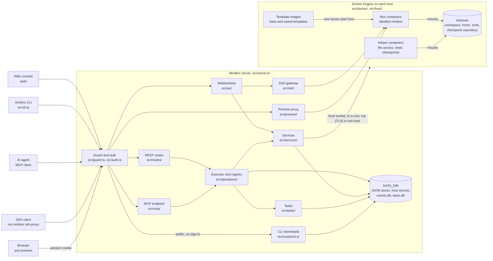

# Architecture

MiniBox is one Bun process. It serves the web console, the REST API, the MCP endpoint, the CLI downloads, the terminal and SSH WebSockets, and port previews. It does all container work through the Docker Engine API. Its own state is plain JSON files and two SQLite databases in `DATA_DIR`.

## Request path

1. `src/server.ts` routes each request. A request to a preview host goes to `src/preview/subdomain.ts` first, before the console's guard. Otherwise it serves console files from `web/`, CLI downloads under `/cli/`, path-mode port previews under `/box/<name>/<port>/`, and the MCP and API paths described below.
2. `src/guard.ts` checks every request first, and refuses cross-site browser requests. `src/auth.ts` finds the caller from a bearer token, which is the access key or an agent token from `src/tokens/`, or from a browser session in `src/sessions.ts`.
3. The REST routes in `src/routes/` and the MCP endpoint in `src/mcp/http.ts` both call `app.operations.run`. The executor in `src/operations/executor.ts` checks the caller's scopes, validates the input, runs the operation and writes an audit event to `events.db`.
4. Services in `src/services/` do the work. They read and write the stores in `DATA_DIR`, and they call the runtime in `src/runtime/`. The Docker implementation is `src/docker/runtime.ts`.
5. Long operations, such as template builds, checkpoints, rollbacks and tool installs, run as tasks in `src/tasks/`. They return `202` with a task ID at once, and their progress streams as server-sent events.

## One operation list, several interfaces

`src/operations/registry.ts` lists every operation. The REST routes, the MCP tools (`src/operations/projections.ts`) and the OpenAPI document in `docs/openapi.json` all come from that list. `bun run openapi` writes the document, through `scripts/export-openapi.ts`. Each operation carries its scope and, when it is an MCP tool, its toolset.

The CLI is a REST client. `minibox mcp` relays standard input and output to `/mcp`. `minibox ssh-proxy` relays them to the SSH WebSocket at `/api/ssh/<box>`. The server also serves the CLI binaries under `/cli/`, which `src/routes/cli.ts` handles.

## Hosts and engines

`src/host/registry.ts` holds one runtime for each host. The `local` host uses the Docker socket on the server. A remote host uses a `unix://`, `tcp://` or `ssh://` endpoint, which `src/host/endpoint.ts` parses. A `tcp://` host uses mutual TLS, and over `ssh://`, `src/host/ssh.ts` opens the tunnel.

An agent host has no endpoint to dial. Its `agent://<agent id>` endpoint is served by the agent on that machine, which opens an outbound WebSocket to `/api/agent/connect` (`src/agent/`). `src/host/agent/hub.ts` keeps the live connections and verifies each agent's signature, `src/host/agent/pairing.ts` holds the one-time pairing codes, and `src/host/agent/store.ts` keeps the agent records in `agents.json`. `src/host/agent/runtime.ts` sends each `Runtime` call over the connection, so an agent host is used like any other host.

Business code reaches an engine only through the `Runtime` interface in `src/runtime/index.ts`. Only `src/docker/` imports the Docker SDK, and `tests/architecture.test.ts` checks this.

Boxes are containers with the label prefix from `LABEL_PREFIX`, which defaults to `minibox`. They join the `<prefix>-boxes` network.

## Images, volumes, checkpoints and secrets

- **Templates** are images on a box's host. The base template is `minibox-template:base` by default, and it is built from `templates/base/Dockerfile`. Saving a box as a template commits it as a snapshot, promotes the snapshot to a template and then removes the snapshot. Volumes are never part of a template. A template built from a Dockerfile, a repository, a build context or a `devcontainer.json` keeps its recipe in `DATA_DIR/template-recipes/`, so a rebuild can run the same source again.
- **Volumes** hold a box's files. Each volume has a role that sets its mount point: `workspace` at `/workspace` and `home` at `/home/dev`, both read-write; `tools` at `/opt/minibox/tools`, read-only; and `cache` at `/home/dev/.cache`. Volume records and storage pools are JSON files in `DATA_DIR`. A pool stores its volumes on the local Docker engine, on an NFS export or in a host path.
- **Checkpoints** are stored in one restic repository per host, in the volume `<prefix>-checkpoints-<host>`. restic runs in helper containers, and its password is generated once into `DATA_DIR/secrets`. An exported checkpoint is a package in `DATA_DIR/packages`, sealed with the passphrase chosen at export. The checkpoint repository key never goes into a package.
- **Secrets** are files in `DATA_DIR/secrets/env`. A box refers to a secret by name, and gets the value when it is created or rebuilt. Secret values never appear in events, the audit log or the server log.

## Background work

- `src/services/lifecycle.ts` runs on a timer. It puts idle boxes to sleep and stops boxes whose TTL has passed.
- `src/services/reconcile.ts` compares the engine with the stored box specs. It claims containers that have no spec, and it settles rollbacks that are still pending.
- `src/services/container-watch.ts` turns engine start, stop and out-of-memory events into the `container.*` activity that the Activity tab shows.
- `src/events/retention.ts` and `src/services/checkpoint-retention.ts` apply the retention limits.
- `src/services/checkpoint-schedule.ts` takes the scheduled checkpoints once a minute, and skips boxes that are stopped or asleep.

## Terminals, sessions and SSH

- `src/ws/terminal.ts` connects a browser terminal to a tmux session in a box, through `src/services/terminals.ts`. Each terminal is a tmux client that Docker starts inside the box.
- `src/ws/ssh.ts` and `src/ssh/gateway.ts` run an SSH server inside the MiniBox process, using the `ssh2` library. Shell, exec and SFTP channels run inside the box.

## Notifications

`src/notify/` turns events into notices and sends them. `rules.ts` maps a stored event to a notice, such as `box.oom` or `exec.failed`. `src/app.ts` passes every event to `Notifications` in `service.ts`, which also takes host link changes, and queues each notice for every channel that subscribes to it. Lifecycle warnings and terminal takeovers are events too, so they take the same path. Sends run in the background, with a bounded queue, a timeout and a fixed number of attempts. Each attempt is recorded as a `notify.deliver` event. `transport.ts` makes the request: it resolves the name once, refuses addresses that are not public, connects to the address it checked, and bounds the whole send with the timeout. `channels.ts` builds the request for each channel type and signs webhooks. `store.ts` keeps the channel settings in `notify.json` and their secrets under `secrets/notify`. The operations that configure channels are in `src/operations/notify.ts`.

## Previews

`src/preview/proxy.ts` forwards HTTP and WebSocket traffic to the box's container address and the port the caller asked for. Path-mode previews are served under `/box/`, and subdomain previews on their own hosts.

In subdomain mode, `src/preview/subdomain.ts` serves the preview host. It spends a one-time ticket, which `src/routes/preview.ts` issues when the console opens a port, and checks the grant cookie from `src/preview/grants.ts`. It also refuses a write or a WebSocket from another origin. `src/preview/headers.ts` sets the preview's Content-Security-Policy and filters cookies in both directions. `src/preview/ws.ts` closes a socket when its sign-in ends or its grant expires. `src/preview/selfcheck.ts` runs the checks on the Settings page.

## Where state lives

Every path is under `DATA_DIR`.

| Path | Module | Contents |
|---|---|---|
| `boxes/<id>.json` | `src/specs/store.ts` | Box specs, which are the desired state |
| `volumes/<id>.json`, `pools.json` | `src/volumes/store.ts` | Volume records and storage pools |
| `tokens.json`, `sessions.json`, `access_key` | `src/tokens/store.ts`, `src/sessions.ts`, `src/data-dir.ts` | Hashed agent tokens, browser sessions and the access key |
| `secrets/env/` | `src/secrets/store.ts` | Host secrets |
| `notify.json` | `src/notify/store.ts` | Notification channels: their settings and endpoints, never a secret or a webhook URL |
| `secrets/notify/` | `src/notify/store.ts` | Notification channel secrets: signing keys, ntfy tokens, Telegram bot tokens and webhook URLs |
| `checkpoints/` | `src/checkpoints/store.ts` | Checkpoint records |
| Preview tickets and grants (memory only) | `src/preview/grants.ts` | Not written to disk, so a restart ends them |
| `checkpoints/schedules/` | `src/checkpoints/store.ts`, `src/services/checkpoint-schedule.ts` | Checkpoint schedules, one per box |
| `packages/` | `src/checkpoints/packages.ts` | Exported checkpoint packages, sealed with a passphrase |
| `exec/` | `src/events/outputs.ts` | Saved output of commands |
| `hosts.json`, `hosts/<id>/` | `src/host/store.ts` | Remote host records and their credential files |
| `agents.json` | `src/host/agent/store.ts` | Paired host agents: ids, public keys and revocation. The private key stays in the agent's own volume |
| `tools.d/` | `src/tools/custom.ts` | Custom tool catalog entries |
| `ssh_host_ed25519_key` | `src/ssh/host-key.ts` | The SSH gateway's host key |
| `events.db`, `tasks.db` | `src/events/store.ts`, `src/tasks/store.ts` | The audit log, and task status and output |
| `cli/` | `src/cli-dist/distribution.ts` | CLI binaries built for download |

`src/config.ts` reads the configuration once at startup, from the process environment, `.env` and the access key file. `src/app.ts` builds the shared application state from it: the stores, one runtime per host, the executor and the background jobs.
