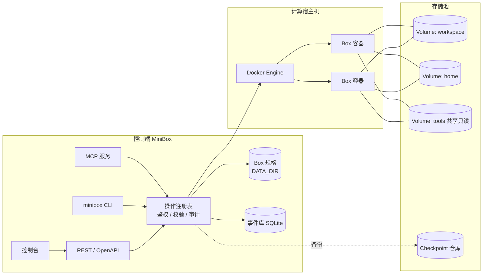
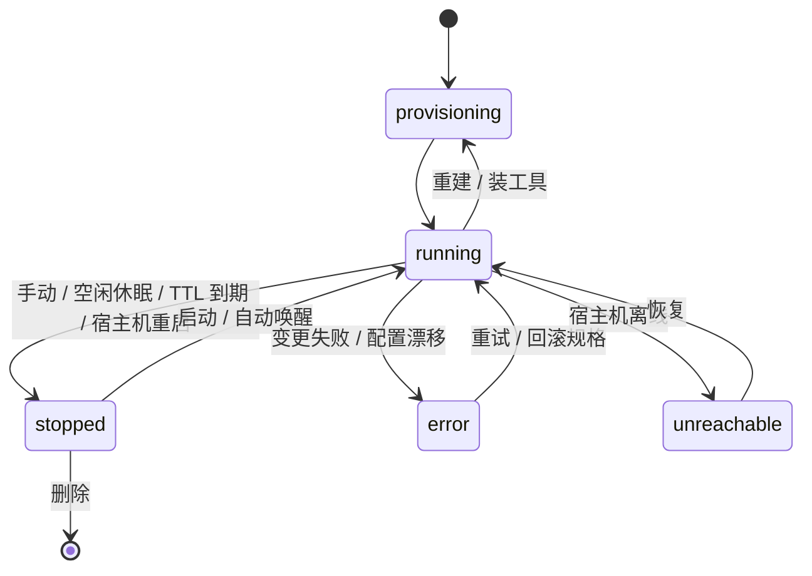

# MiniBox 产品与架构设计

> 状态：**设计已定稿，尚未实施**。本文是 2026-10 整体评审后逐项确定的产品设计，作为后续开发的依据。
> 路线图与任务拆分见 [#20](https://github.com/ArnoChenFx/minibox/issues/20)，每个章节末尾标注了对应的 issue。
> 与当前代码不一致之处，以本文为目标、以代码为现状。
>
> **第二轮修订**（决策记录第 36–40 条）：更正 MCP 工具数量（27 个，默认启用 15 个）；`no-new-privileges` 与 `sudo` 互斥，改为「标准 / 严格」两个安全档位；自动生成的密钥写入 `DATA_DIR/access_key` 而不是 `.env`；阶段 1 拆为 8 个 PR；明确阶段 0 的顺序与发布注意事项。
>
> **第一轮修订记录**：开发主管评审（见 [17 决策记录](#17-决策记录) 第 30–35 条）后做了以下修正：规格备份改为只在标签里存不可变部分；Box 停止时的文件 API 改用辅助容器 + Docker archive API；操作注册表的鉴权与审计改为可插拔钩子；Runtime / Host 抽象提前到阶段 0；基础模板提前到阶段 1；事件总线随审计在阶段 1 引入；MiniBox Agent 与存储节点移出主路线。

## 目录

1. [定位与原则](#1-定位与原则)
2. [现状评审](#2-现状评审)
3. [总体模型](#3-总体模型)
4. [Agent 接口与操作注册表](#4-agent-接口与操作注册表)
5. [Box 规格与生命周期](#5-box-规格与生命周期)
6. [Volume 与存储池](#6-volume-与存储池)
7. [Checkpoint 与备份](#7-checkpoint-与备份)
8. [事件与审计](#8-事件与审计)
9. [令牌与权限](#9-令牌与权限)
10. [会话与接管](#10-会话与接管)
11. [工具目录与基础模板](#11-工具目录与基础模板)
12. [多宿主机与 MiniBox Agent](#12-多宿主机与-minibox-agent)
13. [控制台信息架构](#13-控制台信息架构)
14. [安全设计](#14-安全设计)
15. [实施路线](#15-实施路线)
16. [暂缓事项与开放问题](#16-暂缓事项与开放问题)
17. [决策记录](#17-决策记录)
18. [术语表](#18-术语表)

---

## 1. 定位与原则

**一句话定位：在你自己的机器上，给每个 Agent 任务一个可随时丢弃、可复现、可远程观察和接管的工作环境。**

MiniBox 面向个人用户，灵感来自 Upstash Box，但不做多租户平台。核心取舍：

- **以 Agent 为主要使用者，人负责观察和接管。** 控制台只是 API 的一个客户端，不得有控制台独有的能力。
- **单人使用。** 一个所有者加多个受限令牌；不做用户与角色体系，但数据模型里保留「主体」字段。
- **「任务/工作流」层暂不做。** 事件里的 `run` 分组是它将来的挂载点。
- **默认简单，按需展开。** 只有一台宿主机的用户看不到「宿主机」概念；一键创建仍然只要填名字。
- **容器隔离，不是安全沙箱。** Box 与宿主机共享内核，适合运行自己的 Agent，不适合运行不可信的第三方代码；可选 gVisor 运行时提升隔离性（见 [14](#14-安全设计)）。

### 产品分层

| 层 | 内容 | 状态 |
| --- | --- | --- |
| 环境层 | Host、Box、模板、Volume、Checkpoint、资源配额 | 单机已有基础，需按本文重构 |
| 能力层 | exec、文件、会话、端口预览、选装 Agent CLI、密钥、令牌 | 基本缺失，是第一优先级 |
| 工作流层 | 「任务」：仓库 + Agent + 提示词 → 运行 → 看 diff → 采纳或丢弃 | 暂不做，只预留接口 |

### 典型使用旅程

1. **起一个能干活的环境**：选模板、勾选要装的 Agent CLI、秒开。
2. **Agent 自己用**：通过 MCP 调用 `create_box` → `exec` → 读写文件 → `checkpoint`，全程使用受限令牌。
3. **观察和接管**：刷新页面后回到同一个 tmux 会话，看 Agent 在做什么，必要时直接接管。
4. **看成果**：Agent 起了 dev server，一键预览。
5. **保存、回滚、迁移**：检查点包含工作区，可回滚，也可派生出新 Box 或搬到另一台宿主机。

---

## 2. 现状评审

### 做得好的地方

- 以 Docker 标签作为唯一事实来源，无状态，重启不丢数据，不需要数据库。
- 后端分层清晰（`routes → docker/* → dockerode`），错误模型统一，校验集中，路由器很小。
- 镜像删除前校验标签，不会误删别的镜像。
- 文档、i18n、发布流程完整；类型检查、lint、单元测试全部通过。

### 主要差距

| 差距 | 说明 |
| --- | --- |
| 对 Agent 不可用 | 没有程序化的 exec 与文件接口、没有端口预览；Agent 只能自己 `docker exec` |
| 快照不含 `/workspace` | 代码都在数据卷里，`docker commit` 保存不到，快照对 Agent 价值很低 |
| 日志页永远为空 | Box 主进程是 `sleep infinity`，`docker logs` 没有输出 |
| 终端断线即丢 | 每次连接新建一个 `docker exec`，没有会话续接 |
| 单机假设 | 直接连本机 Docker Socket，指标读本机 `/proc`，`DockerCtx` 是全局单例 |
| 存算耦合 | 每个 Box 自带一个 `minibox-ws-<名称>` 卷，不能共享，不能放到存储盘 |
| 状态只在内存 | 活动记录最多 50 条，重启即丢；审计靠部分路由手动套 `tracked()` |
| 权限只有一把钥匙 | 单一 `ACCESS_KEY` 等同宿主机 root，Cookie 里直接存放原始密钥 |
| 长请求无任务模型 | 已由任务模型解决，见 [§8.10](#810-实现说明16)。模板构建与快照提交返回 202，进度走事件总线 |
| 轮询架构 | 前端多处定时轮询，每个标签页都对 Docker 产生同样的调用。已由实时流解决（会话列表除外），见 [§8.11](#811-实现说明17) |

安全问题（限流可被 `X-Forwarded-For` 绕过、缺少 Origin 校验与 CSP、Box 缺少加固等）见 [14](#14-安全设计) 与 issue #1 #3 #4 #5 #7。

---

## 3. 总体模型

### 对象



| 对象 | 说明 | 章节 |
| --- | --- | --- |
| **Host** | 一台运行 Box 的宿主机；单机时是隐式的 `local` | [12](#12-多宿主机与-minibox-agent) |
| **Box** | 声明式规格 + 一个容器实例，容器可随时重建 | [5](#5-box-规格与生命周期) |
| **Volume** | 独立于 Box 的持久存储，属于某个存储池 | [6](#6-volume-与存储池) |
| **Checkpoint** | 规格 + 数据层 + 可选系统层的组合快照 | [7](#7-checkpoint-与备份) |
| **Template** | 只含系统环境的镜像（不含数据、不含规格） | [11](#11-工具目录与基础模板) |
| **Tool** | 可选装的 Agent CLI，是规格的一部分 | [11](#11-工具目录与基础模板) |
| **Token** | 受限的 API 令牌，用于 Agent | [9](#9-令牌与权限) |
| **Event** | 审计与活动事件 | [8](#8-事件与审计) |

### 存算分离

| | 存储面（持久） | 计算面（可丢弃） |
| --- | --- | --- |
| 对象 | Volume、卷快照、备份仓库 | Box 容器、模板、已装工具 |
| 生命周期 | 独立创建和删除，默认不随 Box 消失 | 随时重建、停止、迁移 |
| 描述方式 | 存储池、后端类型、大小 | Box 规格：模板 + 资源 + 挂载列表 + 环境变量 |

### 控制端状态

控制端不再是纯无状态，所有状态进入 `DATA_DIR`（issue #6）：

| 路径 | 内容 |
| --- | --- |
| `boxes/<id>.json` | Box 规格（唯一权威来源；容器标签只带创建时不可变的部分，用于认领恢复） |
| `events.db` | 审计与活动事件（`bun:sqlite`，WAL） |
| `exec/` | exec 输出，单独存放，7 天且有总大小上限 |
| `secrets/` | 环境变量里的密钥值、restic 仓库密钥；规格里只放引用 |
| `access_key` | 自动生成的 `ACCESS_KEY`（权限 600）；MiniBox 不再改写 `.env` |
| `tokens` / `sessions.json` | 令牌哈希、浏览器会话（浏览器会话已实现，见 [9.3](#93-浏览器会话)） |
| `hosts.json` / `pools.json` | 宿主机、存储节点、存储池配置与证书 |

这是文件与 SQLite，不是外部数据库，「无需运维数据库」的定位不变。`DATA_DIR` 应定期备份到存储池。若 `DATA_DIR` 丢失，只能从存活容器做**降级恢复**（身份、挂载、当前资源可恢复，空闲超时、TTL、工具、环境变量等可变字段需重新设置，见 [5.2](#52-存储位置)）。

---

## 4. Agent 接口与操作注册表

对应 issue #22 #9。

### 4.1 单一操作注册表

所有操作在一个注册表里**定义一次**，由它生成：REST 路由、OpenAPI 3.1 文档、MCP 工具、CLI 命令。控制台只调用同一套 REST。

每个操作的定义包含：

- `name`（如 `box.create`）、摘要；
- 输入与输出 schema；
- 所需 scope 与资源选择器（如何从输入中取出目标 Box 或 Volume）；
- 种类：`read` / `write` / `destructive`；
- 是否异步；
- MCP 元数据（工具集、工具名、描述）、CLI 命令名。

**统一执行器**是唯一入口，依次完成：

1. 鉴权：令牌 scope + 资源范围（默认 `created-by-me`）+ 配额；
2. 输入校验（schema）；
3. 危险操作的确认校验；
4. 幂等键与 `on_exists: error | reuse`；
5. 写入审计事件，取消手动 `tracked()`；
6. 统一错误 `{code, message, hint, retryable}`。

**鉴权和审计是执行器上的可插拔钩子。** 阶段 0 先实现「仅所有者」的鉴权钩子和只写日志的审计接收器，验收用假实现测试；真实的令牌与资源范围（issue #13）、SQLite 事件库（issue #25）在阶段 1 接入同一组钩子，不改动操作定义。这样注册表本身不依赖后面阶段才有的东西。

需要引入一个小的 schema 库（候选 zod / valibot，要求能输出 JSON Schema 并兼容 Bun）。这会打破目前只依赖 dockerode 的状态，已接受。

所有操作都基于 `Runtime` 接口（见 [12.2](#122-host-抽象)），而不是直接依赖 dockerode。

### 4.2 MCP 工具集

共 27 个工具，按工具集分组，可按需启用（`/mcp?toolsets=core,session`），避免占满 Agent 的上下文。**默认只启用 `core` + `meta`（15 个）**，其余工具集按需打开。（此前文档误写为「约 18 个」，以下表为准。）

| 工具集 | 工具 |
| --- | --- |
| `core` | `list_boxes` `get_box` `create_box` `update_box` `box_action`（start/stop/restart）`delete_box` `exec` `exec_get` `exec_kill` `read_file` `write_file` `list_files` `copy_files` |
| `session` | `session_start` `session_send` `session_read` |
| `network` | `expose_port` `list_ports` |
| `storage` | `checkpoint` `list_checkpoints` `restore` `create_volume` `list_volumes` |
| `tools` | `install_tool` `list_tools` |
| `meta` | `get_activity` `task_wait` |

`delete_box` 单独成工具，便于单独授权。

已实现的是 box 的 6 个工具加上 `exec`、`exec_get`、`exec_kill`，共 9 个，属于默认工具集。`rebuild_box` 不在上表的 27 个工具里，它需要显式确认，不属于 `core`（决策 45），因此单独放在非默认的 `rebuild` 工具集（`/mcp?toolsets=rebuild`）。`storage` 工具集已实现 9 个卷与存储池工具：`list_volumes`、`get_volume`、`create_volume`、`delete_volume`、`attach_volume`、`detach_volume`、`measure_volume`、`list_pools` 与 `replace_pools`（决策 50）。其中 `create_volume`、`delete_volume`、`attach_volume`、`detach_volume` 与 `replace_pools` 需要 `confirm: true`（决策 49）；`measure_volume` 只刷新缓存的大小，不需要。实现的工具共 19 个：默认工具集 9 个，`rebuild` 1 个，`storage` 9 个。`meta` 的 `get_activity` 与 `task_wait` 还未实现，因此默认工具集目前是这 9 个，而不是表里的 15 个。`session`、`network`、`tools` 可以被 `?toolsets=` 接受，目前没有工具。文件工具 `read_file` / `write_file` / `list_files` / `copy_files` 已加入 `core`。

### 4.3 执行模型

- **`exec` 是一次性命令**：`{cmd | argv, cwd?, env?, timeoutSec?, stdin?, user?, background?}`，返回 `{execId, background, woke, status, exitCode, stdout, stderr, truncated, durationMs, outputRef, timedOut}`，其中 `status` 为 `running`、`exited` 或 `killed`。通过 `exec.inspect()` 取真实退出码；超时或 `exec_kill` 后在箱内终止整个进程树（见下）。
- **输出上限**：接口内联每个流的头尾各约 16 KiB（合计约 32 KB）。超出部分用 `outputRef` 表示，`GET /api/execs/{execId}/output` 返回保存的窗口（每个流头尾各 64 KiB）。
- **长命令**：`background: true` 返回 `execId`，再用 `exec_get(execId, waitMs)` 长轮询（最长 25000 毫秒，不依赖客户端是否支持流式输出）；`exec_kill` 终止进程树。
- **自动唤醒**：对已停止的 Box 执行 `exec` 会先启动它。唤醒把期望状态改为 `running`，这是规格的一次修改（见 [5.1](#51-规格与观测状态)），因此 `revision` 加 1（决策 46）。读过 `revision` 的客户端在带 `If-Match` 的修改之前需要重新读取。被并发上限拒绝的调用不会唤醒 Box。已到期 TTL 的 Box 不会被启动，返回 `409 box_ttl_expired`。空闲休眠与 TTL 的规则见 [5.10](#510-实现说明12)。
- **默认用户**：非 root 用户 `dev`。工作目录默认 `/workspace`。
- **前台时限**：前台调用的 `timeoutSec` 最多 55 秒，因为服务器的 idle 超时是 60 秒。更长的命令用 `background: true`，`timeoutSec` 最多 3600。超时不是 HTTP 错误：结果里 `timedOut: true`，退出码来自 `inspect`，没有退出码时用 137。
- **并发上限**：后台 exec 每个 Box 最多 8 个，全部 MiniBox 最多 64 个。超限的调用返回 `429`，且不会唤醒已停止的 Box（决策 47）。前台调用不计入。
- **终止在箱内完成**（决策 44）：非 TTY 的命令经包装 shell 运行，包装 shell 的参数中带有一个随机令牌。终止时，箱内的脚本在 `/proc` 中按命令行找到包装 shell；`/tmp/.minibox-exec-<令牌>.<pid>` 形式的标记文件只提供候选，同样要核对命令行。「标准」与「宽松」档位以 `root` 执行，使 `sudo` 等提权子进程也能被结束；「严格」档位以 exec 的用户执行，该档位无法提权。脚本冻结整棵进程树（沿父进程号收集；包装 shell 自己是会话或进程组首进程时，同一会话与进程组也一并收集），再逐个 `SIGKILL`，并重新扫描直到没有新进程。宿主机从不向 Docker 报告的宿主机 pid 发送信号。Docker 报告 exec 已结束后才算成功；否则返回 `502`，exec 保持 `running`，可以重试。不在保证范围内的进程：调用 `setsid` 换了会话、且父进程已先退出的进程；命令结束后留在箱内的后台进程；处于不可中断睡眠的进程。Box 需要 `/bin/sh`、`cat`、`rm` 与 `sleep`。
- **权限**：`exec` 意味着可以读写该 Box 上挂载的每一个卷。更细的 `files:*` 范围只对没有 `exec` 的令牌有意义。挂载卷需要对该卷的 `volume:attach`，读写挂载或新建卷还需要 `volume:write`（见 [9.2](#92-必须写进文档与测试的安全约束)）。所有者密钥拥有全部范围；Agent 令牌只拥有创建时授予的范围（#13）。
- **执行用户**：「严格」档位的 exec 只允许 `dev` 或 `1000`，其他用户在唤醒 Box 之前返回 `403`。其他档位可以用 `root`，审计记录标记 `privileged: true`（决策 48）。
- **会话** `session_*` 用于长任务和需要观察的交互式程序，见 [10](#10-会话与接管)。

### 4.4 文件接口

已实现（Refs #9，Volume #24 之后）。REST / MCP / CLI 均可用。

- `read_file` / `write_file` / `list_files` / `copy_files`，以及上传下载（目录打包为 base64 tar：`GET/PUT /api/volumes/:id/files/archive`）。
- **以 Volume 为对象，而不是 Box**：Box 停止时也可用。
- 调用计入挂载该卷的每个 Box 的空闲活动（决策 56），但不启动已停止的 Box。
- **实现不依赖读取宿主机上的卷目录。** `/var/lib/docker/volumes/…/_data` 通常是 root 属主，MiniBox 以普通用户运行，或运行在容器里时读不到：
  - 卷已被某 Box 容器挂载（运行中或仅已创建）：对该容器使用 archive API；
  - 卷当前没有容器：创建（不启动）一个挂载该卷的辅助容器，用 Docker archive API（`getArchive` / `putArchive`）读写，用完删除；
  - 列目录：短生命周期辅助容器执行 `find -P -maxdepth`，并限制条目数（辅助镜像复用基础模板，决策 D12）；
  - 写入时 tar 头里的 uid/gid 设为 `dev`（1000）。
- 路径限制在卷的挂载根内，防符号链接逃逸；有路径越界测试。读 symlink 只返回元数据，不跟随。
- **权限**：`exec` 隐含该 Box 所有挂载卷的读写；`files:*` 只对没有 `exec` 的令牌有意义。
- 存储节点代理（已移出主路线，见 [12.4](#124-存储节点角色)）以后只作为加速路径。

### 4.5 对 Agent 友好的约定

- 按名称或 ID 寻址（名称全局唯一）。
- 重试安全：`create_box`、`checkpoint` 等支持幂等键。
- 结构化错误，例如 `hint: "Box 已停止，调用 box_action 启动"`。
- 危险操作要求键入确认：`delete_box` 需 `confirm: "<box 名称>"`，重建类变更需 `confirm: true`。
- 长操作返回任务句柄，统一用 `task_wait` 等待（任务模型见 issue #16）。
- `run` 分组：REST 请求头 `X-Minibox-Run`；MCP 会话 ID 自动作为 `run`。

### 4.6 传输

| 方式 | 说明 |
| --- | --- |
| HTTP | 控制台上的 `/mcp`（Streamable HTTP + Bearer 令牌），远程 Agent 经 HTTPS 使用 |
| stdio | `minibox mcp`，适合本机客户端 |
| CLI | `bun build --compile` 编成单文件二进制，如 `minibox exec mybox -- npm test` |
| OpenAPI | 由注册表导出，随发布提供 |

MCP 的 `instructions` 字段写明推荐流程（创建 → exec → 检查点），并提供可粘贴进 `AGENTS.md` 的使用说明。

---

## 5. Box 规格与生命周期

对应 issue #23。

### 5.1 规格与观测状态

```text
BoxSpec（期望，存控制端）              BoxStatus（观测，来自 Docker）
├ id        稳定 ID，如 bx_8f3k2        ├ containerId / hostId
├ name      全局唯一                    ├ state / reason
├ host      auto 或指定                 ├ startedAt / ip
├ template  镜像引用 + 固定 digest       ├ drift（实际配置与规格不一致）
├ resources cpus / memory / pids        └ lastError
├ mounts[]  {volume, path, mode(rw|ro)}
├ env       明文变量 + 密钥引用
├ tools[]   {id, version}
├ lifecycle desired(running|stopped)、idleTimeout、ttl
└ revision  每次修改 +1
```

### 5.2 存储位置

- **权威来源**：`DATA_DIR/boxes/<id>.json`。所有可变字段（空闲超时、TTL、标签、当前名称、工具、环境变量引用、期望状态、版本号）只存在这里。
- **容器标签只带创建时不可变的部分**：稳定 ID、创建时的名称、模板 digest、挂载列表、创建时的资源。原因是 Docker 容器标签创建后不可变，`docker update` 只能改资源与重启策略，所以标签里的内容不可能跟随原地修改。重命名使用 `docker rename`，当前名称以容器的真实名称为准。标签里**不放任何密钥**。
- **认领与降级恢复**：`DATA_DIR` 丢失时，从存活容器恢复：身份与挂载来自标签，当前资源来自 `inspect`，当前名称来自容器名。规格里的重启策略固定为 `no`（决策 43）：观察到的策略记在恢复信息里，协调器再把它改回 `no`。空闲超时、TTL、标签、工具、环境变量（含密钥引用）回到默认值，需要重新设置。
- **灾备**：`DATA_DIR` 应定期备份到存储池；真正的恢复靠这份备份，标签恢复只是兜底。
- **现有 Box 自动认领**：由 `inspect` 反推出规格。
- **漂移检测**：用 `inspect` 得到的实际配置与规格中应有的值比对，而不是比对标签里的哈希。

### 5.3 标识

- Box 的稳定 ID 与容器 ID 脱钩；**名称全局唯一，与宿主机无关**，迁移后 URL 与令牌授权不变。
- 新建容器名仍是 `minibox-<名称>`。认领已有 Box 时不改名（决策 42）。重建把容器名改为 `minibox-<id>`。之后的原地重命名仍用 `docker rename` 改成 `minibox-<新名称>`。降级恢复时，若容器名后缀就是该容器的稳定 ID，名称以标签里的当前名称为准，而不是这个 ID。
- 现有「容器 ID 或 `minibox-<名称>`」形式的路由继续兼容，并同时接受稳定 ID 与 Box 名称。

### 5.4 变更分两类

| 类型 | 字段 | 影响 |
| --- | --- | --- |
| **原地更新** | cpus、memory、pids、标签、空闲超时、TTL、重命名 | 无中断 |
| **重建** | 模板、挂载（增删卷）、环境变量、网络、安全档位 | 进程终止 |

Docker 不能给运行中的容器加挂载，所以「挂载共享卷」和「换模板」必然是一次重建。工具安装通过 `exec` 完成，不属于这两类。原地更新的字段只改 `DATA_DIR` 里的规格（资源另外用 `docker update`，重命名用 `docker rename`），不会去改容器标签。

- 修改接口使用 `If-Match: <revision>` 乐观并发，防止人和 Agent 同时修改互相覆盖；规格保留最近 20 个版本（`SPEC_HISTORY_LIMIT`），失败的重建回滚到上一版。
- **重建必须显式确认**：用 `docker diff` 预览可写层会丢失的改动。未带 `confirm: true` 时返回 `409 confirmation_required` 和预览，不改容器。可选的重建前检查点不在这一步，本版本也尚未实现（§7.6）。
- **跟随标签的 Box**：模板是标签，且创建时的镜像就是标签（`template.ref` 等于 `template.image`）时，标签若改指向另一个镜像，重建会把它列为一处模板变更，预览显示 `标签 (旧镜像短 ID) → 标签 (新镜像短 ID)`。确认后新容器从标签当前指向的镜像创建，标签字符串不变，`template.digest` 更新为新镜像 ID；新容器运行的镜像与规格不一致时，重建失败并回滚。快照 Box（模板为 `snapshot:<ref>`）不跟随，标签已被删除也不算移动。请求里指定了其它模板时，以该模板为准。

### 5.5 重建时什么保留、什么丢失

- **保留**：所有挂载卷的内容、规格、名称与稳定 ID、卷快照、活动记录。
- **丢失**：容器可写层（没写入卷或模板的改动，如 `/etc` 修改、`/tmp`）、运行中的进程（含 tmux 会话）、容器 IP。

### 5.6 重建流程（失败可回滚）

1. 用新规格创建新容器（不启动），验证镜像与配置；
2. 停旧容器并改名为 `-old`；
3. 新容器改为正式名称并启动；
4. 启动检查通过后删除旧容器；失败则恢复旧容器，并把规格回滚到上一版。回滚写回的是变更前的规格，这样在历史已经存满 20 条时也不会丢掉更早的一条。期望状态为 `stopped` 时，新容器仍会先启动作为健康检查，通过后再停掉。重启策略保持 `no`（决策 43）。

### 5.7 状态机



期望状态存在规格里，服务或宿主机重启后据此拉起或保持停止。

### 5.8 删除语义

- 创建 Box 时**自动新建**的卷标记为「随 Box 拥有」，删除时询问是否一并删除，**默认保留**（与现在一致）。
- 显式创建或被多个 Box 共享的卷是「独立」的，删除 Box 永不带走。
- 删除 Box 只删除记录中所有者为本 Box、且没有其它 Box 挂载的卷。没有记录的卷、所有者为空的记录、属于其它 Box 的记录，即使本 Box 的规格仍挂着它们，也不删除。
- 无任何 Box 挂载的卷在库里标「未挂载」，并给出清理建议。

### 5.9 与其它特性的关系

- **空闲休眠** = 期望状态改为 `stopped`，**不删容器**。`docker stop` 已释放 CPU 和内存，删容器只会多回收可写层磁盘，却丢掉装在可写层里的东西。删除容器仅用于重建与迁移。
- **预热池**只对默认挂载有效：一旦需要额外挂载、换模板或改环境变量就要重建。
- 环境变量里的密钥单独存储，**不写进容器标签**。

### 5.10 实现说明（#12）

- **心跳与持有。** `ActivityPulse` 在内存中按稳定的 `boxId` 记录每个 Box 的最近活动（决策 51）。`hold` 是引用计数的持有，有持有时 Box 不会因空闲休眠；释放时刷新心跳，因此空闲从释放时刻起算。
- **休眠判定。** `LifecycleWatcher.maybeSleep` 依次检查：`busy`（持有；MiniBox 自己打开的终端；打开的 SSH 连接；运行中或正在进入的 exec；运行中的任务）；`terminalOpen`（箱内有任何 tmux 客户端附着，决策 58）；`quietFor`（心跳距今不少于空闲时长，没有心跳时从监视开始或创建时起算）；最近的 CPU 采样严格低于 `BOX_IDLE_CPU_PERCENT`。没有 CPU 采样时不休眠。真正休眠前，判定在该 Box 的锁内再做一次（`stillIdleBox`，检查同样几项，但先查 tmux 再查 `busy`：tmux 检查要在箱内执行命令，期间开始的持有、SSH 连接、exec 或任务因此仍会被看到，最后一项检查与停止之间没有等待），因此判定之后到达的请求或之后附着的终端都会让 Box 保持唤醒；人为停止的 Box 不会被当作空闲休眠。
- **外部终端。** `TerminalService.hasAttachedClient` 读取箱内 `tmux list-sessions` 的 `session_attached`，只要有一个会话有客户端，就算打开的终端，无论它由 MiniBox 还是 `docker exec -it <box> tmux attach` 之类的外部命令附着（决策 58）。看到附着时刷新心跳；第一次发现它已离开的巡检会再刷新一次，因此空闲窗口从那次巡检起算：不早于关闭时刻，最迟晚一个 `LIFECYCLE_INTERVAL_MS`。箱内没有 tmux 或没有 `dev` 用户（`session_image_unsupported`）时视为没有客户端，旧镜像的 Box 仍可休眠。其它失败（如引擎错误或 tmux 超时）让该 Box 本轮不休眠，错误记入 `box.lifecycle_failed`，下一轮再查：判定失败时宁可多醒一轮，因为误休眠会结束 tmux 服务器和其中的工作，而多醒只多占一轮资源，TTL 仍照常生效。
- **每箱串行化。** 启动、唤醒、停止、休眠、重启与删除都经过 `BoxPower` 的每箱队列，并在锁内重新读取规格。
- **唤醒。** `ensureRunning`（exec 与会话启动）唤醒任何已停止的 Box；`wakeIfSleeping`（终端 WebSocket 与预览）只唤醒休眠中的 Box，人为停止的 Box 仍返回 `409`（决策 52）。唤醒把期望状态改为 `running`，`revision` 加 1；若原因是 `idle` 或 `ttl`，记入 `box.wake`，`detail` 为 `{boxId, from}`。终端 WebSocket 唤醒后，tmux 会话已随容器停止而消失，附着会以 `session_not_found`（1011）关闭，Box 则保持运行。会话的读取、发送、关闭与列表不唤醒。卷上的文件调用也不唤醒（决策 56）。
- **TTL。** `ttlEndsAt` 用 `createdAt` 加上 `ttlSec` 得到到期时刻；缺失、非正或无法解析的值视为不限。到期后监视器以原因 `ttl` 停止 Box，不论活动情况，并记入 `box.ttl_expire`。`refuseExpired` 在启动、重启、重建与唤醒中拒绝到期的 Box（决策 53）。协调器遇到期望运行而已到期的 Box，会让它休眠，而不是启动它。
- **多宿主机。** 终端与预览用 `locateBox` 查找 Box：先看规格归属的宿主机，再依次尝试其余宿主机，只跳过返回 404 的那一台。监视器与 TTL 检查逐台宿主机进行。
- **任务结束。** `TaskManager` 在任务结束后调用 `onSettled`，服务端据此刷新该 Box 的心跳（决策 54）。
- **中间帧。** 休眠与唤醒各会先发出一帧中间状态的 `box` 帧（期望状态已变，容器状态尚未刷新），最终状态由随后的帧给出。终端页可能因此闪过一瞬，之后显示正确的状态。
- **已知限制。** 重建一个因空闲休眠（未到期）的 Box，会先启动容器再停止它。预览的流式响应体在读完或取消之前保持唤醒；上游失败时立即释放。文件请求不启动已停止的 Box（决策 56）。#12 议题把「文件」列为唤醒入口，但文件接口以卷为对象，一个卷可能挂给多个 Box，没有唯一的 Box 可唤醒；若维护者要求唤醒，需先定下唤醒哪个 Box。分离的会话（没有附着任何客户端）不保持 Box 唤醒：超过空闲时长没有会话请求时，其中安静运行的任务会随 Box 休眠而结束。议题的豁免只列「打开的终端」与「后台任务」，因此这是议题未决时采用的推荐默认（决策 59）。

---

## 6. Volume 与存储池

对应 issue #24 #27 #28 #29 #30。

### 6.1 Volume 是独立对象

- 有自己的生命周期，默认不随 Box 消失；Box 通过规格里的 `mounts[]` 挂载 0..N 个卷，每次挂载指定路径与读写模式。
- 卷名不再由 Box 名推导。已有的 `minibox-ws-*` 卷**自动识别**为 Volume，不需要迁移步骤。

### 6.2 共享

同一个 Volume 可同时挂载到多个 Box。**默认可读写，由用户负责**，每次挂载仍可单独选只读。

- 界面补偿：把已被其它 Box 读写挂载的卷再挂载时提示风险；工具卷默认以只读方式挂给其它 Box。
- 安全：挂载某卷等同于获得该卷的读权限，创建 Box 或更新挂载需要对该卷的 `volume:attach` 授权；读写挂载、新建卷以及新建 Box 自动创建的卷还需要 `volume:write`（见 [9](#9-令牌与权限)）。
- 所有模板统一 uid/gid，否则共享卷会出现权限问题（见 [11](#11-工具目录与基础模板)）。
- 卷根目录的属主由 Docker 决定：卷为空时，挂载会把镜像中挂载点的内容与属主复制进卷；卷已有内容后，之后的挂载不再改变根目录的属主，因此由 root 留下的工作区换到 `dev` 模板上仍归 root。创建或重建时，若模板的标签给出属主（见 [11.4](#114-基础模板调整)），而可写 `/workspace` 的根目录属主不同，启动前把根目录改为该属主，只改根目录，不递归；重建回滚时恢复原属主。认领已有容器不做这一步（决策 42）。
- Docker 不管文件锁，并发写冲突由应用自己负责。

### 6.3 标准卷角色

| 角色 | 默认存储池 | 挂载点 | 说明 |
| --- | --- | --- | --- |
| `workspace` | 默认池（如 NAS） | `/workspace` | 代码与项目文件 |
| `home` | 默认池 | `/home/dev` | 用户配置与登录态；标记为敏感（含凭据） |
| `tools` | 默认池，只读共享 | `/opt/minibox/tools` | Agent CLI 等，多个 Box 共用 |
| `cache` | **本地池** | `~/.cache` 等 | 包管理器与构建缓存，可丢弃，**不进检查点** |

系统级的包归模板；容器可写层里的内容重建后丢失。`cache` 卷放本地是为了绕开网络存储上小文件操作慢的问题。

### 6.4 存储池与后端

存储池 = `{名称, 后端类型, 参数, 能力}`。Volume 属于某个池；「默认存储池」可配置，各角色可单独覆盖。

```yaml
pools:
  - name: nas
    backend: nfs
    server: 192.168.1.10
    export: /volume1/minibox
    options: [nfsvers=4.1, hard, noatime]
    default: true
  - name: local
    backend: local
```

**第一版后端：**

| 后端 | 说明 |
| --- | --- |
| `local` | Docker 本地卷 |
| `nfs` | MiniBox 管理的 NFS：使用 Docker `local` 驱动的 NFS 选项，卷在**容器启动时**挂载，挂载失败则启动失败，不会静默写入本地盘；子目录由短生命周期的辅助容器在导出根目录下创建并设置权限 |
| `path` | 用户自己挂载好的存储根目录（协议无关）。需要「挂载守卫」：校验标记文件，避免 NFS 未挂载时静默写入本地盘 |

后端能力标志（`shareable` / `snapshots` / `quota` / `clone` / `crossHost`）决定界面上哪些功能可用。装有存储节点代理的池可升级能力，见 [12.4](#124-存储节点角色)（该部分已移出主路线，第一版不依赖）。

### 6.5 哪些放存储端，哪些留在本地

| 放存储端 | 必须留在计算端 |
| --- | --- |
| workspace、home、共享卷、工具卷、检查点仓库 | Docker 镜像与容器可写层（`overlay2` 不能放在 NFS 上）、`DATA_DIR` |

不要把整个 Docker `data-root` 搬到网络存储上。`DATA_DIR` 可定期备份到存储池。

### 6.6 存储健康

- 探测池可达性；存储不可达时相关 Box 显示「存储不可达」，避免看起来像 Agent 卡死（`hard` 挂载下 I/O 会卡住，`docker stop` 也可能卡住）。
- 池剩余空间告警；每卷占用靠辅助容器统计并缓存。
- 第一版无每卷配额；以后由存储节点代理提供（已移出主路线）。

### 6.7 NAS 与网络注意事项

- **商用 NAS 不能依赖其原生快照/克隆**：粒度为整个共享文件夹，btrfs 嵌套子卷经 NFS 导出还有可见性问题。第一版检查点用 restic。
- NAS 对整个 `minibox` 共享文件夹开启的定时快照可作为灾备层，与 MiniBox Checkpoint 互补。
- 2.5G 网络对大文件够用，但 NFS 上小文件操作受往返延迟限制，缓存与构建产物放本地 `cache` 卷；`node_modules` 无法预挂载（路径取决于项目位置），可为具体路径额外挂本地卷。
- NFS 默认不加密，应在内网或 WireGuard / Tailscale 内使用；导出目录专用并限制客户端 IP；建议 `all_squash` 配合固定 `anonuid`，与模板 uid 对齐。
- 存储端宕机时，`hard` 挂载会使所有 Box 的 I/O 卡住；`soft` 挂载有数据损坏风险，不建议。
- SQLite、文件锁、inotify 在 NFS 上行为可能异常。

详细的部署步骤见 issue #30 的文档。

### 6.8 实现说明（#24）

第一版实现与上文的差异如下。

- **引擎名**：新建卷的 Docker 卷名就是卷 id（`vol_…`），显示名另存。Docker 不能在创建后补标签，所以已有的 `<prefix>-ws-*` 只写入所有权记录，不改名、不补标签、启动时不 chown；创建或重建采用该卷时的属主修正见 §6.2。认领容器也不改名。
- **chown**：新建的本地卷用基础模板镜像的辅助容器（root，`0:0`）执行 `chown -R 1000:1000`，失败则创建失败。镜像不存在时跳过并记 `volume.chown_skipped`。NFS 与 path 必须先建子目录；chown 尽力而为（`root_squash` 常见，辅助容器打印 `MINIBOX_CHOWN_SKIPPED`）。重建不递归 chown 已有数据。创建或重建到带属主标签的模板时，只把可写 `/workspace` 的根目录改为模板属主（见 §6.2）；其余遗留的 root 属主工作区仍用 README 中的一次性命令。
- **重建改名**：挂载变更会重建容器，新容器名为 `<prefix>-<box id>`。失败则回滚名称，并在原先处于运行时重新启动旧容器，不写规格。界面在容器 id 变化后跳到新 id；稳定 box id 在 API 里仍然有效。
- **探测**：池健康缓存在 `VolumeStore` 的内存里，15 秒。`GET /api/pools` 会探测（`refresh=true` 强制）。列出 Box 不探测 NFS，因此 `storage.status` 在探测前是 `unknown`；界面只把 `unreachable` 标成警告。启动、重启和创建在非本地池不是 `reachable`（含缺少基础镜像时的 `unknown`）时返回 503 `docker_unavailable`，消息键 `storage_unreachable`。本地池只有引擎探测失败才算不可达。协调器捕获该错误，记 `reconcile.start_failed` 后继续。
- **NFS**：数据卷使用用户选项（通常 `hard`）。探测根卷 `<prefix>-pool-<pool>` 强制 `soft,timeo=10,retrans=1`，并在驱动选项变化时重建，避免死服务器挂起探测。已有数据卷保持创建时的选项。不要把 Docker data-root 搬到网络存储上。
- **path**：辅助容器以只读方式绑定根目录，并 `test -f` 标记文件（默认 `.minibox-mounted`，只能是单个文件名）。标记不存在则为不可达，不写入、不创建标记。
- **能力**：由后端计算，用户不能设置。全部可共享；`snapshots`、`quota`、`clone` 为 false；只有 nfs 的 `crossHost` 为 true。无每卷配额。
- **授权**：`volume:attach`、`volume:write` 与 `pool:admin` 各自是一次 `authorize()` 调用，带 `scope` 与资源：有记录的卷带 `id`，尚无记录的名字只带 `name`。操作级调用的 `scope` 为空，钩子可以区分「能否执行操作」和「能否挂这只卷」。`pool.replace` 在操作内单独检查 `pool:admin`，`volume:write` 不能代替它。读写挂载计为写入。所有者与浏览器会话以所有者身份访问，因此始终允许；Agent 令牌按其 scope 与卷记录判断（见 §9）。拒绝时审计状态为 `denied`。
- **确认**：`create_volume`、`delete_volume` 与 `replace_pools` 没有 `confirm: true` 时不改动任何内容，返回 `409 confirmation_required` 与 `details.preview`，预览即将发生的改动：新卷的池与名称、将删除的卷、将新增与移除的池。`delete_volume` 对已挂载的卷直接返回 `volume_mounted`，不生成预览。`volume.attach` 与 `volume.detach` 会重建容器，沿用 `box.rebuild` 的确认与重建预览。`volume.usage`（测量）只刷新缓存的大小，因此不加确认（决策 49）。
- **MCP 存储工具集**：卷与存储池工具放在非默认的 `storage` 工具集（决策 50）。MCP 工具的错误结果带上 `details`（`structuredContent.details`），代理因此能读到 `details.preview`。挂载与卸载经 `rebuildBox`，适用与 `rebuild_box` 相同的记录规则（见 §9.2）。
- **位置**：池配置是控制面全局的（`DATA_DIR/pools.json`）。每条 Volume 记录带 `hostId`，挂到另一台主机上的卷会被拒绝。文件原子写入，模式 600，目录 700。损坏的池文件不覆盖，记 `pools.unreadable`，并按隐式本地池处理。
- **失败的创建**：一次创建产生的容器、规格、卷记录、引擎卷与子目录，失败时按相反顺序撤销（`VolumeChanges`）。NFS 池根卷若是这次创建或其可达性探测首次建立的，同样撤销；池根卷原本就存在则保留。遗留的 `<prefix>-ws-*` 只恢复原来的记录，不删除引擎卷。引擎拒绝删除容器时，保留规格和卷，避免仍在使用的资源失去记录。
- **工具卷与引擎名**：共享工具卷名为 `<prefix>-tools-<主机 id>`，同名检查只在同一主机内进行。已有的工具卷按记录复用，不论叫什么名字。引擎名若已被引擎中的其它卷占用，返回 409 `volume_engine_exists`：不接管，也不删除该卷。
- **丢失的卷**：记录存在而引擎中已没有该卷时，启动、重启、创建、重建、挂载和测量都返回 409 `volume_missing`，不交给 Docker 自动建一个空卷（创建容器、启动容器和运行辅助容器时，Docker 都会自动创建缺失的命名卷）。检查在每次引擎调用之前进行；创建时在规格锁内再查一次。遗留的 `<prefix>-ws-*` 若有记录而引擎卷已不存在，同样拒绝，不另建新工作区。删除记录仍可用：引擎卷已不存在时视为已删除。列出卷时尚不标记 `missing`，留待后续。
- **删除 Box**：`deleteVolume=true` 只删除记录中所有者为本 Box（`ownerBoxId` 相等）、且没有其它规格挂载它的卷，并在删除卷之前先删容器。没有记录的引擎卷即使仍被本 Box 的规格挂着也不删除，按名字回退删除的分支已经移除。引擎拒绝删除时保留记录，并以 `volumeError` 返回原因。
- **辅助容器**：`runHelper` 的容器不接入网络，根文件系统只读，`/tmp` 是 16 MiB 的 tmpfs，丢掉全部能力，只加回调用方列出的能力，禁止提权，内存 256 MiB、进程数 64，由引擎在退出后删除（`AutoRemove`）。命名卷以 `NoCopy` 挂载，否则 Docker 会把镜像里的 `/mnt` 复制进空卷，覆盖刚 chown 的属主。池探测以 `1000:1000` 运行、不带能力，因此 path 池的挂载根若对该用户不可搜索，会被判为不可达（`unreachable`）。
- **暂缓**：restic 检查点（#11）、存储节点代理（#28 / #29）、每卷配额。更长的 NAS 部署说明仍是 #30。文件 API（#9）已实现。

---

## 7. Checkpoint 与备份

对应 issue #11。

### 7.1 对象

用户看到的是一个组合对象，底层仍是独立的存储：

```text
Checkpoint
├ 规格版本            ← 当时的 BoxSpec(revision)
├ 数据层[]            ← 每个被包含的卷各一份卷快照
├ 系统层（可选）       ← docker commit 出的镜像
├ 元信息              ← 名称、原因、创建者（主体）、是否置顶、是否自动生成
└ 一致性模式           ← live | pause | stop
```

- 卷快照也可**脱离 Box 单独存在**，直接对 Volume 操作。
- 现有纯系统层快照视为「只有系统层的 Checkpoint」，继续有效。
- **默认内容**：规格 + 该 Box「拥有」的卷（workspace + home）；共享卷需逐个勾选；`cache` 卷不进检查点；系统层可选，界面用 `docker diff` 提示可写层改动量。
- home 卷标记为**敏感**：派生新 Box 时「复制 home」默认关闭；导出包默认加密。

### 7.2 引擎

去重增量（restic 类），做成可插拔接口，备份目标也可插拔（本地卷、SFTP、S3）。

- 辅助镜像里运行 restic，仓库放在专用卷或存储池中；NAS 场景下放在**另一个**共享文件夹，不要与工作区处于同一快照范围。
- 优点：Agent 频繁做检查点也不会吃满磁盘；自带保留策略与加密；仓库以后可指向异地。
- 代价：多一个辅助镜像和仓库密钥（存 `DATA_DIR/secrets`；每次调用以只读文件交给辅助容器，不进入环境变量，决策 62）。
- **能力阶梯**（装有存储节点代理时，后续才有）：原生快照/克隆 > reflink 复制 > restic。第一版只有 restic。
- **一致性**：默认 `live`（崩溃一致）；`pause`（冻结容器）、`stop` 可选。回滚前的安全点在 Box 已停止时执行（以 `stop` 拍摄）；重建前的安全点尚未实现（§7.6）。
- **与休眠**：拍摄、派生与回滚持有 Box 的电源锁并计为活动，空闲休眠不会打断它们；休眠中的 Box 也不会因此被唤醒（决策 57）。
- 本地仓库与 Docker 数据同盘，**不是灾备**，文档需写明；真正的灾备要把仓库另指别处。

### 7.3 恢复

| 方式 | 说明 |
| --- | --- |
| **派生新 Box（Fork）** | 创建新 Box 与新卷，原 Box 不受影响。适合让多个 Agent 从同一检查点各试一条路 |
| **原地回滚** | **恢复到一个全新的卷，再重建 Box 把挂载切到新卷**；原卷保留到用户确认或撤销。共享卷只提供「恢复为新卷」，不原地覆盖 |
| **取回单个文件** | 浏览快照内容并拷出（接口预留，后做） |

回滚后，Box 详情的「检查点」标签页提示旧卷仍保留，并给出 [确认并清理] [撤销回滚]（决策 60、65）。等待期间，另一次回滚与对安全检查点的删除都被拒绝。

### 7.4 触发与保留

- 触发：手动（REST）、自动（回滚前的安全点）。MCP 工具（`checkpoint(label, reason)`）、重建前的安全点与定时尚未实现（§7.6）。
- 保留策略：`keep-last`（`CHECKPOINT_KEEP_LAST`，默认 20）与 `keep-days`（`CHECKPOINT_KEEP_DAYS`，默认 30，0 为不限）。目前只有全局设置，尚不能按 Box 覆盖，也没有 `keep-daily`（决策 61）。自动生成的受策略清理；手动的不会被自动清；置顶的永远保留；待定回滚所持有的安全检查点也保留。
- 容量：`CHECKPOINT_CAPACITY_MB`（默认 0，不限）。显示仓库总占用；达到上限的 80% 时告警（`checkpoint.capacity_warning`）；达到上限即拒绝新的自动检查点，因此回滚也被拒绝，手动拍摄仍可进行（决策 61）。
- 可选「回收站」：删除 Box 或卷前自动做一份最终快照，保留几天再清理。本版本未实现（§7.6）。

### 7.5 API

```text
POST  /api/boxes/:id/checkpoints   { label, include, consistency }
GET   /api/checkpoints[/:id]
GET   /api/checkpoints/usage
POST  /api/checkpoints/:id/fork    { name, host?, copyHome? }
POST  /api/boxes/:id/rollback      { checkpoint, confirm }
GET   /api/boxes/:id/rollback
POST  /api/boxes/:id/rollback/confirm
POST  /api/boxes/:id/rollback/undo
POST  /api/volumes/:id/snapshots   /  POST /api/volumes/:id/restore
PATCH /api/checkpoints/:id         { pinned, label }
DELETE /api/checkpoints/:id
```

均为异步任务，带进度。「提升为模板」需要系统层，没有则提示「现在捕获系统层」。

上面的路由已实现，除了卷快照的两条（`/api/volumes/:id/snapshots` 与 `restore`）；派生的 `host` 参数需等多宿主机完成后再加（§7.6）。

### 7.6 实现说明（#11）

- **引擎与密钥。** 辅助镜像为 `restic/restic:0.18.1`，仓库卷为 `<前缀>-checkpoints-<宿主机>`。密码首次使用时生成到 `DATA_DIR/secrets/checkpoint-repo.key`（权限 600）。每次调用都以只读文件挂入辅助容器的 `/run/secrets/repo.key`，由 `RESTIC_PASSWORD_FILE` 指向它，密码因此不进入环境变量或容器配置（决策 62）。辅助容器每次调用限制为 1 GiB 内存、256 个进程、64 MiB 的 `/tmp` 与 3600 秒。
- **回滚的确认与撤销。** 回滚先以 `stop` 为当前数据拍摄安全检查点（自动，标签为 `Before rollback to <标签>`），再把检查点的数据恢复到新卷并重建 Box。被替换的卷保留且不挂载，待定记录写入 `DATA_DIR/checkpoints/rollbacks/<bx_id>.json`（决策 60）。待定期间，同一 Box 的另一次回滚返回 `409 rollback_pending`，删除其安全检查点返回 `409 checkpoint_held_by_rollback`，保留策略也不会清理它。
- **保留与容量。** 保留策略只作用于自动检查点：每个 Box 保留最新的 `CHECKPOINT_KEEP_LAST` 个（默认 20），删除超过 `CHECKPOINT_KEEP_DAYS` 天（默认 30，0 为不限）的。手动与置顶的检查点从不被删除。服务启动时执行一次，之后每小时一次（`CheckpointSweep`）。容量上限 `CHECKPOINT_CAPACITY_MB` 默认为 0，即不限。占用达到上限的 80% 时记录 `checkpoint.capacity_warning`；达到上限时新的自动检查点被拒绝，回滚随之被拒绝。占用无法测量时放行（决策 61）。
- **令牌的手动检查点配额。** `maxCheckpoints` 限制令牌创建的手动检查点数量，跨所有 Box 与宿主机合计，置顶的也计入。`sandboxed-agent` 默认 20，超出返回 `403 quota_checkpoints`。自动检查点不计入，它们由保留策略限制，而不由令牌决定（决策 63）。
- **启动时的恢复。** 对帐时解冻被检查点（`pause` 或 `stop`）中断而暂停的容器，并启动期望运行却未运行的 Box，因此被中断的拍摄不会留下冻结或停止的 Box（决策 64）。
- **控制台。** Box 详情的「检查点」标签页列出检查点，并提供拍摄、派生、回滚预览、确认与撤销；仓库占用与保留策略也显示在该页。界面文本有中英文，服务端生成的检查点标签（如回滚前的安全检查点）保持英文（决策 65）。
- **用量接口仅所有者可读。** `GET /api/checkpoints/usage` 使用 `checkpoint:usage` scope，没有令牌持有该 scope，路由与执行器都会拒绝令牌（决策 66）。
- **未实现。** 导入导出（包括加密导出包，§7.1 的加密要求尚未满足）、定时检查点、重建前的安全检查点、卷快照的独立路由、单文件取回、MCP 工具、按 Box 覆盖的保留策略、回收站、存储页的检查点时间线，以及派生的 `host` 参数。其中多数已列在 §16。

---

## 8. 事件与审计

对应 issue #25。

### 8.1 记录入口

在操作注册表的执行器里**统一记录一次**，REST / MCP / CLI / 控制台自动全覆盖，不会再有漏记的路由。

### 8.2 事件结构

```text
Event
├ id        ULID（可排序）
├ ts / durationMs / status   started | ok | error | denied
├ principal { type: owner|token|box-self|system, id, name }
├ source    ui | rest | mcp | cli | scheduler | system
├ op        如 box.create、exec.run、file.write、checkpoint.create
├ target    { kind, id, name }
├ hostId
├ summary   一句人话
├ detail    各操作自己的结构化内容（已脱敏）
├ run       分组标识
├ parentId  由哪个事件触发（如 update_box 触发的重建）
└ ref       { execId, outputRef, taskId }
```

`run` 是将来「任务」层的挂载点，无需改事件模型。

`source` 由服务端决定：REST 与 CLI 的调用都记为 `rest`，MCP 记为 `mcp`。客户端请求头 `X-Minibox-Client` 只是声明，不改变来源（决策 48）。`cli` 仍在枚举中，但只有在能验证 CLI 身份时才会使用。

### 8.3 分档与保留

| 档位 | 内容 | 默认保留 |
| --- | --- | --- |
| 审计 | 创建/删除/修改 Box、启停、挂载变更、检查点与回滚、令牌创建与吊销、登录成功与失败、被拒绝的操作、端口暴露、宿主机变更 | 1 年 |
| 活动 | exec（完整命令行、退出码、耗时）、文件写入（路径、大小、哈希，**不记内容**）、会话发送、终端会话开闭 | 30 天 |
| 输出 | exec 的 stdout/stderr（头尾各最多 64 KB），单独存放 | 7 天，且有总大小上限 |

- 命令与退出码比输出保留得久。
- 文件读取按「主体 + Box + 每分钟」**合并为带计数的一条**；登录失败按 IP 按分钟合并。
- 删除 Box 后事件仍按保留期留存，并支持「清除该 Box 全部历史」。

### 8.4 事件与活动信号

- **事件**持久化。
- **活动信号**只是内存里的「该 Box 最后活动时间」心跳，不落盘。预览代理的每个请求、终端数据帧只更新活动信号，否则一个网页预览就会产生海量事件。
- 空闲休眠使用活动信号，不使用事件表。

### 8.5 存储

`bun:sqlite` 单文件（WAL），位于 `DATA_DIR`，提供 JSONL 导出。保留期清理即一条 `DELETE`。

### 8.6 脱敏

1. 环境变量**只记变量名，不记值**；
2. 精确匹配：凭据存储里所有已知值（访问密钥、令牌、环境变量里的密钥）出现在命令或输出中时替换为 `***`；
3. 启发式：常见格式（`sk-…`、`ghp_…`、`AKIA…`、JWT、`Bearer xxx`）尽力替换——**文档注明是尽力而为，不保证**；
4. 文件内容永不记录；
5. 可按令牌或按 Box 关闭输出采集；
6. 审计日志本身是敏感数据：仅所有者与 `admin` 令牌可读；Agent 令牌的 `get_activity` 默认只看自己范围内的事件。

### 8.7 审计边界

**只审计经过控制面的操作，不是对 Box 内部行为的录像。**

- 网页终端只记会话开闭和数据量，不逐键记录。
- Box 里运行的 Agent（如 Claude Code 自己执行的命令）MiniBox 看不到。
- 可按 Box 开启 tmux 会话录制（`pipe-pane` 写入 Box 卷内日志，随检查点走）。
- 暂缓：在工具目录里声明各 Agent CLI 的 transcript 位置并只读展示。

### 8.8 接口

- `GET /api/events?box=&principal=&op=&status=&run=&since=&cursor=`
- `GET /api/events/stream`（SSE）。**事件总线随审计在阶段 1 引入**；Box 状态变化和资源采样（issue #17）在阶段 2 迁到同一条总线上，而不是反过来依赖它。
- MCP `get_activity(box, since, limit)` 返回紧凑摘要，供 Agent 在上下文被清空后找回「我做过什么」。

### 8.9 实现说明（#25）

第一版实现与上文的差异如下。

- **分档**：非拒绝的读取，以及 `exec.*`（含 `exec.run`、`exec.get`、`exec.output`、`exec.start`、`exec.finish`、`exec.killed`），进入「活动」档（30 天）。其它写操作（含删除）与被拒绝的调用进入「审计」档（1 年）。被拒绝的 exec 仍是审计档，因为拒绝先于操作名判断。会话发送与终端开闭按 §8.3 属于「活动」档，已实现（#14，见 §10.5）。接管与归还是写操作，进入「审计」档。文件写入仍未实现，文件 API 在 Volume #24 之后。
- **合并**：同一主体、同一操作、同一对象、相同结果、同一分钟内，非拒绝的读取合并为一条，带 `count`。`exec.*` 不合并。被合并的事件不再推送。
- **SSE**：`id` 即事件序号（`seq`）。新连接先收到 `retry: 3000`，之后只收到连接后记录的事件。`Last-Event-ID` 之后最多重放 500 条，超出则发送 `event: reset`（`{"after": N}`），客户端改用 `GET /api/events` 补齐缺口，再继续接收流。未读取期间排队超过 1000 条消息时同样重置，并丢弃已排队未发送的帧。心跳为每 15 秒一条 `: keep-alive` 注释。以浏览器会话发起的流会在该会话结束（登出、撤销或到期）时关闭，与终端一致。所有者的访问密钥不绑定会话。Agent 令牌的流使用同一套可见性，并在令牌吊销或到期时结束；没有 `box:read` 的令牌不能打开流。
- **列表是操作，流不是**：`events.list` 通过操作注册表定义（REST 为 `GET /api/events`），因此出现在 OpenAPI 中，读取日志本身也会被记录。SSE 流不是 JSON 请求与响应，不进入注册表，也不在 OpenAPI 中，但沿用同样的鉴权与同源检查。
- **范围钩子**：`visibilityOf()`（`src/events/scope.ts`）决定主体能看到哪些事件。所有者不加限制。带授权的令牌只看自己造成的事件，以及其 Box 范围内的事件；未改范围的 `admin` 预设看全部。没有授权的令牌、以及 `system` 等尚未定义规则的主体类型会抛出错误，即失败关闭。`box-self` 只看它自己的 Box，但目前不签发这种主体。
- **来源与预留字段**：`ui` 保留给控制台自身的会话（#2）。`started` 由长任务（#16，见 §8.10）和 `exec.start` 写入。长任务的终端事件用 `parentId` 指向这条 `started`，并填写 `ref.taskId`。`exec.start`、`exec.finish` 与 `exec.killed` 用 `parentId` 挂到产生它们的 `exec.run` 上，并填写 `ref.execId`；`exec.finish` 同时填写 `ref.outputRef`。重建流程（#23）可继续使用 `parentId`。
- **脱敏**：精确匹配包含访问密钥，以及本进程内创建的 API 令牌。重启之后，形如 `mbx_` 再加至少 20 个字符的值仍会打码；设置页列表里的 12 字符前缀短于这个长度，不会被当成完整密钥。环境变量里的其他密钥仍待后续凭据存储。`detail` 超过 8 KB 时替换为 `{"truncated": true, "bytes": N}`。
- **写入失败**：审计写入失败只记录 `audit.failed`，不影响操作结果。
- **存储**：`events.db` 使用 WAL、`synchronous=NORMAL`、`busy_timeout=5000`，并以 `PRAGMA user_version` 记录迁移版本。
- **总线**：`src/lib/bus.ts` 是类型化的进程内总线，主题在 `AppTopics` 中声明。#16、#17 增加主题即可复用，不必另起通道。
- **暂缓**：JSONL 导出（§8.5）；「清除该 Box 全部历史」（§8.3）；按令牌或按 Box 关闭输出采集（§8.6）；文件事件（文件 API 在 Volume #24 之后）；tmux 会话录制（`pipe-pane`，§8.7）；登录事件与按 IP 合并的登录失败（#2）；活动信号（§8.4，#17）；MCP `get_activity`（尚未实现）；环境变量里的其他密钥（待凭据存储）。

### 8.10 实现说明（#16）

长操作不再占用一条 HTTP 连接直到结束。

- **受理**：`template.build` 与 `snapshot.create` 在校验、前置条件和解析通过后写入一条 `started` 审计事件（`ref.taskId`），立刻返回 `202` `{ "taskId" }`。领域结果（模板的 `{ ref }`、快照的 `{ snapshot }`）写在任务的 `result` 上，OpenAPI 用 `x-task-result` 标出。校验失败和互斥冲突不创建任务。
- **进度**：日志和状态变更发布到总线主题 `task`，经 `GET /api/tasks/:id/events` 流出。这条 SSE 复用事件流的心跳、重放上限和 `reset`，不另建一套。它和事件流一样不进操作注册表。新连接不回放历史；界面先 `GET` 任务上保留的输出，再用 `after` 续上（浏览器的 `EventSource` 第一次请求带不上 `Last-Event-ID`）。
- **存储**：`DATA_DIR/tasks.db`（WAL）。每个任务只保留最新 64 KB 日志，避免把构建输出写进一年期的审计库（审计明细还有 8 KB 上限）。
- **互斥**：同一主机同时只能构建一个模板（`template.build:<host>`），每个 Box 同时只能提交一个快照（`snapshot.create:<host>:<boxId>`，用解析后的 Box id，名字和 id 共用一把锁）。冲突返回 `409`，`details.taskId` 指向持有锁的任务：正在运行的任务，或已取消但后台工作尚未返回的任务。
- **取消**：把任务标为 `cancelled` 并中止 `AbortSignal`。构建关掉引擎的输出流，并在连接关闭后才返回（引擎在此之前可能仍在构建）。`docker commit` 无法中途取消：开始前和返回后各检查一次；若提交已经完成，镜像留下，任务仍可以是 `cancelled`，不回滚。互斥锁在后台工作返回之后才释放，所以取消后，同一主机或同一 Box 的新任务要等到引擎调用结束才能开始，期间返回 `409`。
- **重启**：启动时把上次仍为 `running` 的任务标为 `interrupted`，不续跑，并释放所有互斥锁（包括已取消但工作未返回的任务持有的锁，持锁的进程已经不在了）。关闭时同样中止、标记并释放。
- **空闲超时**：Bun 的 `idleTimeout` 从请求开始计算，按 4 秒进位，写出的字节（包括 SSE 心跳）不会延长它。只有 `server.timeout(req, 0)` 能关掉它。因此心跳只对付反向代理的 `proxy_read_timeout`，对付不了 Bun 自己。构建改为 202 之后，那条会被掐断的长连接不复存在；进度流显式关掉计时。这一点在 Bun 1.4.3 上用 4 秒上限核实过：静默处理和每秒心跳的流都会在约 4 秒被断开，`timeout 0` 可以撑过更长的等待。仓库不保留测 Bun 内部的用例（那类用例靠时间阈值判断，在 CI 上不稳定）；`tests/long-work-routes.test.ts` 只断言 MiniBox 自己的保证：202 立即返回，进度流和事件流调用 `server.timeout(req, 0)`，普通请求保留 Bun 的上限。生产配置保持 60 秒。

### 8.11 实现说明（#17）

Box 状态、资源采样与容器日志由后端推送，控制台不再为每个标签页各自轮询。对应 issue #17 的余下工作：日志面板接入实时流，`ContainerWatch` 与采样器共用一条引擎事件订阅，采样器的队列与读取带并发上限和超时。

- **归属**：每台主机一个 `HostSampler`（`src/host/sampler.ts`），在 `src/host/registry.ts` 中随主机创建。它是该主机唯一的容器事件订阅，也是盒子缓存的唯一维护者。`ContainerWatch`（#14）经 `subscribeEvents()` 接收同一份事件，不再开第二条订阅。事件按 `id`、`action` 与 `timeNano` 去重，引擎重连后重放的事件既不再进入缓存，也不再送达监听者。状态挂在每台主机上，没有进程级的单例；#21 增加主机时只需再注册一台。
- **采样按需进行**：有实时订阅者（`watch()`）时，按 `METRICS_INTERVAL_MS` 采样每个运行中的盒子。没有订阅者时，只有最近 5 分钟内该主机有人读取过用量，才按 30 秒（不短于 `METRICS_INTERVAL_MS`）采样；每次读取用量都会续期（`need()` 租约）。两者都没有时，采样器不调用 `containerStats`，宿主机指标也不读取引擎，只保留本机 `/proc` 的读数。这是对 issue 原文「没有订阅者时暂停采样」的一处扩展：REST 客户端（包括 Agent）读取 `stats` 时需要相对新鲜的样本，只靠实时流满足不了。超过 60 秒的样本不再作为 `stats` 返回；读取时若样本已旧，先采样一轮（最多等待 5 秒），同时到达的读取共用这一轮。
- **日志只跟随一次**：每台主机上每个盒子只有一条容器日志跟随（`LogFollows`，`src/host/log-follow.ts`），由该盒子的所有日志流共享。环形缓冲保留最近 5000 行或 2 MiB（以先到者为准）。新订阅者立即拿到其中最新的 `tail` 行，之后每行只送达一次。最后一个订阅者离开后，跟随再保留 30 秒。容器停止时引擎端的跟随结束，缓存显示它重新运行后再接续。引擎断开跟随时，从最新一行之前 1 秒处续读，以免两路输出的乱序行被漏掉，并按文本计数丢弃已送出的行。
- **流的形态**：`GET /api/boxes/:id/logs/stream?tail=N`（`src/logs/stream.ts`，路由在 `src/routes/box-logs.ts`）。响应先给出 `retry: 3000`，再给出 `sync`（当前最新的行），之后每行一帧 `line`。容器被替换时发送新的 `sync`，之后是新容器的行；客户端队列溢出时同样先清空，再发送 `sync`。盒子被删除时发送 `closed` 并结束。主机停止时不发帧，流直接结束，浏览器在 `retry` 之后重连，此时盒子仍存在，它读取的是当前的行。心跳每 15 秒一条注释。
- **鉴权**：与 `GET /api/boxes/:id/logs` 相同，要求 `box:read` 范围，盒子须对调用者可见（否则 `403` `box_out_of_scope`，未知盒子 `404`），没有凭据返回 `401`。跨站请求由 `src/guard.ts` 的 `CHECKED_BOX_LOG_STREAM` 拒绝（`403`），与事件读取相同。令牌被吊销或浏览器会话结束时流立即关闭。每次打开都记入审计，与 `box.logs` 的读取相同，被拒绝的记为 `denied`。流计入 `STREAM_MAX_CONNECTIONS`，超出返回 `429`。路由不经过操作注册表，因此不进入 OpenAPI，与事件流和任务流一致。
- **前端**：`web/js/lib/logs-stream.js` 使用 `EventSource`。浏览器自行重连；浏览器放弃时（`CLOSED`），按 `retryDelay()` 重新打开，即 1 秒起、翻倍、最长 30 秒。连接断开期间，日志面板每 4 秒读取一次 `GET /api/boxes/:id/logs` 作为回退，连上后停止。关闭「自动刷新」时只读取一次，不开流。活动列表在收到本盒子的 `event` 帧时刷新，有 300 毫秒的防抖。
- **轮询范围**：盒子列表（5 秒）、概览（10 秒）、详情（3 秒）、主机指标（3 秒）、任务抽屉（2 秒）与活动列表（5 秒）都只在事件流断开时轮询。日志面板的 4 秒读取只在日志流断开时运行。终端会话列表（#14）仍每 10 秒轮询一次 `GET /api/boxes/:id/sessions`：会话没有实时帧，未纳入本次。
- **边界**：日志与采样样本只在内存中，不写入 `events.db`，实时帧只在总线上流动。日志内容与 `GET /api/boxes/:id/logs` 相同，原样送出，不经过审计的脱敏（§8.6）。
- **与空闲休眠（#12）**：打开日志流、读取用量与采样租约都不算 Box 的活动，不推迟空闲休眠，也不唤醒已停止的 Box。只看日志的标签页不会让 Box 一直运行；Box 休眠后日志流保持打开，Box 再次运行时接着推送新行。

---

## 9. 令牌与权限

对应 issue #13 #2。

### 9.1 令牌模型

```text
Token
├ scopes      box:read · box:write · box:delete · exec · box:ssh · files:read/write
│             port:expose · checkpoint:create/restore · tool:install
│             volume:read · volume:write · volume:attach
│             （pool:admin 只属于所有者，不是令牌可以持有的 scope）
├ 资源范围     boxes:   created-by-me（默认）| 指定 ID/标签 | *
│             volumes: 显式授予列表
│             hosts:   允许的宿主机
├ 配额         maxBoxes · maxCpus · maxMemoryMb · maxTtl · 速率限制
└ 过期、最后使用、创建者
```

预设：`readonly`、`operator`、`sandboxed-agent`、`admin`。

- **默认只管理「自己创建的 Box」（`created-by-me`）**：不用手动列清单，你其它的环境默认看不到也碰不到；创建出的 Box 记录归属，吊销令牌时可一并清理。
- **TTL**：`create_box` 支持 `ttl`，到期自动停止（不删除），避免 Agent 留下僵尸 Box；配额兜住失控的并发创建。
- 令牌只在创建时显示一次，服务端只保存哈希；记录最后使用时间与 IP；可随时撤销。
- 所有鉴权入口（REST、MCP、WebSocket、预览代理）统一经过执行器，替换现在的布尔判断 `isAuthorized`。
- 单人场景，不做用户与角色体系；事件与令牌里带「主体」字段，为将来加用户体系预留。

### 9.2 必须写进文档与测试的安全约束

- **`exec` 隐含该 Box 所有挂载卷的读写能力**，所以细分的 `files:*` 权限只对没有 `exec` 的令牌有意义。
- **挂载某卷等于获得该卷的读权限**：创建 Box 或更新挂载需要对该卷的 `volume:attach` 授权，否则 Agent 可以新建 Box 把别人的卷挂进去读走。
- **写入也是权限（N5）**：读写挂载（`rw`）还需要 `volume:write`，只读的 `volume:attach` 不能让 Agent 写入别人的卷。新建卷需要 `volume:write`，不带 `mounts` 的新建 Box 会创建自己的工作区、主目录与缓存卷，因此也需要 `volume:write`。`box.update` 与 `box.rebuild` 的挂载变更同样检查。配额（§6.6）尚无后端，因此 rw 挂载暂不计入配额。
- **存储池是管理员操作（N2）**：`pool.replace` 需要 `pool:admin`，`volume:write` 不能代替它。存储池决定之后所有新卷放在哪里，只有所有者可以修改。
- **存储写入需要确认**：`create_volume`、`delete_volume` 与 `replace_pools` 没有 `confirm: true` 时不改动任何内容，返回 `409 confirmation_required` 与 `details.preview`；`attach_volume` 与 `detach_volume` 沿用重建的确认。确认防的是误操作和 Agent 的误调用，不替代权限：有写权限的主体仍可以带上 `confirm: true`（决策 49）。
- **挂载的结构检查**：创建 Box、重建与挂载变更共用同一套检查（`src/services/attachments.ts` 的 `assertMountAllowed`）。它独立于 `volume:attach` 授权，所有者同样受其约束。违反时在改动容器之前返回 `403 forbidden`，或 `409 volume_missing`。检查以 Volume 记录为准：引擎中带 MiniBox 标签、还没有记录的卷先被认领，再判断。
  - 一律拒绝，不论卷是否存在、是否已挂载：`minibox-data`（保存访问密钥与会话）、池根卷 `<prefix>-pool-<pool>`、带 `<prefix>.internal` 标签的辅助卷，以及没有 MiniBox 标签的卷。
  - 记录的所有者是另一个仍然存在的 Box（`owned`）时拒绝挂载，因此别的 Box 的工作区不能被挂走。独立记录（`independent`）可以被多个 Box 挂载，§6.2 的共享工具卷因此可用。所有者已删除的记录视为无主。
  - 记录存在、或 Box 已经挂载的卷，若引擎中已不存在，返回 `409 volume_missing`，不会静默重建：Docker 在容器创建或启动时会自动建一个同名空卷，那就等于悄悄替换了数据。
  - 不存在的名字可以新建为独立记录（引擎名为 `vol_…`，与 `volume.create` 一致），但以 `<prefix>-ws-` 或 `<prefix>-pool-` 开头的名字拒绝挂载，`vol_…` 形式的 id 没有记录时返回 `404 volume_not_found`。创建 Box 时的显式挂载只接受已有记录，因此优先使用已记录的卷。
  - Box 已经挂载的卷不做标签与所有权检查，所以只改其它字段的重建照常进行（上面一律拒绝的卷除外）。
  - 挂载变更（创建、`box.update`、`box.rebuild`）只检查新增或改变的挂载：卷、路径、模式都与现有挂载相同的，视为保留，不再检查。新挂载需要 `volume:attach`，读写挂载还需要 `volume:write`；尚无记录的新名字需要 `volume:write`，因为它会被新建为独立卷。`volume.attach` 按同一规则检查；`volume.detach` 检查被卸下的那只卷的 `volume:attach`。
  - 不带 `mounts` 的新建 Box 需要 `volume:write`。若采用了遗留的 `<prefix>-ws-<名称>` 工作区，它按读写挂载检查（`volume:attach` 与 `volume:write`）；复用已有的共享工具卷，需要对它的 `volume:attach`。
  - 网络只允许宿主机的 Box 网络（默认 `minibox-boxes`）和 Box 当前已在使用的网络，早于 Box 网络创建的 `bridge` Box 因此可以保持原样。`host`、`none` 与 `container:*` 始终拒绝。
- **`/mcp` 同时接受访问密钥与 Agent 令牌**：持有访问密钥的 MCP 客户端拥有全部所有者权限，包括以 root 执行 `exec`（非「严格」档）、`delete_box` 与 `rebuild_box`。令牌与密钥经同一条鉴权路径进入；`tools/list` 只列出其 scope 能到达的工具，调用无权的工具返回 `forbidden` 工具错误且不执行。README 与 `docs/agents.md` 必须写明这一点。错误的 Bearer 密钥与错误的登录密钥共享同一限流（`/api/`、`/mcp` 与终端）（决策 48）。
### 9.3 浏览器会话

已实现（#2）。此前 Cookie 里直接存放原始 `ACCESS_KEY`，有效期 30 天，泄露即永久 root 且无法单独撤销。现在登录后签发随机会话令牌（32 字节，即 256 bit，来自 CSPRNG），Cookie 只保存该令牌；服务端在 `DATA_DIR/sessions.json` 中只保存其 SHA-256 哈希，以及创建时间、过期时间、最后活动时间、User-Agent 与地址，写入采用临时文件加重命名。登出立即作废；`ACCESS_KEY` 变更后，下次启动时全部会话失效（文件中保存的是密钥的 scrypt 校验值，用于检测变更）；绝对有效期由 `SESSION_TTL_DAYS` 决定（默认 30 天），`SESSION_IDLE_DAYS` 可选开启滑动过期；设置页提供会话列表，可撤销单个会话或「退出其他会话」。`Authorization: Bearer <ACCESS_KEY>` 保留，用于脚本。

### 9.4 暂缓：Box 内 Agent 的自访问

Box 里的 Agent 想自己做检查点、暴露端口、派生子 Box，但 MiniBox 默认只监听 `127.0.0.1`，容器内访问不到，且在 Box 里放长期令牌容易被写进文件或快照。方向是：为每个 Box 注入**自动签发、仅限自身、随 Box 销毁而失效**的令牌，或每个 Box 一个 Unix socket（远程宿主机需要计算节点代理）。令牌模型先预留 `box-self` 主体类型，放到第二阶段。本阶段不签发。

### 9.5 实现说明（#13）

- **存储**：`DATA_DIR/tokens.json`（权限 600）只保存 SHA-256。明文 `mbx_…` 只出现在创建响应里。与浏览器会话分文件。更换 `ACCESS_KEY` 会结束会话，**不会**吊销 API 令牌；吊销在设置页或 `DELETE /api/tokens/:id`。
- **预设**：`readonly`（`box:read` 与 `files:read`）、`operator`（除了不能签发令牌之外的全部 scope）、`sandboxed-agent`（operator 去掉 `volume:attach`、`tool:install` 和 `box:ssh`）、`admin`（全部 scope，Box 与宿主机为 `*`）。`sandboxed-agent` 的默认配额是 5 个 Box、合计 8 个 CPU、16 GB、TTL 4 小时、每 60 秒 60 次请求，以及 20 个手动检查点（`maxCheckpoints`，§7.6）。未改 scope、且 Box 与宿主机都是 `*` 的 admin 可以读全部审计；其余令牌只看自己的事件和范围内 Box 的事件。任何预设都不能创建或吊销令牌。
- **默认范围**：Box 为 `created-by-me`，宿主机为 `local`，卷为空。只读预设不能创建 Box，因此在改成 `*` 或列出 id / 标签之前，它看不到已经存在的 Box。
- **授权**：仍是执行器上的 `authorize` 钩子，操作定义没有改。调用前检查 scope；输入合法且目标解析之后，再检查宿主机、卷、Box、TTL 和配额。直接读取范围外的已有 Box 返回 403，不存在的 Box 仍是 404。列表在处理函数里过滤，因为钩子只能拒绝整次调用。
- **`exec`**：对令牌可见的 Box，`exec` 隐含其全部挂载的读写，所以 `files:*` 只对没有 `exec` 的令牌有意义。文件 API 已实现（#9）。终端要求 `exec` 且 Box 在范围内。
- **卷**：创建 Box 总会挂上工作区卷。卷还不存在时，这是新建，不需要 `volume:attach`。卷已经存在时，这是挂载，必须对该卷有 `volume:attach`。请求里已经能写出的 `mounts`、`volumes`、`volume` 同样检查。
- **TTL**：令牌带 `maxTtlSec` 时，省略或显式给出 `null` 都会把这个上限写入 `lifecycle.ttlSec`；大于上限的值返回 403（`quota_ttl`）。创建与更新都按此检查。到点自动停止由生命周期清扫完成（#12），这里只负责写入上限。
- **配额**：统计 `createdBy` 是该令牌的 Box，跨所有宿主机。`maxCpus` 和 `maxMemoryMb` 是这些 Box 的合计，因此也限制单个 Box。只改名称不会因为资源已经超限而被拒绝。配额检查在按令牌串行的临界区内完成（N1），两个竞争的创建不能同时占用最后一个名额。速率限制是进程内的固定窗口，超出返回 429，不写入磁盘。`maxCheckpoints` 统计该令牌创建的手动检查点，跨所有 Box 与宿主机；超出返回 403（`quota_checkpoints`），检查与拍摄在按令牌排队的临界区内完成。自动检查点不计入（§7.6）。
- **吊销**：立即从查找表删除哈希。`?deleteCreated=true` 会删除该令牌创建的 Box 及其工作区卷，覆盖所有宿主机。删除是尽力而为的：无法删除的 Box 连同宿主机与原因列在响应的 `failedBoxes` 中，其余 Box 照常删除（N7）。已打开的终端以关闭码 1008 结束；事件流、任务进度流、SSE 实时流与该令牌的 MCP 会话同时结束，之后的请求返回 401。
- **MCP**：设置页和 README 给出可粘贴的配置。`/mcp` 接受令牌，并与 REST 共用鉴权路径，每次调用都以令牌主体执行，因此同样经过 scope 与授权规则。会话绑定到打开它的主体，令牌吊销时结束；其他主体按会话 id 也读不到它。
- **事件名称**：事件接口（列表与实时流）按 Box 名称匹配时，只计入该 Box 创建之后记录的事件（`createdAt`），因此同名的早先 Box 的事件不会泄露给后来的令牌。按 id 匹配不受此限制，重建替换容器 id 之后，事件仍按名称与创建时间匹配。已知限制：创建操作自己的事件以操作开始时间记录，早于 `createdAt`，所以在 Box 被重建后，授予令牌的 Box 的创建事件不再可见。这是失败关闭，只会少显示。
- **任务**：任务列表、任务读取与任务进度流按任务的发起者，或其目标 Box 对令牌可见来判断；目标 Box 在所有宿主机上查找（T3）。
- **模板与快照**：令牌只能从 `template=true` 的镜像与自己可见的快照创建、重建或派生；按 sha256 或镜像 id 引用时先解析再检查（T2）。`template.promote` 检查快照的所有者，`template.delete` 只允许所有者或模板的创建者，`template.build` 只允许所有者。
- **卷**：挂载按卷记录判断（`ownerBoxId`、`createdBy`），而不按名称。池根卷对所有主体拒绝；令牌不能挂载其他令牌创建的卷，即使它的卷授权是 `all`。`pool:admin` 不是令牌可以持有的 scope，存储池管理只属于所有者。
- **宿主机**：Box 没有记录宿主机时，只有 `all` 的宿主机授权才允许访问（失败关闭，N4）。
- **活动**：`/api/activity` 只对所有者开放（路由默认 `OWNER_ONLY`）。令牌使用按范围过滤的 `/api/events`。
- **会话与 exec**：`box:exec` 与 `box:session`（终端与会话 API）都映射到 `exec` scope，因为它们能在 Box 内执行命令。
- **SSH**（`box:ssh`）：`GET /api/ssh/:box` 升级为 WebSocket，承载一条 SSH 连接。握手即完成鉴权（访问密钥或令牌的 Bearer，浏览器会话不可用），因此 SSH 层接受任何认证方式，用户只能是 `dev` 或 Box id。`box:ssh` 与 `exec` 一样能在 Box 内以 `dev` 执行任意命令、读写全部挂载，因此 `sandboxed-agent` 不包含它，授予时应同样谨慎。`-L` 另需 `port:expose`，且只转发到 Box 的回环地址；`-R`、Unix 套接字转发、X11 与 agent 转发一律拒绝并审计。打开的连接计入空闲休眠判断。主机密钥保存在 `DATA_DIR/ssh_host_ed25519_key`。

---

## 10. 会话与接管

对应 issue #14。

### 10.1 会话原语

- 基础模板预装 `tmux`。终端 WebSocket 默认附着到 tmux 会话，可有多个具名会话；关闭浏览器后进程继续运行，重新打开可续接。
- 工具：`session_start {box, name}` · `session_send {keys|text}` · `session_read {lines|since}`。
- 一次性命令用 `exec`，长任务和需要观察的用 `session`。
- **Agent 与控制台终端共享同一个会话**：人在控制台打开的就是 Agent 正在驱动的那个。

### 10.2 接管：硬锁

- 打开 Agent 正在驱动的会话时**默认只读观察**；点「接管」才可输入。
- 接管期间会话进入「人控制」状态：Agent 的 `session_send` 被拒绝并返回结构化错误 `taken_over`（提示稍后重试），`session_read` 仍可用，Agent 能看到人在做什么。
- 手动「还给 Agent」，或空闲超时自动归还（可配置）。
- 接管期间，Agent 的关闭（`DELETE` 与 `minibox session close`）同样被拒绝并返回 `taken_over`：会话保持存在，只有控制台能关闭被人持有的会话。
- 锁的边界：它约束会话 API 与终端，不约束箱内的 `exec`。`exec` 以 `dev` 运行时与 tmux 服务器同属一个用户，可直接调用 `tmux send-keys` 或 `tmux kill-session`。因此接管是对 Agent 的协调信号，不是沙箱。要让锁也约束箱内命令，需要把 tmux 服务器与 exec 分到不同用户，或为会话另设权限，这不在 #14 的范围内。
- 理由：不加锁时，人和 Agent 同时往同一个 tmux 敲字，输入会互相穿插，结果不可预测。

### 10.3 活动标签页取代日志页

Box 详情的「活动」标签页合并：exec 历史、容器事件（启动/停止/OOM）、会话开闭；保留原 `docker logs` 作为次要选项。默认只记会话开闭，不录键入；可按 Box 开启会话录制。

### 10.4 终端健壮性

心跳与超时清理；处理 `ws.send` 的返回值实现背压；退出时确保终止对应 exec 进程；可选保存最近 N KB 输出用于重连回放。WebSocket 升级需要 Origin 校验。

### 10.5 实现说明（#14）

第一版实现与上文的差异如下。

- **tmux 会话**：每个会话是 Box 内 `dev` 用户的一个 tmux 会话（`tmux -u`，名称 1 到 32 位，字母或数字开头，可含 `-` 与 `_`）。tmux 的每条命令都是一次短的 `dev` exec，服务端不持有会话进程。发起方（`agent` 或 `human`）记在 tmux 的用户选项 `@minibox-origin` 中，重启后仍可读到。
- **控制方与接管只在内存中**：控制方（`controller`）与接管状态不落盘。重启后，每个会话的控制方回到其发起方的默认值：Agent 发起的会话归 Agent，控制台发起的会话归人。
- **空闲归还**：接管后超过 `SESSION_TAKEOVER_IDLE_SEC`（默认 300 秒）没有人的输入，会话自动归还 Agent。`0` 关闭自动归还，接管持续到手动归还，即使页面已经关闭。计时只针对接管：控制台发起的会话不因空闲而归还。
- **读取游标**：`session_read` 的游标保存在内存中，只接续最新的一次读取。过期的游标，以及重启之后的第一次读取，返回 `reset: true` 并给出当前窗口。
- **只读的 Bearer 终端**：`/api/boxes/:id/terminal` 的 Bearer 调用者只能读取输出。输入与接管、归还等控制帧被拒绝，返回 `forbidden` 错误帧（`terminal_read_only`）。这是相对早期版本的行为变化：早期的终端对 Bearer 调用者可以输入。
- **箱内终止**：终端的附着进程（`tmux attach-session`）与其它 exec 一样经由 §10.4 的包装脚本结束。WebSocket 关闭（包括异常断开）时在箱内终止附着进程，tmux 会话保持运行。
- **心跳与背压**：Bun 的 WebSocket `idleTimeout` 设为 30 秒，静默的连接被关闭。`ws.send` 返回背压时暂停读取 tmux 输出，`drain` 时恢复；未读的数据超过 4 MiB 时关闭连接（`closeOnBackpressureLimit`），不再无限缓冲。
- **事件**：`session.start`、`session.send`、`session.close`、`terminal.open` 与 `terminal.close` 属于活动档。`session.takeover` 与 `session.release` 是写操作，进入审计档。`session.send` 只记录按键数与字节数，`terminal.close` 记录两个方向的字节数与时长。键入的内容从不记录。
- **会话身份**：一个会话的身份是 tmux 的会话 id（如 `$3`）与创建时间，不是 `@minibox-origin` 选项。Agent 改写该选项不会重置接管。同名的新会话（id 或创建时间不同）是另一个会话，从其发起方的默认控制方重新开始。
- **资源上限**：每个 Box 最多 16 个 tmux 会话，箱内每一个 tmux 会话都计入，包括名称 MiniBox 无法使用的会话（决策 59），启动第 17 个时返回 `429 too_many_requests`；每个会话最多 8 个同时打开的终端（含正在启动的），超过时返回同样的错误码；其中 Bearer 终端最多 6 个（`VIEWER_ATTACHES_MAX`），其余 2 个留给控制台，因此 Bearer 终端无法把人挡在门外。`session_read` 的 `capture-pane` 只回看 4000 行（`READ_LINES_MAX` 的两倍），而不是整个回滚缓冲。每条 tmux 命令的输出最多保留最新的 4 MiB，超出部分从完整的一行开始截取；若其中没有换行，则从完整的字符开始，不留下 `U+FFFD`。这防止异常大的输出（例如没有换行的超长行）耗尽内存。
- **只读的 Bearer 附着**：Bearer 调用者以 `tmux attach-session -r -f ignore-size` 附着，即只读客户端，且忽略窗口尺寸；服务端同时丢弃它发来的 `resize` 消息。`-f ignore-size` 需要 tmux 3.2 或更高版本：附着前先执行 `tmux -V`，更旧的 tmux 返回 `409 conflict` 并说明版本，而不是让 tmux 的通用用法错误原样返回。控制台（浏览器会话）仍以可写方式附着，输入是否送达由接管锁决定。
- **暂缓**：`pipe-pane` 录制（§8.7）与服务端回放缓冲（§10.4）不在 #14 的验收标准之内，尚未实现。重连时由 tmux 重绘屏幕。

---

## 11. 工具目录与基础模板

对应 issue #8 #27 #15。

### 11.1 创建时选装，运行中追加

- 创建 Box 时可勾选 Agent CLI；常用工具在一键层直接勾选，并记住上次选择。
- 运行中的 Box 可随时安装、升级、卸载，无需重建。
- `BoxSpec.tools[]` 是期望状态。安装是「让实际状态趋向期望状态」的幂等操作，重建后依据规格自动补装缺失工具。
- 由 `docker exec` 在 Box 内以 `dev` 用户执行，不属于「重建」类变更。

### 11.2 安装位置

- Agent CLI 装到**共享的只读工具卷**（`/opt/minibox/tools`，`PATH` 已包含其 `bin`）；多个 Box 共用，省磁盘也省安装时间。
- 安装/升级/卸载通过控制面的**专用写入 helper**完成：把 tools 卷以读写方式挂进短生命周期容器，以 uid 1000 运行并允许出站（npm / PyPI）；Box 内仍只读挂载。检测命令同样在 helper 中执行。
- 写入前，本地池上的 tools 卷先由 root 辅助容器（仅 `CHOWN`）整卷交给 uid 1000。Box 首次挂载空卷时，Docker 会把镜像里挂载点的属主复制进卷，模板里的 `/opt/minibox/tools` 是 root 属主，不做这一步，写入 helper 会因无权限失败。NFS 与 path 池在创建时已准备目录，不再交接。
- 用户配置与登录态放 **home 卷**；系统级的包（`apt`）归模板。

### 11.3 工具目录

声明式清单：`id`、名称、说明、安装/检测/升级/卸载命令、依赖（如 Node ≥ 20）、是否需要 root、预估体积、安装来源（npm / pip / 官方脚本）。

- 分组（`category`）：`agents` AI 编程助手、`languages` 语言与运行时、`terminal` 终端与开发工具、`networking` 网络。`tools.d` 里没写 `category` 的旧自定义条目归入 `agents`。创建对话框与 Box 的「工具」页都按分组展示，并提供按名称、说明与分组过滤的搜索框。
- 内置：AI 编程助手 Claude Code、OpenAI Codex CLI、OpenCode、Pi coding agent、fx agent、Antigravity CLI、Grok Build CLI、Qoder CLI、oh-my-pi；语言与运行时 Bun、uv、Rust（rustup）、Zig；终端与开发工具 herdr、luvus；网络 Tailscale（`needsRoot`）。
- `needsRoot` 的条目只列出，安装、升级与卸载都被拒绝（`tool_needs_root`），MiniBox 从不以 root 安装。
- 检测：镜像或家目录里已有的工具显示为已安装并带版本，但不计为受管；只有 tools 卷上的入口点才受管。升级与卸载只作用于受管工具，其它情况返回 `tool_unmanaged`。已检测到的工具不会被重复安装。
- 清单放仓库 `catalog/*.json`，并允许在 `DATA_DIR/tools.d/` 放自定义条目。
- 长耗时安装使用异步任务与进度流；兼容代理配置。
- API Key：短期用环境变量输入，密钥单独存储；长期方向是宿主机侧密钥注入，避免把密钥写进 Box。

### 11.4 基础模板调整

`templates/base/Dockerfile` 需要：

1. 非 root 用户 `dev`，固定 uid/gid（如 1000，构建参数可调），默认以该用户进入终端与 exec；「标准」与「宽松」档位下提供无密码 `sudo`（仅限 Box 内）；「严格」档位下 `sudo` 仍已安装，但因 `no-new-privileges` 无法提权（见 [14](#14-安全设计)）。
2. 预装 `tmux`。
3. 常用工具：`jq`、`ripgrep`、`openssh-client`、`unzip`，保留现有 git / curl / python3 / build-essential / procps / less / vim-tiny。
4. 挂载点约定：`/workspace`、`/home/dev`、`/opt/minibox/tools`；`~/.cache` 与包管理器缓存（`npm_config_cache`、`PIP_CACHE_DIR` 等）指向 `cache` 卷。
5. 保持 `CMD ["sleep","infinity"]` 与现有标签；标签中记录 uid 约定，创建 Box 时若模板 uid 与存储池约定不一致则警告。`minibox.template.uid` 与 `minibox.template.gid` 记录 `dev` 的 uid 与 gid（十进制），创建与重建时据此修正可写工作区根目录的属主（见 [6.2](#62-共享)）。
6. 多架构构建（`amd64`、`arm64`）。

### 11.5 模板增强（后续）

官方变体（Node / Python / Go / 极简）、声明式模板（Dockerfile / Git 仓库）、创建时克隆 git 仓库与初始化脚本、按需 `docker pull`。**预热池**：预先创建带空 workspace 卷的 Box，认领时把该卷记为新 Box 的 workspace；只对默认挂载有效。

---

## 12. 多宿主机与 MiniBox Agent

对应 issue #21 #28 #29。

### 12.1 已定稿的决策

- **连接形态：先做 SSH / TLS 直连，再做出站 Agent。** NAT 后面的机器在第一阶段暂不支持。
- 单人使用，令牌区分 Agent。
- Box 的稳定 ID 与全局唯一名称使迁移不改变标识；规格里带 `host`，迁移 = 改 `host` 再执行。
- Box 可放在任何能访问其存储池的宿主机上；本地卷绑定宿主机，调度时 Box 必须跟着卷走。

### 12.2 Host 抽象

`Host = { id, name, kind, endpoint, labels, status }`，`DockerCtx` 变成每个 Host 一个，由 `HostRegistry` 管理。把散落的直接调用收敛到一个窄的 `Runtime` 接口（容器 / 镜像 / 卷 / exec / stats / events），Docker 是第一个实现，便于以后接 gVisor、Podman，也方便测试里 fake。单机不配置时是隐式的 `local`，行为与现在一致。

**这一步（issue #32）提前到阶段 0 的最前面。** exec、Box 规格、Volume、检查点都基于 `Runtime` 接口来写，而不是直接依赖 dockerode，否则等到多宿主机时要整体返工。多宿主机的其余部分（SSH / TLS 连接、调度、迁移，issue #21）留在阶段 4。同时提供 fake `Runtime`，让业务层不依赖真实 Docker 即可测试。

### 12.3 连接方式

| 阶段 | 方式 |
| --- | --- |
| A | `unix://`、`tcp://`（必须 TLS 双向认证）、`ssh://user@host`（通过 SSH 隧道转发 Docker API，不需要在远端暴露端口，最易上手） |
| B（已后移） | 计算节点 Agent：主动连回控制台，适合 NAT 后面的机器，只暴露 MiniBox 需要的那一小部分 API。与 [12.4](#124-存储节点角色) 同属 MiniBox Agent，一并移出主路线 |

要点：

- 路由 `/api/hosts/:host/boxes/:id/...`，同时保留 `/api/boxes/...`（默认 `local`）。列表聚合所有宿主机，并行请求，单台超时或离线不阻塞整体。
- **指标**：远程读不到 `/proc`。阶段 A 用 `docker info` / `docker system df` 的核数、内存、容器数，实时占用汇总各 Box 的 stats 近似；阶段 B 由 Agent 上报。
- **调度与容量**：`assertCapacity` 按目标宿主机校验并考虑已分配配额；`host: "auto"` 按剩余容量或标签挑选，先做「最空闲优先」。
- **模板与检查点按宿主机独立**：创建时目标机缺少模板则自动构建或拉取，或清晰报错；跨机复制用 `docker save | docker load` 或共享仓库。共享存储池下迁移只需换宿主机重新挂载，不用拷数据。
- **预览代理**：远程宿主机上不能直连容器 IP，需要经 SSH 隧道或 Agent 转发。
- **可靠性**：宿主机离线时 UI 灰态，其上的 Box 标「不可达」而不是消失；后台重试带退避。

### 12.4 存储节点角色

> **状态：已移出主路线，排到最后，动手前先单独评估范围。** 评审认为 Agent 框架（配对、mTLS、出站通道、多架构发布、能力探测）加上存储节点角色的工作量接近一个独立产品。第一版的设计**不依赖**它：没有 Agent 时，存储池走 NFS + 辅助容器，文件 API 走辅助容器 + archive API，检查点走 restic。本节保留为后续方向。对应 issue #28 #29。

存储节点代理是 MiniBox Agent 的 `storage` 角色，可在 NAS（有 Docker 或可运行二进制）和普通 Linux 存储服务器上运行。**它是可选的，不是依赖**：没有 Agent 时存储池照常工作，界面按实际能力显示可用功能。

**一个 Agent，两种角色：**

| 角色 | 跑在哪 | 职责 |
| --- | --- | --- |
| `storage` | 有磁盘的机器：NAS、Linux 存储服务器 | 本节点上的目录、配额、用量、快照、备份、健康 |
| `compute` | 跑 Box 的机器 | 转发 Docker API、采集指标、转发终端与预览流量 |

同一台机器可同时启用两个角色。

**部署与安全：**

- 容器（挂入共享文件夹）或单文件二进制 + systemd；多架构 `amd64` / `arm64`。并非所有 NAS 支持 Docker，所以二进制方式必须提供。
- **配对**：控制台生成一次性配对命令，Agent **主动连回**控制台（出站连接，对 NAT 与防火墙友好），换发各自的证书（mTLS），可随时吊销。
- **权限边界**：只暴露**固定的一组操作**（不是远程 shell），所有路径限定在配置的根目录内，防符号链接逃逸。
- **能力探测**：启动时探测并上报文件系统类型、可用工具、容量；控制台据此显示每个节点或存储池实际可用的功能。

**存储节点的能力：**

| 能力 | 说明 |
| --- | --- |
| 目录管理 | 创建/删除/重命名 Volume 目录，**在本机直接设置属主与权限**，绕开 NAS 的 squash 限制 |
| 用量统计 | 本机读盘：ZFS 用 `zfs get used`，btrfs/xfs 用对应配额统计，否则 `du` 并缓存 |
| 配额 | 文件系统支持则启用 ZFS 数据集配额、btrfs qgroup、xfs 项目配额；否则软配额（监控 + 告警） |
| 快照与克隆 | 按能力阶梯选择（见下） |
| 本地 restic | 备份与恢复在存储节点本机读盘，仓库也在本机，**数据不走局域网** |
| 文件接口 | 直接读写 Volume 文件，不需要 Box 运行，也不经过计算服务器 |
| 健康 | 磁盘空间、文件系统错误、btrfs/ZFS scrub 状态、可选 SMART |
| NFS 导出 | 仅限普通 Linux 且需显式开启；NAS 的导出由用户在其管理界面设置 |

**快照与克隆的能力阶梯**（启动时探测，选最优）：

1. **原生**：ZFS 数据集快照与 `zfs clone`；btrfs 子卷快照（需先确认 NFS 导出能正确看到子卷，探测不通过则跳过）。
2. **reflink 复制**：btrfs 或开启 reflink 的 xfs 上用 `cp --reflink`，Fork 秒级且几乎不占空间。因为只是普通目录和文件，**没有嵌套子卷的 NFS 可见性问题**，对商用 NAS 更稳妥。OpenZFS 2.2+ 开启 block cloning 后也可用。
3. **restic**：通用兜底，第一版就有。

---

## 13. 控制台信息架构

对应 issue #26。控制台改版随各阶段逐页落地，不做一次性重写。

### 13.1 原则

1. 默认简单，按需展开。
2. **观察和接管是主线**，概览第一屏回答「现在有哪些 Agent 在做什么」。
3. 各类对象体验一致：列表、详情、活动、权限。
4. 改动前先说清影响：热更新立即生效，需要重建的变更先暂存后统一确认。

### 13.2 导航（7 项）

| 导航 | 内容 |
| --- | --- |
| 概览 | 「正在进行」、需要关注的事项、容量、最近时间线 |
| Boxes | 列表、筛选、创建 |
| 存储 | Volume 与 Checkpoint 两个标签页 |
| 库 | 模板、工具目录 |
| 活动 | 全局审计时间线，可按 Box、令牌、操作、状态过滤 |
| 设置 | 宿主机 · 令牌与会话 · 默认值 · 备份 · 安全与审计 · 系统 |
| 关于 | 版本与运行信息，项目链接（README、文档、更新日志、问题反馈、许可证） |

宿主机筛选器只在配置了不止一台宿主机时才出现在顶栏；宿主机管理在「设置 → 宿主机」。

### 13.3 概览首屏

```text
┌ 正在进行 ──────────────────────────────────────────────────────┐
│ ● agent-dev    令牌 claude-ci   正在运行: npm test   12s 前输出   │
│   ▸ 最近输出（实时 3 行）                    [观察] [接管]        │
│ ● scraper      令牌 codex       空闲 4 分钟                      │
├ 需要关注 ──────────────────────────────────────────────────────┤
│ ⚠ demo 内存使用 92%   ⚠ 检查点失败: web-app   ⓘ 旧卷待确认删除     │
├ 容量 / 宿主机 ──────────────┬ 最近活动 ──────────────────────────┤
```

- 「正在进行」来自活动信号与事件流：最近有活动的 Box、其主体（令牌）、当前或最近的命令。
- 「需要关注」汇总异常：OOM、超配额、检查点失败、配置漂移、回滚后待确认的旧卷、存储池不可达。
- Box 列表里有「Agent 活动中 · 12 秒前」的指示。

### 13.4 创建 Box：三层

1. **一键层**：名称（自动建议）· 模板 · 规格预设 · 常用工具勾选（记住上次选择）。
2. **更多选项（折叠）**：宿主机（多机时）· 工作区（新建/挂载已有卷，指定路径与读写）· 环境变量 · 克隆 git 仓库 · TTL 与空闲超时 · 安全档位 · 从检查点创建。
3. **规格视图**：JSON 规格编辑，并提供「复制为 CLI 命令 / curl / MCP 调用」。

提交前显示一行摘要，例如「将创建 1 个 Box、2 个新卷，占用 2 核 / 4 GB」，并沿用容量校验。

### 13.5 Box 详情（6 个标签页）

**概览 · 终端 · 文件 · 端口 · 活动 · 设置**

> 本节是早期草稿。当前实现的标签页为 概览 · 终端 · 活动 · 资源 · 端口 · 工具 · 检查点（见 `web/js/pages/box-detail.js`）。检查点的列表与操作在「检查点」标签页中（§7.6）。

- 终端：列出所有 tmux 会话，标明是 Agent 创建还是你创建。
- 文件：基于 Volume，Box 停止时也可浏览。
- 设置分区：资源 · 存储与挂载 · 工具 · 环境变量 · 生命周期 · 安全 · 检查点 · 规格历史。
- 标题栏有「创建检查点」按钮。

### 13.6 重建类变更：暂存，统一应用

热更新字段改完立即生效；需要重建的字段只**暂存**，设置页顶部出现横幅：

> 3 项变更待应用，需要重建 Box。 [查看差异] [应用并重建] [放弃]

点击后确认框显示：规格差异（改前 → 改后）、将终止的会话与进程数、`docker diff` 的可写层改动（可展开）、勾选「先创建检查点（含系统层）」，并明确写出「所有卷中的数据保持不变」。

### 13.7 存储页

- **Volume 表**：名称、大小、已挂载的 Box（带读写标签）、拥有者（随 Box / 独立）、所在存储池与能力、最近检查点、状态。没有任何 Box 挂载的标「未挂载」并给出清理建议。操作：浏览文件、快照、挂载到 Box、删除。
- **确认流程（已实现）**：保存存储池前先请求预览，界面列出保存后的池、新增与移除的池，确认后带 `confirm: true` 重发。删除卷前先确认，然后请求 `DELETE /api/volumes/:id?confirm=true`。挂载与卸载显示与 §13.6 相同的重建预览，确认后才应用。
- **Checkpoint**：按 Box 的时间线分组，显示时间、标签、手动/自动/置顶、包含的内容和大小。操作：派生新 Box、回滚、置顶、删除。未实现：本版本的检查点在 Box 详情的「检查点」标签页中操作（决策 65），存储页的时间线留待后续。

### 13.8 首次引导

没有 Box 时，概览显示三步清单：**① 构建基础模板 → ② 创建第一个 Box → ③ 连接 Agent**。

第三步是 Agent 优先产品的关键入口：选择客户端类型（Claude Code、Codex、其它）→ 选令牌预设 → 生成可直接复制的 MCP 配置片段，并一次性显示令牌。

### 13.9 移动端

手机上最常用的场景是看有什么在跑、看终端、接管、停止一个 Box。底部放标签栏（概览 / Boxes / 活动 / 更多），终端加一排辅助键（Esc、Ctrl、Tab、方向键），设置类的复杂表单不优先适配。

---

## 14. 安全设计

MiniBox 的前提是**一个可信用户在自己的机器上使用**。Docker Socket 等同于宿主机 root，访问密钥一旦泄露就等于完全失守。本节汇总评审中发现的问题与对策，对应 issue #1 #2 #3 #4 #5 #7。

| 问题 | 对策 |
| --- | --- |
| 登录限流可通过伪造 `X-Forwarded-For` 绕过；限流 Map 可被撑爆 | 新增 `TRUST_PROXY`（默认关闭），仅在开启时读取代理头；`X-Forwarded-Proto` 同样受控；限流表加清理或容量上限 |
| Cookie 存原始 `ACCESS_KEY` | 已实现为会话令牌，见 [9.3](#93-浏览器会话) |
| WebSocket 终端和写接口没有 Origin 校验 | 校验 `Origin`（或 `Sec-Fetch-Site`），写接口要求 `Content-Type: application/json`，Cookie 升级为 `SameSite=Strict`（需验证） |
| 没有 CSP / HSTS；xterm.js 从 CDN 加载且无 SRI | xterm 打包进 `web/vendor/`，加严格 CSP，HTTPS 请求发送 HSTS；`innerHTML` 拼接逐步收敛到统一转义 |
| Box 缺少加固 | 三个安全档位（见下），默认都带 `PidsLimit` 与 ulimit；模板用非 root；每个 Box 放在独立网络 `minibox-boxes`（关闭容器间通信），出站策略暂缓（见下）；可选 `RUNTIME=runsc`（gVisor）；磁盘配额待存储节点代理（已后移） |
| 快照描述存在标签注入 | 校验拒绝控制字符与换行，或统一转义标签值 |
| `restart.sh` 的 `chmod 666 docker.sock` | 改为把用户加入 `docker` 组 |
| 镜像以 root 运行 | 挂载 Socket 的代价；文档给出 socket proxy 或 rootless 方案 |
| 自动生成密钥会覆盖整个 `.env` | 自动生成的密钥写入 `DATA_DIR/access_key`（权限 600），**MiniBox 不再写 `.env`**；读取优先级为进程环境变量 > `.env` > `DATA_DIR/access_key`；已有部署里写在 `.env` 的密钥照常生效 |
| `/mcp` 只认主访问密钥，错误的 Bearer 密钥不计入限流，`rebuild_box` 在默认工具集中 | 错误的 Bearer 密钥计入登录限流（决策 48）；`/mcp` 接受 Agent 令牌（#13，见 §9.5），主密钥的权限范围写入文档；`rebuild_box` 移入非默认的 `rebuild` 工具集（决策 45） |
| exec 终止时用宿主机 `SIGKILL` 发给 Docker 报告的宿主机 pid，可能误杀无关进程（pid 复用），或因 uid 不同而失败却被吞掉 | 终止在箱内完成，以包装 shell 命令行中的随机令牌找到进程树（标记文件只作线索），标准与宽松档位以 root 执行，失败返回 `502` 并保持 `running`，超时终止按递增间隔重试（决策 44） |
| 后台 exec 没有上限；结束后的 `durationMs` 仍随时间增长；`x-minibox-client` 头可以伪造审计来源 | 后台 exec 每箱 8 个、全局 64 个，超限返回 `429` 且不唤醒 Box（决策 47）；结束时冻结 `durationMs`；审计来源由服务端决定（决策 48） |
| 「严格」档位下 exec 可以用 `root` 运行 | 「严格」档位只允许 `dev` 或 `1000`，其他用户返回 `403`；其他档位的 `root` 运行在审计中标记为 `privileged`（决策 48） |

### 升级注意事项：隧道无需改动，改写 Host 的反向代理需要 ALLOWED_ORIGINS

OpenTunnel 已在线上实测（tcpdump 验证）：隧道保留 `Host` 与 `Origin`，不添加任何 `X-Forwarded-*` 头，客户端自带的 `X-Forwarded-For` / `X-Forwarded-Host` 原样透传，所有请求都从 `127.0.0.1` 到达。因此 OpenTunnel 后面的部署保持 `TRUST_PROXY` 关闭，`ALLOWED_ORIGINS` 可选，升级时无需改动配置。其他隧道未实测，应按反向代理处理：先确认它覆盖还是追加了哪些头、是否改写 `Host`，再决定配置。

`TRUST_PROXY` 默认关闭（issue #1）与 Origin 校验（issue #3）会改变通过反向代理访问的现有部署的行为：

- 隧道后面所有请求都来自 `127.0.0.1`，限流按同一个来源计数：错误的密钥共享额度，但正确的密钥总能登录。不要为隧道开启 `TRUST_PROXY`：隧道不添加代理头，开启后 MiniBox 会信任客户端自带的 `X-Forwarded-For`，换一个值即可绕过按地址的限流，只剩全局上限。登录 Cookie 的 `Secure` 不依赖 `TRUST_PROXY`：浏览器在 HTTPS 页面登录时带的 `https://` Origin 已足以加上它（`COOKIE_SECURE=1` 可强制加上）。
- Origin 校验按 `Host`（或 `ALLOWED_ORIGINS`）判断同源。OpenTunnel 保留 `Host`，同源检查直接通过。改写 `Host` 的反向代理（nginx 默认如此）会让登录与终端请求返回 `403`，此时需要设置 `ALLOWED_ORIGINS=https://公网地址`。
- 只有会覆盖 `X-Forwarded-For`、`X-Forwarded-Proto`、`X-Forwarded-Host` 的反向代理之后，才设置 `TRUST_PROXY=true`。检测到代理头而 `TRUST_PROXY` 未开启时，MiniBox 会输出一次 `proxy.headers_ignored` 警告；OpenTunnel 不添加代理头，正常情况下不会出现。README 与 CHANGELOG 把这两项列为升级必读，并分别写明隧道与反向代理的做法。

### 安全档位：`no-new-privileges` 与 `sudo` 互斥

实测表明，默认加 `no-new-privileges` 会让容器内的 setuid 程序无法提权，`sudo` 因此失效。所以默认的「标准」档位不开启它，另设一个开启它的「严格」档位，「宽松」档位则保留引擎默认能力：

| 档位 | `no-new-privileges` | `sudo` | `CapDrop` | 适用 |
| --- | --- | --- | --- | --- |
| **标准（默认）** | 否 | 有（无密码，仅限 Box 内） | `ALL`，再加回 11 项：`AUDIT_WRITE`、`CHOWN`、`DAC_OVERRIDE`、`FOWNER`、`FSETID`、`KILL`、`NET_BIND_SERVICE`、`NET_RAW`、`SETFCAP`、`SETGID`、`SETUID` | Agent 需要 `apt install`、`ping` 等操作的日常使用 |
| **严格** | 是 | 已安装，但无法提权 | `ALL`，不加回任何能力 | 不需要提权的环境；系统包只能放进模板（与「系统包归模板」一致）。`ping` 也不可用（没有 `NET_RAW`） |
| **宽松** | 否 | 有（无密码，仅限 Box 内） | 不做 `CapDrop`，保留引擎默认能力集（即标准的 11 项再加 `MKNOD`、`SETPCAP`、`SYS_CHROOT`） | 其它档位拦截了工具时手动选用，默认不用 |

三个档位都默认带 `PidsLimit`（`BOX_PIDS_LIMIT`，默认 1024）与 ulimit（core 为 0，nofile 为 65536），并放在独立网络 `minibox-boxes` 上，其中的 Box 之间不能互相访问。档位是规格里的 `securityProfile` 字段（API 中为 `profile`），属于「重建」类变更：改档位走 `POST /api/boxes/:id/rebuild`，未带 `confirm: true` 时返回预览，不在原地更新里生效。

**暂缓：出站策略与磁盘配额。** 本阶段不为 Box 实现出站（egress）策略：Box 的出站流量经 Docker 的普通 NAT 转发，不做过滤，也能访问宿主机在网桥网关上提供的服务。磁盘配额依赖存储节点代理，同样暂缓。两者都不随 #5 交付，动手前需要单独评估范围。

另有两条贯穿全文的约束：

- `exec` 隐含该 Box 所有挂载卷的读写能力；挂载某卷需要 `volume:attach` 授权，读写挂载还需要 `volume:write`（见 [9.2](#92-必须写进文档与测试的安全约束)）。
- 共享可写卷是横向移动通道：一个被攻破的 Box 可以改 `.bashrc`、git hook 或脚本，污染另一个 Box。默认可读写是产品决策，但界面要给出提示，工具卷默认只读。

---

## 15. 实施路线


| 阶段 | 内容 | issue |
| --- | --- | --- |
| **0 地基** | 先做 M0 的第一个 PR：限流、Origin、CSP 的现成代码整理（#1 #3 #4）；然后并行：Runtime / Host 抽象（隐式 `local`，行为不变，#32）、`DATA_DIR`（#6）、剩余 CI（#18）；最后是操作注册表（鉴权与审计为可插拔钩子，先实现仅所有者与日志接收器，#22） | #1 #3 #4 → #32 #6 #18 → #22 |
| **1 模板、规格、审计、令牌** | 拆为 8 个 PR，见下 | #27 #5 #23 #25 #16 #13 #2 |
| **2 存储与 Agent 接口** | Volume 与存储池（`local` / `nfs` / `path`）、exec 与文件 API（辅助容器 + archive API）与 MCP 与 CLI、tmux 会话与接管、Docker 采样迁到事件总线、NAS 文档 | #24 #9 #14 #17 #30 |
| **3 核心价值** | Checkpoint（restic）、端口预览、创建时选装 Agent CLI | #11 #10 #8 |
| **4 多宿主机与优化** | 多宿主机（仅 SSH / TLS）、空闲休眠、模板增强与预热池 | #21 #12 #15 |
| **后续，待评估** | MiniBox Agent 框架、存储节点角色、计算节点出站 Agent；动手前先单独评估范围 | #28 #29 |
| **贯穿各阶段** | 控制台改版（逐页落地）、集成测试、低危安全加固 | #26 #19 #7 |

阶段内的先后顺序：阶段 1 中 #27 先于 #5 的模板相关部分（非 root 与 `CapDrop` 需要模板配合；`PidsLimit`、ulimit、网络隔离不依赖模板，可先做），#23 先于 #13（`created-by-me` 需要 Box 记录创建者），#25 引入事件总线。阶段 1 的规格里 `mounts[]` 先等价于现状（每个 Box 自带一个 workspace 卷），共享与存储池由阶段 2 的 #24 放开。

### 阶段 1 的 PR 拆分（8 个）

阶段 1 原先一次性涵盖 7 个 issue，过重。按下面的顺序拆成 8 个可独立评审、独立合并的 PR（拆分可由实施者调整，但每个 PR 应保持可独立验证）：

| PR | 内容 | issue | 前置 |
| --- | --- | --- | --- |
| 1-1 | 基础模板：非 root 用户 `dev`、tmux、常用工具、挂载点约定、多架构构建 | #27 | 阶段 0 |
| 1-2 | Box 加固（不依赖模板的部分）：`PidsLimit`、ulimit、独立网络（出站策略暂缓，见 [14](#14-安全设计)）、`RUNTIME` 配置；引入 `securityProfile` 字段 | #5 的 A 部分 | 阶段 0 |
| 1-3 | Box 加固（依赖模板的部分）：`标准` / `严格` / `宽松` 三个档位，`CapDrop` 与 `sudo` | #5 的 B 部分 | 1-1 1-2 |
| 1-4 | Box 规格：`BoxSpec` 存储、稳定 ID、自动认领、漂移检测（先只读，不改变现有行为） | #23 前半 | 阶段 0 |
| 1-5 | 事件与审计：SQLite 事件库、脱敏、保留策略、`events` 查询接口 | #25 前半 | 阶段 0 的 #22 |
| 1-6 | 异步任务模型与 SSE 事件总线 | #16 与 #25 后半 | 1-5 |
| 1-7 | 规格变更：原地更新、重建流程（含失败回滚）、`revision` 与 `If-Match`、`docker diff` 预览 | #23 后半 | 1-4 1-6 |
| 1-8 | 令牌与会话令牌：`authorize` 钩子的真实实现、`created-by-me`、配额与 TTL、浏览器会话 | #13 #2 | 1-4 1-5 |

#5 的 A、B 两部分由 1-2 与 1-3 合并为一个 PR 实现。其中 1-2 的出站策略按 [14](#14-安全设计) 暂缓。

### 阶段 0 的发布注意事项

M0 的第一个 PR 会改变通过反向代理访问的现有部署的行为（见 [14](#14-安全设计)「升级注意事项」）。OpenTunnel 已在线上实测：保持 `TRUST_PROXY` 关闭，`ALLOWED_ORIGINS` 可选，升级时无需改动配置。改写 `Host` 的反向代理需要在合并前配好 `ALLOWED_ORIGINS` 并实测登录，否则自动更新后登录请求会返回 `403`。

### 依赖关系

- Runtime / Host 抽象（#32）是注册表、规格、Volume、exec、检查点、多宿主机的前置，所以放在最前面。
- `DATA_DIR`（#6）是令牌、规格、审计、存储池、宿主机配置的前置。
- 操作注册表（#22）自身只依赖 #32 与 #6；它的鉴权与审计是**可插拔钩子**，真实的令牌（#13）与审计（#25）之后接入，不构成反向依赖。
- Box 规格（#23）是令牌（`created-by-me`）、工具、检查点、休眠、预热池、多宿主机、Volume 的前置。
- 基础模板（#27）是 Box 加固中非 root 部分（#5）、会话（#14）、工具（#8）的前置。
- 事件总线随 #25 引入，#17 之后只是把 Docker 采样迁上去。
- Volume 与存储池（#24）是工具、检查点、多宿主机的前置。
- 多宿主机（#21）会改变 Box 的标识与路由；因为 Runtime 抽象已提前到阶段 0，后续功能直接按「每个 Host 一个 Runtime」来写。
- MiniBox Agent 与存储节点（#28 #29）不是任何主路线功能的前置。

---

## 16. 暂缓事项与开放问题

### 暂缓

- Box 内 Agent 的自访问接口（`self` 令牌或每 Box 一个 Unix socket）。
- Agent 请求人工审批：令牌上的某些操作先进入审批队列，由你在概览里批准。
- 预设保存为蓝图；webhook 通知。
- 各 Agent CLI 的 transcript 位置声明与只读展示。
- 「任务/工作流」层：仓库 + Agent + 提示词 → 运行 → 看 diff → 采纳或丢弃。
- 取回检查点中的单个文件。
- 检查点的导入导出（含加密导出包）、定时检查点、重建前的检查点、独立卷快照、按 Box 覆盖的保留策略、回收站与 MCP 工具（见 §7.6）。
- MiniBox Agent 框架、存储节点角色、计算节点出站 Agent（issue #28 #29）：工作量接近一个独立产品，动手前先单独评估范围。
- 商用 NAS 的原生快照/克隆后端（依赖存储节点代理）。

### 开放问题

| 问题 | 备注 |
| --- | --- |
| schema 库选型（zod / valibot） | 需能输出 JSON Schema、兼容 Bun、体积可接受 |
| Agent 程序的实现语言与体积（后移） | 倾向与控制端同一个 TypeScript/Bun 代码库（`bun build --compile`），体积是否可接受需评估；随 #28 一并评估 |
| 存储节点代理保存 restic 密钥的方式（后移） | 本地保存（权限 600）还是由控制端按操作传入。#11 已在控制端选定本地保存（权限 600），每次调用以只读文件交给辅助容器（决策 62）；存储节点代理的做法仍随 #28 再定 |
| 辅助容器使用什么镜像 | 文件 API 的列目录需要 `find` 等工具，可复用基础模板或使用精简镜像；需权衡体积与是否需要预先构建 |
| 模板构建超过 60 秒是否真的被 `idleTimeout` 断开 | 会。Bun 从请求开始计时，写出的字节不延长它；4 秒一档，故 60 秒同样会断。在 Bun 1.4.3 上以 4 秒上限核实过。202 立即返回，进度流和事件流调用 `server.timeout(req, 0)`（`tests/long-work-routes.test.ts`）。见 [§8.10](#810-实现说明16) |
| 端口预览的路径前缀与子域名两种模式 | 路径模式下很多前端框架有 base path 问题，倾向优先子域名模式；预览页与控制台同源的隔离方案需细化（issue #10） |
| 各 NAS 型号的 NFS 权限与 squash 选项 | 实现前按具体型号核对 |

---

## 17. 决策记录

| # | 话题 | 决定 |
| --- | --- | --- |
| 1 | 主要使用者 | Agent 为主，人负责观察和接管 |
| 2 | 工作流层 | 先不做，只预留接口 |
| 3 | 多机连接 | 先 SSH / TLS 直连，再做出站 Agent |
| 4 | 使用范围 | 单人，用令牌区分 Agent；数据模型预留主体字段 |
| 5 | 共享范围 | 存储池 + `local` / `nfs` / `path` 后端放进第一版；原生快照与存储节点代理放后面 |
| 6 | 共享读写 | 默认可读写，由用户负责；挂载仍可单独选只读 |
| 7 | 写层持久化 | home 卷 + 共享工具卷，系统包归模板；另设本地 `cache` 卷 |
| 8 | 规格存储 | 控制端 `DATA_DIR` 为权威来源；容器标签只存创建时不可变的部分（**经第 30 条修正**） |
| 9 | 重建策略 | 显式确认，预览可写层改动，可选先做检查点 |
| 10 | 删除默认值 | 自动新建的卷默认保留，询问是否一并删除 |
| 11 | 标识与名称 | 稳定 ID，名称全局唯一且与宿主机无关 |
| 12 | 快照引擎 | restic 类去重增量引擎，抽象成可插拔接口 |
| 13 | 快照对象 | Checkpoint 组合对象 |
| 14 | 回滚方式 | 恢复到新卷并切换挂载，原卷保留到确认 |
| 15 | 检查点默认内容 | 规格 + 自有卷（workspace + home），系统层可选，派生时默认不复制 home |
| 16 | 工具粒度 | 按工具集分组、可按需启用；共 27 个工具，默认启用 `core` + `meta`（15 个）（**数量经第 36 条更正**，原写「约 18 个」） |
| 17 | 令牌范围 | 默认只管理自己创建的 Box，附带配额和 TTL |
| 18 | 实现方式 | 单一操作注册表，统一生成 REST / OpenAPI / MCP / CLI |
| 19 | 会话原语 | 第一版纳入，与控制台终端共享同一个 tmux 会话 |
| 20 | 事件存储 | `bun:sqlite` 单文件，提供 JSONL 导出 |
| 21 | exec 输出 | 命令与退出码长期保留，输出默认 7 天且有总大小上限 |
| 22 | 脱敏 | 环境变量只记名字 + 精确匹配已知密钥 + 常见格式启发式 |
| 23 | 审计边界 | 默认只审计控制面，终端仅记会话开闭，可按 Box 开启会话录制 |
| 24 | 接管模型 | 硬锁：接管期间 Agent 的 `session_send` 被拒绝，可读不可写，支持自动归还 |
| 25 | 导航 | 6 项：概览 / Boxes / 存储 / 库 / 活动 / 设置 |
| 26 | 创建对话框 | 三层：一键层 + 更多选项 + 规格/CLI 复制 |
| 27 | 规格变更 | 先暂存，统一「应用并重建」，热更新项立即生效 |
| 28 | 休眠语义 | 空闲休眠就是 `stop`，不删容器 |
| 29 | Agent 形态 | 一个 MiniBox Agent，按 `storage` / `compute` 角色启用（**已被第 34 条移出主路线**） |
| 30 | 规格标签 | 容器标签只存创建时不可变的部分（ID、创建时名称、模板 digest、挂载、创建时资源）；可变字段只存 `DATA_DIR`。原因：容器标签创建后不可变，`docker update` 改不了标签。`DATA_DIR` 丢失时只能降级恢复，真正的灾备是定期备份 `DATA_DIR` |
| 31 | 停止时的文件 API | 不读宿主机卷目录；用辅助容器（创建不启动）+ Docker archive API 读写，列目录用短生命周期辅助容器执行 `find` |
| 32 | 注册表依赖 | 鉴权与审计是执行器上的可插拔钩子；阶段 0 先做「仅所有者」与日志接收器，令牌与 SQLite 在阶段 1 接入 |
| 33 | 阶段调整 | Runtime / Host 抽象（#32）提前到阶段 0 最前面；基础模板（#27）提前到阶段 1 并先于 #5 的非 root 部分；事件总线随 #25 在阶段 1 引入；阶段 1 的规格挂载先等价于现状 |
| 34 | Agent 与存储节点 | 保留 issue #28 #29，移出主路线，排到最后，动手前先单独评估范围；第一版设计不依赖它们，多宿主机第一版只做 SSH / TLS |
| 35 | 辅助容器 | 文件 API、`nfs` 后端建目录、restic 都使用短生命周期的辅助容器，镜像选择见开放问题 |
| 36 | 工具数量 | 更正：共 27 个工具（13 + 3 + 2 + 5 + 2 + 2），默认启用 `core` + `meta`（15 个）；原「约 18 个」是计数错误 |
| 37 | 安全档位 | `no-new-privileges` 会让 `sudo` 失效，二者互斥：默认「标准」档（有 `sudo`，不开 `no-new-privileges`，`CapDrop: ALL` 后加回 11 项最小集合），可选「严格」档（`no-new-privileges`，`sudo` 已安装但无法提权）（**经第 41 条补充「宽松」档**） |
| 38 | 自动生成的密钥 | 写入 `DATA_DIR/access_key`（权限 600），MiniBox 不再写 `.env`；优先级：进程环境变量 > `.env` > `DATA_DIR/access_key` |
| 39 | 阶段 1 拆分 | 拆为 8 个 PR（模板 / 加固 A / 加固 B / 规格 / 事件 / 任务与总线 / 变更与重建 / 令牌），见 [15](#15-实施路线) |
| 40 | 阶段 0 顺序 | 先 #1 #3 #4 的现成代码整理为第一个 PR，再并行 #32 #6 #18，最后 #22；第一个 PR 合并前，改写 `Host` 的反向代理需先配好 `ALLOWED_ORIGINS` 并实测登录（OpenTunnel 已实测，无需改动，见 [15](#15-实施路线)） |
| 41 | Box 加固（#5） | 新增「宽松」档（引擎默认能力集，不做 `CapDrop`，有 `sudo`）；「严格」档的 `sudo` 行为见第 37 条。出站策略与磁盘配额暂缓，不随 #5 交付。已有 Box 保留创建时的网络与配置，早于此功能创建的 Box 仍在默认 `bridge` 网络上，不强制重建 |
| 42 | 认领不改名（D6） | 认领已有容器时不 `docker rename`，容器名保持创建时的 `minibox-<名称>`。改成 `minibox-<id>` 在重建时做。工作区属主修正（`chown`）在创建与重建时进行（见 §6.2），认领不自动执行 |
| 43 | 重启策略 `no`（D8） | 规格中的重启策略恒为 `no`，由协调器按期望状态 `running` 或 `stopped` 启动或停止，不让引擎自行重启。漂移比较 `inspect` 与规格，不比较标签哈希；资源、挂载、网络和镜像的漂移只报告，不在这一步自动改回。规格保留最近 20 个版本，原地更新和重建都会写入；失败的重建回滚到上一版 |
| 44 | exec 进程树的终止位置 | 终止在箱内完成，宿主机不对 Docker 报告的宿主机 pid 发信号。「标准」与「宽松」档位以 `root` 执行，使 `sudo` 等提权子进程也能被结束；「严格」档位以 exec 的用户执行，该档位无法提权。进程树由包装 shell 命令行中的随机令牌找到，标记文件只作线索。失败时 exec 保持 `running`，调用返回 `502`，可以重试；超时的终止按递增间隔重试。（原先的宿主机 `SIGKILL` 在 uid 不同时失败，且失败被吞掉；原先以 exec 用户在箱内终止时，setuid 子进程改为 root 后无法被结束，标记文件也可被改写。） |
| 45 | `rebuild_box` 工具集 | `rebuild_box` 不在 27 个工具的 `core` 中，也不进入默认工具集。它放在非默认的 `rebuild` 工具集（`/mcp?toolsets=rebuild`），仍需 `confirm: true`。默认工具集因此是 9 个工具，而不是 10 个 |
| 46 | exec 唤醒与 revision | 保留 `revision` 加 1。唤醒把期望状态改为 `running`，期望状态属于规格（§5.1、§5.2、§5.7、§5.9），每次修改都加 1。若唤醒不改 `revision`，期望状态的变化就不在 `If-Match` 的保护之内。客户端唤醒后要重新读取 `revision`，文档与 MCP 说明都写明这一点 |
| 47 | exec 资源上限 | 前台 `timeoutSec` 最多 55 秒（服务器空闲超时是 60 秒）；后台最多 3600 秒；后台 exec 每箱 8 个、全局 64 个。超限返回 `429`，并在唤醒 Box 之前拒绝 |
| 48 | MCP 认证与审计 | `/mcp` 最初只用主访问密钥，文档写明它拥有完全的所有者权限；令牌（#13）实现后，`/mcp` 同时接受 Agent 令牌（见 §9.5）。错误的 Bearer 密钥计入登录限流。审计来源只由服务端决定：REST 与 CLI 记为 `rest`，MCP 记为 `mcp`。「严格」档位的 exec 只允许 `dev` 或 `1000`；其他档位允许 `root`，审计标记 `privileged` |
| 49 | 存储写入确认 | `create_volume`、`delete_volume`、`replace_pools` 没有 `confirm: true` 时不改动任何内容，返回 `409 confirmation_required` 与 `details.preview`。`attach_volume` 与 `detach_volume` 沿用重建的确认。`delete_volume` 对已挂载的卷直接返回 `volume_mounted`，不生成预览。`measure_volume` 只刷新缓存的大小，不加确认。确认是防误操作的闸，不是权限；权限仍由 `volume:*` 与 `pool:admin` 决定 |
| 50 | 存储工具集 | 卷与存储池工具放在非默认的 `storage` 工具集（`/mcp?toolsets=storage`），共 9 个。MCP 错误结果带上 `details`，代理因此能读到 `details.preview`。挂载与卸载经 `rebuildBox`，适用与 `rebuild_box` 相同的记录规则。设计目录中 `storage` 行列出的检查点工具仍未实现 |
| 51 | 空闲计时的活动来源 | 活动心跳只存在内存中，不写入事件表，因为每次请求都会刷新它。计入：终端的输入、输出与关闭，以及打开中的 WebSocket；exec 从开始到结束；会话的启动、读取与发送；预览的 HTTP 请求、流式响应体与预览 WebSocket；卷上的文件调用（对挂载该卷的每个 Box，调用期间持有）；箱内异步任务结束时。读取 Box 记录、统计与日志（包括 SSE 实时流）不计入，否则只被监控页面查看的 Box 永远不会休眠 |
| 52 | 唤醒的入口分工 | exec 与 `session_start` 唤醒任何已停止的 Box，与 §4.3 一致。终端 WebSocket 与端口预览只唤醒休眠中的 Box：人为停止的 Box 仍返回 `409`，因为人停下它是有意的。会话读取、发送、关闭与列表不唤醒，因为会话随容器结束，唤醒也救不回它们。唤醒审计为 `box.wake` |
| 53 | TTL 对所有启动入口生效 | 到期的 Box 不能被启动、重启、重建、唤醒、exec、会话、终端或预览再次启动，统一返回 `409 box_ttl_expired`。重建与协调器也在其列：重建会启动新容器，协调器若启动到期的 Box 就绕过了 TTL。到期只停止 Box，不删除容器与卷；清除或延长 TTL 后即可再次启动 |
| 54 | 任务结束计为活动 | 箱内异步任务运行期间保持 Box 唤醒。任务结束时也刷新心跳，因此空闲窗口从结束时刻起算，而不是从上一次请求起算，长任务刚结束不会立刻休眠 |
| 55 | 重启后的空闲起点 | 心跳不持久化，重启后没有记录。空闲时长从监视开始时计起，而不是从创建时刻计起，否则一次重启会让所有 Box 同时休眠 |
| 56 | 文件接口的活动与唤醒 | 文件接口以卷为对象（§4.4）。每次调用都在其间持有挂载该卷的每个 Box：计入空闲计时，持有期间不休眠，结束时刷新心跳。它不启动已停止的 Box，因为卷的文件调用在 Box 停止时也可用，而且一个卷可能挂给多个 Box，没有唯一的 Box 可唤醒 |
| 57 | 检查点与电源锁 | 拍摄、派生与回滚在该 Box 的电源锁内进行，并持有它的活动心跳：空闲休眠不会在操作中途停止它，操作结束时刷新心跳，空闲从结束时刻起算。启动、停止、休眠与删除等电源操作等待正在进行的检查点结束。派生持有源 Box 的电源锁与心跳，因此删除源 Box 会等派生读完快照。回滚在锁内检查 TTL，到期即拒绝（决策 53）。休眠中的 Box 不会因检查点、派生或回滚被唤醒：拍摄按原样读取卷，派生不改动源 Box，回滚后期望状态仍为 `stopped`、原因仍为 `idle`，只是重建会先短暂启动容器（同 §5.10 的已知限制）。检查点记录写入之后若 Box 恢复失败，检查点保留，失败记入任务日志，任务不报错，否则重试会再拍一份 |
| 58 | 外部附着的终端（#12） | 箱内任何 tmux 会话上附着的客户端都算作打开的终端，无论由谁附着：控制台、只读查看，或 `docker exec -it <box> tmux attach` 之类的外部客户端。判定读取 `tmux list-sessions` 的 `session_attached`，每次巡检与真正休眠前的锁内复查各做一次。看到附着即刷新心跳；第一次发现它已离开的巡检再刷新一次，因此空闲窗口不早于关闭时刻，最迟晚一个 `LIFECYCLE_INTERVAL_MS` 起算。箱内没有 tmux 或没有 `dev` 用户时视为没有客户端，旧镜像的 Box 仍可休眠；其它失败让该 Box 本轮不休眠，下一轮再查 |
| 59 | 分离的会话与会话上限（#12） | 分离的会话（没有附着的客户端）不计为活动，也不保持 Box 唤醒。议题的豁免只列「打开的终端」与「后台任务」，因此这是议题未决时采用的推荐默认（§5.10 已知限制）。会话上限计入箱内每一个 tmux 会话，包括由外部创建、名称 MiniBox 无法使用（如含空格的 `my work`）的会话：它们不出现在列表中，也不能被寻址，但占用名额（§10.5 资源上限） |
| 60 | 回滚的确认与撤销（#11） | 回滚先以 `stop` 为当前数据拍安全检查点，再把检查点的数据恢复到新卷并重建 Box。旧卷保留且不挂载，待定记录保存在 `DATA_DIR/checkpoints/rollbacks/`，直到 `POST /api/boxes/:id/rollback/confirm` 删除它们，或 `POST /api/boxes/:id/rollback/undo` 重新挂载它们并删除恢复出的卷。撤销会丢掉回滚之后在恢复出的卷中写入的数据，因此需要 `If-Match` 与 `confirm: true`。待定期间，同一 Box 的另一次回滚被拒绝，其安全检查点不能删除 |
| 61 | 保留与容量的默认值（#11） | 设计文档没有给出数值，以下默认值由本次实现选定：自动检查点每个 Box 保留最新 20 个（`CHECKPOINT_KEEP_LAST`），超过 30 天的删除（`CHECKPOINT_KEEP_DAYS`，0 为不限）。手动、置顶与待定回滚所持有的检查点从不被删除。容量默认不限（`CHECKPOINT_CAPACITY_MB=0`）；占用达到上限的 80% 告警，达到上限即拒绝新的自动检查点（因而也拒绝回滚），手动拍摄仍可进行。服务启动时执行一次，之后每小时执行一次 |
| 62 | restic 密钥的交付（§16 开放问题） | 密码生成后保存在 `DATA_DIR/secrets/checkpoint-repo.key`（权限 600）。每次调用以只读文件挂入辅助容器的 `/run/secrets/repo.key`，由 `RESTIC_PASSWORD_FILE` 指向它。密码不进入环境变量或容器配置，`docker inspect` 看不到。这回答了 §16 的开放问题：密钥本地保存（权限 600），按每次调用交给辅助容器，不常驻于容器或环境变量 |
| 63 | 令牌的检查点配额（#11） | `maxCheckpoints` 限制令牌创建的手动检查点数量，跨所有 Box 与宿主机合计，置顶的也计入。自动检查点（回滚的安全检查点）不计入，因为它们由保留策略限制，而不是由令牌拍摄。`sandboxed-agent` 默认 20，超出返回 403（`quota_checkpoints`）。检查与拍摄在按令牌排队的临界区内完成，因此两次并发拍摄不能同时占用最后一个名额 |
| 64 | 启动时的恢复（#11） | 对帐发现被检查点（`pause` 或 `stop`）中断而暂停的容器时，解冻它；期望运行却未运行的 Box 照常启动。这样崩溃后的 Box 不会留在冻结或停止状态 |
| 65 | 控制台的位置（#11） | 检查点放在 Box 详情的「检查点」标签页，而不是存储页或设置页。理由：检查点属于一个 Box，拍摄、派生、回滚与确认都针对 Box，而存储页按卷组织。界面文本提供中英文；服务端生成的检查点标签（如回滚前的安全检查点）保持英文 |
| 66 | 用量接口（#11） | `GET /api/checkpoints/usage` 只有所有者可读。仓库大小是宿主机的指标（与 §6.6 的存储健康相同），令牌不需要它，也不持有 `checkpoint:usage` scope，路由与执行器都拒绝令牌。返回值包含占用、上限、状态与保留策略，便于界面解释 |

---

## 18. 术语表

| 术语 | 含义 |
| --- | --- |
| Box | 一个隔离的开发环境：声明式规格加一个 Docker 容器实例 |
| BoxSpec | Box 的期望配置，存控制端，带版本号 |
| Volume | 独立于 Box 的持久存储 |
| 存储池 | 一组同类后端参数的 Volume 容器，如某个 NAS 上的 NFS 导出 |
| Checkpoint | 规格 + 数据层 + 可选系统层的组合快照 |
| 重建 | 删除容器并按规格重新创建；卷中数据保留，可写层与进程丢失 |
| 活动信号 | 内存中的「该 Box 最后活动时间」心跳，用于空闲判断，不持久化 |
| 事件 | 持久化的审计或活动记录 |
| `run` | 事件分组标识，将来「任务」层的挂载点 |
| 工具集 | MCP 工具的分组，可按需启用 |
| `created-by-me` | 令牌的默认资源范围：只管理自己创建的 Box |
| 接管 | 人在控制台获得对 Agent 正在驱动的 tmux 会话的输入权 |
| MiniBox Agent | 跑在其它机器上的小程序，按 `storage` / `compute` 角色启用 |
