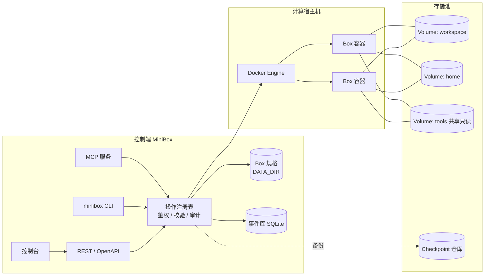
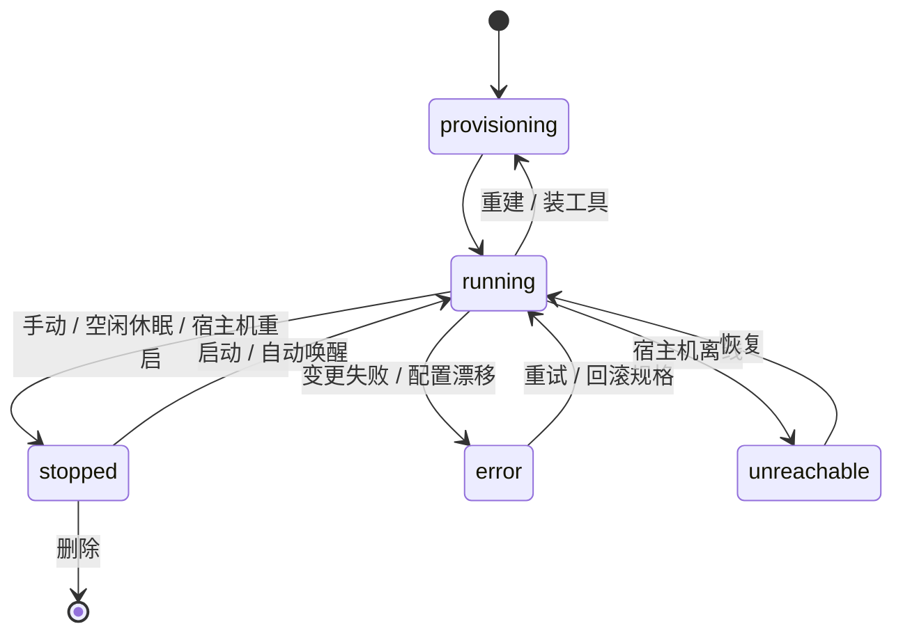

# MiniBox 产品与架构设计

> 状态：**设计已定稿，尚未实施**。本文是 2026-10 整体评审后逐项确定的产品设计，作为后续开发的依据。
> 路线图与任务拆分见 [#20](https://github.com/ArnoChenFx/minibox/issues/20)，每个章节末尾标注了对应的 issue。
> 与当前代码不一致之处，以本文为目标、以代码为现状。

## 目录

1. [定位与原则](#1-定位与原则)
2. [现状评审](#2-现状评审)
3. [总体模型](#3-总体模型)
4. [Agent 接口与操作注册表](#4-agent-接口与操作注册表)
5. [Box 规格与生命周期](#5-box-规格与生命周期)
6. [Volume 与存储池](#6-volume-与存储池)
7. [Checkpoint 与备份](#7-checkpoint-与备份)
8. [事件与审计](#8-事件与审计)
9. [令牌与权限](#9-令牌与权限)
10. [会话与接管](#10-会话与接管)
11. [工具目录与基础模板](#11-工具目录与基础模板)
12. [多宿主机与 MiniBox Agent](#12-多宿主机与-minibox-agent)
13. [控制台信息架构](#13-控制台信息架构)
14. [安全设计](#14-安全设计)
15. [实施路线](#15-实施路线)
16. [暂缓事项与开放问题](#16-暂缓事项与开放问题)
17. [决策记录](#17-决策记录)
18. [术语表](#18-术语表)

---

## 1. 定位与原则

**一句话定位：在你自己的机器上，给每个 Agent 任务一个可随时丢弃、可复现、可远程观察和接管的工作环境。**

MiniBox 面向个人用户，灵感来自 Upstash Box，但不做多租户平台。核心取舍：

- **以 Agent 为主要使用者，人负责观察和接管。** 控制台只是 API 的一个客户端，不得有控制台独有的能力。
- **单人使用。** 一个所有者加多个受限令牌；不做用户与角色体系，但数据模型里保留「主体」字段。
- **「任务/工作流」层暂不做。** 事件里的 `run` 分组是它将来的挂载点。
- **默认简单，按需展开。** 只有一台宿主机的用户看不到「宿主机」概念；一键创建仍然只要填名字。
- **容器隔离，不是安全沙箱。** Box 与宿主机共享内核，适合运行自己的 Agent，不适合运行不可信的第三方代码；可选 gVisor 运行时提升隔离性（见 [14](#14-安全设计)）。

### 产品分层

| 层 | 内容 | 状态 |
| --- | --- | --- |
| 环境层 | Host、Box、模板、Volume、Checkpoint、资源配额 | 单机已有基础，需按本文重构 |
| 能力层 | exec、文件、会话、端口预览、选装 Agent CLI、密钥、令牌 | 基本缺失，是第一优先级 |
| 工作流层 | 「任务」：仓库 + Agent + 提示词 → 运行 → 看 diff → 采纳或丢弃 | 暂不做，只预留接口 |

### 典型使用旅程

1. **起一个能干活的环境**：选模板、勾选要装的 Agent CLI、秒开。
2. **Agent 自己用**：通过 MCP 调用 `create_box` → `exec` → 读写文件 → `checkpoint`，全程使用受限令牌。
3. **观察和接管**：刷新页面后回到同一个 tmux 会话，看 Agent 在做什么，必要时直接接管。
4. **看成果**：Agent 起了 dev server，一键预览。
5. **保存、回滚、迁移**：检查点包含工作区，可回滚，也可派生出新 Box 或搬到另一台宿主机。

---

## 2. 现状评审

### 做得好的地方

- 以 Docker 标签作为唯一事实来源，无状态，重启不丢数据，不需要数据库。
- 后端分层清晰（`routes → docker/* → dockerode`），错误模型统一，校验集中，路由器很小。
- 镜像删除前校验标签，不会误删别的镜像。
- 文档、i18n、发布流程完整；类型检查、lint、单元测试全部通过。

### 主要差距

| 差距 | 说明 |
| --- | --- |
| 对 Agent 不可用 | 没有程序化的 exec 与文件接口、没有端口预览；Agent 只能自己 `docker exec` |
| 快照不含 `/workspace` | 代码都在数据卷里，`docker commit` 保存不到，快照对 Agent 价值很低 |
| 日志页永远为空 | Box 主进程是 `sleep infinity`，`docker logs` 没有输出 |
| 终端断线即丢 | 每次连接新建一个 `docker exec`，没有会话续接 |
| 单机假设 | 直接连本机 Docker Socket，指标读本机 `/proc`，`DockerCtx` 是全局单例 |
| 存算耦合 | 每个 Box 自带一个 `minibox-ws-<名称>` 卷，不能共享，不能放到存储盘 |
| 状态只在内存 | 活动记录最多 50 条，重启即丢；审计靠部分路由手动套 `tracked()` |
| 权限只有一把钥匙 | 单一 `ACCESS_KEY` 等同宿主机 root，Cookie 里直接存放原始密钥 |
| 长请求无任务模型 | 模板构建、快照提交是同步 HTTP 请求，`idleTimeout: 60` 下可能被中途断开（待复现） |
| 轮询架构 | 前端多处定时轮询，每个标签页都对 Docker 产生同样的调用 |

安全问题（限流可被 `X-Forwarded-For` 绕过、缺少 Origin 校验与 CSP、Box 缺少加固等）见 [14](#14-安全设计) 与 issue #1 #3 #4 #5 #7。

---

## 3. 总体模型

### 对象



| 对象 | 说明 | 章节 |
| --- | --- | --- |
| **Host** | 一台运行 Box 的宿主机；单机时是隐式的 `local` | [12](#12-多宿主机与-minibox-agent) |
| **Box** | 声明式规格 + 一个容器实例，容器可随时重建 | [5](#5-box-规格与生命周期) |
| **Volume** | 独立于 Box 的持久存储，属于某个存储池 | [6](#6-volume-与存储池) |
| **Checkpoint** | 规格 + 数据层 + 可选系统层的组合快照 | [7](#7-checkpoint-与备份) |
| **Template** | 只含系统环境的镜像（不含数据、不含规格） | [11](#11-工具目录与基础模板) |
| **Tool** | 可选装的 Agent CLI，是规格的一部分 | [11](#11-工具目录与基础模板) |
| **Token** | 受限的 API 令牌，用于 Agent | [9](#9-令牌与权限) |
| **Event** | 审计与活动事件 | [8](#8-事件与审计) |

### 存算分离

| | 存储面（持久） | 计算面（可丢弃） |
| --- | --- | --- |
| 对象 | Volume、卷快照、备份仓库 | Box 容器、模板、已装工具 |
| 生命周期 | 独立创建和删除，默认不随 Box 消失 | 随时重建、停止、迁移 |
| 描述方式 | 存储池、后端类型、大小 | Box 规格：模板 + 资源 + 挂载列表 + 环境变量 |

### 控制端状态

控制端不再是纯无状态，所有状态进入 `DATA_DIR`（issue #6）：

| 路径 | 内容 |
| --- | --- |
| `boxes/<id>.json` | Box 规格（主存储，容器标签带一份不含密钥的备份） |
| `events.db` | 审计与活动事件（`bun:sqlite`，WAL） |
| `exec/` | exec 输出，单独存放，7 天且有总大小上限 |
| `secrets/` | 环境变量里的密钥值、restic 仓库密钥；规格里只放引用 |
| `tokens` / `sessions` | 令牌哈希、浏览器会话 |
| `hosts.json` / `pools.json` | 宿主机、存储节点、存储池配置与证书 |

这是文件与 SQLite，不是外部数据库，「无需运维数据库」的定位不变。`DATA_DIR` 丢失时，Box 规格可从存活容器的标签恢复（密钥除外）。

---

## 4. Agent 接口与操作注册表

对应 issue #22 #9。

### 4.1 单一操作注册表

所有操作在一个注册表里**定义一次**，由它生成：REST 路由、OpenAPI 3.1 文档、MCP 工具、CLI 命令。控制台只调用同一套 REST。

每个操作的定义包含：

- `name`（如 `box.create`）、摘要；
- 输入与输出 schema；
- 所需 scope 与资源选择器（如何从输入中取出目标 Box 或 Volume）；
- 种类：`read` / `write` / `destructive`；
- 是否异步；
- MCP 元数据（工具集、工具名、描述）、CLI 命令名。

**统一执行器**是唯一入口，依次完成：

1. 鉴权：令牌 scope + 资源范围（默认 `created-by-me`）+ 配额；
2. 输入校验（schema）；
3. 危险操作的确认校验；
4. 幂等键与 `on_exists: error | reuse`；
5. 写入审计事件，取消手动 `tracked()`；
6. 统一错误 `{code, message, hint, retryable}`。

需要引入一个小的 schema 库（候选 zod / valibot，要求能输出 JSON Schema 并兼容 Bun）。这会打破目前只依赖 dockerode 的状态，已接受。

### 4.2 MCP 工具集

约 18 个工具，按工具集分组，可按需启用（`/mcp?toolsets=core,session`），避免占满 Agent 的上下文。

| 工具集 | 工具 |
| --- | --- |
| `core` | `list_boxes` `get_box` `create_box` `update_box` `box_action`（start/stop/restart）`delete_box` `exec` `exec_get` `exec_kill` `read_file` `write_file` `list_files` `copy_files` |
| `session` | `session_start` `session_send` `session_read` |
| `network` | `expose_port` `list_ports` |
| `storage` | `checkpoint` `list_checkpoints` `restore` `create_volume` `list_volumes` |
| `tools` | `install_tool` `list_tools` |
| `meta` | `get_activity` `task_wait` |

`delete_box` 单独成工具，便于单独授权。

### 4.3 执行模型

- **`exec` 是一次性命令**：`{cmd | argv, cwd?, env?, timeoutSec?, stdin?, user?}`，返回 `{exitCode, stdout, stderr, truncated, durationMs}`。通过 `exec.inspect()` 取真实退出码；超时后终止整个进程树。
- **输出上限**：默认保留头尾共 32 KB，其余给 `output_ref`，需要时再取。
- **长命令**：`background: true` 返回 `execId`，再用 `exec_get(execId, wait_ms)` 长轮询（不依赖客户端是否支持流式输出）；`exec_kill` 终止。
- **自动唤醒**：对已停止的 Box 执行 `exec` 默认自动启动。
- **默认用户**：非 root 用户 `dev`。
- **会话** `session_*` 用于长任务和需要观察的交互式程序，见 [10](#10-会话与接管)。

### 4.4 文件接口

- `read_file` / `write_file` / `list_files` / `copy_files`，以及上传下载（目录打包为 tar）。
- **以 Volume 为对象，而不是 Box**：Box 停止时也可用；装有存储节点代理时可直接读盘。
- 路径限制在卷的挂载根内，防符号链接逃逸。

### 4.5 对 Agent 友好的约定

- 按名称或 ID 寻址（名称全局唯一）。
- 重试安全：`create_box`、`checkpoint` 等支持幂等键。
- 结构化错误，例如 `hint: "Box 已停止，调用 box_action 启动"`。
- 危险操作要求键入确认：`delete_box` 需 `confirm: "<box 名称>"`，重建类变更需 `confirm: true`。
- 长操作返回任务句柄，统一用 `task_wait` 等待（任务模型见 issue #16）。
- `run` 分组：REST 请求头 `X-Minibox-Run`；MCP 会话 ID 自动作为 `run`。

### 4.6 传输

| 方式 | 说明 |
| --- | --- |
| HTTP | 控制台上的 `/mcp`（Streamable HTTP + Bearer 令牌），远程 Agent 经 HTTPS 使用 |
| stdio | `minibox mcp`，适合本机客户端 |
| CLI | `bun build --compile` 编成单文件二进制，如 `minibox exec mybox -- npm test` |
| OpenAPI | 由注册表导出，随发布提供 |

MCP 的 `instructions` 字段写明推荐流程（创建 → exec → 检查点），并提供可粘贴进 `AGENTS.md` 的使用说明。

---

## 5. Box 规格与生命周期

对应 issue #23。

### 5.1 规格与观测状态

```text
BoxSpec（期望，存控制端）              BoxStatus（观测，来自 Docker）
├ id        稳定 ID，如 bx_8f3k2        ├ containerId / hostId
├ name      全局唯一                    ├ state / reason
├ host      auto 或指定                 ├ startedAt / ip
├ template  镜像引用 + 固定 digest       ├ drift（实际配置与规格不一致）
├ resources cpus / memory / pids        └ lastError
├ mounts[]  {volume, path, mode(rw|ro)}
├ env       明文变量 + 密钥引用
├ tools[]   {id, version}
├ lifecycle desired(running|stopped)、idleTimeout、ttl
└ revision  每次修改 +1
```

### 5.2 存储位置

- **主存储**：`DATA_DIR/boxes/<id>.json`。
- **容器标签带一份只读备份**（规格 JSON，**不含密钥值**，密钥只存引用）。`DATA_DIR` 丢失时可从存活容器标签「认领」恢复。
- 现有 Box 自动「认领」：由 `inspect` 反推出规格。

### 5.3 标识

- Box 的稳定 ID 与容器 ID 脱钩；**名称全局唯一，与宿主机无关**，迁移后 URL 与令牌授权不变。
- 容器名派生为 `minibox-<id>`。
- 现有「容器 ID 或 `minibox-<名称>`」形式的路由继续兼容。

### 5.4 变更分两类

| 类型 | 字段 | 影响 |
| --- | --- | --- |
| **原地更新** | cpus、memory、pids、标签、空闲超时、TTL、重命名 | 无中断 |
| **重建** | 模板、挂载（增删卷）、环境变量、网络、安全档位 | 进程终止 |

Docker 不能给运行中的容器加挂载，所以「挂载共享卷」和「换模板」必然是一次重建。工具安装通过 `exec` 完成，不属于这两类。

- 修改接口使用 `If-Match: <revision>` 乐观并发，防止人和 Agent 同时修改互相覆盖；保留最近 N 个版本，可回滚。
- **重建必须显式确认**：用 `docker diff` 预览可写层会丢失的改动，可选先创建含系统层的检查点。

### 5.5 重建时什么保留、什么丢失

- **保留**：所有挂载卷的内容、规格、名称与稳定 ID、卷快照、活动记录。
- **丢失**：容器可写层（没写入卷或模板的改动，如 `/etc` 修改、`/tmp`）、运行中的进程（含 tmux 会话）、容器 IP。

### 5.6 重建流程（失败可回滚）

1. 用新规格创建新容器（不启动），验证镜像与配置；
2. 停旧容器并改名为 `-old`；
3. 新容器改为正式名称并启动；
4. 启动检查通过后删除旧容器；失败则恢复旧容器，并把规格回滚到上一版。

### 5.7 状态机



期望状态存在规格里，服务或宿主机重启后据此拉起或保持停止。

### 5.8 删除语义

- 创建 Box 时**自动新建**的卷标记为「随 Box 拥有」，删除时询问是否一并删除，**默认保留**（与现在一致）。
- 显式创建或被多个 Box 共享的卷是「独立」的，删除 Box 永不带走。
- 无任何 Box 挂载的卷在库里标「未挂载」，并给出清理建议。

### 5.9 与其它特性的关系

- **空闲休眠** = 期望状态改为 `stopped`，**不删容器**。`docker stop` 已释放 CPU 和内存，删容器只会多回收可写层磁盘，却丢掉装在可写层里的东西。删除容器仅用于重建与迁移。
- **预热池**只对默认挂载有效：一旦需要额外挂载、换模板或改环境变量就要重建。
- 环境变量里的密钥单独存储，**不写进容器标签**。

---

## 6. Volume 与存储池

对应 issue #24 #27 #28 #29 #30。

### 6.1 Volume 是独立对象

- 有自己的生命周期，默认不随 Box 消失；Box 通过规格里的 `mounts[]` 挂载 0..N 个卷，每次挂载指定路径与读写模式。
- 卷名不再由 Box 名推导。已有的 `minibox-ws-*` 卷**自动识别**为 Volume，不需要迁移步骤。

### 6.2 共享

同一个 Volume 可同时挂载到多个 Box。**默认可读写，由用户负责**，每次挂载仍可单独选只读。

- 界面补偿：把已被其它 Box 读写挂载的卷再挂载时提示风险；工具卷默认以只读方式挂给其它 Box。
- 安全：挂载某卷等同于获得该卷的读权限，创建 Box 或更新挂载需要对该卷的 `volume:attach` 授权（见 [9](#9-令牌与权限)）。
- 所有模板统一 uid/gid，否则共享卷会出现权限问题（见 [11](#11-工具目录与基础模板)）。
- Docker 不管文件锁，并发写冲突由应用自己负责。

### 6.3 标准卷角色

| 角色 | 默认存储池 | 挂载点 | 说明 |
| --- | --- | --- | --- |
| `workspace` | 默认池（如 NAS） | `/workspace` | 代码与项目文件 |
| `home` | 默认池 | `/home/dev` | 用户配置与登录态；标记为敏感（含凭据） |
| `tools` | 默认池，只读共享 | `/opt/minibox/tools` | Agent CLI 等，多个 Box 共用 |
| `cache` | **本地池** | `~/.cache` 等 | 包管理器与构建缓存，可丢弃，**不进检查点** |

系统级的包归模板；容器可写层里的内容重建后丢失。`cache` 卷放本地是为了绕开网络存储上小文件操作慢的问题。

### 6.4 存储池与后端

存储池 = `{名称, 后端类型, 参数, 能力}`。Volume 属于某个池；「默认存储池」可配置，各角色可单独覆盖。

```yaml
pools:
  - name: nas
    backend: nfs
    server: 192.168.1.10
    export: /volume1/minibox
    options: [nfsvers=4.1, hard, noatime]
    default: true
  - name: local
    backend: local
```

**第一版后端：**

| 后端 | 说明 |
| --- | --- |
| `local` | Docker 本地卷 |
| `nfs` | MiniBox 管理的 NFS：使用 Docker `local` 驱动的 NFS 选项，卷在**容器启动时**挂载，挂载失败则启动失败，不会静默写入本地盘；子目录由短生命周期的辅助容器在导出根目录下创建并设置权限 |
| `path` | 用户自己挂载好的存储根目录（协议无关）。需要「挂载守卫」：校验标记文件，避免 NFS 未挂载时静默写入本地盘 |

后端能力标志（`shareable` / `snapshots` / `quota` / `clone` / `crossHost`）决定界面上哪些功能可用。装有存储节点代理的池可升级能力，见 [12.4](#124-存储节点角色)。

### 6.5 哪些放存储端，哪些留在本地

| 放存储端 | 必须留在计算端 |
| --- | --- |
| workspace、home、共享卷、工具卷、检查点仓库 | Docker 镜像与容器可写层（`overlay2` 不能放在 NFS 上）、`DATA_DIR` |

不要把整个 Docker `data-root` 搬到网络存储上。`DATA_DIR` 可定期备份到存储池。

### 6.6 存储健康

- 探测池可达性；存储不可达时相关 Box 显示「存储不可达」，避免看起来像 Agent 卡死（`hard` 挂载下 I/O 会卡住，`docker stop` 也可能卡住）。
- 池剩余空间告警；每卷占用靠辅助容器统计并缓存。
- 第一版无每卷配额；需要配额时由存储节点代理提供。

### 6.7 NAS 与网络注意事项

- **商用 NAS 不能依赖其原生快照/克隆**：粒度为整个共享文件夹，btrfs 嵌套子卷经 NFS 导出还有可见性问题。第一版检查点用 restic。
- NAS 对整个 `minibox` 共享文件夹开启的定时快照可作为灾备层，与 MiniBox Checkpoint 互补。
- 2.5G 网络对大文件够用，但 NFS 上小文件操作受往返延迟限制，缓存与构建产物放本地 `cache` 卷；`node_modules` 无法预挂载（路径取决于项目位置），可为具体路径额外挂本地卷。
- NFS 默认不加密，应在内网或 WireGuard / Tailscale 内使用；导出目录专用并限制客户端 IP；建议 `all_squash` 配合固定 `anonuid`，与模板 uid 对齐。
- 存储端宕机时，`hard` 挂载会使所有 Box 的 I/O 卡住；`soft` 挂载有数据损坏风险，不建议。
- SQLite、文件锁、inotify 在 NFS 上行为可能异常。

详细的部署步骤见 issue #30 的文档。

---

## 7. Checkpoint 与备份

对应 issue #11。

### 7.1 对象

用户看到的是一个组合对象，底层仍是独立的存储：

```text
Checkpoint
├ 规格版本            ← 当时的 BoxSpec(revision)
├ 数据层[]            ← 每个被包含的卷各一份卷快照
├ 系统层（可选）       ← docker commit 出的镜像
├ 元信息              ← 名称、原因、创建者（主体）、是否置顶、是否自动生成
└ 一致性模式           ← live | pause | stop
```

- 卷快照也可**脱离 Box 单独存在**，直接对 Volume 操作。
- 现有纯系统层快照视为「只有系统层的 Checkpoint」，继续有效。
- **默认内容**：规格 + 该 Box「拥有」的卷（workspace + home）；共享卷需逐个勾选；`cache` 卷不进检查点；系统层可选，界面用 `docker diff` 提示可写层改动量。
- home 卷标记为**敏感**：派生新 Box 时「复制 home」默认关闭；导出包默认加密。

### 7.2 引擎

去重增量（restic 类），做成可插拔接口，备份目标也可插拔（本地卷、SFTP、S3）。

- 辅助镜像里运行 restic，仓库放在专用卷或存储池中；NAS 场景下放在**另一个**共享文件夹，不要与工作区处于同一快照范围。
- 优点：Agent 频繁做检查点也不会吃满磁盘；自带保留策略与加密；仓库以后可指向异地。
- 代价：多一个辅助镜像和仓库密钥（存 `DATA_DIR/secrets`）。
- **能力阶梯**（装有存储节点代理时）：原生快照/克隆 > reflink 复制 > restic。
- **一致性**：默认 `live`（崩溃一致）；`pause`（冻结容器）、`stop` 可选。回滚前或重建前的安全点在 Box 已停止时执行。
- 本地仓库与 Docker 数据同盘，**不是灾备**，文档需写明；真正的灾备要把仓库另指别处。

### 7.3 恢复

| 方式 | 说明 |
| --- | --- |
| **派生新 Box（Fork）** | 创建新 Box 与新卷，原 Box 不受影响。适合让多个 Agent 从同一检查点各试一条路 |
| **原地回滚** | **恢复到一个全新的卷，再重建 Box 把挂载切到新卷**；原卷保留到用户确认或撤销。共享卷只提供「恢复为新卷」，不原地覆盖 |
| **取回单个文件** | 浏览快照内容并拷出（接口预留，后做） |

回滚后 Box 上提示「已回滚到 X，旧卷 Y 仍保留 [确认并清理] [撤销回滚]」。

### 7.4 触发与保留

- 触发：手动、API/MCP（`checkpoint(label, reason)`）、自动（回滚前、重建前的安全点）、定时。
- 保留策略：`keep-last`、`keep-daily` 等，全局默认，可按 Box 覆盖。自动生成的受策略清理；手动的不会被自动清；置顶的永远保留。
- 容量：显示仓库总占用，到阈值告警，超限拒绝新的自动检查点。
- 可选「回收站」：删除 Box 或卷前自动做一份最终快照，保留几天再清理。

### 7.5 API

```text
POST  /api/boxes/:id/checkpoints   { label, include, consistency }
GET   /api/checkpoints[/:id]
POST  /api/checkpoints/:id/fork    { name, host?, copyHome? }
POST  /api/boxes/:id/rollback      { checkpoint, confirm }
POST  /api/volumes/:id/snapshots   /  POST /api/volumes/:id/restore
PATCH /api/checkpoints/:id         { pinned, label }
```

均为异步任务，带进度。「提升为模板」需要系统层，没有则提示「现在捕获系统层」。

---

## 8. 事件与审计

对应 issue #25。

### 8.1 记录入口

在操作注册表的执行器里**统一记录一次**，REST / MCP / CLI / 控制台自动全覆盖，不会再有漏记的路由。

### 8.2 事件结构

```text
Event
├ id        ULID（可排序）
├ ts / durationMs / status   started | ok | error | denied
├ principal { type: owner|token|box-self|system, id, name }
├ source    ui | rest | mcp | cli | scheduler | system
├ op        如 box.create、exec.run、file.write、checkpoint.create
├ target    { kind, id, name }
├ hostId
├ summary   一句人话
├ detail    各操作自己的结构化内容（已脱敏）
├ run       分组标识
├ parentId  由哪个事件触发（如 update_box 触发的重建）
└ ref       { execId, outputRef, taskId }
```

`run` 是将来「任务」层的挂载点，无需改事件模型。

### 8.3 分档与保留

| 档位 | 内容 | 默认保留 |
| --- | --- | --- |
| 审计 | 创建/删除/修改 Box、启停、挂载变更、检查点与回滚、令牌创建与吊销、登录成功与失败、被拒绝的操作、端口暴露、宿主机变更 | 1 年 |
| 活动 | exec（完整命令行、退出码、耗时）、文件写入（路径、大小、哈希，**不记内容**）、会话发送、终端会话开闭 | 30 天 |
| 输出 | exec 的 stdout/stderr（头尾各最多 64 KB），单独存放 | 7 天，且有总大小上限 |

- 命令与退出码比输出保留得久。
- 文件读取按「主体 + Box + 每分钟」**合并为带计数的一条**；登录失败按 IP 按分钟合并。
- 删除 Box 后事件仍按保留期留存，并支持「清除该 Box 全部历史」。

### 8.4 事件与活动信号

- **事件**持久化。
- **活动信号**只是内存里的「该 Box 最后活动时间」心跳，不落盘。预览代理的每个请求、终端数据帧只更新活动信号，否则一个网页预览就会产生海量事件。
- 空闲休眠使用活动信号，不使用事件表。

### 8.5 存储

`bun:sqlite` 单文件（WAL），位于 `DATA_DIR`，提供 JSONL 导出。保留期清理即一条 `DELETE`。

### 8.6 脱敏

1. 环境变量**只记变量名，不记值**；
2. 精确匹配：凭据存储里所有已知值（访问密钥、令牌、环境变量里的密钥）出现在命令或输出中时替换为 `***`；
3. 启发式：常见格式（`sk-…`、`ghp_…`、`AKIA…`、JWT、`Bearer xxx`）尽力替换——**文档注明是尽力而为，不保证**；
4. 文件内容永不记录；
5. 可按令牌或按 Box 关闭输出采集；
6. 审计日志本身是敏感数据：仅所有者与 `admin` 令牌可读；Agent 令牌的 `get_activity` 默认只看自己范围内的事件。

### 8.7 审计边界

**只审计经过控制面的操作，不是对 Box 内部行为的录像。**

- 网页终端只记会话开闭和数据量，不逐键记录。
- Box 里运行的 Agent（如 Claude Code 自己执行的命令）MiniBox 看不到。
- 可按 Box 开启 tmux 会话录制（`pipe-pane` 写入 Box 卷内日志，随检查点走）。
- 暂缓：在工具目录里声明各 Agent CLI 的 transcript 位置并只读展示。

### 8.8 接口

- `GET /api/events?box=&principal=&op=&status=&run=&since=&cursor=`
- `GET /api/events/stream`（SSE），与状态变化推送共用同一条事件总线（issue #17）。
- MCP `get_activity(box, since, limit)` 返回紧凑摘要，供 Agent 在上下文被清空后找回「我做过什么」。

---

## 9. 令牌与权限

对应 issue #13 #2。

### 9.1 令牌模型

```text
Token
├ scopes      box:read · box:write · box:delete · exec · files:read/write
│             port:expose · checkpoint:create/restore · volume:attach · tool:install
├ 资源范围     boxes:   created-by-me（默认）| 指定 ID/标签 | *
│             volumes: 显式授予列表
│             hosts:   允许的宿主机
├ 配额         maxBoxes · maxCpus · maxMemoryMb · maxTtl · 速率限制
└ 过期、最后使用、创建者
```

预设：`readonly`、`operator`、`sandboxed-agent`、`admin`。

- **默认只管理「自己创建的 Box」（`created-by-me`）**：不用手动列清单，你其它的环境默认看不到也碰不到；创建出的 Box 记录归属，吊销令牌时可一并清理。
- **TTL**：`create_box` 支持 `ttl`，到期自动停止或删除，避免 Agent 留下僵尸 Box；配额兜住失控的并发创建。
- 令牌只在创建时显示一次，服务端只保存哈希；记录最后使用时间与 IP；可随时撤销。
- 所有鉴权入口（REST、MCP、WebSocket、预览代理）统一经过执行器，替换现在的布尔判断 `isAuthorized`。
- 单人场景，不做用户与角色体系；事件与令牌里带「主体」字段，为将来加用户体系预留。

### 9.2 必须写进文档与测试的安全约束

- **`exec` 隐含该 Box 所有挂载卷的读写能力**，所以细分的 `files:*` 权限只对没有 `exec` 的令牌有意义。
- **挂载某卷等于获得该卷的读权限**：创建 Box 或更新挂载需要对该卷的 `volume:attach` 授权，否则 Agent 可以新建 Box 把别人的卷挂进去读走。

### 9.3 浏览器会话

现在 Cookie 里直接存放原始 `ACCESS_KEY`，有效期 30 天，泄露即永久 root 且无法单独撤销。改为登录后签发随机会话令牌（至少 256 bit），服务端保存其哈希、创建时间、最后活动时间；支持登出作废、绝对与滑动过期、设置页「会话列表 / 退出其他设备」。`Authorization: Bearer <ACCESS_KEY>` 保留，用于脚本。

### 9.4 暂缓：Box 内 Agent 的自访问

Box 里的 Agent 想自己做检查点、暴露端口、派生子 Box，但 MiniBox 默认只监听 `127.0.0.1`，容器内访问不到，且在 Box 里放长期令牌容易被写进文件或快照。方向是：为每个 Box 注入**自动签发、仅限自身、随 Box 销毁而失效**的令牌，或每个 Box 一个 Unix socket（远程宿主机需要计算节点代理）。令牌模型先预留 `self` 主体类型，放到第二阶段。

---

## 10. 会话与接管

对应 issue #14。

### 10.1 会话原语

- 基础模板预装 `tmux`。终端 WebSocket 默认附着到 tmux 会话，可有多个具名会话；关闭浏览器后进程继续运行，重新打开可续接。
- 工具：`session_start {box, name}` · `session_send {keys|text}` · `session_read {lines|since}`。
- 一次性命令用 `exec`，长任务和需要观察的用 `session`。
- **Agent 与控制台终端共享同一个会话**：人在控制台打开的就是 Agent 正在驱动的那个。

### 10.2 接管：硬锁

- 打开 Agent 正在驱动的会话时**默认只读观察**；点「接管」才可输入。
- 接管期间会话进入「人控制」状态：Agent 的 `session_send` 被拒绝并返回结构化错误 `taken_over`（提示稍后重试），`session_read` 仍可用，Agent 能看到人在做什么。
- 手动「还给 Agent」，或空闲超时自动归还（可配置）。
- 理由：不加锁时，人和 Agent 同时往同一个 tmux 敲字，输入会互相穿插，结果不可预测。

### 10.3 活动标签页取代日志页

Box 详情的「活动」标签页合并：exec 历史、容器事件（启动/停止/OOM）、会话开闭；保留原 `docker logs` 作为次要选项。默认只记会话开闭，不录键入；可按 Box 开启会话录制。

### 10.4 终端健壮性

心跳与超时清理；处理 `ws.send` 的返回值实现背压；退出时确保终止对应 exec 进程；可选保存最近 N KB 输出用于重连回放。WebSocket 升级需要 Origin 校验。

---

## 11. 工具目录与基础模板

对应 issue #8 #27 #15。

### 11.1 创建时选装，运行中追加

- 创建 Box 时可勾选 Agent CLI；常用工具在一键层直接勾选，并记住上次选择。
- 运行中的 Box 可随时安装、升级、卸载，无需重建。
- `BoxSpec.tools[]` 是期望状态。安装是「让实际状态趋向期望状态」的幂等操作，重建后依据规格自动补装缺失工具。
- 由 `docker exec` 在 Box 内以 `dev` 用户执行，不属于「重建」类变更。

### 11.2 安装位置

- Agent CLI 装到**共享的只读工具卷**（`/opt/minibox/tools`，`PATH` 已包含其 `bin`）；多个 Box 共用，省磁盘也省安装时间。
- 用户配置与登录态放 **home 卷**；系统级的包（`apt`）归模板。

### 11.3 工具目录

声明式清单：`id`、名称、说明、安装/检测/升级/卸载命令、依赖（如 Node ≥ 20）、是否需要 root、预估体积、安装来源（npm / pip / 官方脚本）。

- 内置：Claude Code、OpenAI Codex CLI、Gemini CLI、OpenCode、Aider 等。
- 清单放仓库 `catalog/*.json`，并允许在 `DATA_DIR/tools.d/` 放自定义条目。
- 长耗时安装使用异步任务与进度流；兼容代理配置。
- API Key：短期用环境变量输入，密钥单独存储；长期方向是宿主机侧密钥注入，避免把密钥写进 Box。

### 11.4 基础模板调整

`templates/base/Dockerfile` 需要：

1. 非 root 用户 `dev`，固定 uid/gid（如 1000，构建参数可调），默认以该用户进入终端与 exec；提供无密码 `sudo`（仅限 Box 内）。
2. 预装 `tmux`。
3. 常用工具：`jq`、`ripgrep`、`openssh-client`、`unzip`，保留现有 git / curl / python3 / build-essential / procps / less / vim-tiny。
4. 挂载点约定：`/workspace`、`/home/dev`、`/opt/minibox/tools`；`~/.cache` 与包管理器缓存（`npm_config_cache`、`PIP_CACHE_DIR` 等）指向 `cache` 卷。
5. 保持 `CMD ["sleep","infinity"]` 与现有标签；标签中记录 uid 约定，创建 Box 时若模板 uid 与存储池约定不一致则警告。
6. 多架构构建（`amd64`、`arm64`）。

### 11.5 模板增强（后续）

官方变体（Node / Python / Go / 极简）、声明式模板（Dockerfile / Git 仓库）、创建时克隆 git 仓库与初始化脚本、按需 `docker pull`。**预热池**：预先创建带空 workspace 卷的 Box，认领时把该卷记为新 Box 的 workspace；只对默认挂载有效。

---

## 12. 多宿主机与 MiniBox Agent

对应 issue #21 #28 #29。

### 12.1 已定稿的决策

- **连接形态：先做 SSH / TLS 直连，再做出站 Agent。** NAT 后面的机器在第一阶段暂不支持。
- 单人使用，令牌区分 Agent。
- Box 的稳定 ID 与全局唯一名称使迁移不改变标识；规格里带 `host`，迁移 = 改 `host` 再执行。
- Box 可放在任何能访问其存储池的宿主机上；本地卷绑定宿主机，调度时 Box 必须跟着卷走。

### 12.2 Host 抽象

`Host = { id, name, kind, endpoint, labels, status }`，`DockerCtx` 变成每个 Host 一个，由 `HostRegistry` 管理。把散落的直接调用收敛到一个窄的 `Runtime` 接口（容器 / 镜像 / 卷 / exec / stats / events），Docker 是第一个实现，便于以后接 gVisor、Podman，也方便测试里 fake。单机不配置时是隐式的 `local`，行为与现在一致。

### 12.3 连接方式

| 阶段 | 方式 |
| --- | --- |
| A | `unix://`、`tcp://`（必须 TLS 双向认证）、`ssh://user@host`（通过 SSH 隧道转发 Docker API，不需要在远端暴露端口，最易上手） |
| B | 计算节点 Agent：主动连回控制台，适合 NAT 后面的机器，只暴露 MiniBox 需要的那一小部分 API |

要点：

- 路由 `/api/hosts/:host/boxes/:id/...`，同时保留 `/api/boxes/...`（默认 `local`）。列表聚合所有宿主机，并行请求，单台超时或离线不阻塞整体。
- **指标**：远程读不到 `/proc`。阶段 A 用 `docker info` / `docker system df` 的核数、内存、容器数，实时占用汇总各 Box 的 stats 近似；阶段 B 由 Agent 上报。
- **调度与容量**：`assertCapacity` 按目标宿主机校验并考虑已分配配额；`host: "auto"` 按剩余容量或标签挑选，先做「最空闲优先」。
- **模板与检查点按宿主机独立**：创建时目标机缺少模板则自动构建或拉取，或清晰报错；跨机复制用 `docker save | docker load` 或共享仓库。共享存储池下迁移只需换宿主机重新挂载，不用拷数据。
- **预览代理**：远程宿主机上不能直连容器 IP，需要经 SSH 隧道或 Agent 转发。
- **可靠性**：宿主机离线时 UI 灰态，其上的 Box 标「不可达」而不是消失；后台重试带退避。

### 12.4 存储节点角色

存储节点代理是 MiniBox Agent 的 `storage` 角色，可在 NAS（有 Docker 或可运行二进制）和普通 Linux 存储服务器上运行。**它是可选的，不是依赖**：没有 Agent 时存储池照常工作，界面按实际能力显示可用功能。

**一个 Agent，两种角色：**

| 角色 | 跑在哪 | 职责 |
| --- | --- | --- |
| `storage` | 有磁盘的机器：NAS、Linux 存储服务器 | 本节点上的目录、配额、用量、快照、备份、健康 |
| `compute` | 跑 Box 的机器 | 转发 Docker API、采集指标、转发终端与预览流量 |

同一台机器可同时启用两个角色。

**部署与安全：**

- 容器（挂入共享文件夹）或单文件二进制 + systemd；多架构 `amd64` / `arm64`。并非所有 NAS 支持 Docker，所以二进制方式必须提供。
- **配对**：控制台生成一次性配对命令，Agent **主动连回**控制台（出站连接，对 NAT 与防火墙友好），换发各自的证书（mTLS），可随时吊销。
- **权限边界**：只暴露**固定的一组操作**（不是远程 shell），所有路径限定在配置的根目录内，防符号链接逃逸。
- **能力探测**：启动时探测并上报文件系统类型、可用工具、容量；控制台据此显示每个节点或存储池实际可用的功能。

**存储节点的能力：**

| 能力 | 说明 |
| --- | --- |
| 目录管理 | 创建/删除/重命名 Volume 目录，**在本机直接设置属主与权限**，绕开 NAS 的 squash 限制 |
| 用量统计 | 本机读盘：ZFS 用 `zfs get used`，btrfs/xfs 用对应配额统计，否则 `du` 并缓存 |
| 配额 | 文件系统支持则启用 ZFS 数据集配额、btrfs qgroup、xfs 项目配额；否则软配额（监控 + 告警） |
| 快照与克隆 | 按能力阶梯选择（见下） |
| 本地 restic | 备份与恢复在存储节点本机读盘，仓库也在本机，**数据不走局域网** |
| 文件接口 | 直接读写 Volume 文件，不需要 Box 运行，也不经过计算服务器 |
| 健康 | 磁盘空间、文件系统错误、btrfs/ZFS scrub 状态、可选 SMART |
| NFS 导出 | 仅限普通 Linux 且需显式开启；NAS 的导出由用户在其管理界面设置 |

**快照与克隆的能力阶梯**（启动时探测，选最优）：

1. **原生**：ZFS 数据集快照与 `zfs clone`；btrfs 子卷快照（需先确认 NFS 导出能正确看到子卷，探测不通过则跳过）。
2. **reflink 复制**：btrfs 或开启 reflink 的 xfs 上用 `cp --reflink`，Fork 秒级且几乎不占空间。因为只是普通目录和文件，**没有嵌套子卷的 NFS 可见性问题**，对商用 NAS 更稳妥。OpenZFS 2.2+ 开启 block cloning 后也可用。
3. **restic**：通用兜底，第一版就有。

---

## 13. 控制台信息架构

对应 issue #26。控制台改版随各阶段逐页落地，不做一次性重写。

### 13.1 原则

1. 默认简单，按需展开。
2. **观察和接管是主线**，概览第一屏回答「现在有哪些 Agent 在做什么」。
3. 各类对象体验一致：列表、详情、活动、权限。
4. 改动前先说清影响：热更新立即生效，需要重建的变更先暂存后统一确认。

### 13.2 导航（6 项）

| 导航 | 内容 |
| --- | --- |
| 概览 | 「正在进行」、需要关注的事项、容量、最近时间线 |
| Boxes | 列表、筛选、创建 |
| 存储 | Volume 与 Checkpoint 两个标签页 |
| 库 | 模板、工具目录 |
| 活动 | 全局审计时间线，可按 Box、令牌、操作、状态过滤 |
| 设置 | 宿主机 · 令牌与会话 · 默认值 · 备份 · 安全与审计 · 系统 |

宿主机筛选器只在配置了不止一台宿主机时才出现在顶栏；宿主机管理在「设置 → 宿主机」。

### 13.3 概览首屏

```text
┌ 正在进行 ──────────────────────────────────────────────────────┐
│ ● agent-dev    令牌 claude-ci   正在运行: npm test   12s 前输出   │
│   ▸ 最近输出（实时 3 行）                    [观察] [接管]        │
│ ● scraper      令牌 codex       空闲 4 分钟                      │
├ 需要关注 ──────────────────────────────────────────────────────┤
│ ⚠ demo 内存使用 92%   ⚠ 检查点失败: web-app   ⓘ 旧卷待确认删除     │
├ 容量 / 宿主机 ──────────────┬ 最近活动 ──────────────────────────┤
```

- 「正在进行」来自活动信号与事件流：最近有活动的 Box、其主体（令牌）、当前或最近的命令。
- 「需要关注」汇总异常：OOM、超配额、检查点失败、配置漂移、回滚后待确认的旧卷、存储池不可达。
- Box 列表里有「Agent 活动中 · 12 秒前」的指示。

### 13.4 创建 Box：三层

1. **一键层**：名称（自动建议）· 模板 · 规格预设 · 常用工具勾选（记住上次选择）。
2. **更多选项（折叠）**：宿主机（多机时）· 工作区（新建/挂载已有卷，指定路径与读写）· 环境变量 · 克隆 git 仓库 · TTL 与空闲超时 · 安全档位 · 从检查点创建。
3. **规格视图**：JSON 规格编辑，并提供「复制为 CLI 命令 / curl / MCP 调用」。

提交前显示一行摘要，例如「将创建 1 个 Box、2 个新卷，占用 2 核 / 4 GB」，并沿用容量校验。

### 13.5 Box 详情（6 个标签页）

**概览 · 终端 · 文件 · 端口 · 活动 · 设置**

- 终端：列出所有 tmux 会话，标明是 Agent 创建还是你创建。
- 文件：基于 Volume，Box 停止时也可浏览。
- 设置分区：资源 · 存储与挂载 · 工具 · 环境变量 · 生命周期 · 安全 · 检查点 · 规格历史。
- 标题栏有「创建检查点」按钮。

### 13.6 重建类变更：暂存，统一应用

热更新字段改完立即生效；需要重建的字段只**暂存**，设置页顶部出现横幅：

> 3 项变更待应用，需要重建 Box。 [查看差异] [应用并重建] [放弃]

点击后确认框显示：规格差异（改前 → 改后）、将终止的会话与进程数、`docker diff` 的可写层改动（可展开）、勾选「先创建检查点（含系统层）」，并明确写出「所有卷中的数据保持不变」。

### 13.7 存储页

- **Volume 表**：名称、大小、已挂载的 Box（带读写标签）、拥有者（随 Box / 独立）、所在存储池与能力、最近检查点、状态。没有任何 Box 挂载的标「未挂载」并给出清理建议。操作：浏览文件、快照、挂载到 Box、删除。
- **Checkpoint**：按 Box 的时间线分组，显示时间、标签、手动/自动/置顶、包含的内容和大小。操作：派生新 Box、回滚、置顶、删除。

### 13.8 首次引导

没有 Box 时，概览显示三步清单：**① 构建基础模板 → ② 创建第一个 Box → ③ 连接 Agent**。

第三步是 Agent 优先产品的关键入口：选择客户端类型（Claude Code、Codex、其它）→ 选令牌预设 → 生成可直接复制的 MCP 配置片段，并一次性显示令牌。

### 13.9 移动端

手机上最常用的场景是看有什么在跑、看终端、接管、停止一个 Box。底部放标签栏（概览 / Boxes / 活动 / 更多），终端加一排辅助键（Esc、Ctrl、Tab、方向键），设置类的复杂表单不优先适配。

---

## 14. 安全设计

MiniBox 的前提是**一个可信用户在自己的机器上使用**。Docker Socket 等同于宿主机 root，访问密钥一旦泄露就等于完全失守。本节汇总评审中发现的问题与对策，对应 issue #1 #2 #3 #4 #5 #7。

| 问题 | 对策 |
| --- | --- |
| 登录限流可通过伪造 `X-Forwarded-For` 绕过；限流 Map 可被撑爆 | 新增 `TRUST_PROXY`（默认关闭），仅在开启时读取代理头；`X-Forwarded-Proto` 同样受控；限流表加清理或容量上限 |
| Cookie 存原始 `ACCESS_KEY` | 会话令牌，见 [9.3](#93-浏览器会话) |
| WebSocket 终端和写接口没有 Origin 校验 | 校验 `Origin`（或 `Sec-Fetch-Site`），写接口要求 `Content-Type: application/json`，Cookie 升级为 `SameSite=Strict`（需验证） |
| 没有 CSP / HSTS；xterm.js 从 CDN 加载且无 SRI | xterm 打包进 `web/vendor/`，加严格 CSP，HTTPS 请求发送 HSTS；`innerHTML` 拼接逐步收敛到统一转义 |
| Box 缺少加固 | 默认 `PidsLimit`、`CapDrop: ["ALL"]` 后按需加回、`no-new-privileges`、ulimit；模板用非 root；每个 Box 独立网络并提供出站策略；可选 `RUNTIME=runsc`（gVisor）；磁盘配额由存储节点提供 |
| 快照描述存在标签注入 | 校验拒绝控制字符与换行，或统一转义标签值 |
| `restart.sh` 的 `chmod 666 docker.sock` | 改为把用户加入 `docker` 组 |
| 镜像以 root 运行 | 挂载 Socket 的代价；文档给出 socket proxy 或 rootless 方案 |
| 自动生成密钥会覆盖整个 `.env` | 只追加 `ACCESS_KEY`，并引入 `DATA_DIR` |

另有两条贯穿全文的约束：

- `exec` 隐含该 Box 所有挂载卷的读写能力；挂载某卷需要 `volume:attach` 授权（见 [9.2](#92-必须写进文档与测试的安全约束)）。
- 共享可写卷是横向移动通道：一个被攻破的 Box 可以改 `.bashrc`、git hook 或脚本，污染另一个 Box。默认可读写是产品决策，但界面要给出提示，工具卷默认只读。

---

## 15. 实施路线


| 阶段 | 内容 | issue |
| --- | --- | --- |
| **0 地基** | `DATA_DIR`、CI 与 Dependabot、限流与 Origin 与 CSP 安全修复、操作注册表 | #6 #18 #1 #3 #4 #22 |
| **1 规格、审计、令牌** | Box 规格与稳定 ID、事件与审计、会话令牌、令牌与权限、Box 加固、异步任务 | #23 #25 #2 #13 #5 #16 |
| **2 存储与 Agent 接口** | Volume 与存储池（`local` / `nfs` / `path`）、基础模板调整、exec 与文件 API 与 MCP 与 CLI、tmux 会话与接管、统一采样与 SSE、NAS 文档 | #24 #27 #9 #14 #17 #30 |
| **3 核心价值** | Checkpoint（restic）、端口预览、创建时选装 Agent CLI | #11 #10 #8 |
| **4 Agent 与存储节点** | MiniBox Agent 框架、存储节点角色 | #28 #29 |
| **5 多宿主机与优化** | 多宿主机（先 SSH / TLS，再计算节点 Agent）、空闲休眠、模板增强与预热池 | #21 #12 #15 |
| **贯穿各阶段** | 控制台改版（逐页落地）、集成测试、低危安全加固 | #26 #19 #7 |

### 依赖关系

- `DATA_DIR`（#6）是令牌、规格、审计、存储池、宿主机配置的前置。
- 操作注册表（#22）是 exec、令牌、会话、审计的前置。
- Box 规格（#23）是工具、检查点、休眠、预热池、多宿主机、Volume 的前置。
- Volume 与存储池（#24）是工具、检查点、多宿主机、存储节点的前置。
- 多宿主机（#21）会改变 Box 的标识与路由，凡涉及 exec / 预览 / 令牌 / 检查点的实现应按「每个 Host 一个 Runtime」来写。

---

## 16. 暂缓事项与开放问题

### 暂缓

- Box 内 Agent 的自访问接口（`self` 令牌或每 Box 一个 Unix socket）。
- Agent 请求人工审批：令牌上的某些操作先进入审批队列，由你在概览里批准。
- 预设保存为蓝图；webhook 通知。
- 各 Agent CLI 的 transcript 位置声明与只读展示。
- 「任务/工作流」层：仓库 + Agent + 提示词 → 运行 → 看 diff → 采纳或丢弃。
- 取回检查点中的单个文件。
- 商用 NAS 的原生快照/克隆后端。

### 开放问题

| 问题 | 备注 |
| --- | --- |
| schema 库选型（zod / valibot） | 需能输出 JSON Schema、兼容 Bun、体积可接受 |
| Agent 程序的实现语言与体积 | 倾向与控制端同一个 TypeScript/Bun 代码库（`bun build --compile`），体积是否可接受需评估 |
| 存储节点代理保存 restic 密钥的方式 | 本地保存（权限 600）还是由控制端按操作传入 |
| 模板构建超过 60 秒是否真的被 `idleTimeout` 断开 | 需要用一次超过 60 秒的构建复现并记录结论 |
| 端口预览的路径前缀与子域名两种模式 | 路径模式下很多前端框架有 base path 问题，倾向优先子域名模式；预览页与控制台同源的隔离方案需细化（issue #10） |
| 各 NAS 型号的 NFS 权限与 squash 选项 | 实现前按具体型号核对 |

---

## 17. 决策记录

| # | 话题 | 决定 |
| --- | --- | --- |
| 1 | 主要使用者 | Agent 为主，人负责观察和接管 |
| 2 | 工作流层 | 先不做，只预留接口 |
| 3 | 多机连接 | 先 SSH / TLS 直连，再做出站 Agent |
| 4 | 使用范围 | 单人，用令牌区分 Agent；数据模型预留主体字段 |
| 5 | 共享范围 | 存储池 + `local` / `nfs` / `path` 后端放进第一版；原生快照与存储节点代理放后面 |
| 6 | 共享读写 | 默认可读写，由用户负责；挂载仍可单独选只读 |
| 7 | 写层持久化 | home 卷 + 共享工具卷，系统包归模板；另设本地 `cache` 卷 |
| 8 | 规格存储 | 控制端 `DATA_DIR` 为主，容器标签备份（不含密钥） |
| 9 | 重建策略 | 显式确认，预览可写层改动，可选先做检查点 |
| 10 | 删除默认值 | 自动新建的卷默认保留，询问是否一并删除 |
| 11 | 标识与名称 | 稳定 ID，名称全局唯一且与宿主机无关 |
| 12 | 快照引擎 | restic 类去重增量引擎，抽象成可插拔接口 |
| 13 | 快照对象 | Checkpoint 组合对象 |
| 14 | 回滚方式 | 恢复到新卷并切换挂载，原卷保留到确认 |
| 15 | 检查点默认内容 | 规格 + 自有卷（workspace + home），系统层可选，派生时默认不复制 home |
| 16 | 工具粒度 | 约 18 个工具，按工具集分组，可按需启用 |
| 17 | 令牌范围 | 默认只管理自己创建的 Box，附带配额和 TTL |
| 18 | 实现方式 | 单一操作注册表，统一生成 REST / OpenAPI / MCP / CLI |
| 19 | 会话原语 | 第一版纳入，与控制台终端共享同一个 tmux 会话 |
| 20 | 事件存储 | `bun:sqlite` 单文件，提供 JSONL 导出 |
| 21 | exec 输出 | 命令与退出码长期保留，输出默认 7 天且有总大小上限 |
| 22 | 脱敏 | 环境变量只记名字 + 精确匹配已知密钥 + 常见格式启发式 |
| 23 | 审计边界 | 默认只审计控制面，终端仅记会话开闭，可按 Box 开启会话录制 |
| 24 | 接管模型 | 硬锁：接管期间 Agent 的 `session_send` 被拒绝，可读不可写，支持自动归还 |
| 25 | 导航 | 6 项：概览 / Boxes / 存储 / 库 / 活动 / 设置 |
| 26 | 创建对话框 | 三层：一键层 + 更多选项 + 规格/CLI 复制 |
| 27 | 规格变更 | 先暂存，统一「应用并重建」，热更新项立即生效 |
| 28 | 休眠语义 | 空闲休眠就是 `stop`，不删容器 |
| 29 | Agent 形态 | 一个 MiniBox Agent，按 `storage` / `compute` 角色启用 |

---

## 18. 术语表

| 术语 | 含义 |
| --- | --- |
| Box | 一个隔离的开发环境：声明式规格加一个 Docker 容器实例 |
| BoxSpec | Box 的期望配置，存控制端，带版本号 |
| Volume | 独立于 Box 的持久存储 |
| 存储池 | 一组同类后端参数的 Volume 容器，如某个 NAS 上的 NFS 导出 |
| Checkpoint | 规格 + 数据层 + 可选系统层的组合快照 |
| 重建 | 删除容器并按规格重新创建；卷中数据保留，可写层与进程丢失 |
| 活动信号 | 内存中的「该 Box 最后活动时间」心跳，用于空闲判断，不持久化 |
| 事件 | 持久化的审计或活动记录 |
| `run` | 事件分组标识，将来「任务」层的挂载点 |
| 工具集 | MCP 工具的分组，可按需启用 |
| `created-by-me` | 令牌的默认资源范围：只管理自己创建的 Box |
| 接管 | 人在控制台获得对 Agent 正在驱动的 tmux 会话的输入权 |
| MiniBox Agent | 跑在其它机器上的小程序，按 `storage` / `compute` 角色启用 |
